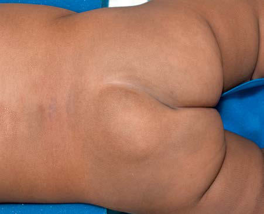

# Chapter 646: Spinal Cord Disorders
> **Course:** Vikkypaedia Pediatric Basic Course (*Nelson Textbook of Pediatrics, 22nd Edition (2025)*)  
> **Part XXV:** The Nervous System  
> **Authors:** Katie P. Fehnel and Mark R. Proctor  
> **Metrics:** 4,826 words · 0 tables/boxes · 1 figures · 0 genes · 8 flashcards · 5 MCQs  
> **Quick Navigation:** [🃏 Study 8 Flashcards](../flashcards/646_flashcards.md) · [📝 Take 5-Q MCQ Quiz](../mcqs/646_mcqs.md) · [📚 Part XXV Guide](../parts/Part_XXV.md) · [🧬 Syndrome & Genetics Atlas](../omim_gene_atlas.md) · [💊 Therapeutics Matrix](../therapies_matrix.md) · [🏠 Course Index](../../index.md)

## Key Chapter Topics & Subchapters
`646.1 Tethered Cord` · `646.2 Diastematomyelia (Split-Cord Malformation)` · `646.3 Syringomyelia` · `646.4 Spinal Cord Tumors` · `646.5 Spinal Arteriovenous Malformations` · `646.1 Tethered Cord Katie P. Fehnel and Mark R. Proctor` · `646.2 Diastematomyelia (Split-Cord Malformation) Katie P. Fehnel and Mark R. Proctor` · `646.3 Syringomyelia Katie P. Fehnel and Mark R. Proctor` · `646.4 Spinal Cord Tumors Katie P. Fehnel and Mark R. Proctor` · `646.5 Spinal Arteriovenous Malformations Katie P. Fehnel and Mark R. Proctor`

## ⚡ High-Yield Nelson Pediatric Board Pearls
- Multidisciplinary management, including a pediatrician, pediatric neurologist, ophthalmologist, orthoptist, radiologist, specialist nurses, and, as needed, dietician, psychologist, interventional radiologist, and neurosurgeon, is helpful both in diagnosis and ongoing management.
- The majority of adults with IIH continue to have headache after nor malization of ICP and hence require continued headache management.
- In its simplest form, tethered cord syndrome results from a thick ened filum terminale, which normally extends as a thin, very mobile structure from the tip of the conus to the sacrococcygeal region, where it attaches.
- TREATMENT There are no nonsurgical options for the management of tethered cord syndrome.
- Large, hairy, midline patches called hypertrichosis, the most common cutaneous manifestations, are present in approximately 60% of the cases.
- Syringomyelia is a cystic distention of the spinal cord caused by obstruction of the flow of spinal fluid from within the spinal cord to its point of absorption.
- In the context of Chiari II malformation associated with spina bifida, syringomyelia usually results from an insidious failure of the shunt used to treat the hydrocephalus.

---
## Full Chapter Text, Tables & Figures
# Chapter 646: Spinal Cord Disorders

*Katie P. Fehnel and Mark R. Proctor*

<!-- p.4816 -->
Any child whose ICP proves to be refractory to treatment warrants repeat full investigation. Serial monitoring of visual function (i.e., visual acuity, color vision, and visual fields) is required in children old enough to participate but remains a challenge in younger children. Serial optic nerve examination is also essential. OCT is useful to seri ally follow changes in papilledema. Serial visual-evoked potentials are useful if the visual acuity cannot be reliably documented.

Multidisciplinary management, including a pediatrician, pediatric neurologist, ophthalmologist, orthoptist, radiologist, specialist nurses, and, as needed, dietician, psychologist, interventional radiologist, and neurosurgeon, is helpful both in diagnosis and ongoing management.

The majority of adults with IIH continue to have headache after nor malization of ICP and hence require continued headache management. Permanent visual function loss in IIH is rare; data from small studies suggest reduced visual acuity in up to 10% and permanent visual field defects in less than 17% of children.

*Visit Elsevier eBooks+ at eBooks.Health.Elsevier.com** for Bibliography.*

*Katie P. Fehnel and Mark R. Proctor*

## 646.1  Tethered Cord Katie P. Fehnel and Mark R. Proctor

Normally, as the spine flexes and extends, the spinal cord is free to move up and down within the spinal canal. If the spinal cord is fixed at any point, its movement is restricted, and the spinal cord and nerve roots can become stretched. This fixing of the spinal cord, regardless of the underlying cause, is called a *tethered cord*. When pain, neurologic deterioration, or bladder and bowel dysfunction occurs in response to the fixation, it is called **tethered cord syndrome**.

By full gestational age, the spinal cord ends, on average, at the lum bar L1-2 disk space, although there is a normal bell-shaped distribu tion from thoracic T12-L3. Spinal cord tethering cannot be determined by position of the conus medullaris alone, but a position below L3 is concerning for tethering, especially when associated with an abnor mality that connects the cord to the bones or soft tissues around the spine. Similarly, the spinal cord can be tethered even if it terminates in a normal position if a tethering lesion is present. This can occur from a variety of causes.

In its simplest form, tethered cord syndrome results from a thick ened filum terminale, which normally extends as a thin, very mobile structure from the tip of the conus to the sacrococcygeal region, where it attaches. When this structure is thickened and/or shortened, the cord can become tethered. This stretching between two points can cause symptoms later in life. Fatty infiltration is often seen in the thickened filum (Fig. 646.1).

Other conditions that are well-established as causes of symptomatic tethering include various forms of occult dysraphism, such as lipomy elomeningocele, myelocystocele, and diastematomyelia. These condi tions can be associated with cutaneous manifestations such as midline lipomas, asymmetry of the gluteal fold (Fig. 646.2), dimples, and hairy patches called *hypertrichosis* (Fig. 646.3). Probably the most commonly known type of symptomatic tethered cord involves patients who had previously undergone closure of an open myelomeningocele and later become symptomatic with pain or neurologic deterioration. Tethered cord syndrome can also be iatrogenic and associated with scarring of

**Fig. 646.1** Sagittal T1-weighted MRI showing thickening and fatty in filtration of the filum terminale (arrow) in a patient with a symptomatic tethered spinal cord.

**Fig. 646.2** Child with a lipomyelomeningocele demonstrating an ex traspinal mass and an asymmetry of the gluteal fold indicative of under lying occult dysraphism. (Used with permission from Barrow Neurologi cal Institute.)

the spinal cord in patients who have undergone surgical procedures that disrupt the pial surface of the spinal cord.

**CLINICAL MANIFESTATIONS** Patients at risk for the subsequent development of tethered cord syn drome can often be identified at birth by the presence of an open myelomeningocele or by cutaneous manifestations of dysraphism (see Chapter 631). It is important to examine the back of the newborn for cutaneous midline lesions (lipoma, dermal sinus, tail, or hairy patch) that may signal an underlying form of occult dysraphism. Dermal sinuses are almost always located *above* the gluteal fold, and dimples in the gluteal cleft directly overlying the coccyx are generally benign fibrous tracts called *coccygeal pits* that are not associated with spinal tethering. However, cutaneous abnormalities may be absent in patients

<!-- p.4818 -->
with tethered spinal cord, and these patients present later in life with clinical manifestations.

Patients who become symptomatic later in life generally present with one of four clinical manifestations, including neurologic, orthopedic, bowel/bladder, and/or pain symptoms. One orthopedic presentation is asymmetry of the feet, with a smaller, high-arched foot with claw ing of the toes (Fig. 646.4), sometimes referred to as **neuroorthopedic syndrome**. Characteristically, there is no ankle jerk on the involved side and the calf is atrophied. Scoliosis can also be a presenting sign. Another clinical presentation is increasing urinary urgency, which may progress to incontinence. Constipation progressing to incontinence can affect the gastrointestinal system as well. Finally, severe general ized back pain, often radiating into the lower extremities, can occur, particularly in older adolescents and adults.

**DIAGNOSTIC EVALUATION** When patients present with symptoms related to tethered cord syn drome, a thorough motor and sensory examination of the patient must be documented. Assessment of bladder function with an ultrasound of the bladder and urodynamic studies is useful in analyzing blad der innervation. Magnetic resonance imaging (MRI) is the diagnostic study of choice for the anatomy of the tethering lesion and to provide information about the risks of surgical intervention.

**TREATMENT** There are no nonsurgical options for the management of tethered cord syndrome. Because the presence of asymptomatic tethering is most likely to be at least suspected in the newborn, prophylactic surgery to prevent late deterioration has been advocated by some neurosurgeons. This strategy remains controversial and depends to some extent on a careful assessment of the risks compared with the benefits. If surgi cal intervention is chosen, microsurgical dissection with release of the spinal cord attachment to the overlying dura and soft tissues is the goal of treatment.

**OUTCOME** The outcome of surgery depends on the complexity of the underlying lesion and the presenting condition of the child because existing defi cits are generally not reversed. Releasing a thickened filum terminale or detethering of patients with diastematomyelia generally yields a good outcome, and the chance of recurrent symptoms is quite low. Patients with symptomatic tethered cord who undergo repair of a myelome ningocele or a lipomyelomeningocele have a significant possibility of recurrent tethering and recurrent symptoms. In this cohort, the

potential need for reoperation and sometimes even multiple reopera tions is high. Given the technical challenges and increased neurologic risk in a patient multiply reoperated on for tethered cord, in adolescent patients for whom axial growth has completed, spinal column shorten ing procedures have been proposed as an alternative treatment modal ity. As opposed to surgery at the site of tethering, the tension is released by actual shortening of the vertebral column.

*Visit Elsevier eBooks+ at eBooks.Health.Elsevier.com** for Bibliography.*

## 646.2  Diastematomyelia (Split-Cord Malformation) Katie P. Fehnel and Mark R. Proctor

Diastematomyelia is a relatively rare form of occult dysraphism in which the spinal cord is divided into two halves and can present as tethered spinal cord. In **type 1** split-cord malformation, there are two spinal cords, each in its own dural tube and separated by a spicule of bone and cartilage (Fig. 646.5). In a **type 2** split-cord malformation, the two spinal cords are enclosed in a single dural sac with a fibrous septum between the two spinal segments (Fig. 646.6). In both cases, the anatomy of the outer half of the spinal cord is essentially normal but the medial half is extremely underdeveloped. Undeveloped nerve roots and dentate ligaments terminate medially into the medial dural tube in type 1 cases and terminate in the membranous septum in type 2 cases. Both types have an associated defect in the bony spinal segment. In the case of type 2 lesions, this defect can be quite subtle.

**CLINICAL MANIFESTATIONS** Patients with both type 1 and type 2 split-cord malformations will have presentations similar to other types of spinal tethering lesions. This may include subtle signs of neurologic involvement, such as unilateral calf atrophy and a high arch in one or both feet early in life, but they are more likely to be neurologically normal. These patients are tethered by the adherence of the spinal cord, so they may develop progressive loss of bowel and bladder function and sensory and motor difficulties in the lower extremities. Back pain is a common symptom in adolescents and adults with split-cord malformation but is uncommon in small children.

Cutaneous manifestations of dysraphism are present in 90% of patients with split-cord malformations. Large, hairy, midline patches called *hypertrichosis,* the most common cutaneous manifestations, are present in approximately 60% of the cases.

**DIAGNOSTIC EVALUATION** MRI, the study of choice, shows the two spinal cords. The frequent association of bony abnormalities in this condition may require further evaluation with computed tomography (CT).

**Fig. 646.3** Hairy patch or hypertrichosis usually associated with di astematomyelia. (Used with permission from Barrow Neurological In stitute.)

**Fig. 646.4** Example of neuropathic changes to the right foot as a re sult of spinal cord tethering, with a smaller high-arched foot and absent ankle jerk on exam. (Used with permission from Barrow Neurological Institute.)

<!-- p.4819 -->

<!-- p.4820 -->
**TREATMENT** The treatment of split-cord malformation is surgical. This abnormality is a form of tethered cord syndrome, and its treatment is to release the spi nal cord to move freely with movement of the spine. In type 1 split-cord malformations, the two half-cords are in separate dural sacs with medial attachment to the dura and bony septum. In this case, the dura needs to be opened, the bony septum removed, the medial attachments to the dura lysed, and a single dural tube created. For type 2 lesions, the membranous septum should be lysed. An attachment of this membrane to the anterior dura should be explored and lysed as well. Retethering of this type is rare, as there is no reason to disrupt the pial layer of the spinal cord.

*Visit Elsevier eBooks+ at eBooks.Health.Elsevier.com** for Bibliography.*

## 646.3  Syringomyelia Katie P. Fehnel and Mark R. Proctor

Syringomyelia is a cystic distention of the spinal cord caused by obstruction of the flow of spinal fluid from within the spinal cord to its point of absorption. There are three recognized forms of syringomy elia, depending on the underlying cause. Communicating syringomy elia implies that cerebrospinal fluid (CSF) from within the ventricles communicates with the fluid within the spinal cord and is assumed to be the source of the CSF that distends the spinal cord. Noncommuni cating syringomyelia implies that ventricular CSF does not commu nicate with the fluid within the spinal cord. It primarily occurs in the context of intramedullary tumors and obstructive lesions. In the final form of syringomyelia, that is, posttraumatic syringomyelia, spinal cord injury results in damage and subsequent softening of the spinal cord. This softening, combined with the scarring of the surrounding spinal cord tissue, results in progressive distention of the cyst. Syringo myelia is highly associated with Chiari malformation and can also be seen after infection or trauma, but many cases seen on imaging are nor mal anatomic variants unassociated with syndromes or any symptoms. It is also associated with connective tissue disorders (Ehlers-Danlos syndrome).

**CLINICAL MANIFESTATIONS** Signs and symptoms of syringomyelia develop insidiously over years or decades. The classic presentation is **central cord syndrome**. Syringo myelia affects the spinal cord beginning from the central region, where the cervical and thoracic nerve fibers are located, so it less commonly affects the lumbar and sacral fibers, which are more laterally located in the spinal cord. Therefore in syringomyelia the patient develops numb ness beginning in the shoulder in a capelike distribution followed by the development of atrophy and weakness in the upper extremities. Trophic ulcers of the hands are characteristic of advanced cases.

Other forms of presentation include scoliosis that may be rapidly progressive and often can be presumed from the absence of superficial abdominal reflexes. Urgency and bladder dysfunction as well as lower extremity spasticity also may be part of the presentation.

In patients with syringomyelia related to significant prior spinal cord injury, the presentation is usually severe pain in the area of the spinal cord distention above the level of the initial injury. There is also an ascending level of motor and sensory dysfunction.

A B C

**Fig. 646.5** Diastematomyelia type 1. A, Coronal T1-weighted MRI in a patient with type 1 DSM shows a large ossified spur (arrow) that splits the thoracic spinal cord. Numerous vertebral segmentation anomalies with posterior rib fusions are present. Sagittal T2-weighted (B) and axial T1- weighted (C) MRI of a different patient shows a type 1 cervical DSM with ossified spur (arrow in B) and two hemicords (arrowheads in C). (From Moore KR. Congenital abnormalities of the spine. In: Coley BD, ed. Caffey’s Pediatric Diagnostic Imaging, 13th ed. Philadelphia: Elsevier; 2019: Fig. 43-12.)

**Fig. 646.6** Diastematomyelia type 2. Axial T2-weighted MRI in a pa tient with type 2 DSM shows the spinal cord split into two hemicords within a single dural tube. No fibrous or osseous septum was identified. (From Moore KR. Congenital abnormalities of the spine. In: Coley BD, ed. Caffey’s Pediatric Diagnostic Imaging, 13th ed. Philadelphia: Else vier; 2019: Fig. 43-13.)

<!-- p.4821 -->

<!-- p.4822 -->
**DIAGNOSTIC EVALUATION** MRI is the radiologic study of choice (Figs. 646.7 and 646.8). The study should include the entire spine, and gadolinium-enhanced sequences should be a part of it if there is a suspicion for tumor. Specific attention should be paid to the craniovertebral junction because of the frequent association of syringomyelia with Chiari malformations. Obstruction to the flow of CSF from the fourth ventricle can cause syringomyelia; therefore most patients also should undergo imaging of the brain if a Chiari malformation is seen on the cervical imaging.

**TREATMENT** The treatment of syringomyelia should be tailored to the underlying cause, and rarely is the syringomyelia addressed directly. If that cause can be removed or ameliorated, the syrinx should improve. Direct sur gery on the syrinx is associated with a much higher surgical risk profile.

Communicating syringomyelia is most frequently seen in the con text of abnormalities at the craniovertebral junction, often associated with Chiari malformations (see Fig. 646.7). In such cases, decompres sion of the craniovertebral junction is usually effective in the manage ment of the syringomyelia. In the context of Chiari II malformation associated with spina bifida, syringomyelia usually results from an insidious failure of the shunt used to treat the hydrocephalus. This dis tention of the spinal cord results in a rapid development of scoliosis and occasionally spasticity in the lower extremities. Repair of the shunt is often effective treatment, and only rarely is surgical decompression at the craniovertebral junction necessary. Other conditions that can cause obstruction at the craniocervical junction include inflammatory condi tions such as chronic meningitis, as seen in tuberculosis or meningeal carcinomatosis.

Noncommunicating syringomyelia results from blocking the flow of spinal cord extracellular fluid or CSF within the central canal by an intramedullary spinal cord tumor or severe external compression of the spinal cord. In such cases, management should be directed to tumor resection or to decompression of constricting elements.

Traumatic syrinxes result from hematomyelia in the substance of the spinal cord coupled with severe arachnoidal scarring around the circumference of the spinal cord. When progressive, this form of syrin gomyelia is treated by exploration and lysis of the adhesions that fix the spinal cord to the overlying dura. Microscopic lysis of the scar sur rounding the spinal cord at the point of injury allows the spinal cord to collapse and prevents it from being distorted by a hydrostatic column of spinal fluid pulsations.

In rare cases, direct drainage procedures must be employed and can result in symptomatic and radiographic improvement. Syrinx-tosubarachnoid or pleural shunting with a small piece of silicone tubing is the treatment option. These procedures often have short-lived suc cess because the tubing tends to become obstructed, so they should be reserved for cases with obstructive symptoms.

In the current era, where many children are undergoing spinal MRI, some children who demonstrate no neurologic deficits are being referred to pediatric neurosurgeons with the diagnosis of syringomy elia. Many of these children were scanned because of back pain or as part of a screening for scoliosis. They are found on MRI to have a **persistent central canal**, and the diagnosis of syringomyelia is made. These syrinxes are 1-3 mm in diameter and may extend over several segments (see Fig. 646.8). There is no distortion of the spinal cord in the region and no change in signal of the surrounding spinal cord. These syrinxes have been called “idiopathic” syrinxes. Follow-up of significant numbers of such children has shown them to be benign in nature and probably represent a normal variant. There does not seem to be a need for routine follow-up imaging without new symptoms. They need no treatment and do not require limitations of activity.

*Visit Elsevier eBooks+ at eBooks.Health.Elsevier.com** for Bibliography.*

**Fig. 646.7** Sagittal MRI of patient with a Chiari I malformation and a holocord syrinx. (Used with permission from Barrow Neurological Insti tute.)

**Fig. 646.8** T2-weighted MRI scan of the cervical and thoracic spinal cord showing dilation of the central canal (C5-T1) in the absence of a Chiari malformation or other pathology.

<!-- p.4823 -->

<!-- p.4824 -->

## 646.4  Spinal Cord Tumors Katie P. Fehnel and Mark R. Proctor

Tumors of the spine and spinal cord are rare in children. Different types of tumors have different relationships with the spinal cord, meninges, and bony elements of the spine (Fig. 646.9). Intramedullary spinal cord tumors arise within the substance of the spinal cord itself (Fig. 646.10). They represent between 5% and 15% of primary central nervous sys tem tumors. This percentage may well reflect the relative volume of spinal cord compared with brain. Approximately 10% of intramedul lary spinal cord tumors are malignant astrocytic tumors, but most are World Health Organization grade I or II tumors of glial or ependymal origin. In children, low-grade astrocytomas and gangliogliomas rep resent the most common tumor types, with ependymomas being less common than in adults.

Except in the context of neurofibromatosis (NF-1 and NF-2; see Chapter 636.1), intradural extramedullary tumors are extremely rare in children. Most are nerve sheath tumors, either schwannomas or neu rofibromas. Intraspinal meningiomas in children are essentially found only in patients with NF-2 or those who have undergone prior irradia tion for some reason. The intradural extramedullary compartment is also a site for metastatic tumors from primary cancers such as leukemia or primitive neuroectodermal tumors. Myxopapillary ependymoma, a benign subtype found in the filum terminale, is another extramedul lary tumor seen in children.

Extradural spinal tumors characteristically begin in the bones of the spine. Primary tumors in this location include aneurysmal bone cysts, Langerhans cell histiocytosis (formerly called *eosinophilic granuloma*), osteoid osteoma, and giant cell tumors. In infants, the extradural space is often the site of neuroblastomas or ganglioneuroblastomas, which tend to extend from a paraspinal location into the epidural space through the intervertebral foramen. In older patients, the bones of the spine may be the site of multiple myeloma and metastases from com mon malignant tumors, such as chordoma and sarcomas.

**CLINICAL MANIFESTATIONS** With the exception of the uncommon malignant glial tumors of the spinal cord, which tend to present precipitously, intramedullary spinal cord tumors present in a very insidious manner. Back pain related to the level of the tumor is a common presenting complaint. It is likely that this pain will awaken the child from sleep and improve as the day pro gresses. Before the use of MRI became routine, the time from the first onset of symptoms to diagnosis of the tumor could be very prolonged, extending years. Weakness, gait disturbance, and sensory deficits are usually subtle but detectable on formal neurologic examination. Scolio sis, limb asymmetry, and bowel or bladder disturbance may be the pre senting complaints associated with intramedullary spinal cord tumors.

Nerve sheath tumors primarily arise from the sensory rootlet of the exiting spinal nerve. They are very slow-growing tumors and present with symptoms and signs relative to the nerve root involved. Pain in a bandlike distribution around the chest or into an extremity is the most common presenting complaint. Tumor growth eventually leads to spinal cord compression and involvement of adjacent nerve roots, but pain is the more likely presenting symptom.

Extramedullary extradural tumors have a tendency to present more acutely owing to rapid growth within a confined space. Such children may present with acute paresis and urinary retention. They can also present abruptly with severe pain and neurologic deficit at the time of pathologic fracture of the vertebral body. Benign tumors such as giant cell tumors and aneurysmal bone cysts present more insidiously as the tumor slowly grows and begins to compress neural structures. Osteoid osteomas present with severe pain relieved by nonsteroidal antiinflam matory drugs.

**DIAGNOSTIC EVALUATION** MRI with and without gadolinium enhancement of the spinal cord is the diagnostic study of choice and is essential in the diagnosis of spi nal cord tumors, especially intramedullary spinal cord tumors. Most

astrocytic tumors of the spinal cord and most ependymomas show diffuse enhancement and will distend the spinal cord focally. These tumors may involve the entire length of the spinal cord (holocord astrocytomas), although much of the change might be due to the asso ciated syrinx. Nerve sheath tumors characteristically enhance and are focal. They may exit through the neural foramen and distend the canal, as can be seen on MRI. They also may be visualized on plain radio graphs of the affected area of the spine because of their chronic effect on the bones.

Plain radiographs of the spine are helpful in defining the relationship of extradural tumors to the bony spine and in documenting evidence of instability in the case of pathologic compression fractures. When a pathologic fracture occurs, CT is essential to determine the effect of the tumor on the bone. Because many of these tumors occur as metastatic lesions, a general staging of the extent of disease is essential. In the

Dura

Extramedullary, extradural tumor

Extramedullary, intradural tumor Intramedullary tumor

**Fig. 646.9** Diagram of the relationship of various tumors to the spine, nerve roots, and spinal cord. (Used with permission from Barrow Neu rological Institute.)

**Fig. 646.10** T1 weighted MRI scan of a spinal cord tumor (arrow). The fusiform expansion of the cervical cord enhances after intravenous gadolinium injection.

<!-- p.4825 -->
case of Langerhans cell histiocytosis, a thorough bone survey should be conducted to look for other lesions. Radionucleotide bone scan ning, rapid STIR MRI, or PET MRI scans are useful in determining the extent of the disease.

**TREATMENT** The primary treatment of both intramedullary and extramedullary intradural tumors is surgical removal. For both low-grade astrocy tomas and ependymomas, microsurgical removal with the intent of total removal is the treatment of choice. This goal should be attain able in most patients with ependymomas and gangliogliomas and in many patients with low-grade astrocytomas. Though the majority of intramedullary spinal cord tumors are benign, the extent of resection may be limited in tumors that are diffusely infiltrating midline gliomas because of tumor invasion and infiltration of gray and white matter tracts. The invasive nature of these tumors is a leading cause of the poor prognosis for many of these patients, resulting in symptom progression and ultimately loss of neurologic function with profound implications on both quality and extent of life and is one of the most significant problems in spinal neurooncology. With the advent of routine molecu lar genetic testing, targetable pathogenic variants have been identified in some intramedullary spinal cord tumors, which will potentially expand nonsurgical and chemotherapeutic treatment options in as of now unresectable spinal cord tumors. Adjunctive treatment is often unnecessary in patients treated with adequate surgical resection. Like wise, schwannomas should be resectable. Occasionally, however, the nerve root must be resected. Doing so may be of no consequence in the thoracic spinal cord, but an attempt to remove the tumor while salvaging the motor root in the cervical and lumbosacral region is critical to preserve movement. Malignant astrocytic tumors cannot be resected without major morbidity and, in any case, carry an extremely poor prognosis. In the case of grades III and IV astrocytomas of the spinal cord, decompression and biopsy followed by radiation therapy and possibly chemotherapy are used.

The diagnosis and treatment of extramedullary spinal cord tumors must be individualized. Patients with bony involvement may be at risk of instability, and treatment will therefore involve both tumor resection and stabilization of the spine. For extramedullary tumors with soft tis sue components such as neuroblastomas, treatment is determined by the nature of the tumor and degree of spinal cord compression and may require needle biopsy of the lesion to direct treatment. In the absence of significant neurologic compression, surgical intervention may not be indicated if adjuvant therapies might be effective.

**OUTCOME** The prognosis for patients with benign intramedullary spinal cord tumors depends, to some extent, on the patient’s condition at the time of surgical intervention. It is very unlikely that nonambulatory patients will improve after surgery, and most patients will have at least tran sient worsening with surgery. If, however, patients are ambulatory at the time of surgery, they are likely to recover at least to their preop erative level of function. The majority of intramedullary tumors in children are benign and behave like tumors with the same histologic findings in the brain. The evidence would point to the fact that intra medullary ependymomas act in a more benign fashion than they do in the fourth ventricle. Gross total removal without adjuvant treatment is the preferred method of treatment and carries not only a much longer progression-free survival time but an improved quality of life as well.

Malignant spinal cord tumors are usually lethal, with death resulting from diffuse metastases via the CSF pathways. Successful resection of nerve sheath tumors should be curative. In the context of neurofibro matosis, however, many more tumors can be found at other levels or can be expected to develop later in life. Surgical intervention in the context of neurofibromatoses should be performed only for clearly symptomatic lesions.

The outcome of treatment of extramedullary tumors depends on the cell type and, in most cases, on the efficacy of nonsurgical, adjunctive

therapies. For aneurysmal bone cysts and giant cell tumors, resection of the tumor and fusion of the spine are the treatments of choice.

*Visit Elsevier eBooks+ at eBooks.Health.Elsevier.com** for Bibliography.*

## 646.5  Spinal Arteriovenous Malformations Katie P. Fehnel and Mark R. Proctor

Arteriovenous malformations of the spinal cord are rare lesions in chil dren. Only about 60 patients younger than age 18 years are treated in the United States each year. These lesions are complex, and despite their rarity there are multiple subtypes, which require different treatment strategies. Patients commonly present with back or neck pain, depending on the segments of the spinal cord involved, and they may experience the insidi ous onset of motor and sensory disturbances. Sudden onset of paraplegia secondary to hemorrhage has been reported. Occasionally, patients pres ent with subarachnoid hemorrhage without overt neurologic deficits, similar to the presentation associated with cerebral aneurysms. In some cases, bruits are audible upon auscultation over the bony spine.

**DIAGNOSTIC EVALUATION** When a spinal arteriovenous malformation is suspected, MRI of the spinal cord is first needed to make the diagnosis and to obtain a gen eral idea of the location of the lesion (Fig. 646.11). MR angiography or CT angiography may provide further information, but formal cath eter angiography of the spinal cord is needed to obtain an adequate understanding of the complex anatomy of the lesion and to plan the intervention.

**TREATMENT** Open microsurgery had been the mainstay of treatment for spinal cord arteriovenous fistulas and arteriovenous malformations. With the rapid development of interventional techniques, the percentage of patients undergoing microsurgery has decreased from 70% to approximately 30%. Stereotactic radiosurgery may be used adjunctively. Treatment of these complex lesions requires the commitment of an organized neu rovascular treatment program.

*Visit Elsevier eBooks+ at eBooks.Health.Elsevier.com** for Bibliography.*

**Fig. 646.11** T2 weighted MRI showing an extensive thoracic spinal arteriovenous malformation.

<!-- p.4826 -->

<!-- p.4827 -->
