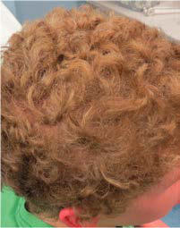
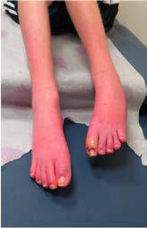

# Chapter 653: Hereditary Motor-Sensory Neuropathies
> **Course:** Vikkypaedia Pediatric Basic Course (*Nelson Textbook of Pediatrics, 22nd Edition (2025)*)  
> **Part XXVI:** Neuromuscular Disorders  
> **Authors:** Adnan Y. Manzur  
> **Metrics:** 9,235 words · 12 tables/boxes · 2 figures · 91 genes · 8 flashcards · 5 MCQs  
> **Quick Navigation:** [🃏 Study 8 Flashcards](../flashcards/653_flashcards.md) · [📝 Take 5-Q MCQ Quiz](../mcqs/653_mcqs.md) · [📚 Part XXVI Guide](../parts/Part_XXVI.md) · [🧬 Syndrome & Genetics Atlas](../omim_gene_atlas.md) · [💊 Therapeutics Matrix](../therapies_matrix.md) · [🏠 Course Index](../../index.md)

## Key Chapter Topics & Subchapters
`653.1 Peroneal Muscular Atrophy (Charcot-Marie-Tooth Disease, HMSN Type IIa)` · `653.2 Peroneal Muscular Atrophy (Axonal Type)` · `653.3 Congenital Hypomyelinating Neuropathy and Déjèrine-Sottas Disease (HMSN Type III)` · `653.4 Roussy-Lévy Syndrome` · `653.5 Refsum Disease (HMSN Type IV) and Infantile Refsum Disease` · `653.6 Fabry Disease` · `653.7 Giant Axonal Neuropathy` · `653.8 Hypermyelinating (Tomaculous) Neuropathy; Hereditary Neuropathy with Liability to Pressure Palsies` · `653.9 Leukodystrophies` · `653.1 Peroneal Muscular Atrophy (Charcot-Marie-Tooth Disease, HMSN Type IIa) Adnan Y. Manzur` · `653.2 Peroneal Muscular Atrophy (Axonal Type) Adnan Y. Manzur` · `653.3 Congenital Hypomyelinating Neuropathy and Déjèrine-Sottas Disease (HMSN Type III) Adnan Y. Manzur`

## Key Genetic & Molecular Targets
`ABC1`, `ABCD1`, `AIFM1`, `AR`, `ARHGEF10`, `ARSA`, `ASCC1`, `ATL1`, `ATL3`, `ATM`, `ATXN10`, `ATXN3`, `BSCL2`, `CMT1A`, `CMT2`, `CMT2G`

## ⚡ High-Yield Nelson Pediatric Board Pearls
- CMT is the most common genetically determined neuropathy and the most common demyelinating variant, also described as CMT1A, and has an overall prevalence of 3.8/100,000 population and accounts for >50% of cases of HMSN overall.
- It is transmitted as an autosomal dominant trait with 83% expressivity; the 17p11.2 locus is the site of the abnormal gene.
- Autosomal recessive transmission also is described but is rarer.
- A much rarer X-linked HMSN type I results from a defect at the Xq13.l locus, causing pathogenic variants in the gap junction protein connexin-32.
- Other forms, caused by >40 genes, have been reported.
- Application of the Cumberland Ankle Instability Tool for Youth is a means of objectively documenting and following this manifestation.
- Proximal muscle weak ness is a late manifestation and is usually mild.

---
## Full Chapter Text, Tables & Figures
# Chapter 653: Hereditary Motor-Sensory Neuropathies

*Adnan Y. Manzur*

<!-- p.4942 -->
The hereditary motor-sensory neuropathies (HMSNs) are a group of progressive diseases of peripheral nerves of genetic (and syndrome) etiology (Tables 653.1 and 653.2). HMSNs are the most common group of hereditary neuropathies and the term Charcot-Marie-Tooth disease (CMT) is used interchangeably, and more commonly. Motor components generally dominate the clinical picture, but sensory and autonomic involvement is expressed later. Sural nerve biopsy used to be the most definitive means of diagnosis, but with the expanded knowledge of the molecular genetics of this group of diseases, the diagnosis of most can be confirmed by less invasive genetic testing. Electromyography (EMG) remains a useful adjunct to clinical diagno sis and helps distinguish between **demyelinating** or **hypomyelinat ing** and **axonal** forms. Clinical clues are noted in Tables 653.3-653.5.

Classification of HMSNs is difficult because no simple unifying scheme is capable of incorporating all the clinical presentations and overlapping genetics (see Tables 653.1 and 653.2). More than 140 genes have been described as causing the HMSN/CMT spectrum. In some neuropathies, a diverse genotype with pathogenic variants in different genes at different chromosomal loci may produce a similar phenotype. One classification identifies the following: I.	 Hereditary neuropathies secondary to general diseases II.	 Primary neuropathies

IIa.	 Hereditary motor sensory neuropathies IIb.	 Distal hereditary motor neuropathies IIc.	 Hereditary sensory ± autonomic neuropathies III.	 Syndromic neuropathies, including congenital hypomyelinating

neuropathies IV.	 Hereditary sensory neuropathy (Refsum disease)

*Visit Elsevier eBooks+ at eBooks.Health.Elsevier.com** for Bibliography.*

## 653.1  Peroneal Muscular Atrophy (Charcot-Marie-Tooth Disease, HMSN Type IIa) Adnan Y. Manzur

CMT is the most common genetically determined neuropathy and the most common demyelinating variant, also described as CMT1A, and has an overall prevalence of 3.8/100,000 population and accounts for >50% of cases of HMSN overall. It is transmitted as an autosomal dominant trait with 83% expressivity; the 17p11.2 locus is the site of the abnormal gene. Autosomal recessive transmission also is described but is rarer. The gene product is peripheral myelin protein 22 (PMP22). A much rarer X-linked HMSN type I results from a defect at the Xq13.l locus, causing pathogenic variants in the gap junction protein connexin-32. Other forms, caused by >40 genes, have been reported (see Table 653.1). Both fatty acid binding by PMP22 and the kinetics of its membrane interactions are affected by mutations.

**CLINICAL MANIFESTATIONS** Most patients are asymptomatic until late childhood or early adoles cence, but young children sometimes manifest gait disturbance as early

as the second year of life. The peroneal and tibial nerves are the ear liest and most severely affected. Children with the disorder are often described as being clumsy, falling easily, or tripping over their own feet. Application of the Cumberland Ankle Instability Tool for Youth is a means of objectively documenting and following this manifestation. The onset of symptoms may be delayed until after the fifth decade.

Muscles of the anterior compartment of the lower legs become wasted, and the legs have a characteristic storklike contour. The mus cular atrophy is accompanied by progressive weakness of dorsiflexion of the ankle and eventual foot drop. The process is bilateral but may be slightly asymmetric. Pes cavus deformities invariably develop as a result of denervation of intrinsic foot muscles, further destabilizing the gait. A small minority of individuals with CMT1A have hip dysplasia. Atrophy of muscles of the forearms and hands is usually not as severe as that of the lower extremities, but in advanced cases contractures of the wrists and fingers produce a claw hand. Proximal muscle weak ness is a late manifestation and is usually mild. Axial muscles are not involved.

The disease is slowly progressive throughout life, but patients occa sionally show accelerated deterioration of function over a few years. Most patients remain ambulatory and have normal longevity, although orthotic appliances are required to stabilize the ankles.

Sensory involvement mainly affects large, myelinated nerve fibers that convey proprioceptive information and vibratory sense, but the threshold for pain and temperature can also increase. Some children complain of tingling or burning sensations of the feet, but pain is rare. Because the muscle mass is reduced, the nerves are more vulnerable to trauma or compression. Autonomic manifestations may be expressed as poor vasomotor control with blotching or pallor of the skin of the feet and inappropriately cold feet.

Nerves often become palpably enlarged. Tendon stretch reflexes are lost distally. Cranial nerves are not affected. Sphincter control remains well preserved. Autonomic neuropathy does not affect the heart, gas trointestinal tract, or bladder. Intelligence is normal. A unique point variant in *PMP22* causes progressive auditory nerve deafness in addi tion, but this is usually later in onset than the peripheral neuropathy. X-linked CMT disease (*GJB1* variant) has been associated with an acute disseminated encephalitis-like illness.

**Davidenkow syndrome** is a variant of HMSN type I with a scapulo peroneal distribution.

**LABORATORY FINDINGS AND DIAGNOSIS** Motor and sensory nerve conduction velocities are greatly reduced, sometimes as slow as 20% of the normal conduction time. In new cases without a family history, both parents should be examined, and nerve conduction studies should be performed.

EMG and muscle biopsy are not usually required for diagnosis, but they show evidence of many cycles of denervation and reinnervation. The serum creatine kinase level is normal. The cerebrospinal fluid (CSF) protein may be elevated, but no cells appear in the CSF.

Sural nerve biopsy is diagnostic. Large- and medium-size myelin ated fibers are reduced in number, collagen is increased, and charac teristic **onion bulb formations** of proliferated Schwann cell cytoplasm surround axons. This pathologic finding is called **interstitial hyper trophic neuropathy.** Extensive segmental demyelination and remy elination also occur. The definitive molecular genetic diagnosis may be made in blood.

**TREATMENT** Stabilization of the ankles is a primary concern. In early stages, stiff boots that extend to the midcalf often suffice, particularly when patients walk on uneven surfaces such as ice and snow or stones. As the dorsiflexors of the ankles weaken further, lightweight plastic splints may be custom-made to extend beneath the foot and around the back of the ankle. They are worn inside the socks and are not visible, reduc ing self-consciousness. External short-leg braces may be required when foot drop becomes complete. Soft tissue/bony foot surgery, or surgi cal fusion of the ankle may be considered in cases of progressive foot deformity, depending upon age and severity.

*Adnan Y. Manzur****

* The editors are grateful to Dr. Harvey B. Sarnat and Dr. Diana X. Bharucha-Goebel, much of whose work on previous editions of this chapter is retained here.

<!-- p.4943 -->

<!-- p.4944 -->

#### **Table 653.1** Nonsyndromic Inherited Neuropathies

| Category / Parameter | Clinical Details & Findings |
| --- | --- |
| **HEREDITARY MOTOR AND SENSORY NEUROPATHIES (HMSNs)** | Demyelinating; Forearm NCV usually <38 m/sec |
| **AD** | Young adult onset, NCV 10-35 m/sec |
| **CMT1A** | PMP22 (usually duplication); Most common (70% of all CMT1); Pathogenic variants also cause CMT3 |
| **MPZ (P0 )** | Pathogenic variants also cause CMT2 and CMT3 |
| **EGR2** | Broad clinical spectrum (also CMT3) |
| **NEFL** | DSS phenotype common; CMT1 plus |
| **FBLN5** | Macular degeneration; cutis laxa |
| **PMP2** | Classic CMT1 |
| **ARHGEF10** | Asymptomatic slowed NCVs |
| **AD** | PMP22 (usually deletion); Adult-onset episodic entrapment neuropathies, mild slowing; (NCV 40-50 m/sec) |
| **CMT3** | Severe, early-onset demyelinating |
| **AR** | CMT1 genes |
| **PRX, MTMR2** | Onset before age 3 yr old |
| **EGR2** | Congenital onset; AR-CHN, also known as CMT4E |
| **AR** | Childhood onset, usually severe |
| **GDAP1** | Both axonal and demyelinating types |
| **MTMR2** | Biopsy shows focally folded myelin |
| **SBF2/MTMR13** | Same as above ± early-onset glaucoma |
| **SH3TC2** | Scoliosis often severe, also axonal types |
| **NDRG1** | Dysmorphic features, deafness |
| **PRX** | DSS phenotype |
| **CTDP1** | Slow NCV |
| **ARHGEF10** | Asymptomatic NCV slowing; Intermediate; NCV 25-45 m/sec |
| **CMTX1** | GJB1/Cx32; Similar to CMT1, but males more severely affected, CNS; involvement common; CMTX2, Cowchock; syndrome |
| **AIFM1** | MR, deafness, axonal |
| **PRPS1** | Axonal CMT, deafness, optic atrophy |
| **PDK3** | Axonal CMT |
| **DRP2** | Intermediate MCVs |
| **DI-CMTA** | 10q24 |
| **DNM2** | Neutropenia |

<!-- p.4945 -->

#### **Table 653.1** Nonsyndromic Inherited Neuropathies—cont’d

| Category / Parameter | Clinical Details & Findings |
| --- | --- |
| **IFN2** | Focal segmental glomerulosclerosis |
| **COX6A1** | Axonal; NCV >38 m/sec |
| **AD** | Young adult onset |
| **MFN2** | KIF1B (rare); Most common; also HMSN V (optic atrophy), VI (spasticity),; and early onset |
| **RAB7** | Severe sensory loss like HSAN-1 |
| **TRPV4** | Vocal cord/diaphragm weakness |
| **GARS** | Arm > leg, motor predominant, similar to dHMN caused by; BSCL2 mutations |
| **NEFL** | Allelic with CMT1E; variable phenotype |
| **HSP27 (HSPB1)** | Motor predominant |
| **CMT2G** | 12q12-13.3; Proximal > distal weakness |
| **GDAP1** | Allelic with CMT4A |
| **MPZ (P 0)** | Cough, pain, autonomic/pupil, deafness |
| **HSP22 (HSPB8)** | Motor predominant, allelic with HMNIIa |
| **DNM2** | Intermediate or CMT2; cataracts; ophthalmoplegia; ptosis |
| **MARS** | Late onset |
| **NAGLU** | Late-onset painful sensory predominant |
| **MORC2** | Pyramidal signs |
| **CMT2** | CMT2 with giant; axons |
| **DCAF8** | Childhood onset |
| **JAG1** | Vocal fold paralysis |
| **TFG** | Proximal > distal |
| **LMNA** | Also called CMT2B1 and CMT4C1 |

<!-- p.4946 -->

#### **Table 653.1** Nonsyndromic Inherited Neuropathies—cont’d

| Category / Parameter | Clinical Details & Findings |
| --- | --- |
| **MME** | Dominant pathogenic variants cause late onset |
| **HSAN** | Sensory (± autonomic) neuropathy |
| **SPTLC1** | Late-onset, slowly progressive sensory axonal neuropathy ±; SNHL, weakness |
| **AD** | 3p24-p22; Variant with cough, GERD, deafness |
| **HSN2** | Congenital sensory loss, acral mutilation |
| **IKBKAP** | Severe dysautonomia, Ashkenazi Jews |
| **TRKA** | Anhidrosis, acral mutilation, ± CNS |
| **NGFB** | Congenital insensitivity to pain |
| **DST** | Severe autonomic dysfunction, death by age 2 |
| **SCN11A** | Congenital insensitivity to pain, hyperhidrosis, GI dysfunction |
| **PRDM12** | Congenital insensitivity to pain |
| **HEREDITARY MOTOR NEUROPATHIES/NEURONOPATHIES (HMNS)** | HMN/dSMA; Distal wasting and weakness; HMNIIa |
| **HSPB8(HSP22)** | Adult onset, allelic with CMT2L; HMNIIb |
| **HSP27(HSPB1)** | Allelic with CMT2F; HMNVa |
| **GARS** | Upper limb predominant; HMNVb |
| **BSCL2** | Allelic with SPG17/Silver syndrome |
| **IGHMBP2** | Severe infantile respiratory distress/SMARD; HMNVIIa |
| **AD** | 2q14; Adult onset, vocal cord paralysis; HMNVIIb |
| **DCTN1** | Same as above |
| **X** | Xq13.1-q21 |
| **AR** | 9p21.1-p12; Childhood-onset (Jerash type) |
| **X** | Androgen Receptor (CAG; rpt); Adult-onset bulbar symptoms, proximal weakness, sensory; neuronopathy, gynecomastia; This table lists the inherited neuropathies that are generally considered to affect the peripheral nerve exclusively or predominantly, although as shown in the Clinical Features column,; many of these diseases affect the CNS and other tissues. For the columns, in the Disease column, the name is usually abbreviated, with full names below; inheritance pattern is; listed as autosomal dominant (AD), autosomal recessive (AR), or X-linked (X); and for gene or locus, the affected gene(s) is listed if known; otherwise, the chromosomal locus is; listed. In cases where the variant is not a missense variant, the type of variant is listed in parentheses (duplication, deletion, or CAG repeat). The diseases are grouped according; to phenotype: HMSN, hereditary motor and sensory neuropathy; HS(A)N, hereditary sensory and (±autonomic) neuropathy; HMN, hereditary motor neuropathy, also called dSMA; (distal spinal muscular atrophy); SBMA, spinal bulbar and muscular atrophy. The HMSNs are further divided into demyelinating, axonal, and intermediate forms based on the usual; range of nerve conduction velocity (NCV).; CHN, Congenital hypomyelinating neuropathy; CMT, Charcot-Marie-Tooth disease; CMTDI, dominant intermediate CMT; CNS, central nervous system; DSS, Déjèrine-Sottas disease;; GERD, gastroesophageal reflux disease; GI, gastrointestinal; HNPP, hereditary neuropathy with liability to form pressure palsies; MCV, motor conduction velocity; MR, mental; retardation; rpt, repeat; SMARD, spinal muscular atrophy with respiratory distress; SNHL, sensorineural hearing loss; SPG, hereditary spastic paraplegia (see Table 653.2).; From Motley W, Chaudry V, Lloyd TE. Treatment and management of hereditary neuropathies. In: Bertorini TE, ed. Neuromuscular Disorders Treatment and Management, 2nd ed.; Philadelphia: Elsevier; 2022: Table 14.2, p. 280–282. |

#### **Table 653.2** Syndromic Neuropathies

| Category / Parameter | Clinical Details & Findings |
| --- | --- |
| **SEPT9** | Recurrent brachial neuritis, dysmorphic features in some; Friedreich ataxia (FRDA) |
| **AR** | Frataxin-GAA; repeats; Ataxia, sensory large fiber axonal neuropathy, positive Babinski sign,; cardiomyopathy |
| **TTPA** | FRDA-like, vitamin E deficiency |
| **TDP1** | Spinocerebellar ataxia, sensory neuropathy |

<!-- p.4947 -->

#### **Table 653.2** Syndromic Neuropathies—cont’d

| Category / Parameter | Clinical Details & Findings |
| --- | --- |
| **CLINICAL FEATURES** | Ataxia-telangiectasia |
| **ATM** | Ataxia, telangiectasias, malignancy, infections |
| **SCA** | Sensory neuropathy variable in most |
| **ATXN3** | Ataxia, spasticity, severe axonal neuropathy |
| **PLEKHG4** | Prominent axonal sensory neuropathy |
| **ATXN10** | ± Sensorimotor neuropathy |
| **AD** | 2p21-p13; Prominent axonal sensory neuropathy |
| **FGF-14** | Mild axonal sensory neuropathy |
| **HSP** | “Complicated HSP” with neuropathy |
| **PLP** | CNS white matter disease ± neuropathy |
| **AR** | Paraplegin; ± Neuropathy, dysarthria, dysphagia |
| **AD** | 10q23.3-24.1; Amyotrophy, cataracts, GERD |
| **KIF5A** | ± Distal atrophy |
| **AR** | Spatacsin; MR, nystagmus, thin corpus callosum |
| **AR** | 3q27-q28; Distal motor neuropathy, MR, visual agnosia |
| **AR** | Spastizin; Pigmented maculopathy, MR, dysarthria |
| **BSCL2** | (Silver syndrome) hand atrophy prominent |
| **AR** | Spartin; (Troyer syndrome) distal atrophy, dysarthria |
| **TTR** | Early adult-onset painful sensorimotor and autonomic neuropathy,; entrapment neuropathy, cardiomyopathy, GI symptoms; (Iowa); ApoAI; Similar to TTR, but progressive renal failure; (Finnish); Gelsolin; Cranial neuropathies, corneal dystrophy; Fabry |
| **X** | α-Gal-A; Child-onset painful SFSN, renal failure, cardiac disease, strokes; Leukodystrophies; Some associated with demyelinating neuropathy; GLD/Krabbe |
| **GALC** | Progressive MR, hyperreflexia, sz, optic atrophy |
| **ARSA** | Same as above, though CNS sx less severe; PCWH/Waardenburg |
| **SOX10** | CHN, central dysmyelination, Waardenburg and Hirschsprung syndrome; Adrenomyeloneuropathy |
| **ABCD1** | Spastic paraparesis, large fiber sensory loss, bowel and bladder incontinence; Merosin deficiency |
| **LAMA2** | Neuropathy and muscular dystrophy; Refsum disease |
| **PEX7** | Ataxia, retinitis pigmentosa, demyelinating neuropathy, cardiac, deafness,; ichthyosis; AMACR deficiency |
| **AMACR** | Adult-onset sensory and motor neuropathy, retinitis pigmentosa, seizures,; ataxia, developmental delay, acute and relapsing encephalopathy with; headache; Mitochondrial diseases; Neuropathy common, axonal or demyelinating; Leigh disease; ARmito; Multiple genes; Early onset CPEO, ptosis, ataxia, MR, pyramidal signs, demyelinating; neuropathy |
| **NARP** | Mito |
| **MTATP6** | Sensory neuropathy, ataxia, retinitis pigmentosa |
| **POLG** | Ptosis, CPEO, leukoencephalopathy, neuropathy, myopathy, GI dysmotility; Porphyria |
| **PBGD** | Acute neuropathy, abdominal pain, psychosis, sz; Copro |
| **CPO** | Similar to AIP, but also skin photosensitivity; Variegate |
| **PPOX** | Similar to AIP, but also skin photosensitivity; Tangiers disease |
| **ABC1** | Orange tonsils, organomegaly, low HDL, atherosclerosis; Abetalipoproteinemia |
| **MTTP** | Ataxia, acanthocytosis, steatorrhea, low LDL |

<!-- p.4948 -->
**DISEASE**

**INHERITANCE PATTERN**

**GENE OR LOCUS CLINICAL FEATURES**

Hypobetalipoproteinemia AD *Apo-B* Ataxia, sensory axonal polyneuropathy

GAN AR Gigaxonin MR, kinky hair, biopsy shows giant axons

ACCPN AR *KCC3* Agenesis of corpus callosum, French Canadian

CCFDN AR *CTDP1* Congenital cataracts, facial dysmorphism

This table lists the inherited neuropathies in which the neuropathy is part of a systemic disease. For the columns, in Disease, the name is usually abbreviated, with full names below; in

the column Inheritance Pattern, data are listed as autosomal dominant (AD), autosomal recessive (AR), X-linked (X), or mitochondrial (maternal) (mito); and for in the Gene or Locus column, the affected gene(s) is listed if known; otherwise, the chromosomal locus is listed. ACCPN, Agenesis of the corpus callosum and peripheral neuropathy, also known as Anderman syndrome; AIP, acute intermittent porphyria; AMACR , alpha-methylacyl-CoA

racemase; AVED, ataxia with isolated vitamin E deficiency; CCFDN, congenital cataracts, facial dysmorphism, neuropathy; CHN, congenital hypomyelinating neuropathy; CNS, central nervous system; Copro, coproporphyria; CPEO, chronic progressive external ophthalmoplegia; FAP, familial amyloidotic polyneuropathy; GAN, giant axonal neuropathy; GERD, gastroesophageal reflux disease; GI, gastrointestinal; GLD, globoid-cell dystrophy; HDL, high-density lipoprotein; HNA, hereditary neuralgic amyotrophy; HSP, hereditary spastic paraplegia; LDL, low-density lipoprotein; MLD, metachromatic leukodystrophy; MJD, Machado-Joseph disease; MNGIE, mitochondrial neurogastrointestinal encephalopathy syndrome; MR, mental retardation; NARP, neuropathy, ataxia, and retinitis pigmentosa; PCWH, peripheral demyelinating neuropathy, central dysmyelination, Waardenburg syndrome, and Hirschsprung disease; SCA, spinocerebellar ataxia; SCAN1, spinocerebellar ataxia with axonal neuropathy 1; SFSN, small fiber sensory neuropathy; SPG, spastic gait; sx, symptoms; sz, seizures; TTR, transthyretin; Variegate, variegate porphyria. From Motley W, Chaudry V, Lloyd TE. Treatment and management of hereditary neuropathies. In: Bertorini TE, ed,. Neuromuscular Disorders Treatment and Management, 2nd ed. Philadelphia: Elsevier; 2022: Table 14.3, p. 283–284.

#### **Table 653.2** Syndromic Neuropathies—cont’d

#### **Table 653.3** Polyneuropathies with Onset in Infancy

| Category / Parameter | Clinical Details & Findings |
| --- | --- |
| **AXONAL NEUROPATHIES** | Pes cavus with footdrop |
| **AD, AR** | Optic atrophy |
| **IOSCA** | C10orf2 |
| **AR** | Infantile neuroaxonal dystrophy |
| **AR** | Ophthalmoparesis; Mitochondrial disorders |
| **SCO2** | C10orf2 |
| **AR** | Skeletal abnormalities; CMT2C, SPSMA, congenital dSMA |
| **AD** | Arthrogryposis; Congenital dSMA |
| **AR** | X-linked SMA |
| **UBE1** | X-linked; Pontocerebellar hypoplasia type 1 |
| **AR** | SMA with congenital fractures |
| **ASCC1** | Presumed AR; Congenital fractures; X-linked SMA |
| **UBE1** | X-linked; SMA with congenital fractures |
| **ASCC1** | Presumed AR; Vocal cord paresis |
| **AD, AR** | CMT2C, SPSMA, congenital dSMA |
| **AR** | BVVL/Fazio-Londe disease |
| **AR** | Early infantile respiratory; failure |
| **AR** | X-linked SMA |
| **UBE1** | X-linked; Pontocerebellar hypoplasia type 1 |
| **AR** | SMA with congenital fractures |
| **ASCC1** | Presumed AR; Lethal neonatal AR axonal sensorimotor polyneuropathy; Unknown |
| **AR** | Congenital axonal neuropathy with encephalopathy; Unknown; Unknown, |

<!-- p.4949 -->

#### **Table 653.3** Polyneuropathies with Onset in Infancy—cont’d

| Category / Parameter | Clinical Details & Findings |
| --- | --- |
| **AXONAL NEUROPATHIES** | Predominant motor; involvement; Congenital dSMA, SPSMA |
| **AR** | X-linked SMA |
| **UBE1** | X-linked; Pontocerebellar hypoplasia type 1 |
| **AR** | SMA with congenital fractures |
| **ASCC1** | Presumed AR; Mitochondrial disorders |
| **AR** | Kinky hair hepatopathy; Giant axonal neuropathy |
| **AR** | Mitochondrial disorders |
| **DGUOK** | C10orf2 |
| **AR** | MTP/LCHAD deficiency |
| **AR** | Cardiomyopathy; Mitochondrial disorders |
| **AR** | MTP/LCHAD deficiency |
| **AR** | CNS involvement; Pontocerebellar hypoplasia type 1 |
| **AR** | Giant axonal neuropathy |
| **AR** | Infantile neuroaxonal dystrophy |
| **IOSCA** | C10orf2 |
| **GJB1** | X-linked; Mitochondrial disorders |
| **AR** | Adrenoleukodystrophy |
| **ABCD1** | X-linked; Developmental regression; Adrenoleukodystrophy |
| **ABCD1** | X-linked; Dysautonomia, chronic skin; ulceration; HSAN III (Riley-Day syndrome) |
| **DEMYELINATING NEUROPATHIES** | Acute sensory ataxia, walking; difficulties in a previously; well child |
| **GBS** | Slowly progressive weakness,; ataxia in a previously well; child; responsive to steroids |
| **CIDP** | Developmental regression |
| **AR** | Krabbe disease |
| **AR** | Irritable, stiff, crying infant;; occasional unexplained fevers; Krabbe disease |
| **AR** | Pes cavus with footdrop,; marked difficulties walking |
| **CMT1A** | PMP22 point variants or; duplication; De novo (AD), |
| **MPZ** | De novo (AD) |

<!-- p.4950 -->

#### **Table 653.3** Polyneuropathies with Onset in Infancy—cont’d

| Category / Parameter | Clinical Details & Findings |
| --- | --- |
| **AXONAL NEUROPATHIES** | Early respiratory insufficiency |
| **CMT1A** | PMP22 point variants or; duplication; De novo (AD), |
| **MPZ** | De novo (AD) |
| **AR, AD** | Severe scoliosis requiring; surgery in infancy |
| **MPZ** | De novo (AD) |
| **AR** | Facial weakness |
| **AR** | Sensorineural hearing loss |
| **CMT1A** | PMP22 point variants or; duplication; De novo (AD), |
| **AR** | Congenital nystagmus |
| **MPZ** | De novo (AD) |
| **AR** | AD, Autosomal dominant; AR, autosomal recessive; BVVL, Brown-Vialetto-Van Laere syndrome; CMT, Charcot-Marie-Tooth disease; CIDP, chronic inflammatory demyelinating; polyneuropathy; CNS, central nervous system; dSMA, distal spinal muscular atrophy; GBS, Guillain-Barré syndrome; HMSN/ACC, hereditary motor and sensory neuropathy with; agenesis of the corpus callosum; HSAN, hereditary sensory and autonomic neuropathy; IOSCA, infantile-onset spinocerebellar ataxia; MLD, metachromatic leukodystrophy; MTP/; LCHAD, mitochondrial trifunctional protein/long-chain 3-hydroxyacyl-CoA dehydrogenase; SMA, spinal muscular atrophy; SMARD, spinal muscular atrophy with respiratory distress; type 1; SPSMA, scapuloperoneal spinal muscular atrophy.; From Konersman C. Hypotonia, weakness, and stroke. In: Kliegman RM, Lye PS, Bordini BJ, et al., eds. Nelson Symptom-Based Diagnosis. Philadelphia: Elsevier; 2018: Table 29.19. |

#### **Table 653.4** Infantile Demyelinating Neuropathies with CNS Involvement

| Category / Parameter | Clinical Details & Findings |
| --- | --- |
| **ASSOCIATED WITH CNS HYPOMYELINATION** | Hypomyelination with congenital cataracts |
| **DRCTNNBIA** | Congenital cataracts, pyramidal signs, cerebellar signs,; intellectual disability; Peripheral demyelinating neuropathy,; central dysmyelinating leukodystrophy,; Waardenburg syndrome and; Hirschsprung disease (PCWH) |
| **SOX10** | Waardenburg syndrome, Hirschsprung disease, spasticity,; ataxia, dysautonomia, intellectual disability; Pelizaeus-Merzbacher disease; X-linked |
| **PLP1*** | Early nystagmus and titubation, ataxia, spasticity,; movement disorder, intellectual disability; Pelizaeus-Merzbacher–like disease |
| **GJA12** | Nystagmus, ataxia, delayed development; Cockayne syndrome |
| **ERCC6, ERCC8** | Growth failure, photosensitivity, retinopathy, progressive; neurologic impairment |
| **ASSOCIATED WITH ABNORMAL CNS WHITE MATTER** | Metachromatic leukodystrophy |
| **ARSA** | Psychomotor regression, spasticity, seizures; Krabbe disease |
| **GALC** | Extreme irritability, spasticity, psychomotor regression; Niemann-Pick disease type C† |
| **NPC1, NPC2** | Hepatomegaly, vertical gaze palsy, progressive ataxia,; dystonia, cataplexy; Merosin-deficient congenital muscular; dystrophy |
| **LAMA2** | Proximal weakness, raised creatine kinase, muscular; dystrophy; Navajo neurohepatopathy |
| **MPV17** | Liver disease, corneal scarring, recurrent metabolic; acidosis, recurrent infections, failure to thrive |
| **ASSOCIATED WITH OTHER CNS INVOLVEMENT** | Congenital disorders of glycosylation |
| **AR** | Multiple genes; Variable features; Congenital cataracts, facial dysmorphism; and neuropathy (CCFDN) |
| **CTDP1** | Congenital cataracts, microretina, intellectual disability,; facial dysmorphism, short stature, hypogonadism |

<!-- p.4951 -->
**INHERITANCE GENE OTHER FEATURES**

POLG-related hepatocerebral mtDNA

deletion syndromes

AR *POLG1* Encephalopathy, refractory seizures, liver dysfunction

Leigh syndrome AR, X-linked,

mitochondrial

Multiple genes Psychomotor regression, brainstem and basal ganglia

signs, raised lactate levels

*Peripheral neuropathy associated with PLP1 null mutations only. †Peripheral neuropathy rarely seen in Niemann-Pick disease type. AD, Autosomal dominant; AR, autosomal recessive; CNS, central nervous system; mtDNA, mitochondrial DNA. From Yiu EM, Ryan MM. Demyelinating prenatal and infantile developmental neuropathies. J Peripher Nerve Syst. 2012;17:32–52. Table 4.

#### **Table 653.4** Infantile Demyelinating Neuropathies with CNS Involvement—cont’d

#### **Table 653.5** Characterization of Inherited Loss of Pain Perception Syndrome

| Category / Parameter | Clinical Details & Findings |
| --- | --- |
| **ARL6IP1 (ARL6IP1)** | Organization of; endoplasmic; reticulum and; mitochondrial; networks |
| **NC** | Congenital; Spastic paraplegia and severe; acromutilations |
| **ATL1 (ATL)** | Membrane-shaping; molecule |
| **AD** | HSAN1 (allelic with spastic; paraplegia: SPG 3 A); Adulthood; Impaired sensation of touch,; involvement of upper motor; neurons (some cases), fractures,; and osteomyelitis |
| **ATL3 (ATL3)** | Membrane-shaping; molecule |
| **HSAN1** | Adulthood; Spasticity (some cases), fractures,; osteomyelitis, and severely; delayed wound healing |
| **(CH22,CLH-22)** | Clathrin-coated; vesicles |
| **NC** | Congenital; Inability to feel touch and; developmental delay |
| **DNMT1 (DNMT1)** | Epigenetic; regulation |
| **AD** | HSAN1 (allelic with autosomal; dominant cerebellar ataxia,; deafness, and narcolepsy: |
| **ADCADN)** | Adulthood; Sensorineural hearing loss,; progressive dementia, and; sleep disorder |
| **DST (DST)** | Organization of the; cytoskeleton |
| **AR** | HSAN6 (allelic with; epidermolysis bullosa,; isoform-dependent); Congenital; Severe psychomotor delay, joint; contractures, alacrima, feeding; difficulties, cardiovascular; instability, hypomimia, and; muscle weakness |
| **ELP1 (ELP1/1KAP)** | Transcription; elongation factor; complex |
| **AR** | HSAN3 (allelic with; medulloblastoma; predisposition syndrome); Congenital; Loss of proprioception leading; to spinal deformities, alacrima,; gastrointestinal dysfunction,; cardiovascular instability, and; autonomic crises |
| **FAAH-OUT** | (non-coding RNA.; FAAHPl); Endocarmabinoid; signaling |
| **CIP** | Congenital; Impaired anxiety |
| **FLVCR1 (FLVCR1)** | Heme metabolism |
| **AR** | NC (allelic with posterior; column ataxia with retinitis; pigmentosa: PCARP); Congenital; Psychomotor delay, delayed; wound healing, anemia, and; retinitis pigmentosa |
| **GMPPA (GMPPA)** | Protein; glycosylation |
| **AR** | Alacrima, achalasia, and; mental retardation; syndrome (AAMR); Congenital; Psychomotor delay, achalasia; (swallowing disorder), and; alacrima (lack of tears) |
| **KIF1A (KIF1A)** | Axonal transport |
| **HSAN2** | Childhood; Muscle weakness and autonomic; involvement |
| **MADD (MADD)** | TNF signaling |
| **AR** | Developmental delay with; endocrine, exocrine,; autonomic, and; hematologic abnormalities |
| **(DEEAH)** | Congenital; Psychomotor delay, exocrine and; endocrine dysfunction, and; pancreatic insufficiency |

<!-- p.4952 -->

#### **Table 653.5** Characterization of Inherited Loss of Pain Perception Syndrome—cont’d

| Category / Parameter | Clinical Details & Findings |
| --- | --- |
| **MPV17** | Maintenance of; mitochondrial; DNA (mtDNA) |
| **AR** | CMT2EE (allelic with; mitochondrial DNA; depletion syndrome 6: |
| **MTDPS6)** | Juvenile,; adulthood; Distal sensory impairment signs; of CMT, restrictive lung disease,; steatosis, and muscle weakness |
| **NCF (NGF)** | Neurotrophin; signaling |
| **HSAN5** | Congenital; Variable degree of intellectual; disability, fractures,; osteomyelitis, corneal lesions,; and anhidrosis (lack of sweating; leading to hyperthermia and; fever episodes) |
| **NTRK1 (TRKA)** | Neurotrophin; signaling |
| **HSAN4** | Congenital; Variable degree of intellectual; disability, painless fractures,; osteomyelitis, corneal lesions,; and anhidrosis (lack of sweating; leading to hyperthermia and; fever episodes) |
| **PRDM 12 (PRDM12)** | Epigenetic; regulation |
| **HSAN8** | Congenital; Normal intellect, but in a few; cases intellectual disability,; facial injuries, corneal lesions,; and hypohidrosis |
| **RAB7A (RAB7)** | Axonal transport |
| **AD** | HSAN (also classified as; Charcot-Marie-Tooth; |
| **CMT2B)** | Adulthood; Strong motor involvement |
| **FAM134B)** | Selective; autophagy of the; ER (ER-phagy),; Golgi |
| **HSAN2** | Childhood; Spasticity: muscle weakness may; occur, osteomyelitis, and; hyper- hidrosis |
| **RFC1 (RFC 1)** | DNA synthesis; during replication; or after damage |
| **AR** | Chronic idiopathic axonal; polyneuropathy (CIAP)/; HSAN (allelic with CANVAS); Adulthood; Large clinical spectrum: sensory; neuropathy, numbness; (sometimes with pain),; chronic cough, cerebellar and; vestibular dysfunction, afferent; ataxia/proprioceptive loss; SCN9A (Na, 1.7); Voltage-gated; sodium channel; (neuron; excitability) |
| **CIP/HSAN2** | Congenital; Anosmia (absent sense of smell); and fractures; SCN11A (Nav l.9); Voltage-gated; sodium channel; (neuron; excitability) |
| **CIP/HSAN7** | Congenital; Pruritus, delayed motor; development, joint; hypermobility, skin ulcers; (cervical region), intestinal; dysmotility, and sometimes; abdominal pain; SPTLC1 (SPTLCl); Sphingolipid; metabolism |
| **AD** | HSAN1 (allelic with ALS); Adulthood; Mild motor involvement (some; cases more pronounced),; osteomyelitis, amputations,; autonomic involvement rare,; shooting and lancinating pain |
| **SPTLC2 (SPTLC2)** | Sphingolipid; metabolism |
| **HSAN1** | Adulthood; Mild motor involvement (some; cases more pronounced),; osteomyelitis, amputations,; autonomic involvement rare,; shooting and lancinating pain |
| **TECPR2 (TECPR2)** | Autophagy |
| **AR** | HSAN9 (allelic with spastic; paraplegia: SPG49); Congenital; Dysautonomia and respiratory; failure; WNKl (WNK1); Kinase activity, ion; transport and ER; function |
| **HSAN 2** | Childhood; Severe acral mutilations |
| **ZFHX2 (ZFHX2)** | Transcription |
| **CIP** | Congenital; Normal intellect; AD, Autosomal dominant; AR, autosomal recessive; CANVAS, cerebellar ataxia, neuropathy, and vestibular areflexia syndrome; CIP, congenital insensitivity to pain; CMT, Charcot-Marie-Tooth;; ALS, amyotrophic lateral sclerosis; ER, endoplasmic reticulum; HSAN, hereditary sensory and autonomic neuropathy; NC, not classified.; From Lischka A, Lassuthova P, Çakar A, et al. Genetic pain loss disorders. Nat Rev Dis Primers. 2022;8:41. Table 1. |

<!-- p.4953 -->
The leg should be protected from traumatic injury. In advanced cases, compression neuropathy during sleep may be prevented by plac ing soft pillows beneath or between the lower legs. Burning paresthe sias of the feet are not common but are often abolished by phenytoin, carbamazepine, or gabapentin. Progressive resistance exercise for foot dorsiflexion may attenuate the progression of weakness.

**Hereditary sensory autonomic neuropathy 1 (HSAN1)** has, in preliminary studies, been treated with oral L-serine, with biochemical improvements (lowering of toxic metabolites). Multiple gene replace ment therapies for CMT disease are in the experimental stage.

*Visit Elsevier eBooks+ at eBooks.Health.Elsevier.com** for Bibliography.*

## 653.2  Peroneal Muscular Atrophy (Axonal Type) Adnan Y. Manzur

Peroneal muscular atrophy is clinically similar to HMSN type I, but the rate of progression in the disability is variable. EMG shows denerva tion of muscle. Sural nerve biopsy reveals axonal degeneration rather than the demyelination and whorls of Schwann cell processes typical in the demyelinating type I. The most common form of axonal HMSN is caused by pathogenic variants in the *MFN2* gene with locus on chro mosome 1 at 1p36. More than 40 genes have been described as causing axonal HMSN, and the inheritance can be dominant or recessive.

An autosomal recessive infantile motor axonal neuropathy can closely mimic infantile spinal muscular atrophy.

*Visit Elsevier eBooks+ at eBooks.Health.Elsevier.com** for Bibliography.*

## 653.3  Congenital Hypomyelinating Neuropathy and Déjèrine-Sottas Disease (HMSN Type III) Adnan Y. Manzur

Congenital hypomyelinating neuropathy is an interstitial hypertro phic neuropathy of autosomal dominant transmission, clinically similar to HMSN type I but more severe. Symptoms develop in early infancy and are rapidly progressive, with hypotonia and breathing and feeding difficulties. Pupillary abnormalities, such as lack of reac tion to light and *Argyll Robertson pupil,* are common. Kyphoscoliosis and pes cavus deformities complicate approximately 35% of cases. Nerves become palpably enlarged at an early age. Déjèrine-Sottas disease is a more slowly progressive variant with onset usually before age 5 years.

An autosomal recessive form of congenital hypomyelinating neu ropathy also is known and may be caused by various pathologic genetic variants, including *MTMR2, PMP22, EGR2,* and *MPZ.* A secondary variant in the *EGR2* gene may intensify the clinical manifestation of Déjèrine disease. Neonatal hypotonia and developmental delay in infancy are hallmark clinical features. Many patients exhibit congenital insensitivity to pain. Cranial nerves are inconsistently involved, and respiratory distress and dysphagia are rare complications. Tendon reflexes are absent. **Arthrogryposis** is present at birth in at least half of the cases.

The onion bulb formations seen in the sural nerve biopsy specimen are pronounced. Hypomyelination also occurs. In the recessive form, hypomyelination may not be accompanied by interstitial hypertrophy in all cases.

The genetic locus of 17p11.2 is identical to that of HMSN type I or CMT disease. Monoallelic variants in *MPZ* (myelin protein zero), *PMP22,* or *EGR2* (early grow response 2) are the most frequent genetic causes. The clinical and pathologic differences may be phenotypic variants of the same disease, analogous to the situation in Duchenne

and Becker muscular dystrophies. An autosomal recessive form of Déjèrine-Sottas disease is incompletely documented.

*Visit Elsevier eBooks+ at eBooks.Health.Elsevier.com** for Bibliography.*

## 653.4  Roussy-Lévy Syndrome Adnan Y. Manzur

Roussy-Lévy syndrome is defined as a combination of HMSN type II and cerebellar deficit resembling Friedreich ataxia, but it does not have cardiomyopathy.

## 653.5  Refsum Disease (HMSN Type IV) and Infantile Refsum Disease Adnan Y. Manzur

See also Chapter 106.2.

Refsum disease is a rare autosomal recessive disease caused by an enzymatic block in β-oxidation of phytanic acid to pristanic acid. Phy tanic acid is a branched-chain fatty acid that is derived mainly from dietary sources, such as spinach, nuts, and coffee. Levels of phytanic acid are greatly elevated in plasma, CSF, and brain tissue. Phytanic and very long-chain fatty acids may be lipotoxic by impairing mitochon drial function in the central and peripheral nervous systems. The CSF shows an albuminocytologic dissociation, with a protein concentra tion of 100-600 mg/dL. Genetic linkage studies identify two distinct loci at 10p13 and 6q22-q24 with *PHYH* and *PEX7* pathogenic variants, respectively. The infantile form also can be caused by the *PEX1, PEX2,* or *PEX26* genes, which produce both clinical and biochemical differ ences from the classic form, and include minor facial dysmorphism, retinitis pigmentosa, sensorineural hearing loss, hypercholesterolemia, hepatomegaly, and failure to thrive. Phytanic acid accumulation in infantile Refsum disease is secondary to a primary peroxisomal dis order; hence, autosomal recessive Refsum disease is really a different disease.

The clinical onset of classic Refsum disease is usually between 4 and 7 years of age, with intermittent motor and sensory neuropathy. Ataxia, progressive neurosensory hearing loss, retinitis pigmentosa with loss of night vision, ichthyosis, and liver dysfunction also develop in vari ous degrees. Skeletal malformations from birth and cardiac findings of conduction disturbances and cardiomyopathy appear in the majority. Motor and sensory nerve conduction velocities are delayed. Sural nerve biopsy shows loss of myelinated axons. Treatment is by dietary man agement and periodic plasma exchange. With careful management, life expectancy can be normal. Hearing loss due to acoustic nerve involve ment may sometimes be improved with cochlear implantation.

*Visit Elsevier eBooks+ at eBooks.Health.Elsevier.com** for Bibliography.*

## 653.6  Fabry Disease Adnan Y. Manzur

See also Chapter 106.4.

Fabry disease, a rare X-linked recessive trait, results in storage of ceramide trihexoside because of deficiency of the enzyme ceramide trihexosidase, which cleaves the terminal galactose from ceramide tri hexoside (ceramide-glucose-galactose-galactose), resulting in tissue accumulation of this trihexoside lipid in central nervous system neu rons, Schwann cells and perineurial cells, ganglion cells of the myen teric plexus, skin, kidneys, blood vessel endothelial and smooth muscle cells, heart, sweat glands, cornea, and bone marrow. It results from a missense pathogenic variant disrupting the crystallographic structure of α-galactosidase A.

<!-- p.4954 -->

<!-- p.4955 -->

<!-- p.4956 -->

<!-- p.4957 -->

<!-- p.4958 -->
**CLINICAL MANIFESTATIONS** The presentation is in late childhood or adolescence, with recurrent episodes of burning pain and paresthesias of the feet and lower legs so severe that patients are unable to walk. These episodes are often precipitated by fever or by physical activity. Objective sensory and motor deficits are not demonstrated on neurologic examination, and reflexes are preserved. Autonomic nerve involvement is almost univer sal and may cause cardiac rhythm abnormalities, cutaneous mottling, and gastrointestinal peristaltic abnormalities; autonomic expression is variable between patients. Cardiac involvement is not limited to auto nomic abnormalities of arrhythmias and conduction defects, but may also include left ventricular hypertrophy, coronary artery disease, and valvular infiltrative myopathy. Characteristic skin lesions are seen in the perineal region, scrotum, buttocks, and periumbilical zone as flat or raised red-black telangiectasias known as **angiokeratoma corporis diffusum.** Hypohidrosis may be present. Corneal opacities, cataracts, and necrosis of the femoral heads are inconstant features. Tortuosity of retinal vessels and of the vertebral and basilar arteries can occur. The disease is progressive. Hypertension and renal failure are usually delayed until early adult life. Recurrent strokes result from vascular wall involvement. Untreated, death often occurs in the fifth decade due to cerebral infarction or renal insufficiency, but a significant morbidity already occurs in childhood despite the absence of major organ failure. Heterozygous female carriers may be asymptomatic or less severely affected than symptomatic males; corneal opacities involve 70–80%, though cataracts are rare.

**LABORATORY FINDINGS** Motor and sensory nerve conduction velocities are normal to only mildly slow, showing preservation of large, myelinated nerve fibers. CSF protein is normal. Proteinuria is present early in the course. An electrochemical skin conductance test is abnormal in the majority of Fabry patients as an indication of small sensory nerve and autonomic nerve involvement. Cardiac evaluation should include ECG, echocar diography, and coronary artery assessment in selected cases.

Calcifications often are seen in the pulvinar of the thalamus, as demonstrated by computed tomography (CT) or magnetic reso nance imaging (MRI), and are specific imaging findings, believed caused by cerebral hyperperfusion. Positron tomography, by con trast, shows reduced cerebral blood flow velocity and impaired autoregulation because of the glycosphingolipid storage in vascular endothelial cells.

Pathologic features are usually first detected in skin or sural nerve biopsy specimens. Electron microscopy demonstrates crystalline glycosphingolipids, appearing as *zebra bodies,* in lysosomes of endo thelial cells, in smooth myocytes of arterioles, and in Schwann cells. Nerves show a selective loss of small, myelinated fibers and rela tive preservation of large- and medium-sized axons, in contrast to most axonal neuropathies, in which large, myelinated fibers are most involved.

An assay for the deficient enzyme, α-galactosidase-A, may be per formed from blood leukocytes, skin fibroblasts, and other tissues. This test may permit detection of the female carrier state; for females, gene sequencing is preferred.

**TREATMENT** See Chapter 106.4 for the specific therapy of Fabry disease, including enzyme replacement.

Medical therapy of painful neuropathies includes management of the initiating disease and therapy directed to the neuropathic pain independent of the etiology. Pain may be burning or associated with paresthesia, hyperalgesia (abnormal response to noxious stimuli), or allodynia (induced by nonnoxious stimuli; see Chapter 93). Neuro pathic pain is often successfully managed by tricyclic antidepressants; selective serotonin reuptake inhibitors are less effective. Anticonvul sants (carbamazepine, phenytoin, gabapentin, lamotrigine) are effec tive, as are narcotic and nonnarcotic analgesics. **Enzyme replacement therapy** has improved the short- and long-term prognosis of the clini cal neuropathy and also reverses the increased blood flow velocity in

the brain. Chaperone therapy with migalastat facilitates trafficking and stabilization of the abnormal enzyme.

*Visit Elsevier eBooks+ at eBooks.Health.Elsevier.com** for Bibliography.*

## 653.7  Giant Axonal Neuropathy Adnan Y. Manzur

Giant axonal neuropathy is a rare autosomal recessive disease with onset in early childhood. It is a progressive mixed peripheral neuropa thy and degeneration of central white matter similar to leukodystro phies (Table 653.6). Ataxia and nystagmus are accompanied by signs of progressive peripheral neuropathy. A large majority of affected chil dren have frizzy or kinky hair, which microscopically shows variation in the diameter of the shaft and twisting, similar to that in Menkes disease; microscopic examination of a few scalp hairs provides a simple screening tool in suspected cases. Focal axonal enlargements are seen in both the peripheral nervous system and the central nervous system, but the myelin sheath is intact. The disease is a general proliferation of intermediate filaments, including neurofilaments in axons, glial fila ments (i.e., Rosenthal fibers) in brain, cytokeratin in hair, and vimentin in Schwann cells and fibroblasts.

Nonsense, missense gene variants, splice site variants, or dele tions occur in *GAN,* with allelic heterogeneity at 16q24. These gene variants are responsible for defective synthesis of the protein gigaxo nin, a member of the cytoskeletal BTB/kelch superfamily, crucial to linkage between intermediate proteins and the cell membrane. MRI shows white matter lesions of the brain similar to leukodystrophies (Fig. 653.1A,B), and MR spectroscopy demonstrates increased ratios of choline:creatine and myoinositol:creatine, with decreased *N*-acetyl aspartate, indicating demyelination and glial proliferation, as well as axonal loss. Gigaxonin is expressed in a wide variety of neuronal cell types and is localized to the Golgi apparatus and endoplasmic reticu lum. *GAN* gene variants have been demonstrated in human cell lines of neoplastic cells and also in a variety of tumors.

The diagnosis is suspected clinically based upon a childhood onset of ataxic gait, findings of neuropathy, and kinky or curly hair (see Fig. 653.1C); it is genetically confirmed by testing of the *GAN* gene. Patho logic findings of enlarged or swollen axons from peripheral nerve biopsy are characteristic. Clinically, the onset of symptoms occurs within the first 5 years of life, and there is progressive ataxia and weak ness. As the disease progresses, patients also develop dysphagia, dys arthria, optic neuropathy, respiratory insufficiency, scoliosis (see Fig. 653.1E), and some in later stages will develop seizures. A gene variant of *BAG3,* one of several genes associated with myofibrillar myopathy (see Chapter 648.5), also can cause the finding of giant axons histo logically, but clinically it is distinguished from giant axonal neuropathy caused by pathologic variants in the *GAN* gene.

*Visit Elsevier eBooks+ at eBooks.Health.Elsevier.com** for Bibliography.*

## 653.8  Hypermyelinating (Tomaculous) Neuropathy; Hereditary Neuropathy with Liability to Pressure Palsies Adnan Y. Manzur

This hereditary neuropathy is characterized by redundant overpro duction of myelin around each axon in an irregular segmental fashion so that tomaculous (sausage-shaped) bulges occur in the individual myelinated nerve fibers. Other sections of the same nerve can show loss of myelin. Such nerves are particularly prone to pressure palsies, and patients, usually beginning in adolescence, present with recur rent or intermittent mononeuropathies secondary to minor trauma or entrapment neuropathies, such as carpal tunnel syndrome, peroneal

<!-- p.4959 -->

<!-- p.4960 -->

<!-- p.4961 -->
That Lead to Altered Pain Perception and Are Inherited in a Mendelian Manner

#### **Table 653.6** Clinical Features of Human Disorders Caused by Pathogenic Variants in Ion Channel and Inflammatory Genes

| Category / Parameter | Clinical Details & Findings |
| --- | --- |
| **ION CHANNELS** | Inherited; erythromelalgia; (primary); SCN9A (Na v 1.7); Heterozygous, activating |
| **GOF, AD** | Onset by age 20 yr; episodic pain; triggered by warmth; feet affected; more frequently than hands; burning; distal extremity pain initiated by heat; or physical activity; Erythema and warmth;; cold relieves; symptoms; (see Chapter 211.5); Paroxysmal extreme; pain disorder; SCN9A (Na v 1.7); Heterozygous, activating |
| **GOF** | Onset at birth; episodic pain; sacral; region is affected most frequently;; face is affected more often than; the limbs; physical triggers include; defecation; Erythema of the sacrum;; tonic attacks; Small-fiber neuropathy; SCN9A (Na v 1.7); Heterozygous, activating |
| **GOF** | Onset at any age but more common in; early adulthood; persistent burning; pain; feet affected more frequently; than hands; Could be autonomic; features; Small-fiber neuropathy; SCN10A (Na v 1.8); Heterozygous, activating |
| **GOF** | Persistent burning pain; Could be autonomic; features; Familial episodic pain; syndrome type I |
| **TRPA1 (TRPA1)** | Heterozygous, activating |
| **GOF** | Onset at birth or in infancy; episodic; chest or arm pain; triggers are hunger; and cold; —; Familial episodic pain; syndrome type III; SCN11A (Na v 1.9); Heterozygous, activating |
| **GOF** | Onset in first decade; episodic; hand and foot pain; triggers are; intercurrent illness or exercise; — |
| **INFLAMMATION** | STING-associated; vasculopathy infantile; onset (SAVI) |
| **AD** | Onset in infancy; Rash → ulcers-necrosis, nose, fingers,; toes, ears; Exacerbated by cold; Lung and joint; involvement; Aicardi-Goutières; syndrome |
| **IFIN1** | AR; rarely AD; Inconsolable crying, jittery, seizures,; microcephaly, rashes, poor feeding; —; Familial chilblain lupus |
| **SAMHD1** | LOF; rarely GOF |
| **AD** | Cold-induced erythema, onset early; childhood; Papules, plaques on fingers, nose,; toes, ear, cheeks; —; AD, Autosomal dominant; AR, autosomal recessive; GOF, gain of function; LOF, loss of function; Nav, sodium ion channel.; Modified from Rabbitt AL. The irritable infant. In: Kliegman RM, Toth H, Bordini BJ, Basel D, eds. Nelson Pediatric Symptom-Based Diagnosis, 2nd ed. Philadelphia: Elsevier; 2023:; Table 30.7, p. 511. |

A B C D E

**Fig. 653.1** Giant axonal neuropathy (GAN). A and B, White matter abnormalities on T2/fluid-attenuated inversion recovery (FLAIR) sequences seen diffusely and including the brainstem and cerebellum in a more advanced patient with GAN. There is also mild ex vacuo dilatation of the ventricles due to progressive atrophy. C, Typical kinky hair in GAN (i.e., dry and tight curly hair) often evident in patients from birth or early childhood. D, Patients with GAN develop distal atrophy and contractures and may have pedal erythema. E, Children with GAN often develop scoliosis by 8-10 yr of age.

palsies, and even writer’s cramp. Phenotype expression is somewhat variable. It is transmitted as an autosomal dominant trait, with loci identified at 17p11.2 and 17p12, and deletion of exons in *PMP22* (in some patients, only microdeletions). Duplication of the same 17p12 locus leads to CMT disease type 1A, *MPZ* gene variants. Sural nerve

biopsy is diagnostic, but special teased fiber preparations should be made to demonstrate the myelin abnormalities most clearly. Skin or conjunctival biopsies also may be diagnostic. Electrophysiologic nerve conduction studies are abnormal but nonspecific. Genetic studies are definitive.

<!-- p.4962 -->
Treatment is supportive and includes avoiding trauma and prolonged nerve compression, including postures when sitting or lying. Surgical release of entrapped nerves is indicated at times, particularly of the ulnar nerve.

*Visit Elsevier eBooks+ at eBooks.Health.Elsevier.com** for Bibliography.*

## 653.9  Leukodystrophies Adnan Y. Manzur

Several hereditary degenerative diseases of white matter of the central nervous system also cause peripheral neuropathy. The most important are Krabbe disease (globoid cell leukodystrophy), metachromatic leu kodystrophy, and adrenoleukodystrophy (see Chapters 106 and 639). Within the brain, they produce progressive but selective demyelination, affecting the deep white matter of the centrum semiovale with relative sparing of U-fibers around each gyrus. Additional metabolic disorders associated with peripheral neuropathy are noted in Table 653.2.

*Visit Elsevier eBooks+ at eBooks.Health.Elsevier.com** for Bibliography.*

## 653.10  Congenital Hereditary Sensory Pain Syndromes

*Adnan Y. Manzur*

*Nociception* is the result of complex activity in sensory pathways, whereas *pain* is the interaction between nociception, cognition, emotion, and social learning. There are genetic disorders of “nociception,” which encompass a range of rare conditions and several genes. These are labeled as “pain” syndromes, which may make clinical assessment difficult.

In understanding genotype-phenotype pathophysiology, there are genes encoding the voltage-dependent sodium channel (Nav chan nel) 1.7, which is expressed selectively in sensory and autonomic neu rons. Inactivating gene variants in SCN9A Nav1.7 result in congenital insensitivity to pain (see Table 653.5), whereas gain-of-function gene variants produce distinct pain syndromes such as inherited erythro melalgia (IEM), paroxysmal extreme pain disorder (PEPD), and smallfiber neuropathy (see Table 653.6).

**GENETIC DISORDERS WITH INCREASED PAIN THRESHOLD OR INSENSITIVITY TO PAIN** Congenital insensitivity to pain disorders are diagnosed in infancy or early childhood (see Chapter 655). Table 653.5 provided a summary of some of the phenotypes presenting with abnormal deficiencies in autonomic nervous system function like anhidrosis, recurrent fever, defective tears, and feeding problems.

The collective term *congenital insensitivity to pain* has five underlying causative HSAN. Each are associated with unique clinical features, and all are autosomal recessive, apart from HSAN I, which is autosomal domi nant. Figure 653.2 is a composite illustration of clinical images of patients with HSAN. These disorders can involve ion channels (channelopathies) or other key elements of nociception transduction pathways, such as modulators.

**HSAN-I** HSAN-I is the most common type of HSAN, and it affects all nerve fiber types. The consequent clinical and sensory deficits are dimin ished or absent reflexes, distal loss of proprioception, light touch, and sensitivity to noxious thermal stimuli. HSAN-I has an auto somal dominant pattern of inheritance with different causative pathologic gene variants, which mostly involve the *SPTLC1* gene (HSAN-IA) and lead to reduced activity of serine palmitoyltrans ferase (a key enzyme in sphingolipid synthesis).

The disease is evident in late adolescence to the early thirties and fea tures pupillary abnormalities, loss of corneal reflex and abrasions, deaf ness, restless legs, cramps, absent reflexes, Charcot joints, and development of painless injuries of the tongue and limbs. The clinical picture may also be complicated with the occurrence of osteomyelitis and sepsis. In this instance, the sensory disturbances of nociception are not a consequence of an ion channel or receptor defect, but down to membrane impairment in signal transduction and variants in the *SPTLC2* gene. Gene variants in the *ATL1* and *ATL3* genes (altered synthesis of axonal proteins), as well as the *DNMT1* gene (DNA methylation protein) have also been reported in HSAN-I.

**HSAN-II** HSAN-II has an autosomal recessive inheritance pattern. The age of clinical onset is during infancy. HSAN-II affects all myelinated fibers,

PRDM12

SCN11A

SCN11A

RETREG1 RETREG1 SCN11A ATL3 NTRK1

NTRK1 SCN9A SCN9A

PRDM12

PRDM12

PRDM12

SPTLC1

RAB7A

**Fig. 653.2** Clinical images of patients with HSAN. These patients may present with a variety of severe clinical symptoms and signs including self- inflicted mutilations of the tongue, lips, and distal phalanges, as well as corneal opacities, foot ulcers, and deformities. Excessive scratching may occur, leading to painless tissue damage. Recurring fractures can result in malposition of bones and joints, here represented by a knee joint in a patient with SCN11A gene variant. The affected genes are indicated, respectively. (From Lischka A, Lassuthova P, Cakar A, et al. Genetic pain loss disorders. Nat Rev Dis Primer. 2022;8:41. Fig. 4; ATL3 from Kornak U, Mademan I, Schinke M, et al. Sensory neuropathy with bone destruction due to a mutation in the membrane-shaping atlastin GTPase 3. Brain. 2014;137(Pt 3):683–692. Fig 3; PRDM12 from Chen YC, Auer-Grumbach M, Matsukawa S, et al. Transcriptional regulator PRDM12 is essential for human pain perception [published correction appears in Nat Genet. 2015 Aug;47(8):962]. Nat Genet. 2015;47(7):803–808. Fig 2; RETREG1 (right panel) from Kurth I, Pamminger T, Hennings JC, et al. Mutations in FAM134B, encoding a newly identified

<!-- p.4963 -->

<!-- p.4964 -->

<!-- p.4965 -->
and so the clinical and sensory deficits that characterize this condition are diminished or absent reflexes, distal loss of proprioception, light touch, and sensitivity to noxious thermal stimuli.

The four gene variants described are *WNK1, FAM134B, KIF1A,* and *SCN9A*; each are associated with different subtypes of HSAN-II. The *WNK1* gene variant leads to the HSAN-IIA phenotype with marked loss of sensitivity to pressure, proprioception, vibration sensation, and areflexia, decreased corneal reflexes, diffuse hypotonia, and episodic hyperhidrosis. *WNK1* is involved with organizing sodium and chloride ion fluxes and cell membrane excitability, as well as coordinating the expression of *TRPV4,* which is an important cation channel involved in nociception. Recessive gene variants in *KIF1A,* encoding kinesin pro teins (axonal transport of synaptic vesicles), can cause other HSAN-II disorders with a more complex neurologic picture.

**HSAN-III** HSAN-III includes **Riley-Day syndrome (familial dysautonomia)** and is typically identified during infancy (see Chapter 655). It affects both unmyelinated fibers and large myelinated fibers leading to auto nomic deficits including hyperhidrosis, defective tears, postural hypo tension, recurrent fevers, and significant feeding problems. Reflexes may be diminished or absent, and the sensory deficits include a general inability to detect noxious stimuli and a diffuse thermal insensitivity.

**Riley-Day syndrome** (familial dysautonomia) is a neurodevelop mental genetic autosomal recessive disorder due to variants in the *IKBKAP* or *ELP1* gene (9q31.3), which encodes the elongator complex protein 1 (ELP1). ELP1 is a scaffold protein for the transcription of neural key proteins and a regulator for different kinases involved in proinflammatory signaling. There are diffuse changes in pathology that affect myelinated terminals (usually small nerve fibers), dorsal root ganglia, spinal cord lateral root entry zones, Lissauer tracts, and para sympathetic afferents.

**HSAN-IV** HSAN-IV is a rare condition and typically diagnosed in infancy because of autonomic dysfunction including anhidrosis and repeated episodes of fever, and sometimes developmental difficulty. HSAN-IV affects both unmyelinated and small myelinated fibers. The reflexes may be diminished, or absent, and sensory deficits include an inability to detect noxious stimuli and diffuse thermal insensitivity. This condi tion is also referred to as congenital insensitivity to pain with anhidro sis (CIPA). Other possible signs and symptoms are bone lesions, facial dysmorphology, microcephaly, mandibular osteolysis, dental caries and premature tooth loss, recurrent soft tissue and bone infections, urine and fecal incontinence, and growth disturbances.

CIPA is an autosomal recessive condition with a loss-of-function pathogenic variant  in the *TRKA* gene encoding the high-affinity tyro sine kinase receptor *NTRK1* for nerve growth factor (NGF). This gene is located on chromosome 1 (1q21-q22) and several mutations have been reported.

**HSAN-V** HSAN-V is a very rare autosomal recessive disease that affects only small-myelinated fibers; hence, the condition is characterized by distal insensitivities to noxious and thermal stimuli. HSAN-V is caused by a pathologic variant in the *NGF-**β* gene (chromosome 1p13.2). Because the *NGF-**β* gene also binds with the *TRKA* gene (HSAN-IV), and is involved with signaling apoptosis of nociceptive sensory neurons, the HSAN-V phenotype can encompass characteristics of HSAN-IV. There may be other phenotypes caused by changes in the NGF/TRKA signal ing pathway.

**GENETIC DISORDERS WITH PAINFUL PERIPHERAL NEUROPATHIES** The familial forms of painful peripheral neuropathy result from a pathologic gain of function in ion channel gene variants, i.e., some the autosomal dominant channelopathies and some inflammatory dis orders (see Table 653.6). The other conditions resulting in pain syn dromes are listed below.

**Familial Episodic Pain Syndrome Type 1 Familial episodic pain syndrome type 1 (FEPS type 1)** is an autoso mal dominant disorder due to pathologic variants in the *TRPA1* gene.

It has only been reported in one family, in Colombia in South Amer ica. The family has 21 affected members over 4 generations. Onset is evident during infancy and characterized by arm and chest pain, tachy cardia, and diaphoresis, which is triggered by cold, hunger (fasting), or physical stress (exertion). Episodes last around 1-2 hours. There is no altered pain sensitivity outside the episodes in the affected individuals.

**FEPS type 2** is seen in adults: only three reported, from two inde pendent families. The episodes of pain are in the feet. One case devel oped episodes of burning and intense itch in the feet in middle age; the patient’s son developed a similar phenotype with allodynia and hyperalgesia at an earlier age. The third case from a different family developed stabbing pain in both feet, lower legs, and hands in middle age. These pain attacks of are not associated with cold or other trigger ing factors, but warmth sometimes relieves the attack.

**FEPS type 3** is an autosomal dominant disorder due to pathologic variants in the *SCN11A* gene, producing a small-fiber painful neu ropathy, again seen predominantly in adults. It has been reported in over 20 families. Infants may present with recurrent episodes of cry ing due to limb and distal joint pain. Fatigue, intercurrent illnesses, and weather changes are common triggers. The pain is sometimes relieved by nonsteroidal antiinflammatory drugs (NSAIDs). Most affected individuals report that the severe pain episodes diminish with age.

**Paroxysmal Extreme Pain Disorder** PEFD (sometimes called **familial rectal pain syndrome**) is an auto somal dominant condition with painful neuropathy due to pathologic gain-of-function variants in the *SCN9A* gene. Pain may begin from birth and is often stimulated by defecation or perineal stimulation dur ing wiping or use of rectal thermometer. Jaw pain may be provoked by cold fluids, spicy foods, and emotion; ocular pain may be caused by cold wind blowing on the face. The pain is severe, paroxysmal, and associated with harlequin color change, tears, rhinorrhea, and tonic stiffening episodes, which may be confused with seizures, syncope, or hyperekplexia. The painful episodes last seconds to a few minutes. Treatment is difficult and may include carbamazepine, mexiletine, top ical lidocaine, and stool softeners (see later).

**Inherited Erythromelalgia** IEM, sometimes called erythermalgia, is due to pathologic gain-offunction variants in the *SCN9A* gene and is characterized by recurrent episodes of bilateral burning pain, erythema, and swelling primarily of the feet and hands (see Chapter 211.5). Over time, the face and ears are involved, and the pain may become constant. It is more commonly evi dent during childhood, but episodes may begin during infancy. Trig gers include a warm environment or prolonged standing. Figure 653.3 illustrates some of the clinical and physiologic features in a patient. Treatment includes cooling with a fan or ice; but be aware that ice may produce cold injury if used too often. Medical therapy is similar to that for PEPD. The differential diagnosis includes Fabry disease (which may initially present in infancy with painful feet and hands) and secondary autoimmune causes of erythromelalgia.

**Other Pathologic Genetic Variants in SCN2A** Other variants in *SCN2A* can cause benign familial infantile seizures, febrile seizures plus syndrome, and intractable epilepsy of infancy. A gain-of-function gene variant is associated with neonatal seizures, epi sodic ataxia, myoclonus, and pain.

**STING-Associated Vasculopathy Infantile Onset** STING-associated vasculopathy infantile onset (SAVI) is a severe autosomal dominant autoinflammatory disorder due to a pathologic gain-of-function variant in *TMEM173,* which encodes the STING pro tein (stimulator of interferon genes). Interferon-driven inflammation (**interferonopathy**) results in painful ulcerating lesions (digits, face, nose, ears) that become eschars and necrotic. The associated features

<!-- p.4966 -->
include interstitial lung disease, livedo reticularis, Raynaud phe nomenon, and elevated inflammatory biomarkers (e.g., erythrocyte sedimentation rate and C-reactive protein). The differential diagnosis includes juvenile idiopathic arthritis, granulomatosis with polyangiitis, and other infant-onset autoinflammatory diseases.

**Aicardi-Goutières Syndrome** Aicardi-Goutières syndrome (AGS) is an autosomal recessive (occa sionally autosomal dominant), systemic autoinflammatory interfer onopathy that presents in infancy with irritability and progresses to dystonia, seizures, developmental delay, and progressive microcephaly.

B

N

C

**Ala1746Gly**

C

A

E

F

Control **Trp1538Arg Ala1746Gly**

–90 –80 –70 –60 –50 –40 –30 –20 –10 0 10 20 30 40 50 60 70 80 –1·0

–0·9

–0·8

–0·7

–0·6

–0·5

–0·4

–0·3

–0·2

–0·1

0

I/I max

Voltage (mV) D

Control Trp1538Arg Ala1746Gly

**1 nA 10 ms**

**Trp1538Arg**

**Fig. 653.3** Clinical characteristics and genetic and physiologic features of inherited erythromelalgia and small-fiber neuropathy. A, Patient with inherited erythromelalgia and erythema cools feet in cold water in an attempt to relieve pain, which is exacerbated by warmth. B, Schematic diagram of the Nav1.7 α subunit. Two mutations are shown in the fourth domain (Trp1538Arg in transmembrane segment 2 and Ala1746Gly in transmem brane segment 6) that cause erythromelalgia with varying clinical phenotypes and that have been characterized biophysically. C, Whole cell voltage- clamp recordings in HEK293 cells expressing wild-type Nav1.7 or mutant channels. From a holding potential of −120 mV, currents were evoked by voltage increments of 5 mV from −80 to 40 mV. D, Normalized current–voltage plots from recordings in (C) show a hyperpolarizing shift in the voltage dependence of activation. This shift is more pronounced in the mutation causing early onset (first decade) of inherited erythromelalgia (Ala1746Gly) rather than late onset (sixth decade; Trp1538Arg). E, Inherited erythromelalgia is not associated with sensory nerve-fiber degeneration, in contrast with small-fiber neuropathy. Epidermal innervations in a healthy individual are detected by immunostaining with the pan-neuronal marker PGP9.5 (red). Intraepidermal fibers (arrows) and dermal fibers (arrowheads) are seen. F, Gain-of-function mutations in Nav1.7 (distinct from mutations caus ing inherited erythromelalgia) or Nav1.8 can cause small-fiber neuropathy characterized by degeneration and loss of intraepidermal nerve fibers as shown here. (A, E, F from Bennett DIH, Woods CG. Painful and painless channelopathies. Lancet Neurol. 2014;13:587–599. Fig. 3; B-D from Cregg R, Laguda B, Werdehausen R, et al. Novel mutations mapping to the fourth sodium channel domain of Nav1.7 result in variable clinical manifestations of primary erythromelalgia. Neuromolecular Med. 2013;15:265–278.)

<!-- p.4968 -->
