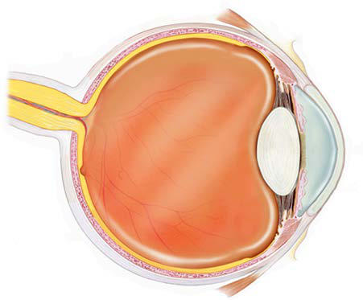
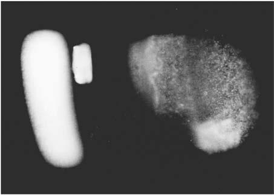

# Chapter 669: Disorders of the Uveal Tract
> **Course:** Vikkypaedia Pediatric Basic Course (*Nelson Textbook of Pediatrics, 22nd Edition (2025)*)  
> **Part XXVII:** Disorders of the Eye  
> **Authors:** Scott E. Olitsky and Justin D. Marsh  
> **Metrics:** 2,350 words · 2 tables/boxes · 2 figures · 0 genes · 8 flashcards · 5 MCQs  
> **Quick Navigation:** [🃏 Study 8 Flashcards](../flashcards/669_flashcards.md) · [📝 Take 5-Q MCQ Quiz](../mcqs/669_mcqs.md) · [📚 Part XXVII Guide](../parts/Part_XXVII.md) · [🧬 Syndrome & Genetics Atlas](../omim_gene_atlas.md) · [💊 Therapeutics Matrix](../therapies_matrix.md) · [🏠 Course Index](../../index.md)

## ⚡ High-Yield Nelson Pediatric Board Pearls
- Treatment and Prognosis Displacement of the lens often results only in optical problems.
- Management must be individualized according to the type of displacement, its cause, and the presence of any complicating ocular or systemic conditions.
- OTHER DISORDERS OF THE LENS Microspherophakia The term microspherophakia refers to a small, round lens that may occur as an isolated anomaly (probably autosomal recessive) or in asso ciation with other ocular abnormalities, such as ectopia lentis, myopia, or retinal detachment (possibly autosomal dominant).
- Posterior Lenticonus Posterior lenticonus, which occurs more commonly than anterior len ticonus, is characterized by a circumscribed round or oval bulge of the posterior lens capsule and cortex, involving the central region of the lens.
- It is believed to be sporadic, although autosomal dominant and X-linked inheritance has been suggested in some cases.
- High-dose intravenous methyl prednisolone is the initial treatment of choice.
- Pars planitis is an uncommon idiopathic form of intermediate uve itis characterized by anterior chamber involvement, anterior vitreous cells and condensations, and peripheral retinal vasculitis.

---
## Full Chapter Text, Tables & Figures
# Chapter 669: Disorders of the Uveal Tract

*Scott E. Olitsky and Justin D. Marsh*

<!-- p.5047 -->
Displacement of the lens occurring as a heritable ocular condition unassociated with systemic abnormalities is referred to as *simple ecto pia lentis*. Simple ectopia lentis is usually transmitted as an autosomal dominant condition. The lens is generally displaced upward and tem porally. The ectopia may be present at birth or may appear later in life. Another form of heritable dislocation is **ectopia lentis et pupillae** (see Chapter 662). In this condition, both the lens and pupil are displaced, usually in opposite directions. This condition is generally bilateral, with one eye being almost a mirror image of the other. *Ectopia len tis et pupillae* is an autosomal recessive condition, although variable expression with some intermingling with simple ectopia lentis has been reported.

**Systemic disorders** associated with displacement of the lens include Marfan syndrome, homocystinuria, Weill-Marchesani syndrome, and sulfite oxidase deficiency. Ectopia lentis occurs in approximately 80% of patients with Marfan syndrome. In approximately 50% of patients with Marfan syndrome, the ectopia is evident by 5 years of age. In most cases, the lens is displaced superiorly and temporally; it is almost always bilateral and relatively symmetric. In homocystinuria, the lens is usually displaced inferiorly and somewhat nasally. The subluxation of the lens occurs early in life and is often evident by 5 years of age. In Weill-Marchesani syndrome, the displacement of the lens is often downward and forward, and the lens tends to be small and round.

Ectopia lentis is also associated occasionally with other conditions, including Ehlers-Danlos, Sturge-Weber, Crouzon, and Klippel-Feil syndromes; oxycephaly; and mandibulofacial dysostosis. A syndrome of dominantly inherited blepharoptosis, high myopia, and ectopia len tis has also been described.

**Treatment and Prognosis** Displacement of the lens often results only in optical problems. In some cases, however, more serious complications may develop, such as glaucoma, uveitis, retinal detachment, or cataract. Management must be individualized according to the type of displacement, its cause, and the presence of any complicating ocular or systemic conditions. For many patients, optical correction by spectacles or contact lenses can be provided. Manipulation of the iris diaphragm with mydriatic or miotic drops may sometimes help improve vision. In selected cases, the best treatment is surgical removal of the lens. In many children, treatment of any associated amblyopia must be instituted early. In addition, for children with ectopia lentis, safety precautions should be taken to pre vent injury to the eye.

**OTHER DISORDERS OF THE LENS Microspherophakia** The term *microspherophakia* refers to a small, round lens that may occur as an isolated anomaly (probably autosomal recessive) or in asso ciation with other ocular abnormalities, such as ectopia lentis, myopia, or retinal detachment (possibly autosomal dominant). Microsphero phakia may also occur in association with various systemic disorders, including Marfan syndrome, Weill-Marchesani syndrome, Alport syn drome, mandibulofacial dysostosis, and Klinefelter syndrome.

**Anterior Lenticonus** Anterior lenticonus is a rare bilateral condition in which the anterior capsule of the lens thins, allowing the lens to bulge forward centrally. It may be accompanied by lens opacities or other eye anomalies and is a prominent feature of Alport syndrome. The increased curvature of the central area may cause high myopia. Spontaneous rupture of the ante rior capsule may occur, requiring prompt surgical intervention.

**Posterior Lenticonus** Posterior lenticonus, which occurs more commonly than anterior len ticonus, is characterized by a circumscribed round or oval bulge of the posterior lens capsule and cortex, involving the central region of the lens. In the early stages, by the red reflex test, this may look like an oil droplet. It occurs in infants and young children and tends to increase with age. Usually the lens material within and surrounding the cap sular bulge eventually becomes opacified. Posterior lenticonus usually

occurs as an isolated ocular anomaly. It is generally unilateral but may be bilateral. It is believed to be sporadic, although autosomal dominant and X-linked inheritance has been suggested in some cases. Infants or children with posterior lenticonus may require optical correction, amblyopia treatment, and surgery for progressive cataract.

*Visit Elsevier eBooks+ at eBooks.Health.Elsevier.com** for Bibliography.*

*Scott E. Olitsky and Justin D. Marsh*

**UVEITIS (IRITIS, CYCLITIS, CHORIORETINITIS)** The uveal tract (the inner vascular coat of the eye, consisting of the iris, ciliary body, and choroid) (Fig. 669.1) is subject to inflammatory involvement in numerous systemic diseases, both infectious and non infectious, and in response to exogenous factors, including trauma and toxic agents (Table 669.1). Inflammation may affect any one portion of the uveal tract preferentially or all parts together. Uveitis may be classified as anterior (iris, ciliary body), intermediate (vitreous-choroid locations), posterior (choroid, retina) or panuveitis, with subclassifica tion as infectious, inflammatory, or systemic disease associated and eye limited.

**Iritis** may occur alone or in conjunction with inflammation of the ciliary body as iridocyclitis or in association with pars planitis. Pain, photophobia, and lacrimation are the characteristic symptoms of acute anterior uveitis, but the inflammation may develop insidiously with out disturbing symptoms. Signs of anterior uveitis include conjuncti val hyperemia, particularly in the perilimbal region (ciliary flush), and cells and protein (“flare”) in the aqueous humor (Figs. 669.2 and 669.3). Inflammatory deposits on the posterior surface of the cornea (keratic precipitates) and congestion of the iris may also be seen. More chronic cases may show degenerative changes of the cornea (band keratopathy), lenticular opacities (cataract), development of glaucoma, and impair ment of vision. The cause of anterior uveitis is often idiopathic; primary considerations in children are rheumatoid disease, particularly pau ciarticular arthritis, Kawasaki disease, postinfectious reactive arthritis syndrome, tubulointerstitial nephritis (TINU), HLA-B27 associated syndromes, and sarcoidosis. Iritis may be secondary to corneal disease, such as herpetic keratitis or a bacterial or fungal corneal ulcer, or to a corneal abrasion or foreign body. Traumatic iritis and iridocyclitis are especially common in children.

**Iridocyclitis** that occurs in children with juvenile idiopathic arthri tis deserves special mention. Unlike most forms of anterior uveitis, it rarely creates pain, photophobia, or conjunctival hyperemia. Loss of vision may not be noticed until severe and irreversible damage has occurred. Because of the lack of symptoms and the high incidence of uveitis in these children, routine periodic screening is necessary. Oph thalmic screening guidelines are based on 3 factors that predispose children with arthritis to uveitis (Fig. 669.4): 1.	Type of arthritis 2.	Age of onset of arthritis 3.	Antinuclear antibody (ANA) status

**Choroiditis,** inflammation of the posterior portion of the uveal tract, invariably also involves the retina; when both are obviously affected, the condition is termed *chorioretinitis*. The causes of posterior uveitis are numerous; the more common are toxoplasmosis, histoplasmosis, cytomegalovirus, sarcoidosis, syphilis, tuberculosis, and toxocariasis

<!-- p.5049 -->
Uvea

Choroid

Ciliary Body

Iris

Lens Vitreous

Retina

Optic Nerve

Pupil

Cornea

Sclera

**Fig. 669.1** Anatomic locations for uveitis. (From National Eye Insti tute: Uveitis. Courtesy National Eye Institute, National Institutes of Health, Bethesda, Maryland. https://www.nei.nih.gov/learn-about-eye- health/eye-conditions-and-diseases/uveitis)

#### **Table 669.1** Uveitis in Childhood

| Category / Parameter | Clinical Details & Findings |
| --- | --- |
| **ANTERIOR UVEITIS** | Juvenile idiopathic arthritis (pauciarticular); Sarcoidosis including Blau syndrome; Trauma; Tuberculosis; Kawasaki disease |
| **MIS-C** | Ulcerative colitis; Crohn syndrome; HLA-B27 associated; Reactive postinfectious (enteric or genital) with arthritis and rash; Spirochetal (syphilis, leptospiral); Lyme disease; Brucellosis; Heterochromic iridocyclitis (Fuchs); Viral (herpes simplex, herpes zoster); Ankylosing spondylitis; Stevens-Johnson syndrome; Chronic infantile neurologic cutaneous arthritis syndrome (CINCA); Familial Mediterranean fever; Hyperimmunoglobulin D syndrome; Tumor necrosis factor receptor–associated periodic syndrome; Muckle-Wells syndrome; Celiac disease; Psoriasis; Multiple sclerosis; Cyclic neutropenia; Chronic granulomatous disease; X-linked lymphoproliferative disease; Hypocomplementemic vasculitis; Tubulointerstitial nephritis and uveitis syndrome; Idiopathic; Drugs (rifabutin, anti-tumor necrosis factor agents, interferon) |
| **INVOLVE RETINA)** | Toxoplasmosis; Toxocariasis; Sarcoidosis including Blau syndrome; Cat-scratch disease; Tuberculosis; Histoplasmosis; Viral (rubella, herpes simplex, HIV, cytomegalovirus, West Nile); Subacute sclerosing panencephalitis; Tubulointestinal nephritis and uveitis syndrome; Diffuse unilateral subacute neuroretinitis (DUSN) secondary to; Ancylostoma caninum or Baylisascaris procyonis; Idiopathic |
| **ANTERIOR AND/OR POSTERIOR (PAN) UVEITIS** | Sympathetic ophthalmia (trauma to other eye); Vogt-Koyanagi-Harada syndrome (uveootocutaneous syndrome:; poliosis, vitiligo, alopecia, deafness, tinnitus, uveitis, aseptic; meningitis, retinitis); Behçet syndrome; Juvenile xanthogranulomatosis; Lyme disease; Sarcoidosis |
| **UVEO-MENINGEAL SYNDROMES** | Vogt-Koyanagi-Harada disease; Behçet; Sarcoidosis; Granulomatosis with polyangiitis; Cat-scratch disease; Whipple disease; Syphilis; Lyme disease; Acute posterior multifocal placoid pigment epitheliopathy; Lymphoma, leukemia; Herpes simplex; Cytomegalovirus; MIS-C, Multisystem inflammatory system in children associated with COVID-19 |

(Fig. 669.5). Depending on the etiology, the inflammatory signs may be diffuse or focal. Vitreous reaction often occurs as well. With many types, the result is atrophic chorioretinal scarring demarcated by pig mentation, often with visual impairment. Secondary complications include retinal detachment, glaucoma, and phthisis.

**Panophthalmitis** is inflammation involving all parts of the eye. It is frequently suppurative, most often as a result of a perforating injury or of septicemia. It produces severe pain, marked congestion of the eye, inflammation of the adjacent orbital tissues and eyelids, and loss of vision. In many cases, the eye is lost despite intensive treatment of the infection and inflammation. Enucleation of the eye or evisceration of the orbit may be necessary.

**Sympathetic ophthalmia** is a rare type of uveal inflammatory response that affects the uninjured eye after a perforating injury to the other eye. It may occur weeks, months, or even years after the injury. A hypersensitivity phenomenon is the most probable cause. Loss of vision in the uninjured (sympathizing) eye may result. Removal of the injured eye prevents the development of sympathetic ophthalmia but does not stop the progres sion of the disease once it has occurred. High-dose intravenous methyl prednisolone is the initial treatment of choice. Immune therapy (immune suppression or modulators) may need to be added to steroids; these agents include cyclosporine, azathioprine, mycophenolate mofetil, cytoxan and TNF-alpha blocking agents (infliximab, adalimumab).

**Treatment** The various forms of intraocular inflammation are treated according to their underlying systemic causal factors. When infection is proved or suspected, appropriate systemic antimicrobial or antiviral therapy is used. In some cases, intravitreal injection is indicated.

Elimination of the intraocular inflammation is important to reduce the risk of severe, and often permanent, vision loss. Untreated, the inflammatory process may lead to the development of band keratopa thy (calcium deposition in the cornea), cataracts, glaucoma, and irre versible retinal damage. Anterior inflammation may respond well to topical corticosteroid treatment. Posterior cases often require systemic therapy. The use of topical and systemic corticosteroids can lead to the development of glaucoma and cataracts. To reduce the need for topi cal and systemic corticosteroids, systemic immunosuppression is often used in patients requiring long-term treatment. Immunosuppressive agents include methotrexate, cyclosporine, and tumor necrosis fac tor inhibitors. Multiple agents may be needed in recalcitrant cases.

<!-- p.5050 -->
Noninfectious inflammatory uveitis in adolescents has been treated with adalimumab, a human antitumor necrosis factor-α monoclonal antibody resulting in improved vision, lack of disease progression, and an ability to wean steroids. Cycloplegic agents, particularly atropine, are also used to reduce inflammation and to prevent adhesion of the iris to the lens (posterior synechiae), especially in anterior uveitis. Extensive posterior synechiae formation can lead to acute angle closure glaucoma. Other complications are noted in Table 669.2.

Surgery may be required for patients who develop glaucoma because of the underlying disease process or the need for corticosteroid treat ment. Cataract surgery should be delayed until the inflammation has been under control for a period of time. Cataract surgery in children with a history of prolonged uveitis can carry significant risk. There is no universal agreement concerning the use of intraocular lenses in these patients.

**Pars planitis** is an uncommon idiopathic form of intermediate uve itis characterized by anterior chamber involvement, anterior vitreous cells and condensations, and peripheral retinal vasculitis. The average age of onset is 9 years. It is predominately bilateral and seen more fre quently in males. Painless decreased vision is the usual presenting sign. The prognosis is good when adequate medical treatment is sought early in the course of the disease.

**Masquerade syndromes** can sometimes mimic intraocular inflam mation. Retinoblastoma, leukemia, retained intraocular foreign body, juvenile xanthogranuloma, and peripheral retinal detachments may produce signs similar to those seen in uveitis. These syndromes should be kept in mind when evaluating a patient with suspected uveitis or if a patient does not respond as anticipated to appropriate treatment. *Visit Elsevier eBooks+ at eBooks.Health.Elsevier.com** for Bibliography.*

**Fig. 669.2** Cell and flare in the anterior chamber. The flare represents protein leakage. (Courtesy Peter Buch, CRA.)

**Fig. 669.3** Iritis. Conjunctival injection is most marked immediately around the cornea (ciliary flush). (From Zitelli BJ, McIntire SC, Nowald AJ, Garrison J, eds. Zitelli and Davis’ Atlas of Pediatric Physical Diagno sis. 8th ed. Philadelphia: Elsevier; 2023: Fig. 20.88, p. 721)

Systemic JIA, polyarthritis

[RF positive], enthesitis-

related arthritis

Oligoarthritis, polyarthritis

[RF negative], psoriatic,

and undifferentiated

ANA positive, JIA

age of onset < 7 years, and disease duration ≤ 4 years

ANA negative, JIA

age of onset ≥ 7 years, or disease duration > 4 years

**Screen every 3 months (high risk)**

**Screen every 6-12 months (low or moderate risk)**

**Fig. 669.4** Ophthalmology screening recommendations. ANA, An tinuclear antibody; JIA, juvenile idiopathic arthritis; RF, rheumatoid factor. (From Angeles-Han ST, Ringold S, Beukelman T, et  al. 2019 American College of Rheumatology/Arthritis Foundation guideline for the screening, monitoring, and treatment of juvenile idiopathic arthritis- associated uveitis. Arthritis Care Res (Hoboken). 2019;71:703–716.)

**Fig. 669.5** Focal atrophic and pigmented scars of chorioretinitis.

in Pediatric Group

#### **Table 669.2** Comorbidities and Complications of Uveitis

| Category / Parameter | Clinical Details & Findings |
| --- | --- |
| **General** | Band keratopathy; Posterior synechia; Peripheral anterior synechia; Cataract; Ocular hypertension; Glaucoma; Ocular hypotension; Cystoid macular edema (CME); Vitreous hemorrhage; Tractional and rhegmatogenous retinal detachment; Epiretinal membrane; Neovascularization of cornea; Neovascular or fibrovascular proliferation on retina or in vitreous; Phthisis bulbi; From Maleki A, Anesi SD, Look-Why S, Manhapra A, Foster CS. Pediatric uveitis: A; comprehensive review. Surv Ophthalmol. 2022;67(2):510–529. Table 4. |

<!-- p.5051 -->
