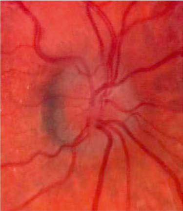

# Chapter 671: Abnormalities of the Optic Nerve
> **Course:** Vikkypaedia Pediatric Basic Course (*Nelson Textbook of Pediatrics, 22nd Edition (2025)*)  
> **Part XXVII:** Disorders of the Eye  
> **Authors:** Scott E. Olitsky and Justin D. Marsh  
> **Metrics:** 4,164 words · 2 tables/boxes · 2 figures · 10 genes · 8 flashcards · 5 MCQs  
> **Quick Navigation:** [🃏 Study 8 Flashcards](../flashcards/671_flashcards.md) · [📝 Take 5-Q MCQ Quiz](../mcqs/671_mcqs.md) · [📚 Part XXVII Guide](../parts/Part_XXVII.md) · [🧬 Syndrome & Genetics Atlas](../omim_gene_atlas.md) · [💊 Therapeutics Matrix](../therapies_matrix.md) · [🏠 Course Index](../../index.md)

## Key Genetic & Molecular Targets
`FXN`, `HESX1`, `MTND1`, `MTND4`, `MTND6`, `ND4`, `PROKR2`, `SOX2`, `SOX3`, `WFS1`

## ⚡ High-Yield Nelson Pediatric Board Pearls
- Because the macula is generally unaffected, the visual prognosis is good.
- Isolated colobomatous anomalies are commonly inherited in an autosomal dominant manner with highly variable penetrance and expressivity.
- OPTIC NERVE HYPOPLASIA Hypoplasia of the optic nerve is a nonprogressive, idiopathic condition characterized by a subnormal number of optic nerve axons with nor mal mesodermal elements and glial supporting tissue.
- This form of optic nerve hypo plasia occurs secondary to transsynaptic degeneration of optic axons caused by the primary bilateral lesion in the optic radiation (periven tricular leukomalacia).
- Drusen may occur as an autosomal dominant condition with incomplete penetrance.
- In childhood, optic neuritis may occur as an isolated condition or as a manifestation of a neurologic or systemic disease.
- Optic neuritis may also be secondary to an exog enous toxin or drug, as with lead poisoning or as a complication of long-term high-dose treatment with chloramphenicol or vincris tine.

---
## Full Chapter Text, Tables & Figures
# Chapter 671: Abnormalities of the Optic Nerve

*Scott E. Olitsky and Justin D. Marsh*

<!-- p.5060 -->
In patients with severe head or chest compressive trauma, a trau matic retinal angiopathy known as **Purtscher retinopathy** may occur. This is characterized by retinal hemorrhage, cotton-wool spots, possible disc swelling, and decreased vision. The pathogen esis is unclear, but there is evidence of arteriolar obstruction in this condition. A Purtscher-like fundus picture may also occur in sev eral nontraumatic settings, such as acute pancreatitis, lupus erythe matosus, and childbirth. **Laser pointers** may produce vision loss with varying findings depending on the retinal area exposed to the nonionizing radiation.

**MYELINATED NERVE FIBERS** Myelination of the optic nerve fibers normally terminates at the level of the disc, but in some individuals, ectopic myelination extends to nerve fibers of the retina. The condition is most com monly seen adjacent to the disc, although more peripheral areas of the retina may be involved. The characteristic ophthalmoscopic picture is a focal white patch with a feathered edge or brushstroke appearance. Because the macula is generally unaffected, the visual prognosis is good. A relative or absolute visual field defect corre sponding to areas of ectopic myelination is usually the only associ ated ocular abnormality. Extensive unilateral involvement, however, is associated with ipsilateral myopia, amblyopia, and strabismus. If unilateral high myopia and amblyopia are present, appropriate optical correction and occlusion therapy should be instituted. For unknown reasons, the disorder is more commonly encountered in patients with craniofacial dysostosis, oxycephaly, neurofibromato sis, and Down syndrome.

**CHORIORETINAL COLOBOMA** The term *coloboma* describes a defect such as a gap, notch, fissure, or hole (see Chapter 662). The typical fundus coloboma is a result of malclosure of the embryonic fissure, which leaves a gap in the retina, RPE, and choroid, thus baring the underlying sclera. The defect may be extensive, involving the optic nerve, ciliary body, and iris and even the lens, or it may be localized to one or more portions of the fissure. The usual appearance is of a well-circumscribed, wedge-shaped white area extending inferonasally below the disc, sometimes involving or engulfing the disc. In some cases, there is ectasia or cyst formation in the area of the defect. Less extensive colobomatous defects may appear as only single or multiple focal

**Fig. 670.13** Shaken baby syndrome (inflicted neurotrauma). Retinal hemorrhages in multiple layers too numerous to count into the far periphery.

punched-out chorioretinal defects or anomalous pigmentation of the fundus in the line of the embryonic fissure. Colobomas may occur in one or both eyes. A visual field defect usually corresponds to the chorioretinal defect. Visual acuity may be impaired, particu larly if the defect involves the disc or macula.

Fundus colobomas may occur in isolation as sporadic defects or as an inherited condition. Isolated colobomatous anomalies are commonly inherited in an autosomal dominant manner with highly variable penetrance and expressivity. Family members of affected patients should receive appropriate genetic counseling. Colobomas may also be associated with such abnormalities as microphthalmia, glioneuroma of the eye, cyclopia, or encephalocele. They occur in children with various chromosomal disorders, including trisomies 13 and 18, triploidy, cat-eye syndrome, and 4p−. Ocular colobomas also occur in many multisystem disorders, including the CHARGE (*C,* coloboma; *H,* heart disease; *A,* atresia choanae; *R,* retarded growth, and development and/or central nervous system anoma lies; *G,* genetic anomalies and/or hypogonadism; *E,* ear anomalies and/or deafness) association; Joubert, Aicardi, Meckel, Warburg, and Rubinstein-Taybi syndromes; linear sebaceous nevus; Golden har and Lenz microphthalmia syndromes; and Goltz focal dermal hypoplasia.

*Visit Elsevier eBooks+ at eBooks.Health.Elsevier.com** for Bibliography.*

*Scott E. Olitsky and Justin D. Marsh*

**OPTIC NERVE APLASIA** This rare congenital anomaly of unknown etiology is typically unilat eral. The optic nerve, retinal ganglion cells, and retinal blood vessels are absent. A vestigial dural sheath usually connects with the sclera in a normal position, but no neural tissue is present within this sheath. Optic nerve aplasia typically occurs sporadically in an otherwise healthy person.

**OPTIC NERVE HYPOPLASIA** Hypoplasia of the optic nerve is a nonprogressive, idiopathic condition characterized by a subnormal number of optic nerve axons with nor mal mesodermal elements and glial supporting tissue. In typical cases, the nerve head is small and pale, with a pale or pigmented peripapillary halo or double ring sign (Fig. 671.1).

This anomaly is associated with defects of vision and of visual fields of varying severity, ranging from blindness to normal or near-normal vision. It may be associated with systemic anomalies that most com monly involve the central nervous system (CNS). CNS defects such as hydranencephaly or anencephaly or more focal lesions compatible with continued development may accompany optic nerve hypoplasia, but unilateral or bilateral optic nerve hypoplasia may be found without any concomitant defects.

Optic nerve hypoplasia is a principal feature of **septo-optic dysplasia (SOD),** a developmental disorder characterized by the association of anomalies of the midline structures of the brain

<!-- p.5062 -->
with hypoplasia of the optic nerves, optic chiasm, and optic tracts; typically noted are agenesis of the septum pellucidum, partial or complete agenesis of the corpus callosum, and malformation of the fornix, with a large chiasmatic cistern. Patients may have hypothalamic abnormalities and endocrine defects ranging from panhypopituitarism to isolated deficiency of growth hormone, hypothyroidism, or diabetes insipidus. Neonatal hypoglycemia and seizures are important presenting signs in affected infants. In some patients with SOD, pathologic variants in *HESX1*, *SOX2*, *SOX3*, *OTX2,* and *PROKR2* have been identified.

MRI is preferred for evaluating CNS abnormalities in patients with optic nerve hypoplasia. During MRI, special attention should be directed to the pituitary infundibulum, where ectopia of the posterior pituitary may be found. Posterior pituitary ectopia appears on MRI as an absence of the pituitary infundibulum with an abnormal bright spot at the upper infundibulum area. This abnormality is present in approx imately 15% of patients and suggests a posterior pituitary hormone deficiency, requiring further endocrinologic workup. Endocrine func tion should be watched closely in patients with optic nerve hypoplasia. The cause of optic nerve hypoplasia remains unclear.

Children with **periventricular leukomalacia** display an unusual form of optic nerve hypoplasia. The optic nerve demonstrates a large cup within a normal-size optic disc. This form of optic nerve hypo plasia occurs secondary to transsynaptic degeneration of optic axons caused by the primary bilateral lesion in the optic radiation (periven tricular leukomalacia).

**OPTIC NERVE COLOBOMA** Optic nerve colobomas can be unilateral or bilateral. The visual acuity can range from normal to complete blindness. The coloboma develops secondary to incomplete closure of the embryonic fissure. The defect may produce a partial or total excavation of the optic disc (Fig. 671.2). Chorioretinal and iris colobomas may also occur (see Chapter 662). Optic nerve colobomas may be seen in a multitude of ocular and systemic abnormalities, including the CHARGE (*C,* coloboma; *H,* heart disease; *A,* atresia choanae; *R,* retarded growth

and development and/or CNS anomalies; *G,* genetic anomalies and/ or hypogonadism; *E,* ear anomalies and/or deafness) association.

**MORNING GLORY DISC ANOMALY** This term describes a congenital malformation of the optic nerve char acterized by an enlarged, excavated, funnel-shaped disc with an elevated rim resembling a morning glory flower. White glial tissue is present in the central part of the disc (Fig. 671.3). The retinal vessels are abnormal and appear at the peripheral disc, coursing over the elevated pink rim in a radial fashion. Pigmentary mottling of the peripapillary region is usu ally seen. Most cases are unilateral. Females are affected twice as often as males. Visual acuity is usually severely reduced. Morning glory disc anomaly has been associated with basal encephalocele in patients with midfacial anomalies. Abnormalities of the carotid circulation can also be seen in patients with morning glory anomaly. Moyamoya disease is a well-described associated finding.

**TILTED DISC** In this congenital anomaly, the vertical axis of the optic disc is directed obliquely, so that the upper temporal portion of the nerve head is more prominent and anterior to the lower nasal portion of the disc. The reti nal vessels emerge from the upper temporal portion of the disc rather than from the nasal side. Often noted is a peripapillary crescent or conus. Associated visual field defects and myopic astigmatism may be found. Clinical recognition of the tilted disc syndrome is important to avoid confusion of its disc and visual field signs with those of papill edema and intracranial tumor.

**DRUSEN OF THE OPTIC NERVE** These globular, acellular bodies are thought to arise from axoplasmic derivatives of disintegrating nerve fibers. Drusen may be buried within the optic nerve, producing elevation of the optic nerve head (pseudopap illedema), or they may be partially or completely exposed, appearing as refractile bodies at the surface of the disc (Fig. 671.4). Visual field defects and spontaneous hemorrhages of the peripapillary nerve fiber layer may occur in association with drusen. Drusen may occur as an autosomal dominant condition with incomplete penetrance. B-scan ultrasonogra phy can help to positively identify drusen suspected on clinical ophthal mic exam in some cases, although drusen in young children may be less likely to be visible with ultrasonography than in adults.

Border of the nerve sheath, black portion (could be white or gray) is the empty sheath not entirely filled with the nerve.

Actual border of the optic nerve; nerve seen as the central pink tissue.

**Fig. 671.1** Optic nerve hypoplasia: the “double ring sign.” The first ring shows the border of the nerve sheath, and the second ring is formed by the actual border of the optic nerve tissue edge. (From Martin RJ, Fanaroff AA, Walsh MC, eds. Fanaroff & Martin’s Neonatal- Perinatal Medicine. 10th ed. Philadelphia: Elsevier; 2015: Fig. 103.24, p. 1753.)

**Fig. 671.2** Optic nerve coloboma.

<!-- p.5063 -->
**PAPILLEDEMA** The term *papilledema* is reserved to describe swelling of the nerve head secondary to increased intracranial pressure (ICP). Clinical manifestations of papilledema include edematous blurring of the disc margins, fullness or elevation of the nerve head, partial or com plete obliteration of the disc cup, capillary congestion and hyper emia of the nerve head, generalized engorgement of the veins, loss of spontaneous venous pulsation, hemorrhages in the nerve fiber layer around the disc, and peripapillary exudates (see Fig. 671.4 and 630.2). In some cases, edema extending into the macula may produce a fan- or star-shaped figure. In addition, concentric peri papillary retinal wrinkling (Paton lines) may be noted. Transient obscuration of vision may occur, lasting seconds, and is associated with postural changes. Vision, however, is usually normal in acute papilledema. Normally, when the ICP is relieved, the papilledema

resolves and the disc returns to a normal or nearly normal appear ance within 6-8 weeks. Sustained chronic papilledema or longstanding unrelieved increased ICP may, however, lead to permanent nerve fiber damage, atrophic changes of the disc, macular scarring, and impairment of vision.

The *pathophysiology* of papilledema is probably as follows: elevation of intracranial subarachnoid cerebrospinal fluid (CSF) pressure, eleva tion of CSF pressure in the sheath of the optic nerve, elevation of tissue pressure in the optic nerve, stasis of axoplasmic flow and swelling of the nerve fibers in the optic nerve head, and secondary vascular changes and the characteristic ophthalmoscopic signs of venous stasis. Associ ated neuro-ophthalmic signs of increased ICP in infants and children include sixth cranial nerve palsy and attendant esotropia, lid retrac tion, paresis of upward gaze, tonic downward deviation of the eyes, and convergent nystagmus.

The common **etiologies** of papilledema in childhood are intra cranial tumors and obstructive hydrocephalus, intracranial hemor rhage, the cerebral edema of trauma, meningoencephalitis, toxic encephalopathy, idiopathic intracranial hypertension, and certain metabolic diseases. Regardless of the cause, the optic disc signs of increased ICP in early childhood may occasionally be modified by the distensibility of the young skull. In the absence of conditions associated with early closure of sutures and early obliteration of the fontanel (craniosynostosis, Crouzon disease, and Apert syndrome), infants with increased ICP may not develop papilledema.

The **differential diagnosis** of papilledema includes structural changes of the disc (pseudopapilledema, pseudoneuritis, drusen, and myelinated nerve fibers; see Fig. 671.4), with which it may be confused, and the disc swelling of papillitis associated with optic neuritis in addition to the disc changes of hypertension and diabetes mellitus. Unless retinal hemorrhage or edema involves the macular area, the preservation of good central vision and the absence of an afferent pupillary defect (Marcus Gunn pupil) help to differentiate acute papilledema from the edema of the optic nerve head found in acute optic neuritis.

*Papilledema is a neurologic emergency.* It can be accompanied by other signs of increased ICP, including headaches, nausea, and vomit ing. Neuroimaging should be performed; if no intracranial masses are detected, a lumbar puncture and determination of CSF pressure should follow.

**OPTIC NEURITIS** This is any inflammation or demyelinization of the optic nerve with attendant impairment of function (see Chapter 640.2). The process is usually acute, with rapidly progressive loss of vision. It may be unilateral or bilateral. Pain on movement or palpation of the globe may precede or accompany the onset of visual symptoms. There is decreased visual activity, decreased color vision and contrast sensi tivity, a relative afferent pupillary defect, and a normal macula and peripheral retina.

**Fig. 671.3** A, Morning glory disc anomaly. The defect looks like a fully opened morning glory flower. B, Normal appearance of scaled fundus photography. (From Martin RJ, Fanaroff AA, Walsh MC, eds. Fanaroff & Martin’s Neonatal-Perinatal Medicine. 10th ed. Philadelphia: Elsevier; 2015: Fig. 103.25, p. 1754.)

A B

A

B

**Fig. 671.4** Comparison of optic disc in children with optic disc drusen and papilledema. A, Optic disc photos of a 10-year-old child with bilat eral buried optic disc drusen. The disc margins are blurred, but there are no hemorrhages, exudates, or vessel obscuration. B, Optic disc photos of a 5-year-old child with mild papilledema due to increased intracranial pressure. Disc margins are blurred with mild obscuration of vessels, but no hemorrhages or exudates. (From Chang MY, Pineles SL. Optic disc drusen in children. Surv Ophthalmol. 2016;61:745–758: Fig. 1).

<!-- p.5064 -->
When the retrobulbar portion of the nerve is affected without ophthalmoscopically visible signs of inflammation at the disc, the term *retrobulbar optic neuritis* is applied. When there is ophthal moscopically visible evidence of inflammation of the nerve head, the term *papillitis* or *intraocular optic neuritis* is used. When there is involvement of both the retina and the papilla, the term *optic neuroretinitis* is used.

In childhood, optic neuritis may occur as an isolated condition or as a manifestation of a neurologic or systemic disease. Optic neu ritis may be secondary to inflammatory diseases (systemic lupus erythematosus, sarcoidosis, Behçet disease); infections (tuberculo sis, syphilis, Lyme disease, meningitis, viral encephalitis, HIV, or postinfectious disease); and toxic or nutritional disorders (metha nol, ethambutol, vitamin B12 deficiency). It may signify one of the many demyelinating diseases of childhood (see Chapter 640.2). Although a significant percentage of adults who experience an epi sode of optic neuritis eventually develop other symptoms associated with multiple sclerosis (MS), young children with optic neuritis are seemingly at less risk (risk of MS is 19% within 20 years). Highrisk features suggestive of MS include visual acuity better than no light perception, periocular pain, acutely normal-appearing optic nerve, no retinal abnormalities, and abnormal MRI suggesting a demyelinating disease. Bilateral optic neuritis in children may be associated with **acute disseminated encephalomyelitis (ADEM)** or **neuromyelitis optica (NMO or Devic disease).** NMO is character ized by rapid and severe bilateral visual loss accompanied by trans verse myelitis and paraplegia. Involvement of the brain stem and occasionally the cortex may be seen on MRI. NMO-specific immu noglobulin G (directed to the aquaporin 4 water channel) is the diagnostic test of choice for Devic syndrome. Antibody-negative NMO patients may have anti-MOG (myelin oligodendrocyte gly coprotein) antibodies, suggesting another form of demyelinating optic neuritis. Optic neuritis may also be secondary to an exog enous toxin or drug, as with lead poisoning or as a complication of long-term high-dose treatment with chloramphenicol or vincris tine. Extensive pediatric neurologic and ophthalmic investigation, including MRI and lumbar puncture, is usually required. Idiopathic NMO is associated with anti–aquaporin 4 antibodies, otherwise known as NMO antibodies.

In most cases of acute optic neuritis, some improvement in vision begins within 1-4 weeks after onset, and vision may improve to nor mal or near normal within weeks or months. The course varies with cause. Although central vision may recover fully, it is common to find permanent defects in other areas of visual function (contrast sensi tivity, color, brightness sense, and motion perception). Recurrences may occur especially, but not universally, in patients who go on to develop MS.

A **treatment** trial has demonstrated that high-dose intravenous methylprednisolone may help to speed the visual recovery in young adults, and it may prevent the development of MS in those at risk. It is unknown to what degree the results of the aforementioned trial may be extrapolated to optic neuritis in childhood.

**LEBER HEREDITARY OPTIC NEUROPATHY** Leber hereditary optic neuropathy (LHON) is characterized by an acute to subacute painless loss of central vision primarily affect ing young males (male to female ratio 2.5:1). The incidence is 1:30,000-50,000 people. A characteristic peripapillary telangiectatic microangiopathy occurs not only in the presymptomatic phase of involved eyes but also in a number of asymptomatic females (Fig. 671.5). Disc hyperemia and edema mark the acute phase of central visual loss. One eye is usually affected before the other; the second eye involvement begins 2-3 months later. Visual field loss (blurring, clouding) and impaired color vision are also present. In time, pro gressive optic atrophy and vision loss usually ensue. The tortuous angiopathy becomes less obvious. Although visual function after

the initial loss generally remains stable, partial or less often com plete recovery may occur in as many as 20–30% of affected individ uals. This recovery may take place years or decades after the initial episode of acute vision loss. The peripapillary angiopathy, the lack of short-term remission and inflammation and MRI, as well as the degree of symmetry or peripheral motor or sensory deficits, serve to distinguish most cases of Leber disease from the optic neuritis of MS.

LHON is maternally inherited and is caused by pathogenic gene variants in mitochondrial DNA (Fig. 671.6). Multiple point variants in the mitochondrial DNA have been identified. Pathogenic vari ants in *MTND1*, *MTND4* (~70%), and *MTND6* represent ~90% of cases. **LHON plus** is a related mitochondrial disorder affecting skel etal and cardiac muscle disorders, including electrocardiographic abnormalities. Only ∼50% of males and 15% of females with a pathogenic gene variant develop symptomatic LHON.

The differential diagnosis includes optic neuritis (Chapter 640.2), other genetic optic neuropathies (Table 671.1; see also Fig. 671.6) and toxic or nutritional neuropathies (Table 671.2).

Gene therapy with intravitreal injection of a vector-*ND4* gene has had success improving vision in patients with LHON.

**OPTIC ATROPHY** This term denotes degeneration of optic nerve axons, with atten dant loss of function. The ophthalmoscopic signs of optic atrophy are pallor of the disc and loss of substance of the nerve head, some times with enlargement of the disc cup. The associated vision defect varies with the nature and site of the primary disease or lesion.

Optic atrophy is the common expression of a wide variety of con genital or acquired pathologic processes (Table 671.3). The cause may be traumatic, inflammatory, degenerative, neoplastic, or vascular; intracranial tumors and hydrocephalus are principal causes of optic atrophy in children. In some cases, progressive optic atrophy is heredi tary. **Dominantly inherited infantile optic atrophy** is a relatively mild heredodegenerative type that tends to progress through child hood and adolescence. **Autosomal recessively inherited congenital optic atrophy** is a rare condition that is evident at birth or develops at

A B C D

**Fig. 671.5** A 9-year-old child with Leber hereditary optic neuropathy (LHON) m.11778 presents with best-corrected visual acuity of 20/20 in the right eye and no symptoms (A). At age 12, retinal nerve fiber layer swelling is observed before reduction in vision (B). His visual acuity rap idly decreases 1 month later to 20/50 and subtle temporal optic nerve pallor is visible (C). Three months later, his visual acuity is <20/400 and diffuse optic nerve pallor is present (D). Notice that peripapillary telan giectasia was present at age 9, 3 years before his visual symptoms start ed. The patient’s left eye progressed similarly to the right eye. (From Pilz YL, Bass SJ, Sherman J. A review of mitochondrial optic neuropa thies: from inherited to acquired forms. J Optometry. 2016;10:205–214: Fig. 1, p. 208).

<!-- p.5065 -->
Monosymptomatic

**DOA**

(OPA1)

**mtDNA nDNA**

**HSP**

(SPG7)

**Costeff/ DOA + cataract**

(OPA3)

**FRDA**

(FXN)

**MTS**

(DDP/TIMM8A)

**CPEO/ DOA plus**

(OPA1)

**CMT2A/ HMSN VI**

(Mfn2)

**Infantile Encephalopathy**

(DLP1)

Monosymptomatic

**LHON**

(ND1, ND4, ND6)

Syndromic **LHON/dystonia/**

**MELAS/Leigh**

(ND1, ND5, ND6)

**Fig. 671.6** Mitochondrial and nuclear DNA etiologies of inherited optic neuropathies. LHON, Leber hereditary optic neuropathy; DOA, dominant optic atrophy; FRDA, Friedreich ataxia; MTS, Mohr-Tranebjaerg syndrome; HSP, hereditary spastic paraplegia; CPEO, chronic progressive external ophthalmoplegia; CMT2A, Charcot Marie tooth; HMSN VI, hereditary motor and sensory neuropathy; mtDNA, mitochondrial DNA; nDNA, nuclear DNA; MELAS, mitochondrial encephalopathy, lactic acidosis, stroke. (Modified from Carelli V, La Morgia C, Valentino ML, et al. Retinal ganglion cell neurodegeneration in mitochondrial inherited disorders. Biochim et Biophysic Acta. 2009;1787:518–528: Fig. 2).

a very early age; the visual defect is usually profound. **Behr optic atro phy** is a hereditary type associated with hypertonia of the extremities, increased deep tendon reflexes, mild cerebellar ataxia, some degree of

mental deficiency, and possibly external ophthalmoplegia. This disor der principally afflicts boys 3-11 years of age. Some forms of heredode generative optic atrophy are associated with sensorineural hearing loss, as may occur in some children with juvenile-onset (insulin-dependent) diabetes mellitus. In the absence of an obvious cause, optic atrophy in an infant or child warrants extensive etiologic investigation.

**OPTIC NERVE GLIOMA** Optic nerve glioma, more properly referred to as **juvenile pilocytic astrocytoma,** is the most frequent tumor of the optic nerve in child hood (Fig. 671.7). This neuroglial tumor may develop in the intraor bital, intracanalicular, or intracranial portion of the nerve; the chiasm is often involved.

The tumor is a cytologically benign hamartoma that is generally stationary or only slowly progressive. The principal *clinical mani festations* when the tumor occurs in the intraorbital portion of the nerve are unilateral loss of vision, proptosis, and deviation of the eye; optic atrophy or congestion of the optic nerve head may occur. Chi asmal involvement may be attended by defects of vision and visual fields (often bitemporal hemianopia), increased ICP, papilledema or optic atrophy, hypothalamic dysfunction, pituitary dysfunction, and sometimes nystagmus or strabismus. Juvenile pilocytic astrocytomas occur with increased frequency in patients with neurofibromatosis (see Chapter 636.1).

**Treatment** of optic pathway gliomas is controversial. The best management is usually periodic observation with serial radiography

∼20% of patients

#### **Table 671.1** Genetic and Clinical Features of Primary Hereditary Optic Atrophies and Their Respective Genes

| Category / Parameter | Clinical Details & Findings |
| --- | --- |
| **WFS1** | Inheritance; Autosomal dominant; Maternal; Autosomal dominant; Autosomal recessive; Autosomal dominant; Age of onset; Childhood; Young adult, male >; female; Late childhood; Childhood; Childhood to adult; Ophthalmologic; features; Slowly progressive,; tritanomaly; Sudden visual; loss. Frequently; beginning unilateral; Often additional; cataract; Early manifestation; and progression; Highly variable; Loss of visual acuity; Moderate to severe; Pronounced visual; impairment; Moderate; Severe visual loss; Variable; Possible extraocular; signs; have neurologic; symptoms (e.g.,; ataxia, neuropathy); Mild neurologic; symptoms possible;; multiple sclerosis–; like symptoms; Late in life; mild; neurologic signs; possible late in life; Subclinical hearing; impairment; Hearing impairment,; disturbed glucose; tolerance,; behavioral; abnormalities; LHON, Leber hereditary optic neuropathy (mt-ND1, mt-ND4, mt-ND46, mt-ND6); OPA1, optic atrophy type 1; OPA3, optic atrophy type 3; TMEM126A, optic atrophy type 7; WFS1,; Wolfram syndrome (diabetes mellitus, diabetes insipidus, optic neuropathy, deafness).; Modified from Neuhann T, Rautenstrauss B. Genetic and phenotypic variability of optic neuropathies. Expert Rev Neurother. 2013;13(4):357–367. |

#### **Table 671.2** Causes of Acquired Optic Neuropathies

| Category / Parameter | Clinical Details & Findings |
| --- | --- |
| **DEFICIENCIES** | Methanol; Ethambutol; Thiamine (Vitamin B1); Riboflavin (Vitamin B2); Pyridoxine (Vitamin B6); Folic Acid (Vitamin B9); Cobalamin (Vitamin |
| **B12)** | Ethanol; Isoniazid; Tobacco; Chloramphenicol; Arsenics; Linezolid; Cobalt; Erythromycin; Thallium; Streptomycin; Carbon disulfide; Ciprofloxacin; Tetrachloride; Dapsone; Cyanide; Antiretrovirals; Ethylene glycol; Amiodarone; Toluene; Infliximab; Styrene; Clioquinol; Perchloroethylene; Pheniprazine; Suramin; Quinine; From Pilz YL, Bass SJ, Sherman J. A review of mitochondrial optic neuropathies: From; inherited to acquired forms. J Optometry. 2016;10:205–214: Table 2. |

<!-- p.5067 -->
