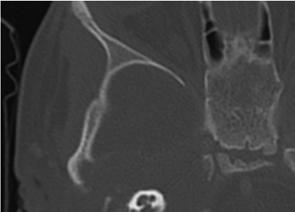
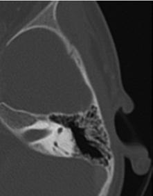

# Chapter 684: Tumors of the Ear and Temporal Bone
> **Course:** Vikkypaedia Pediatric Basic Course (*Nelson Textbook of Pediatrics, 22nd Edition (2025)*)  
> **Part XXVIII:** The Ear  
> **Authors:** Joseph Haddad Jr.  
> **Metrics:** 986 words · 0 tables/boxes · 2 figures · 0 genes · 8 flashcards · 5 MCQs  
> **Quick Navigation:** [🃏 Study 8 Flashcards](../flashcards/684_flashcards.md) · [📝 Take 5-Q MCQ Quiz](../mcqs/684_mcqs.md) · [📚 Part XXVIII Guide](../parts/Part_XXVIII.md) · [🧬 Syndrome & Genetics Atlas](../omim_gene_atlas.md) · [💊 Therapeutics Matrix](../therapies_matrix.md) · [🏠 Course Index](../../index.md)

## ⚡ High-Yield Nelson Pediatric Board Pearls
- ACOUSTIC TRAUMA Acoustic trauma results from exposure to high-intensity sound (fire works, gunfire, loud music, heavy machinery) and is initially manifested by a temporary decrease in the hearing threshold, most commonly at 4,000 Hz on an audiometric examination, and tinnitus.
- Noise-induced hearing loss results from interactions between genes and the environment.
- Rhabdomyosarcoma is the most common malignancy of the temporal bone in children.
- Diagnosis is based on biopsy, but the extent of disease is determined by both CT and MRI of the temporal and facial bones, skull base, and brain.

---
## Full Chapter Text, Tables & Figures
# Chapter 684: Tumors of the Ear and Temporal Bone

*Joseph Haddad Jr.*

<!-- p.5134 -->
loss of cochlear and vestibular function; hemotympanum; rarely, external canal bleeding; and CSF otorrhea, either in the external auditory canal or behind the TM, which can exit the nose via the eustachian tube.

If temporal bone fracture is suspected or seen on radiographs, gen tle examination of the pinna and ear canal is indicated; lacerations or avulsion of soft tissue is common with temporal bone fractures. Vigor ous removal of external auditory canal blood clots or tympanocentesis is not indicated, because removing the clot can further dislodge the ossicles or reopen CSF leaks. The effectiveness of prophylactic antibi otics to prevent meningitis in patients with basilar skull fractures and CSF otorrhea or rhinorrhea cannot be determined because studies to date are flawed by biases. If a patient is afebrile and the drainage is not cloudy, watchful waiting without antibiotics is indicated. Surgical intervention is reserved for children who require repair of a nonheal ing TM perforation, who have suffered dislocation of the ossicular chain, or who need decompression of the facial nerve. SNHL can also follow a blow to the head without an obvious fracture of the temporal bone (labyrinthine concussion).

**ACOUSTIC TRAUMA** Acoustic trauma results from exposure to high-intensity sound (fire works, gunfire, loud music, heavy machinery) and is initially manifested by a temporary decrease in the hearing threshold, most commonly at 4,000 Hz on an audiometric examination, and tinnitus. If the sound is between 85 and 140 dB, the loss is usually temporary (after a rock con cert), but both the hearing loss and the tinnitus can become permanent with chronic noise exposure; the frequencies from 3,000-6,000 Hz are most often involved. Sudden, extremely loud (>140 dB), short-duration noises with loud peak components (gunfire, bombs) can cause perma nent hearing loss after a single exposure. Noise-induced hearing loss results from interactions between genes and the environment. A metaanalysis demonstrated that loud music exposure resulted in increased hearing thresholds and decreased otoacoustic emissions in children and adolescents. Ear protection and avoidance of chronic exposure to loud noise are preventive measures. Hearing loss from chronic noise exposure should be entirely preventable. Parents should be made aware of the dangers of acoustic trauma, from the environment and from the use of headphones, and should take measures to minimize exposure. Treatment with high-dose steroids for 1-2 weeks should be considered to treat acute hearing loss related to noise trauma.

*Visit Elsevier eBooks+ at eBooks.Health.Elsevier.com** for Bibliography.*

Benign tumors of the external canal include osteomas and monostotic and polyostotic fibrous dysplasia. Osteomas are usually unilateral and located lateral in the bony canal; they require removal only if hearing is impaired or external otitis results. Exostoses (see Chapter 550.2), or localized bony hyperplasias, may be confused with osteomas; however, exostoses are usually bilateral and located in the region of the annulus of the tympanic membrane. Masses occurring over the mastoid bone, such as first branchial cysts, dermoid cysts, and lipomas, may be con fused with primary mastoid tumors; imaging can help with the diag nosis and treatment plan.

**Eosinophilic granuloma**, which can occur in isolation or as part of systemic Langerhans cell histiocytosis (see Chapter 556.1), should be suspected in patients with otalgia, otorrhea (sometimes bloody), hearing loss, abnormal tissue within the middle ear or ear canal, and roentgenographic findings of a sharply delineated destructive lesion of the temporal bone. Definitive diagnosis is made by biopsy. Treat ment depends on the site of the lesion and histology. Depending on the site, it may be treated by surgical excision, curettage, or local radia tion. If the lesion is part of a systemic presentation of Langerhans cell histiocytosis, chemotherapy in addition to local therapy (surgery with or without radiation) is indicated. Long-term follow-up is necessary whether the temporal bone lesion is a single isolated lesion or part of a multisystem disease.

**Rhabdomyosarcoma** is the most common malignancy of the temporal bone in children. Symptoms and signs of rhabdomyosar coma (see Chapter 549) originating in the middle ear or ear canal include a mass or polyp in the middle ear or ear canal, bleeding from the ear, otorrhea, otalgia, facial paralysis, and hearing loss. Other cranial nerves also may be involved. Diagnosis is based on biopsy, but the extent of disease is determined by both CT and MRI of the temporal and facial bones, skull base, and brain (Fig. 684.1).

*Joseph Haddad Jr.*

A B

**Fig. 684.1** Rhabdomyosarcoma in a 2-yr-old male with hearing loss and right periauricular swelling. A, Axial CT shows a large soft tissue mass of the right temporal bone (arrows) with extensive osseous destruction. B, Coronal STIR MR image shows hyperintense mass of the right temporal bone. Focal loss of integrity of the floor of the right middle cranial fossa (yellow arrow) and intact dura (black arrows) are shown. Destruction of the bony labyrinth (white arrow) by the mass. (Modified from Koral K. Neoplasia. In: Coley BD, ed. Caffey’s Pediatric Diagnostic Imaging, 13th ed, Philadelphia: Elsevier; 2019: Fig. 12.1.)

<!-- p.5136 -->
Management usually involves a combination of chemotherapy, radi ation, and surgery.

Non-Hodgkin lymphoma (see Chapter 545.2) and leukemia (see Chapter 544) also occur rarely in the temporal bone. Although primary neoplasms of the middle ear are very uncommon in chil dren, they include adenoid cystic carcinoma, adenocarcinoma, and squamous cell carcinoma. Benign tumors of the temporal bone include glomus tumors. The initial signs and symptoms of the more

common nasopharyngeal neoplasms (angiofibroma, rhabdomyo sarcoma, epidermoid carcinoma) may be associated with insidious onset of chronic otitis media with effusion (often unilateral). A high index of suspicion is needed for diagnosing these tumors early.

*Visit Elsevier eBooks+ at eBooks.Health.Elsevier.com** for Bibliography.*

<!-- p.5137 -->
