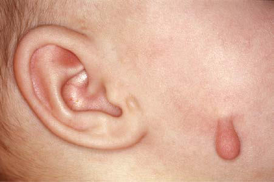

# Chapter 689: Cutaneous Defects
> **Course:** Vikkypaedia Pediatric Basic Course (*Nelson Textbook of Pediatrics, 22nd Edition (2025)*)  
> **Part XXIX:** The Skin  
> **Authors:** Kari L. Martin  
> **Metrics:** 3,013 words · 1 tables/boxes · 2 figures · 2 genes · 8 flashcards · 5 MCQs  
> **Quick Navigation:** [🃏 Study 8 Flashcards](../flashcards/689_flashcards.md) · [📝 Take 5-Q MCQ Quiz](../mcqs/689_mcqs.md) · [📚 Part XXIX Guide](../parts/Part_XXIX.md) · [🧬 Syndrome & Genetics Atlas](../omim_gene_atlas.md) · [💊 Therapeutics Matrix](../therapies_matrix.md) · [🏠 Course Index](../../index.md)

## Key Genetic & Molecular Targets
`AR`, `BMS1`

## ⚡ High-Yield Nelson Pediatric Board Pearls
- The differential diagnosis in neonates includes transient neonatal pustular melanosis, erythema toxicum, milia, cutaneous candidiasis, and staphylococcal pustulosis.
- The differential diagnosis includes erythema toxicum neonatorum, infantile acropus tulosis, localized pustular psoriasis, pustular folliculitis, and transient neonatal pustular melanosis.
- Constrictive tissue bands are caused by primary amniotic rupture, with subsequent entanglement of fetal parts, particularly limbs, in shriveled fibrotic amniotic strands.
- The craniofacial defects appear not to be caused by constrictive amniotic bands, but to result from a vascular disruption sequence with or without cephaloamniotic adhesion.
- Second branchial cleft cysts are the most common.
- These anoma lies may be inherited as autosomal dominant traits.
- A pathognomonic sign is vertical motion of the mass with swallowing and tongue protrusion.

---
## Full Chapter Text, Tables & Figures
# Chapter 689: Cutaneous Defects

*Kari L. Martin*

<!-- p.5160 -->
They are intensely pruritic. Preferred sites are the palms of the hands and the soles and sides of the feet, where the lesions may be extensive. A less dense eruption may be found on the dorsum of the hands and feet, ankles, and wrists. Pustules occasionally occur elsewhere on the body. Each episode lasts 7-14 days, during which time pustules continue to appear in crops. After a 2- to 4-week remission, a new outbreak follows. This cyclic pattern continues for approximately 2 years; permanent reso lution is often preceded by longer intervals of remission between periods of activity. Infants with acropustulosis are otherwise well.

Wright-stained smears of intralesional contents show abundant neu trophils or, occasionally, a predominance of eosinophils. Histologically, well-circumscribed, subcorneal, neutrophilic pustules, with or without eosinophils, are noted.

The differential diagnosis in neonates includes transient neonatal pustular melanosis, erythema toxicum, milia, cutaneous candidiasis, and staphylococcal pustulosis. In older infants and toddlers, addi tional diagnostic considerations include scabies, dyshidrotic eczema, pustular psoriasis, subcorneal pustular dermatosis, and hand-footand-mouth disease. A therapeutic trial of a scabicide is warranted in equivocal cases.

Therapy is directed at minimizing discomfort for infants. Topical mid- to high-potency corticosteroids and/or oral antihistamines may decrease the severity of the pruritus and an infant’s irritability. Dapsone (1-2 mg/kg/day by mouth, divided in one to two doses) is effective but has potentially serious side effects, notably, hemolytic anemia and met hemoglobinemia; its use should be limited to particularly severe cases.

**EOSINOPHILIC PUSTULAR FOLLICULITIS** Eosinophilic pustular folliculitis is defined as recurrent crops of pru ritic, coalescing, follicular papulopustules on the face, trunk, and extremities. Fifty percent of patients have peripheral eosinophilia, with eosinophil counts exceeding 5%, and approximately 30% have leukocy tosis (>10,000 leukocytes/mm3).

Infants account for <10% of all cases of eosinophilic pustular follicu litis. The clinical and histologic appearances of this disorder in infants closely resemble those in immunocompetent adults, with minor excep tions. In infants, the lesions are most prominent on the scalp, although they also occur on the trunk and extremities and occasionally are found on the palms and soles. The classic annular and polycyclic appearance with centrifugal enlargement is not seen in infants. The differential diagnosis includes erythema toxicum neonatorum, infantile acropus tulosis, localized pustular psoriasis, pustular folliculitis, and transient neonatal pustular melanosis. High-potency topical corticosteroids are the most effective treatment (see Table 687.1).

*Visit Elsevier eBooks+ at eBooks.Health.Elsevier.com** for Bibliography.*

**Fig. 688.6** Acropustulosis of infancy. Multiple tense erythematous papules and pustules on the palm of this 4-mo-old girl. (From Kliegman RM, Lye PS, Bordini BJ, Toth H, Basel D, eds. Nelson Pediatric Symptom- Based Diagnosis. Philadelphia: Elsevier; 2017: Fig. 47.3, p. 854.)

**SKIN DIMPLES** Cutaneous depressions over bony prominences and in the sacral area, at times associated with pits and creases, may occur both in normal children and in association with dysmorphic syndromes. Skin dimples may develop in utero because of interposition of tissue between a sharp bony point and the uterine wall, which leads to decreased subcutane ous tissue formation.

Dimples may also be present overlying an area of bone hypoplasia. Bilateral acromial skin dimples are usually an isolated finding, but they are also seen in association with deletion of the long arm of chromosome 18. Dimples tend to occur over the patella in congenital rubella, over the lateral aspects of the knees and elbows in prune-belly syndrome, on the pretibial surface in campomelic syndrome, and in the shape of an H on the chin in Freeman-Sheldon (“whistling face”) syndrome.

**Sacral dimples** are common and usually are isolated findings. They may be seen in multiple syndromes or in association with spina bifida occulta and diastematomyelia. Association with a mass or other cuta neous stigma (hair, aplasia cutis, lipoma, hemangioma) should increase concern for underlying **spinal dysraphism** (see Chapter 631). Simple sacral dimples do not predict underlying spinal cord malformations, and spinal ultrasounds should not be performed in these cases because most of the abnormal findings reported in them are of no clinical sig nificance. In infants younger than 3 months who warrant imaging, ultrasound is an initial, cost-effective, noninvasive method. If there is serious concern of an underlying defect, MRI is indicated. *MRI of the spine is the imaging modality of choice for patients older than 3 months if there is a strong suspicion of a spinal dysraphism.*

**REDUNDANT SKIN** Loose folds of skin must be differentiated from a congenital defect of elastic tissue or collagen such as cutis laxa, Ehlers-Danlos syndrome, or pseudoxanthoma elasticum. Redundant skin over the posterior part of the neck is common in Turner, Noonan, Down, and Klippel-Feil syn dromes and monosomy 1p36; more generalized folds of skin occur in infants with trisomy 18 and short-limbed skeletal dysplasia.

**AMNIOTIC CONSTRICTION BANDS** Partial or complete constriction bands that produce defects in extremi ties and digits are found in 1 in 10,000-45,000 otherwise normal infants. Constrictive tissue bands are caused by primary amniotic rupture, with subsequent entanglement of fetal parts, particularly limbs, in shriveled fibrotic amniotic strands. This event is probably sporadic, with negligible risk of recurrence. Formation of constrictive tissue bands is associated with maternal history of abdominal trauma, amniocentesis, and heredi tary defects of collagen such as Ehlers-Danlos syndrome and osteogenesis imperfecta. Treatment traditionally involves multiple surgical elongating procedures such as Z- and W-plasties. A surgical alternative uses lipoinjec tion and multiple internal incisions on the deep surface of the band.

Adhesive bands involve the craniofacial area and are associated with severe defects such as encephalocele and facial clefts. Adhesive bands result from broad fusion between disrupted fetal tissue and an intact amniotic membrane. The craniofacial defects appear not to be caused by constrictive amniotic bands, but to result from a vascular disruption sequence with or without cephaloamniotic adhesion (see Chapter 100).

The limb–body wall complex involves vascular disruption early in development, affecting several embryonic structures; it includes at least two of the following three characteristics: exencephaly or encephalo cele with facial clefts, thoracoschisis and/or abdominoschisis, and limb defects.

*Kari L. Martin*

<!-- p.5162 -->
**PREAURICULAR SINUSES AND PITS** Pits and sinus tracts anterior to the pinna may be a result of imperfect fusion of the tubercles of the first and second branchial arches. These anomalies may be unilateral or bilateral, may be familial, and at times are associated with other anomalies of the ears and face. **Preauricular pits** are present in **branchiootorenal dysplasia 1 syndrome** (*EYA-1* gene), an autosomal dominant disorder that consists of external ear malformations, branchial fistulas, hearing loss, and renal anomalies. When the tracts become chronically infected, retention cysts may form and drain intermittently; such lesions may require excision.

**ACCESSORY TRAGI** An accessory tragus typically appears as a single pedunculated, fleshcolored papule in the preauricular region anterior to the tragus. Less commonly, accessory tragi are multiple or bilateral and may be located in the preauricular area, on the cheek along the line of the mandible (Fig. 689.1), or on the lateral aspect of the neck anterior to the ster nocleidomastoid muscle. In contrast to the rest of the pinna, which develops from the second branchial arch, the tragus and accessory tragi derive from the first branchial arch. Accessory tragi may occur as isolated defects or in chromosomal first branchial arch syndromes that include anomalies of the ears and face, such as cleft lip, cleft palate, and mandibular hypoplasia. An accessory tragus is consistently found in oculoauriculovertebral syndrome (Goldenhar syndrome). Other associated syndromes include mandibulofacial dysostosis (Treacher Collins syndrome), Townes-Brocks, VACTERL, and Wolf-Hirschhorn syndrome. Surgical excision is appropriate if cosmetically desired.

Studies are controversial on whether patients with accessory tragi and preauricular pits have a higher prevalence of hearing loss and uri nary tract anomalies. *Renal ultrasound should be performed when found with at least one of the following: other malformations or dysmorphic features; family history of deafness, auricular, and/or renal malforma tion; or a maternal history of gestational diabetes.*

**BRANCHIAL CLEFT AND THYROGLOSSAL CYSTS AND SINUSES** Cysts and sinuses in the neck may be formed along the course of the first, second, third, or fourth branchial clefts as a result of improper closure during embryonic life. Second branchial cleft cysts are the most common. The lesions may be unilateral or bilateral (2–3%) and may open onto the cutaneous surface or drain into the pharynx. Secondary infection is an indication for systemic antibiotic therapy. These anoma lies may be inherited as autosomal dominant traits.

**Thyroglossal cysts** and fistulas are similar defects located in or near the midline of the neck; they may extend to the base of the tongue. A pathognomonic sign is vertical motion of the mass with swallowing and tongue protrusion. In nearly 50% of affected children, the cyst or fistula manifests as an infected midline upper neck mass. Cysts in the tongue base may be differentiated from an undescended lingual thy roid by radionuclide scanning. Unlike branchial cysts, a thyroglos sal duct cyst often appears after an upper respiratory infection (see Chapter 601).

**PILONIDAL SINUS AND ABSCESS** The etiology of pilonidal disease remains unknown; three hypotheses explaining its origin have been proposed. The first states that trauma, such as can occur with prolonged sitting, impacts hair into the subcuta neous tissue, which serves as a nidus for infection. The second suggests that in some patients, hair follicles exist in the subcutaneous tissues, perhaps the result of some embryologic abnormality, and that they serve as a focal point for infection, especially with secretion of hair oils. The third speculates that motion of the buttocks disturbs a particularly deep midline crease and works bacteria and hair beneath the skin. This theory arises from the apparent improved short-term and long-term results of operations that close the wound off the midline, obliterating the deep natal cleft.

Pilonidal disease usually manifests in adolescents or young adults with significant hair over the midline sacral and coccygeal areas. It can occur as an acute abscess with a tender, warm, flocculent, erythema tous swelling or as draining sinus tracts. This disease does not resolve with nonoperative treatment. An acute abscess should be drained and packed open, using appropriate anesthesia. Oral broad-spectrum anti biotics covering the usual isolates (*Staphylococcus aureus* and *Bacte roides* species) are prescribed, and the patient’s family withdraws the packing over the course of a week. When the packing has been totally removed, the area can be kept clean by a bath or shower. The wound usually heals completely in 6 weeks. Once the wound is healed, most pediatric surgeons feel that elective excision should be scheduled to avoid recurrence. There are some reports, however, that this is only necessary if the disease recurs. Usually, patients who present with sinus tracts are managed with a single elective excision.

Most surgeons carefully identify the extent of each sinus tract and excise all skin and subcutaneous tissue involved to the fascia covering the sacrum and coccyx. Some close the wound in the midline; oth ers leave it open and packed for healing by secondary intention. This method has been modified by the application of a vacuum-assisted (VAC sponge) dressing. This is a system that applies continuous suction to a porous dressing. It is usually changed every 3 days and can be done at home with the assistance of a nurse. Some marsupialize the wound by suturing the skin edges down to the exposed fascia covering the sacrum and coccyx. There appears to be improved success with exci sion and closure in such a way that the suture line is not in the midline. Currently there appears to be enthusiasm for the less radical methods that Bascom has introduced, treating simple sinus tracts with small local procedures and limiting excision to only diseased tissues, while still keeping the incision off the midline. Recurrence or wound-healing problems are relatively common, occurring in 9–27% of cases. The variety of treatments and procedures currently being described indi cates that all are associated with significant complications and delays in return to normal activity. Still, it is rare for problems to persist beyond 1-2 years. Recalcitrant cases are treated by a large, full-thickness gluteal flap or skin grafting.

**SUPERNUMERARY NIPPLES** Solitary or multiple accessory nipples may occur in a unilateral or bilateral distribution along a line from the anterior axillary fold to the inguinal area. Accessory nipples may or may not have areolae and may be mistaken for congenital nevi. They may be excised for cosmetic reasons, but otherwise, treatment is not necessary. Renal or urinary tract anomalies, malignancies—especially genitourinary cancers—and hematologic abnormalities may rarely occur in children with this find ing (see Chapter 588).

**APLASIA CUTIS CONGENITA (CONGENITAL ABSENCE OF SKIN)** Developmental absence of skin is usually noted on the scalp as multiple or solitary (70%), noninflammatory, well-demarcated, oval or circular 1to 2-cm ulcers (Table 689.1). The appearance of lesions varies, depend ing on when they occurred during intrauterine development. Those that form early in gestation may heal before delivery and appear as atrophic, fibrotic scars with associated alopecia, whereas more recent defects may

**Fig. 689.1** Accessory tragus on cheek along jaw line.

<!-- p.5163 -->
manifest as ulcerations. Most occur at the vertex of the scalp just lateral to the midline, but similar defects may also occur on the face, trunk, and limbs, where they are often symmetric and usually associated with an intrauterine fetal demise of a twin **(fetus papyraceus)**. The depth and size of the ulcer vary. Only the epidermis and upper dermis may be involved, resulting in minimal scarring or hair loss, or less often, the defect may extend to the deep dermis; to the subcutaneous tissue; and, rarely, to the periosteum, skull, and dura. Lesions may be surrounded by a ring of hair known as the **hair collar sign** (Fig. 689.2). The hair collar sign may also be associated with an encephalocele, meningocele, hetero topic glial tissue, or a meningothelial hamartoma.

Diagnosis is made on physical findings indicative of in utero disrup tion of skin development. Lesions are sometimes mistakenly attributed to scalp electrodes or obstetric trauma. Most are sporadic, but auto somal dominant and recessive cases also occur; some are caused by pathogenic variants in *BMS1*.

Although most individuals with aplasia cutis congenita have no other abnormalities, these lesions may be associated with isolated physical anomalies or with malformation syndromes, including Opitz, Adams-Oliver, oculocerebrocutaneous, Johanson-Blizzard, and 4p(−), X-p22 microdeletion syndromes; trisomy 13-15; and chro mosome 16-18 defects (see Table 689.1). Aplasia cutis congenita may also be found in association with an overt or underlying embryologic malformation, such as congenital pulmonary malformations, menin gomyelocele, gastroschisis, omphalocele, or spinal dysraphism. Apla sia cutis congenita in association with the vanishing twin syndrome (fetus papyraceus) is apparently caused by ischemic or thrombotic events in the placenta and fetus such as the hypovolemia that occurs with acute transfusion from a surviving to a dying twin. Blistering or skin fragility and/or absence or deformity of nails in association with aplasia cutis congenita is a well-recognized manifestation of epider molysis bullosa.

Major complications are rare and more often associated with large, stellate lesions of the midline parietal scalp. Hemorrhage, secondary local infection, and meningitis have been reported. If the defect is small, recovery is uneventful, with gradual epithelialization and forma tion of a hairless atrophic scar over a period of several weeks. Small bony defects usually close spontaneously in the first year of life. Large or numerous scalp defects may require repair, but care must be taken, as abnormal underlying venous structures have complicated surgical repair. Truncal and limb defects, despite being large, usually epithelial ize and form atrophic scars, which can later be revised.

Although the hair collar sign is often associated with aplasia cutis, it may also be seen with encephaloceles, meningoceles, heterotopic glial elements, or hamartoma. Brain MRI is often indicated to evaluate for these lesions in patients with the hair collar sign without aplasia cutis (Fig. 689.3).

**FOCAL FACIAL DERMAL DYSPLASIAS** The focal facial dermal dysplasias (FFDDs) are a rare group of con ditions sharing bitemporal or preauricular lesions resembling scars or aplasia cutis congenita. FFDD1 **(Brauer syndrome)** is inherited in an autosomal dominant fashion and typically has mild associated facial features. FFDD2 **(Brauer-Setleis syndrome)** and FFDD3 **(Setleis syn drome)** are associated with thin, puckered periorbital skin, distichiasis

Cutis Congenita

#### **Table 689.1** Freiden’s Classification of Aplasia

| Category / Parameter | Clinical Details & Findings |
| --- | --- |
| **INHERITANCE** | 1; Isolated scalp involvement; may be; associated with single defects |
| **AD** | 2; Scalp ACC with limb reduction defects; (Adams-Oliver syndrome); may be; associated with encephalocele |
| **AD** | 3; Scalp ACC with epidermal nevus; Sporadic; 4; ACC overlying occult spinal dysraphism,; spina bifida, or meningoencephalocele; Sporadic; 5; ACC with placental infarcts and/or fetus; papyraceus (disappearing twin syndrome); Sporadic; 6; ACC with epidermolysis bullosa; Bart; phenotype*; AD or AR; 7; ACC localized to extremities without; blistering; usually affecting pretibial; areas and dorsum of hands and feet; AD or AR; 8; ACC caused by teratogens (e.g.,; varicella, herpes, methimazole, valproic; acid, misoprostol); Sporadic; 9; ACC associated with malformation; syndromes (e.g., trisomy 13, deletion; 4p−, deletion Xp22.1, ectodermal; dysplasia, Johanson-Blizzard syndrome,; Adams-Oliver syndrome); Variable; *Bart phenotype ACC with epidermolysis bullosa and dystrophic nails.; ACC, Aplasia cutis congenital; AD, autosomal dominant; AR, autosomal recessive.; Modified from Frieden IJ. Aplasia cutis congenita: a clinical review and proposal for; classification. J Am Acad Dermatol. 1986;14:646–660. |

**Fig. 689.2** Solitary scalp vertex lesion of aplasia cutis congenita with hair collar sign.

**Fig. 689.3** An elastic protruding hairless nodule measuring up to 1.5 cm in diameter, with a ring of dark, coarse, long hairs surrounding the nodule forming a “hair collar.” (From Chien MM, Chen KL, Chiu HC. The “hair collar” sign. J Pediatr. 2016;168:246.)

<!-- p.5165 -->
