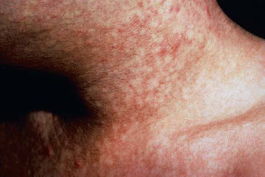
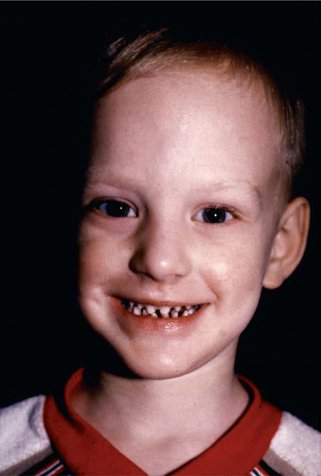

# Chapter 690: Ectodermal Dysplasias
> **Course:** Vikkypaedia Pediatric Basic Course (*Nelson Textbook of Pediatrics, 22nd Edition (2025)*)  
> **Part XXIX:** The Skin  
> **Authors:** Kari L. Martin  
> **Metrics:** 2,229 words · 4 tables/boxes · 2 figures · 28 genes · 8 flashcards · 5 MCQs  
> **Quick Navigation:** [🃏 Study 8 Flashcards](../flashcards/690_flashcards.md) · [📝 Take 5-Q MCQ Quiz](../mcqs/690_mcqs.md) · [📚 Part XXIX Guide](../parts/Part_XXIX.md) · [🧬 Syndrome & Genetics Atlas](../omim_gene_atlas.md) · [💊 Therapeutics Matrix](../therapies_matrix.md) · [🏠 Course Index](../../index.md)

## Key Genetic & Molecular Targets
`AR`, `CDH3`, `CYP26C1`, `DLX3`, `EDA`, `EDA1`, `EDAR`, `EDARADD`, `GJA1`, `GJB1`, `GJB2`, `GJB6`, `GRHL2`, `IKBKG`, `KDF1`, `KREMEN1`

## ⚡ High-Yield Nelson Pediatric Board Pearls
- FOCAL DERMAL HYPOPLASIA (GOLTZ-GORLIN SYNDROME) A rare congenital mesoectodermal and ectodermal disorder, focal dermal hypoplasia is characterized by dysplasia of connective tissue in the skin and skeleton.
- This disorder is an X-linked dominant dis order caused by pathogenic variants in the PORCN gene.
- Osteopathia striata are fine parallel vertical stripes noted on radiographs in the metaphyses of long bones of patients with this disorder; these are highly characteristic of focal dermal hypoplasia but are not pathognomonic.
- Many ocular abnormalities, the most common of which are colobomas, strabismus, nystagmus, and microphthalmia, are also characteristic.
- DKC may be X-linked recessive (DKC- 1 gene), autosomal dominant (hTERC and TINF2 genes), or autosomal recessive (NOLA3 gene).
- The scalp is characterized by convoluted elevated folds, 1-2 cm in thickness, usually in the fronto-occipital axis.
- Ectodermal dysplasia (ED) is a heterogeneous group of disorders characterized by a constellation of findings involving defects of two or more of the following: teeth, skin, and appendageal structures, includ ing hair, nails, and eccrine and sebaceous glands.

---
## Full Chapter Text, Tables & Figures
# Chapter 690: Ectodermal Dysplasias

*Kari L. Martin*

<!-- p.5164 -->
and/or absent eyelashes, upslanting palpebral fissures, flat nasal bridge, large lips, and redundant facial skin. FFDD2 is inherited in an auto somal dominant fashion, whereas FFDD3 is autosomal recessive and caused by pathogenic variants in *TWIST2;* autosomally dominant cases of FFDD3 have been reported and are caused by chromosome dupli cation/triplication of the 1p36.22p36.21 region. FFDD4 has no other related skin findings; it is inherited both in autosomal dominant and recessive manners and is caused by pathogenic variants in *CYP26C1*.

**FOCAL DERMAL HYPOPLASIA (GOLTZ-GORLIN SYNDROME)** A rare congenital mesoectodermal and ectodermal disorder, focal dermal hypoplasia is characterized by dysplasia of connective tissue in the skin and skeleton. This disorder is an X-linked dominant dis order caused by pathogenic variants in the *PORCN* gene. It manifests as numerous soft tan papillomas. Other cutaneous findings include linear atrophic lesions, reticulated hypopigmentation and hyperpig mentation, telangiectasias, congenital absence of skin, angiofibromas presenting as verrucous excrescences, and papillomas of the lips, tongue, circumoral region, vulva, anus, and the inguinal, axillary, and periumbilical areas. Partial alopecia, sweating disorders, and dystro phic nails are additional, less common ectodermal anomalies. The most frequent skeletal defects are syndactyly, clinodactyly, polydac tyly, and scoliosis. **Osteopathia striata** are fine parallel vertical stripes noted on radiographs in the metaphyses of long bones of patients with this disorder; these are highly characteristic of focal dermal hypoplasia but are not pathognomonic. Many ocular abnormalities, the most common of which are colobomas, strabismus, nystagmus, and microphthalmia, are also characteristic. Small stature, enamel hypoplasia, soft tissue anomalies, and peculiar dermatoglyphic pat terns are also common. Cognitive impairment occurs occasionally. There is no specific treatment.

**DYSKERATOSIS CONGENITA (ZINSSER-ENGMAN- COLE SYNDROME)** Dyskeratosis congenita (DKC), a rare familial syndrome, consists classi cally of the triad of reticulated hyperpigmentation of the skin (Fig. 689.4), dystrophic nails, and mucous membrane leukoplakia in association with immunologic and hematologic abnormalities. Patients with DKC also show signs of premature aging and increased occurrence of cancer, espe cially squamous cell carcinoma. DKC may be X-linked recessive (*DKC- 1* gene), autosomal dominant (*hTERC* and *TINF2* genes), or autosomal recessive (*NOLA3* gene). Onset occurs in childhood, most commonly as nail dystrophy**.** The nails become atrophic and ridged longitudinally with progression to pterygia and complete nail loss. Skin changes usu ally appear after onset of nail changes and consist of reticulated graybrown pigmentation, atrophy, and telangiectasia, especially on the neck, face, and chest. Hyperhidrosis and hyperkeratosis of the palms and soles, sparse scalp hair, and easy blistering of the hands and feet are also char acteristic. Blepharitis, ectropion, and excessive tearing because of atresia

**Fig. 689.4** Reticulated dyspigmentation on neck of patient with dys keratosis congenita.

of the lacrimal ducts are occasional manifestations. Oral leukokeratosis may give rise to squamous cell carcinoma. Other mucous membranes, including conjunctival, urethral, and genital, may be involved. Infection, malignancy, pulmonary fibrosis, and bone marrow failure are common, and death before age 40 years is typical. No effective treatment exists. Allogenic hemopoietic stem cell transplantation is curative treatment when bone marrow failure occurs.

**CUTIS VERTICIS GYRATA** Cutis verticis gyrata, an unusual alteration of the scalp that is more common in males, may be present from birth or may develop during adolescence. The scalp is characterized by convoluted elevated folds, 1-2 cm in thickness, usually in the fronto-occipital axis. Unlike the lax skin of other disorders, the convolutions cannot generally be flattened by traction. **Primary cutis gyrata** may be associated with intellectual disability, retinitis pigmentosa, sensorineural deafness, and thyroid aplasia. **Secondary cutis gyrata** may be the result of chronic inflam matory diseases, tumors, nevi, and acromegaly.

*Visit Elsevier eBooks+ at eBooks.Health.Elsevier.com** for Bibliography.*

Ectodermal dysplasia (ED) is a heterogeneous group of disorders characterized by a constellation of findings involving defects of two or more of the following: teeth, skin, and appendageal structures, includ ing hair, nails, and eccrine and sebaceous glands. Although more than 150 EDs have been described, the majority are rare, with an estimated incidence of 3.5 in 10,000 individuals.

Individuals presenting with a constellation of abnormalities involv ing the teeth, skin, and nails should raise suspicion for a diagnosis of ED. Table 690.1 provides a general list of abnormalities that may be seen in patients with EDs. Further specifying the specific type of ED can be challenging because there are a large number of subtypes and most are extremely rare (Table 690.2). Exome sequencing may enhance the identification of these rare subtypes.

*Kari L. Martin*

Dysplasia

#### **Table 690.1** Clinical Abnormalities in Ectodermal

| Category / Parameter | Clinical Details & Findings |
| --- | --- |
| **General** | Teeth; Small primary teeth, anodontia or hypodontia of; secondary teeth, conical or peg teeth, premature loss; of teeth, delayed eruption of teeth, defective enamel,; small widely spaced teeth, elongated pulp chamber; in teeth; Skin; Atopic dermatitis, xerosis, photosensitivity,; palmoplantar keratoderma, facial telangiectasias; Hair; Abnormal quantity, structure and quality: thin, brittle,; slow-growing, kinky or wooly, fragile, dry, and; lusterless hair. Often involves scalp, eyebrows and; eyelashes.; Nails; Brittle, dystrophic, absent, ridging, pitting; Sweat; Hypohidrosis, hyperhidrosis of palms and soles; Other; Recurrent sinus infection, nasal congestion, hoarse; voice, wheezing; Normal phenotype is also possible for any of these categories. |

<!-- p.5166 -->

#### **Table 690.2** Classification for Ectodermal Dysplasias*

| Category / Parameter | Clinical Details & Findings |
| --- | --- |
| **EDA/NF-κB PATHWAY** | Hypohidrotic ectodermal dysplasia |
| **EDA1** | Ectodysplasin (EDA); Membrane ligand; Hypohidrotic ectodermal dysplasia |
| **EDAR** | EDA receptor (EDAR); Receptor of EDA |
| **EDARADD** | EDAR-associated death; domain; Adaptor molecule; Hypohidrotic ectodermal dysplasia |
| **EDAR** | Receptor of EDA |
| **EDARADD** | EDAR-associated death; domain; Adaptor molecule |
| **TRAF6** | TNF receptor–associated; factor 6; Activates IKK; Hypohidrotic ectodermal dysplasia; with immune deficiency (males); ± osteopetrosis (males) ±; lymphedema |
| **NEMO/IKBKG** | NF-kB essential modulator; NF-kB activation; Incontinentia pigmenti (females) |
| **XLD** | NEMO/IKKγ; NF-κB essential modulator; NF-κB activation; Hypohidrotic ectodermal dysplasia; with immune deficiency |
| **AR** | IkBα; IkBα; NF-kB activation |
| **P63 PATHWAY** | Ectrodactyly-ectodermal dysplasia-; clefting syndrome |
| **AD** | p63; p63; Transcription factor; Rapp-Hodgkin syndrome |
| **AD** | p63; p63; Transcription factor; Ankyloblepharon-ectodermal; dysplasia-clefting syndrome (AEC) |
| **AD** | p63; p63; Transcription factor; Acrodermatoungual-lacrimal-tooth |
| **AD** | p63; p63; Transcription factor; Limb-mammary syndrome |
| **AD** | p63; p63; Transcription factor; Curly hair, ankyloblepharon,; and nail dystrophy (CHAND); syndrome |
| **RIPK4** | Serine/threonine; protein kinase; Popliteal pterygium syndromes; (spectrum); Popliteal pterygium; Bartsocas-Papas; (Cocoon syndrome) |
| **CHUK** | Transcription factor; Kinase; Kinase; Ectodermal dysplasia |
| **KDF1** | Keratinocyte; differentiation factor; Trichodentoosseous syndrome (TDO) |
| **DLX3** | Transcription factor; Clefting-ectodermal dysplasia |
| **PVRL1** | Nectin 1; Interacts with cadherins,; especially at adherens; junctions; Ectodermal dysplasia-syndactyly; syndrome |
| **PVRL4** | Nectin 4; Interacts with cadherins,; especially at adherens; junctions; Hypotrichosis with juvenile macular; dystrophy ± ectrodactyly/other; ectodermal defects |
| **CDH3** | Cadherin 3/P-cadherin; Adhesion molecule for; cell-cell binding |
| **WNT PATHWAY** | Witkop syndrome |
| **MSX1** | Transcription factor; Focal dermal hypoplasia; X-linked dominant |
| **PORCN** | Regulates Wnt signaling; Oculodentodigital dysplasia (ODDD) |
| **WNT10A** | Wnt10A; Wnt pathway; Hypohidrotic ectodermal dysplasia |
| **WNT10A** | Wnt10A; β-catenin-mediated; signaling; Schöpf-Schulz-Passarge syndrome |
| **WNT10A** | Wnt10A; β-catenin-mediated; signaling |

<!-- p.5167 -->
**HYPOHIDROTIC ECTODERMAL DYSPLASIA** The syndrome known as hypohidrotic ectodermal dysplasia (HED) manifests as a triad of defects: partial or complete absence of sweat glands, anomalous dentition, and hypotrichosis. There are many rec ognized types of HED; HED-1 (X-linked recessive) is most common, with a frequency of 1 per 17,000 live births.

In HED, affected patients are unable to sweat and may experi ence episodes of high fever in warm environments, which may be mistakenly considered to be **fevers of unknown origin**. This error is particularly common in infancy when the facial changes are not easily appreciated. Diagnosis at this time may be made using the starch-iodine test or palmar or scalp biopsy. Scalp biopsy is the most sensitive and is 100% specific. It shows a complete lack of eccrine structures. Infants and older children must be protected from high temperatures given their inability to sweat. Cooling devices and clothing can be helpful to increase participation in activities and sports. Aside from patients with *WNT10A* pathogenic variants— who do not have facial dysmorphism—the typical facies are char acterized by frontal bossing; malar hypoplasia; a flattened nasal bridge; recessed columella; thick, everted lips; wrinkled, hyperpig mented periorbital skin; and prominent, low-set ears (Fig. 690.1). The skin over the entire body is dry, finely wrinkled, and hypopig mented, often with a prominent venous pattern. Extensive peeling of the skin is a clinical clue to diagnosis in the newborn period. The paucity of sebaceous glands may account for the dry skin. The scalp hair is sparse, fine, and lightly pigmented, and eyebrows and lashes are sparse or absent. Other body hair is also sparse or absent. Sexual hair growth is normal. Anodontia or hypodontia with widely spaced, conical teeth is a consistent feature (see Fig. 690.1). *Co-management with pediatric dentistry familiar with ectodermal dysplasias is critical for oral health, nutrition, and maintenance of the facial bones.* Oto laryngic and ophthalmologic abnormalities secondary to decreased saliva and tear production are seen. The incidence of atopic diseases in children with HED is high. Gastroesophageal reflux is common and may play a role in failure to thrive, which is seen in 20% of

cases. Sexual development is usually normal. Historically, the infant mortality rate has been 30%. Carrier females of X-linked HED may have no or less severe clinical manifestations.

Prenatal therapy of X-linked HED with a recombinant protein containing the EDA receptor binding domain has been successful in three patients.

**Hypohidrotic ED with immune deficiencies** causes similar find ings in sweating and hair and nail development, in association with a dysgammaglobulinemia. Significant mortality is seen from recur rent infections. A variety of pathogenic variants of the genes encod ing the tumor necrosis factor α (TNFα)–related signaling pathway proteins—key in signal transduction from ectoderm to mesoderm during development—are the molecular basis for this disorder (see Table 690.2).

Treatment of children with HED includes protecting them from exposure to high ambient temperatures. Early dental evaluation is nec essary so that prostheses can be provided for cosmetic reasons and for adequate nutrition. The use of artificial tears prevents damage to the cornea in patients with defective lacrimation. Alopecia may necessitate the wearing of a wig to improve appearance.

**HIDROTIC ECTODERMAL DYSPLASIA (CLOUSTON SYNDROME)** The salient features of the autosomal dominant disorder hidrotic ED are dystrophic, hypoplastic, or absent nails; sparse hair; and hyperkeratosis of the palms and soles (Table 690.3). Conjunctivitis and blepharitis are common. The dentition and sweating are always normal. Absence of eyebrows and eyelashes, clubbing of the fingers, and hyperpigmenta tion over the knees, elbows, and knuckles have been noted in some affected individuals. Pathogenic variants in the *GJB6* gene encoding the gap junction protein connexin 30 are responsible for this disorder. A similar disorder associated with deafness has been described with pathogenic variants in the *GJB2* gene encoding the connexin 26 pro tein. Pathogenic variants in *GJB1* have also been implicated.

#### **Table 690.2** Classification for Ectodermal Dysplasias*—cont’d

| Category / Parameter | Clinical Details & Findings |
| --- | --- |
| **FUNCTION** | Ectodermal dysplasia |
| **KREMEN1** | Receptor involved in; Wnt regulation |
| **STRUCTURAL ELEMENT** | Clouston syndrome |
| **GJB6** | Connexin 30; Intercellular junctions; Ectodermal dysplasia |
| **GRHL2** | Grainyhead-like 2; Transcription factor; Oculodentodigital dysplasia (ODDD) |
| **GJA1** | Connexin 43; Intercellular junctions; Ellis van Creveld syndrome |
| **EVC, EVC2** | Ciliopathy; Ectodermal dysplasia 4, hair/nail type |
| **KRT85** | Keratin; Keratitis-ichthyosis-deafness; syndrome, autosomal dominant |
| **GJB2** | Connexin 26; Intercellular junctions; Ectodermal dysplasia: skin fragility; syndrome |
| **PKP1** | Plakophilin 1; Desmosomal plaque/; stability; Naegeli- Franceschetti-Jadassohn; syndrome |
| **KRT14** | Keratin; Pachyonychia congenita |
| **AD** | KRT 6a, 6b, 6c, 16, 17; KRT 6a, 6b, 6c, 16, 17; Keratin; *Many forms of ectodermal dysplasia remain unclassified.; †Some more recently described forms of ectodermal dysplasia are not yet named.; AD, Autosomal dominant; AR, autosomal recessive; IKK, inhibitor of kappa light polypeptide gene enhancer in B-cell kinase; TNF, tumor necrosis factor; XLD, X-linked dominant;; XLR, X-linked recessive.; From Paller AS, Mancini AJ. Hurwitz Clinical Pediatric Dermatology, 6th ed. Philadelphia: Elsevier; 2022: Table 7.1, p. 165. |

<!-- p.5168 -->

**Fig. 690.1** Hypohidrotic ectodermal dysplasia is characterized by pointed ears, fine hair, periorbital hyperpigmentation, midfacial hypoplasia, and pegged teeth. (Courtesy the Fitzsimons Army Medical Center teaching file.)

*Continued*

#### **Table 690.3** Common Ectodermal Dysplasias: Inheritance and Characteristic Clinical Findings

| Category / Parameter | Clinical Details & Findings |
| --- | --- |
| **CHARACTERISTIC CLINICAL FINDINGS** | Hypohidrotic ED |
| **XLR, AD, AR** | Distinctive facies: prominent forehead, thick lips and flattened nasal bridge; collodion-like; membrane; eczema; Hypotrichosis of scalp and trunk, light/brittle/slow-growing hair; Hypodontia, conical teeth; Hypohidrosis; Hypohidrotic ED-; immune deficiency |
| **XLR, AD** | Seborrheic dermatitis–like rash, intertrigo; Hypotrichosis; Hypodontia, pointed teeth; Hypohidrosis/anhidrosis; Recurrent infections; Decreased immunoglobulin levels; Hidrotic ED (Clouston) |
| **AD** | Hyperpigmented skin over joints; palmoplantar keratoderma, conjunctivitis, blepharitis; Milky-white nails in early childhood, nail dystrophy, clubbing; Sparse, wiry, brittle, pale scalp hair to total alopecia; Normal sweating; Witkop tooth and nail; syndrome |
| **AD** | Usually normal hair, rarely sparse or fine; Normal sweating; Small primary teeth, hypodontia causing lower lip eversion (“pouting lower lip”); Thin, slow growing hypoplastic nails (toes > fingers), koilonychia |
| **AD** | Dry skin, aplasia or hypoplasia of skin; Normal sweating; Coarse, lightly pigmented hair; thick eyebrows; Hypodontia (reduced number), taurodontia, premature loss of teeth, dental enamel; abnormalities; Ectrodactyly more common than syndactyly; Nail dystrophy, transverse ridging and pitting; Corneal erosion, lacrimal duct abnormality, blepharitis, GU defects, cleft lip or palate |

<!-- p.5170 -->
