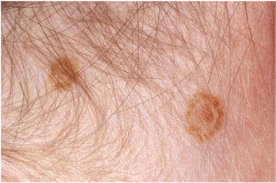
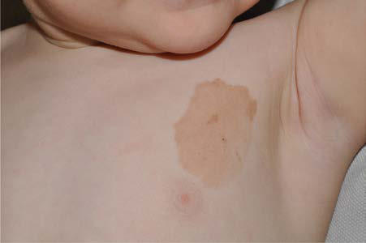

# Chapter 692: Cutaneous Nevi
> **Course:** Vikkypaedia Pediatric Basic Course (*Nelson Textbook of Pediatrics, 22nd Edition (2025)*)  
> **Part XXIX:** The Skin  
> **Authors:** Kari L. Martin  
> **Metrics:** 5,395 words · 2 tables/boxes · 2 figures · 10 genes · 8 flashcards · 5 MCQs  
> **Quick Navigation:** [🃏 Study 8 Flashcards](../flashcards/692_flashcards.md) · [📝 Take 5-Q MCQ Quiz](../mcqs/692_mcqs.md) · [📚 Part XXIX Guide](../parts/Part_XXIX.md) · [🧬 Syndrome & Genetics Atlas](../omim_gene_atlas.md) · [💊 Therapeutics Matrix](../therapies_matrix.md) · [🏠 Course Index](../../index.md)

## Key Genetic & Molecular Targets
`AKT1`, `BRAF`, `FGFR2`, `GJB2`, `HRAS`, `KRAS`, `KRT2`, `NRAS`, `PIK3CA`, `PTEN`

## ⚡ High-Yield Nelson Pediatric Board Pearls
- Prognosis and Treatment Acquired pigmented nevi are benign, but a very small percentage undergo malignant transformation.
- ATYPICAL MELANOCYTIC NEVUS Atypical melanocytic nevi occur both in an autosomal dominant famil ial melanoma-prone setting (familial mole–melanoma syndrome, dys plastic nevus syndrome, BK mole syndrome) and as a sporadic event.
- The term atypical mole syndrome describes lesions in those individuals without an autosomal dominant familial history of melanoma but with more than 50 nevi, some of which are atypical.
- These nevi are most common on the posterior trunk, suggest ing that intermittent, intense sun exposure has a role in their genesis.
- The median age at diagnosis of the melanomas that arise within a giant congenital nevus is 7 years.
- MELANOMA Malignant melanoma is the most common skin cancer in children, and approximately 1% of all melanomas occur before 20 years of age.
- There is variability in prognosis depending on the age of diagnosis in pediatric patients.

---
## Full Chapter Text, Tables & Figures
# Chapter 692: Cutaneous Nevi

*Kari L. Martin*

<!-- p.5182 -->
Nevus skin lesions are characterized histopathologically by collections of well-differentiated cell types normally found in the skin. Vascular nevi are described in Chapter 691. Melanocytic nevi are subdivided into two broad categories: those that appear after birth (acquired nevi) and those that are present at birth (congenital nevi).

**ACQUIRED MELANOCYTIC NEVUS** Melanocytic nevi are benign clusters of melanocytic nevus cells that arise as a result of alteration and proliferation of melanocytes at the epidermal-dermal junction.

**Epidemiology** The number of *acquired* melanocytic nevi increases gradually during childhood and more slowly in early adulthood. The number reaches a plateau in the third or fourth decade and then slowly decreases there after. The mean number of melanocytic nevi in an adult varies depend ing on genetics, skin color, and sun exposure. The greater the number of nevi present, the greater the risk for development of melanoma, though the majority of melanomas arise de novo. Sun exposure during childhood, particularly intermittent, intense exposure of an individual with light skin, and a propensity to burn and freckle rather than tan are important determinants of the number of melanocytic nevi that develop. Red-haired children, despite their light skin and propensity to freckle and sunburn, have fewer nevi than other children. Increased numbers of nevi are also associated with immunosuppression and administration of chemotherapy.

**Clinical Manifestations** Melanocytic nevi have a well-defined life history and are classified as junctional, compound, or dermal in accordance with the location of the nevus cells in the skin. In childhood, >90% of nevi are junctional; melanocyte proliferation occurs at the junction of the epidermis and dermis to form nests of cells. Junctional nevi appear anywhere on the body in various shades of brown; they are relatively small, discrete, flat, and variable in shape. Although some nevi, particularly those on the palms, soles, and genitalia, remain junctional throughout life, most become compound as melanocytes migrate into the papillary dermis to form nests at both the epidermal-dermal junction and within the dermis. If the junctional melanocytes stop proliferating, nests of mela nocytes remain only within the dermis, forming an intradermal nevus. With maturation, compound and intradermal nevi may become raised, dome-shaped, verrucous, or pedunculated. Slightly elevated lesions are usually compound. Distinctly elevated lesions are usually intradermal. With age, the dermal melanocytic nests regress and nevi gradually disappear.

**Prognosis and Treatment** Acquired pigmented nevi are benign, but a very small percentage undergo malignant transformation. Suspicious changes are indica tions for excision and histopathologic evaluation. This includes rapid increase in size; unusual colors such as red, black, varying shades of brown, gray, and white; bleeding; textures such as scaling, erosion, ulceration, and induration; and regional lymphadenopathy. Most of these changes are from irritation, infection, or maturation; darkening and gradual increase in size and elevation normally occur during ado lescence and should not be cause for concern. Two common benign changes are clonal nevi (fried-egg moles) and eclipse nevi. A **clonal nevus** is light brown with a dark, raised center representing a clonal change of a subset of nevus cells within the lesion. **Eclipse nevi** are flat and light brown with dark brown rims. They are seen primarily in the

scalp (Fig. 692.1). Consideration should be given to the presence of risk factors for development of melanoma and the patient’s parents’ wishes about removal of the nevus. If doubt remains about the benign nature of a nevus, excision is a safe and simple outpatient procedure that may be justified to allay anxiety.

**ATYPICAL MELANOCYTIC NEVUS** Atypical melanocytic nevi occur both in an autosomal dominant famil ial melanoma-prone setting (familial mole–melanoma syndrome, dys plastic nevus syndrome, BK mole syndrome) and as a sporadic event. Only 2% of all pediatric melanomas occur in individuals with a familial syndrome; melanoma develops before age 20 years in 10% of individu als with the syndrome. Malignant melanoma has been reported in chil dren with dysplastic nevus syndrome as young as 10 years old. Risk for development of melanoma is essentially 100% in individuals with dysplastic nevus syndrome who have two family members who have had melanomas. The term *atypical mole syndrome* describes lesions in those individuals without an autosomal dominant familial history of melanoma but with more than 50 nevi, some of which are atypical. The lifetime risk of melanoma associated with dysplastic nevi in this context is estimated to be 5–10%.

Atypical nevi tend to be large (5-15 mm) and round to oval. They have irregular margins and variegated color, and portions of them are elevated. These nevi are most common on the posterior trunk, suggest ing that intermittent, intense sun exposure has a role in their genesis. They may also occur in sun-protected areas such as the breasts, but tocks, and scalp. Atypical nevi do not usually develop until puberty, although scalp lesions may be present earlier. Atypical nevi demon strate disordered proliferation of atypical intraepidermal melanocytes, lymphocytic infiltration, fibroplasia, and angiogenesis. It may be help ful to obtain histopathologic documentation of dysplastic change by biopsy to identify these individuals. It is prudent to excise borderline atypical nevi in immunocompromised children or in those treated with irradiation or chemotherapeutic agents. Although chemotherapy is associated with the development of a greater number of melanocytic nevi, it has not been directly linked to increased risk for development of melanoma. The threshold for removal of clinically atypical nevi is also lower at sites that are difficult to observe, such as the scalp. Chil dren with atypical nevi should undergo a complete skin examination every 6-12 months. In these children, photographic mole mapping serves as a useful adjunct in following nevus change. Parents must be counseled about the importance of sun protection and avoidance and should be instructed to look for early signs of melanoma on a regular basis, approximately every 3-4 months.

**CONGENITAL MELANOCYTIC NEVUS** Congenital melanocytic nevi are present in 2–3% of newborn infants. These nevi have been categorized by size: giant congenital nevi are >40 cm in diameter (adult size) or >5% of the body surface; large nevi are 20-40 cm, medium nevi are 1.5-20 cm, and small nevi are <1.5 cm in diameter (Fig. 692.2). Congenital nevi are characterized by the

*Kari L. Martin*

**Fig. 692.1** Eclipse nevi (rim moles) in the scalp.

<!-- p.5183 -->
presence of nevus cells in the lower reticular dermis; between collagen bundles; surrounding cutaneous appendages, nerves, and vessels in the lower dermis; and occasionally extending to the subcuticular fat. Large and giant congenital nevi often harbor *NRAS* pathogenic variants, and *BRAF* pathogenic variants typically seen in regular melanocytic nevi are most common in small or medium congenital nevi. Identification is often uncertain, however, because they may have the histologic features of ordinary junctional, compound, or intradermal nevi. Some nevi that were not present at birth display histopathologic features of congenital nevi; these should not be considered congenital, but may be called con genital nevus–like nevi (CNLN). Furthermore, congenital nevi may be difficult to distinguish clinically from other types of pigmented lesions, adding to the difficulty that parents may have in identifying nevi that were present at birth. The clinical differential diagnosis includes dermal melanocytosis, café-au-lait macules, and smooth muscle hamartomas.

Sites of predilection for small congenital nevi are the lower trunk, upper back, shoulders, chest, and proximal limbs. The lesions may be flat, elevated, verrucous, or nodular and may be various shades of brown, blue, or black. Given the difficulty in identifying small con genital nevi with certainty, data regarding their malignant potential are controversial and likely overstated. The true incidence of mela noma in congenital nevi, especially small and medium-sized lesions, is unknown. Removal of all small congenital nevi is not warranted because the development of melanoma in a small congenital nevus is an exceedingly rare event before puberty. A number of factors must be weighed in the decision about whether or not to remove a nevus, including its location, the ability to monitor it clinically, the potential for scarring, the presence of other risk factors for melanoma, and the presence of atypical clinical features.

**Giant congenital pigmented nevi** (<1 in 20,000 births) occur most commonly on the posterior trunk (Fig. 692.3) but may also appear on the head or extremities. These nevi are of special significance because

of their association with leptomeningeal melanocytosis (neurocutane ous melanocytosis) and their predisposition for development of malig nant melanoma.

**Leptomeningeal** involvement occurs most often when the nevus is located on the head or midline on the trunk, particularly when associ ated with multiple “satellite” melanocytic nevi (>20 lesions). Nevus cells within the leptomeninges and brain parenchyma may cause increased intracranial pressure, hydrocephalus, seizures, intellectual disability, and motor deficits and may result in melanoma. Malignancy can be identified by careful cytologic examination of the cerebrospinal fluid for melanin-containing cells. MRI demonstrates asymptomatic lepto meningeal melanosis in 30% of individuals with giant congenital nevus of the type described earlier. The overall incidence of malignant mela noma arising in a giant congenital nevus is 1–2%. The median age at diagnosis of the melanomas that arise within a giant congenital nevus is 7 years. The mortality rate approaches 100%. The risk of melanoma is greater in patients in whom the predicted adult size of the nevus is >40 cm, lesions are on the trunk, and satellite lesions are present. Manage ment of giant congenital nevi remains controversial and should involve the parents, pediatrician, dermatologist, and plastic surgeon. If the nevus lies over the head or spine, MRI may allow detection of neural melanosis**,** the presence of which makes gross removal of a nevus from the skin a futile effort. In the absence of neural melanosis, early exci sion and repair aided by tissue expanders or grafting may reduce the burden of nevus cells and thus the potential for development of mela noma, but at the cost of many potentially disfiguring operations. Nevus cells deep within subcutaneous tissues may evade excision. Random biopsies of the nevus are not helpful, but biopsy of newly expanding nodules is indicated. Follow-up every 6 months for 5 years and every 12 months thereafter is recommended. Serial photographs of the nevus may aid in detecting changes.

**MELANOMA** Malignant melanoma is the most common skin cancer in children, and approximately 1% of all melanomas occur before 20 years of age. An estimated 400 cases of pediatric melanoma are diagnosed each year. The incidence of melanoma in the pediatric population increases with age, from 1-2 cases per 1 million in children under age 10 to 16.9 cases in children age 15-19 years. The incidence of pediatric melanoma has increased by an average of 2% per year between 1973 and 2009. This increase was especially notable in females between the ages of 15 and 19. In this age-group, melanoma accounts for 6% of all childhood can cers. Melanoma develops primarily in White individuals, on the head and trunk in males, and on the extremities in females. In preadoles cent patients, melanoma is more likely to present on the head and neck than in other locations. Risk factors for the development of melanoma include the presence of familial atypical mole–melanoma syndrome or xeroderma pigmentosum; an increased number of acquired mela nocytic nevi, or atypical nevi; fair complexion; excessive sun expo sure, especially intermittent exposure to intense sunlight; a personal or family (first-degree relative) history of a previous melanoma; giant

A

B

**Fig. 692.2** Congenital melanocytic nevus. Changing appearance with time of a congenital melanocytic nevus of small-to-medium size on the trunk when the patient was 9 months old (A) and 10 years old (B). (From Anderson-Vildosola J, Hernandez-Martin A. Addressing fre quently asked questions and dispelling myths about melanocytic nevi in children. Dermatol Clin. 2022;40:51–59, Fig. 5)

**Fig. 692.3** “Bathing suit” large congenital melanocytic nevus.

<!-- p.5184 -->
congenital nevus; and immunosuppression (Table 692.1). In previ ously well children, UV radiation is responsible for most melanomas. Less than 5% of childhood melanomas develop within giant congeni tal nevi or in individuals with familial atypical mole–melanoma syn drome. Approximately 40–50% of the time, melanoma develops at a site where there was no apparent nevus. The mortality rate from mela noma is related primarily to tumor thickness and the level of invasion into the skin. About 75% of pediatric cases are localized and have an excellent outcome. Ninety percent of pediatric patients diagnosed with melanoma are expected to be alive in 5 years. In patients with nodal disease, the outcomes are intermediate, with about 60% expected to survive long-term.

There is variability in prognosis depending on the age of diagnosis in pediatric patients. Children younger than 10 with melanoma often have poor prognostic features. They are more often non-White, have head and neck primary tumors, thicker primary lesions, a higher inci dence of spitzoid morphology, vascular invasion and nodal metastases, and more often have syndromes that predispose them to melanoma. The treatment of melanomas, as in adult patients, is surgical excision with 1-cm margins for tumors <1 mm deep, 1- to 2-cm margins for tumors >1 mm and <2 mm deep, and 2-cm margins for tumors >2 mm deep. Sentinel lymph node biopsy has become a widespread practice in pediatric melanoma. It should be considered in lesions >1 mm and in thin lesions with ulceration, mitotic rate greater than 1 mm2, and young age. Though pediatric patients are more likely to have nodal metastases than their adolescent counterparts, this has not been associated with a decrease in overall survival. Alternatively, in adolescents, nodal disease is a significant negative prognostic factor. Increased tumor thickness and ulceration are associated with lymph node positivity. If the sentinel node is positive, a lymph node dissection can be considered. Patients with regional lymph node involvement can be offered treatment with interferon alfa-2b or ipilimumab (FDA approved for 12 years of age and older). *BRAF* and *MEK* inhibitors are not currently available for pediatric patients; however, phase 1 and 2 clinical trials are currently ongoing for adolescent patients.

Given the lack of effective therapy for melanoma, prevention and early detection are the most effective measures. Emphasis should be given to avoidance of intense midday sun exposure between 10 am and 3 pm; wearing of protective clothing such as a hat, long sleeves, and pants; and use of sunscreen. Adolescents should be counseled not to use tanning booths. Early detection includes frequent clinical and photographic examinations of patients at risk (dysplastic nevus syn drome) and prompt response to rapid changes in nevi (size, shape,

color, inflammation, bleeding or crusting, and sensation). The ABCDE rule (asymmetry, border irregularities, color variability, diameter >6 mm, evolving), which is a useful screening tool for adults, may not be as effective for children. Unlike adult melanomas, which are usually pigmented, pediatric melanomas are often amelanotic and can mimic benign lesions such as warts and pyogenic granulomas. They are also more likely to have regular borders and to be less than 6 mm in diame ter. They often present as papules or papulonodules. To highlight these differences from adult melanomas, an **ABCDE rule for pediatric mel anoma** has been proposed: **A**melanotic, **B**leeding, **B**umps, uniform **C**olor, small **D**iameter, **D**e novo, and in **E**volution.

**HALO NEVUS** Halo nevi occur primarily in children and young adults, most com monly on the back (Fig. 692.4). Development of the lesion may coin cide with puberty or pregnancy. Several pigmented nevi frequently develop halos simultaneously. Subsequent disappearance of the central nevus over several months is the usual outcome, and the depigmented area usually repigments. Excision and histopathologic examination of the lesion is indicated only when the nature of the central lesion is in question. An acquired melanocytic nevus occasionally develops a peripheral zone of depigmentation over a period of days to weeks. There is a dense inflammatory infiltrate of lymphocytes and histiocytes in addition to the nevus cells. The pale halo reflects disappearance of the melanocytes. This phenomenon is associated with congenital nevi, blue nevi, Spitz nevi, dysplastic nevi, neurofibromas, primary and sec ondary malignant melanoma, and occasionally with poliosis, **Vogt- Koyanagi-Harada** syndrome, and pernicious anemia. Patients with vitiligo have an increased incidence of halo nevi. Individuals with halo nevi have circulating antibodies against the cytoplasm of melanocytes and nevus cells.

**SPITZ NEVUS (SPINDLE AND EPITHELIOID CELL NEVUS)** Spitz nevus manifests most commonly in the first 2 decades of life as a pink to red, smooth, dome-shaped, firm, hairless papule on the face, shoulder, or upper limb (Fig. 692.5). Most are <1 cm in diameter, but they can achieve a size of 3 cm. Rarely, they occur as numerous grouped lesions. Visually similar lesions include pyogenic granuloma, hemangioma, nevocellular nevus, juvenile xanthogranuloma, and basal cell carcinoma, but these entities are histologically distinguish able. Classic-appearing Spitz nevi can be monitored with regular clini cal and dermoscopic examination, and multiple dermoscopy studies

#### **Table 692.1** Summary of Clinical and Histologic Features by Subtypes of Pediatric Melanoma

| Category / Parameter | Clinical Details & Findings |
| --- | --- |
| **CONVENTIONAL MELANOMA** | Clinical; Papule or nodule; frequently; amelanotic, but can be any color; (e.g., pink-red to blue-black);; distribution is not limited to sun-; exposed skin; New, rapidly growing nodule arising; in the deep dermis or subcutaneous; tissues of a CMN; commonly solitary; and ulcerated; by comparison,; proliferative nodules commonly occur; in multiples and are not ulcerated; Children: typically papules or nodules of any; color, but often amelanotic; most do not; follow ABCD criteria; nodular subtype most; common; Adolescents: similar to presentation in adults; with lesions having ABCD criteria; Histologic; Primary differential diagnosis is Spitz; nevus vs atypical Spitz tumor; most; cells have abundant eosinophilic; cytoplasm and characteristic spitzoid; cytomorphology; nuclear atypia is; typically high grade; growth in the; form of expansile nodules or sheets;; ulceration, epidermal consumption,; brisk deep mitotic activity, and poor; maturation are often seen; epidermal; hyperplasia might be seen on the; surface, but Kamino bodies are; relatively uncommon; The primary differential diagnosis is; benign proliferative nodules arising in; congenital nevi; compared with benign; proliferative nodules, melanomas; typically have epithelioid or small,; blue cell, tumor-like morphology, with; sheets of melanocytes with high-; grade nuclear atypia; mitotic activity; is high (often >3/mm2); zones of; necrosis or ulceration can be helpful in; establishing a diagnosis; Nodular melanoma: similar to adult nodular; melanoma; no horizontal growth phase; present; superficial spreading melanoma:; similar to superficial spreading melanoma; in adults with a preceding horizontal growth; phase, pagetosis, lentiginous growth,; and junctional confluence with frequent; alteration of the epidermal contour;; precursor nevus is common; CMN, Congenital melanocytic nevi; ABCD, asymmetry, border irregularity, color variegation, diameter >6 mm.; From Merkel EA, Mohan LS, Shi K, et al. Paediatric melanoma: clinical update, genetic basis, and advances in diagnosis. Lancet Child Adoles. 2019;3:646–654, Table 1). |

<!-- p.5185 -->
have demonstrated a tendency for these benign lesions to develop a reticular or homogeneous pattern and/or regress over time. Guidelines recommend excision be reserved for suspicious lesions (>8-10 mm, with excessive growth, asymmetry, or ulceration) in children over 12 years of age and for suspicious lesions in all ages when melanoma can not be excluded. If a nevus arouses clinical suspicion that it may be a melanoma, an excisional biopsy of the entire lesion is recommended. If the margins of excision of a Spitz nevus are positive but the biopsy sam ple suggested a typical Spitz nevus, reexcision of the site is no longer routinely recommended. Because Spitz nevi may be difficult to distin guish histopathologically from malignant melanoma, immunohisto chemistry and genomic alteration studies can be useful adjunct tools. Atypical Spitz tumors are Spitz nevi with atypical histologic features or unknown malignant potential. Management for these tumors is not clearly defined and may range from clinical monitoring to yearly nodal ultrasonography to potentially sentinel lymph node biopsy and lymph adenectomy. Improving genetic profiling of these tumors may provide better prognostic information soon. Prognostic implication of positive sentinel lymph node biopsy has not been established, and given the potential morbidity of the procedure, it is often avoided.

**ZOSTERIFORM LENTIGINOUS NEVUS (AGMINATED LENTIGINES)** Zosteriform lentiginous nevus is a unilateral, linear, bandlike collec tion of numerous 2- to 10-mm brown or black macules on the face, trunk, or limbs. The nevus may be present at birth or may develop dur ing childhood. There are higher numbers of melanocytes in elongated rete ridges of the epidermis.

**NEVUS SPILUS (SPECKLED LENTIGINOUS NEVUS)** Nevus spilus is a flat brown patch within which are darker flat or raised brown melanocytic elements with a prevalence of 2–3% (Fig. 692.6). It varies considerably in size and can occur anywhere on the body. The color of the macular component may vary from light to dark brown,

and the number of darker lesions may be low or high. Nevus spilus is rare at birth and is commonly acquired in late infancy or early child hood. Dark elements within the nevus are usually present initially and tend to increase in number gradually over time. The darker macules represent nevus cells in a junctional or dermal location; the patch has increased numbers of melanocytes in a lentiginous epidermal pat tern. The malignant potential of these nevi is uncertain; nevus spilus is found more commonly in individuals with melanoma than in matched control subjects. Like congenital melanocytic nevi, the risk of mela noma developing within a nevus spilus is thought to be proportionate to the size of the lesion as a whole. The nevi need not be excised unless atypical features or recent clinical changes are noted.

**NEVUS OF OTA AND NEVUS OF ITO Nevus of Ota** is more common among females and Asian and Black patients. This nevus consists of a permanent patch composed of partially confluent blue, black, and brown macules. Enlargement and darkening may occur with time. Occasionally, some areas of the nevus are raised. The macular nevi resemble the more common dermal melanocytosis of the lower back and buttocks in color and occur unilaterally in the areas supplied by the first and second divisions of the trigeminal nerve. Nevus of Ota differs from a more common dermal melanocytosis patch not only by its distribution but also by having a speckled rather than a uniform appearance. Both are forms of mid-dermal melanocytosis. Nevus of Ota also has a greater concentration of elongated, dendritic dermal melanocytes located in the upper rather than the lower portion of the dermis. This nevus is sometimes present at birth; in other cases, it may arise during the first or second decade of life. Patchy involve ment of the conjunctiva, hard palate, pharynx, nasal mucosa, buccal mucosa, or tympanic membrane occurs in some patients. Malignant change is exceedingly rare. Laser therapy may effectively decrease the pigmentation but can be unpredictable.

**Nevus of Ito** is localized to the supraclavicular, scapular, and deltoid regions. This nevus tends to be more diffuse in its distribution and less mottled than nevus of Ota. It is also a form of mid-dermal melanocytosis. The only available treatments are masking with cosmetics and laser therapy.

**BLUE NEVI** The common blue nevus is a solitary, asymptomatic, smooth, domeshaped, blue to blue-gray papule <10 mm in diameter on the dorsal aspect of the hands and feet. Rarely, common blue nevi form large plaques. Blue nevus is nearly always acquired, often during childhood and more commonly in females. Microscopically, it is characterized by groups of intensely pigmented, spindle-shaped melanocytes in the der mis. This nevus is benign.

The cellular blue nevus is typically 1-3 cm in diameter and occurs most frequently on the buttocks and in the sacrococcygeal area. In addition to collections of deeply pigmented dermal dendritic melano cytes, cellular islands composed of large spindle-shaped cells are noted in the dermis and may extend into the subcutaneous fat. A histologic continuum may be seen from blue nevi to cellular blue nevi. A com bined nevus is the association of a blue nevus with an overlying mela nocytic nevus.

**Fig. 692.4** Well-developed halo nevus.

**Fig. 692.5** Dome-shaped red Spitz nevus.

**Fig. 692.6** Nevus spilus.

<!-- p.5186 -->
The blue-gray color that is characteristic of these nevi is an opti cal effect caused by dermal melanin. Longer wavelengths of visible light penetrate to the deep dermis and are absorbed there by melanin; shorter-wavelength blue light cannot penetrate deeply but instead is reflected back to the observer.

**NEVUS DEPIGMENTOSUS (ACHROMIC NEVUS)** Nevi depigmentosi are usually present at birth; they are localized mac ular hypopigmented patches or streaks, often with irregular borders (Fig. 692.7). They can resemble hypomelanosis of Ito clinically, except that they are more localized and often unilateral. Small lesions may also resemble the ash leaf macules of tuberous sclerosis. Nevi depig mentosi appear to represent a focal defect in transfer of melanosomes to keratinocytes.

**EPIDERMAL NEVI** Epidermal nevi may be visible at birth or may develop in the first few months or years of life. They affect both sexes equally and usually occur sporadically. Epidermal nevi are hamartomatous lesions characterized by hyperplasia of the epidermis and/or adnexal structures in a focal area of the skin.

Epidermal nevi are classified into a number of variants, depending on the morphology and extent of the individual nevus and the pre dominant epidermal structure (Table 692.2). An epidermal nevus may appear initially as a discolored, slightly scaly patch that, with matura tion, becomes more linear, thickened, verrucous, and hyperpigmented. *Systematized* refers to a diffuse or extensive distribution of lesions, and *ichthyosis hystrix* indicates that the distribution is extensive and bilat eral (Fig. 692.8). Morphologic types include pigmented papillomas, often in a linear distribution; unilateral hyperkeratotic streaks involv ing a limb and perhaps a portion of the trunk; velvety hyperpigmented plaques; and whorled or marbled hyperkeratotic lesions in localized plaques or over extensive areas of the body along Blaschko lines. An inflammatory linear verrucous variant is markedly pruritic and tends to become erythematous, scaling, and crusted. Many have *RAS* patho genic variants.

The histologic pattern evolves as an epidermal nevus matures, but epidermal hyperplasia of some degree is apparent in all stages of devel opment. One or another dermal appendage may predominate in a par ticular lesion. These nevi must be distinguished from lichen striatus, lymphangioma circumscriptum, shagreen patch of tuberous sclerosis, congenital hairy nevi, linear porokeratosis, linear lichen planus, lin ear psoriasis, the verrucous stage of incontinentia pigmenti, and nevus sebaceus (Jadassohn). Keratolytic agents such as retinoic acid and sali cylic acid may be moderately effective in reducing scaling and control ling pruritus, but definitive treatment requires full-thickness excision; recurrence is usual if more superficial removal is attempted. Alterna tively, the nevus may be left intact. Epidermal nevi are occasionally associated with other abnormalities of the skin and soft tissues; eyes; and nervous, cardiovascular, musculoskeletal, and urogenital systems. In these instances, the disorder is referred to as epidermal nevus syn drome. This syndrome, however, is not a distinct clinical entity.

**Nevus Sebaceus (Jadassohn)** A relatively small, sharply demarcated, oval or linear, elevated, yelloworange plaque that is usually devoid of hair, nevus sebaceus occurs on the head and neck of infants (Fig. 692.9). Although the lesion is charac terized histopathologically by an abundance of sebaceous glands, all ele ments of the skin are represented. It is frequently flat and inconspicuous in early childhood. With maturity, usually during adolescence, the lesions become verrucous and studded with large rubbery nodules. The chang ing clinical appearance reflects the histologic pattern, which is character ized by a variable degree of hyperkeratosis, hyperplasia of the epidermis, malformed hair follicles, and often a profusion of sebaceous glands and

Genetic Syndromes

#### **Table 692.2** Epidermal Nevi and Their Associated

| Category / Parameter | Clinical Details & Findings |
| --- | --- |
| **KERATINOCYTIC NEVI** | Epidermal nevus |
| **PIK3CA** | Epidermolytic ichthyosis |
| **KRT2** | CHILD syndrome |
| **NSDHL** | PTEN nevus |
| **PTEN** | Proteus syndrome and epidermal nevi |
| **AKT1** | PIK3CA-related overgrowth spectrum/ |
| **PIK3CA** | Acantholytic dyskeratotic epidermal nevus |
| **GJB2** | Inflammatory linear verrucous epidermal; nevus; Not identified to date |
| **ADNEXAL NEVI** | Nevus sebaceous/nevus sebaceous; syndrome |
| **NRAS** | Porokeratotic adnexal ostial nevus; GJB2 (connexin 26); Nevus comedonicus/nevus comedonicus; syndrome |
| **FGFR2** | Becker nevus/Becker nevus syndrome; ACTB (beta-actin); CHILD, Congenital hemidysplasia with ichthyosiform erythroderma and limb defects; |

<!-- p.5187 -->
the presence of ectopic apocrine glands. Sebaceous nevi are caused by somatic mosaic pathogenic variants in *HRAS* and *KRAS.* The disruption of these oncogenes helps explain the 14% incidence of these lesions devel oping tumors throughout a patient’s lifetime. Most tumors are benign (trichoblastomas, syringocystadenoma papilliferum, trichilemmomas), but basal cell carcinoma can occur as well. Lesions may be monitored or excised if the family is unable to or uncomfortable with monitoring alone. Sebaceous nevi associated with central nervous system, skeletal, and ocular defects represent a variant of the epidermal nevus syndrome.

**Becker Nevus (Becker Melanosis)** Becker nevus develops predominantly in males, during childhood or adolescence, initially as a hyperpigmented patch. The lesion commonly develops hypertrichosis, limited to the area of hyperpigmentation, and evolves into a unilateral, slightly thickened, irregular, hyperpigmented plaque. The most common sites are the upper torso and upper arm (Fig. 692.10). The nevus shows an increased number of basal melanocytes and variable epidermal hyperplasia. Becker melanosis is commonly associated with a smooth muscle hamartoma, which may appear as slight perifollicular papular elevations or slight induration. Stroking of such a lesion may induce smooth muscle contraction and make the hairs stand up **(pseudo-Darier sign)**. The nevus is benign, has no risk for malignant change, and is rarely associated with other anomalies.

**NEVUS COMEDONICUS** An uncommon organoid nevus of epithelial origin, nevus comedoni cus consists of linear plaques of plugged follicles that simulate come dones; they may be present at birth or may appear during childhood. The horny plugs represent keratinous debris within dilated, malformed pilosebaceous follicles. The lesions are most often unilateral and may develop at any site. Rarely, they are associated with other congenital malformations, including skeletal defects, cerebral anomalies, and cat aracts. Although these lesions are often asymptomatic, some affected individuals experience recurrent inflammation, resulting in cyst

formation, fistulas, and scarring. There is no effective treatment except full-thickness excision; palliation of larger lesions may be achieved by regular applications of a retinoic acid preparation.

**CONNECTIVE TISSUE NEVUS** Connective tissue nevus is a hamartoma of collagen, elastin, and/or glycosaminoglycans of the dermal extracellular matrix. It may occur as a solitary defect or as a manifestation of an associated disorder. These nevi may occur at any site but are most common on the back, buttocks, arms, and thighs. They are skin-colored, ivory, or yellow plaques, 2-15 cm in diameter, composed of many tiny papules or grouped nodules that are frequently difficult to appreciate visually because of the subtle color changes. The plaques have a rubbery or cobblestone consistency on palpation. Biopsy findings are variable and include increased amounts and/or degeneration or fragmentation of dermal collagen, elastic tissue, or ground substance. Similar lesions occurring with tuberous sclerosis are called shagreen patches; however, shagreen patches consist only of excessive amounts of collagen. The association of many small papular connective tissue nevi with osteopoikilosis is called *dermatofibrosis len ticularis disseminata *(Buschke-Ollendorff syndrome)**.

**SMOOTH MUSCLE HAMARTOMA** Smooth muscle hamartoma is a developmental anomaly resulting from hyperplasia of the smooth muscle (arrector pili) associated with hair follicles. It is usually evident at birth or shortly thereafter as a fleshcolored or lightly pigmented plaque with overlying hypertrichosis on the trunk or limbs (Fig. 692.11). Transient elevation or a rippling movement of the lesion, caused by contraction of the muscle bundles, can sometimes be elicited by stroking of the surface (pseudo-Darier sign). Smooth muscle hamartoma can be mistaken for congenital pig mented nevus, but the distinction is important because the former has no risk for malignant melanoma and need not be removed.

*Visit Elsevier eBooks+ at eBooks.Health.Elsevier.com** for Bibliography.*

**Fig. 692.8** Epidermal nevus (ichthyosis hystrix type).

**Fig. 692.9** Orange-yellow nevus sebaceus of the scalp.

**Fig. 692.10** Becker nevus on the shoulder of an adolescent male.

**Fig. 692.11** Large smooth muscle hamartoma of the buttock.

<!-- p.5188 -->
