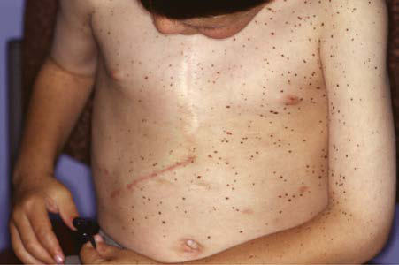
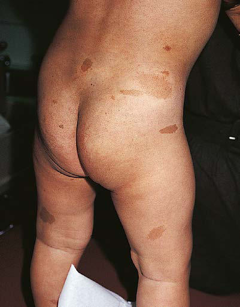

# Chapter 693: Hyperpigmented Lesions
> **Course:** Vikkypaedia Pediatric Basic Course (*Nelson Textbook of Pediatrics, 22nd Edition (2025)*)  
> **Part XXIX:** The Skin  
> **Authors:** Joel C. Joyce  
> **Metrics:** 2,509 words · 2 tables/boxes · 2 figures · 15 genes · 8 flashcards · 5 MCQs  
> **Quick Navigation:** [🃏 Study 8 Flashcards](../flashcards/693_flashcards.md) · [📝 Take 5-Q MCQ Quiz](../mcqs/693_mcqs.md) · [📚 Part XXIX Guide](../parts/Part_XXIX.md) · [🧬 Syndrome & Genetics Atlas](../omim_gene_atlas.md) · [💊 Therapeutics Matrix](../therapies_matrix.md) · [🏠 Course Index](../../index.md)

## Key Genetic & Molecular Targets
`AR`, `ATM`, `BRAF`, `FANCA`, `GNAS`, `GNAS1`, `MAP2K1`, `NF1`, `NF2`, `PRKAR1A`, `PTEN`, `PTPN11`, `RAF1`, `SPRED1`, `STK11`

## ⚡ High-Yield Nelson Pediatric Board Pearls
- Carney complex is an autosomal dom inant syndrome characterized by multiple lentigines and neoplasms, including myxomas of the skin, heart (atrial), and breast; psammoma tous melanotic schwannomas; epithelioid blue nevi of skin and muco sae; growth hormone–producing pituitary adenomas; and testicular Sertoli cell tumors.
- The complex is inherited in an autosomal dominant pattern and caused by an inactivating pathogenic variant of the PRKAR1A gene.
- Peutz-Jeghers syndrome is characterized by melanotic macules on the lips and mucous membranes and by gastrointestinal (GI) polyposis.
- It is inherited as an autosomal dominant trait caused by pathogenic variants of STK11.
- CALMs can also be seen in segmental NF1, which results from somatic mosaicism arising from postzygotic pathogenic genetic vari ants in the NF1 gene such that the clinical manifestations of NF1 are present only in a localized body segment.

---
## Full Chapter Text, Tables & Figures
# Chapter 693: Hyperpigmented Lesions

*Joel C. Joyce*

<!-- p.5189 -->
**DISORDERS OF PIGMENTATION** Pigmentation of the skin requires migration of melanoblasts from the neural crest to the dermal-epidermal junction, enzymatic processes to form pigment, structural components to contain the pigment (mela nosomes), and transfer of pigment to the surrounding keratinocytes. Increased skin color may be generalized or localized and may result from various defects in any of these requirements. Some of these aber rations are a manifestation of systemic disease, others represent gener alized or focal developmental or genetic defects, and still others may be nonspecific and the result of cutaneous inflammation.

**EPHELIDES (FRECKLES)** Ephelides (freckles) are well-demarcated macules—light or dark brown, round, oval, or irregularly shaped—that occur in sun-exposed areas such as the face, upper back, arms, and hands. They are usually less than 3 mm in diameter and are induced by exposure to sun, par ticularly during the summer, and may fade or disappear during the winter. They are a result of increased sun-induced melanogenesis and melanosome transport from melanocytes to keratinocytes and not from increased numbers of melanocytes. They are more common in redheads and fair-haired individuals and first appear in the preschool years. Histologically, they are marked by increased melanin pigment in epidermal basal cells, which have more numerous and larger dendritic processes than the melanocytes of the surrounding paler skin. The lack of melanocytic proliferation or elongation of epidermal rete ridges dis tinguishes them from **lentigines**. Ephelides have been identified as a marker for increased risk for ultraviolet (UV)-induced neoplasia and hence melanoma independent of melanocytic nevi. Treatment is not required, but regular and consistent sun protection can slow ephelis development.

**LENTIGINES** Lentigines, often mistaken for ephelides or junctional nevi, are small (usually <5 mm but occasionally 1-2 cm), round, dark-brown macules that can appear anywhere on the body. They can be solitary or grouped. Onset can be at an early age, particularly when associated with genetic syndromes, but can appear at any age. They are more common in darkly pigmented than in lightly pigmented individuals. They do not vary in coloration seasonally and remain permanently. Histologically they have elongated, club-shaped epidermal rete ridges with increased numbers of melanocytes and dense epidermal deposits of melanin. No nests of melanocytes are found. Lentigines are benign and, when few, may be viewed as a normal occurrence. They are seen most commonly on the lower lip and sun-exposed skin but may occur elsewhere, par ticularly when associated with syndromes, inadvertent or therapeutic radiation exposure, or patterned (inherited-tendency).

**Eruptive/generalized lentiginosis (lentiginosis profusa)** involves innumerable small pigmented macules that are present at birth or appear during childhood. There are no associated abnormalities, and mucous membranes are spared. Carney complex is an autosomal dom inant syndrome characterized by multiple lentigines and neoplasms, including myxomas of the skin, heart (atrial), and breast; psammoma tous melanotic schwannomas; epithelioid blue nevi of skin and muco sae; growth hormone–producing pituitary adenomas; and testicular Sertoli cell tumors. Components of the Carney complex have been described previously as the NAME (nevi, atrial myxoma, myxoid neu rofibroma, ephelides) and LAMB (lentigines, atrial myxoma, mucocu taneous myxoma, blue nevi) syndromes. The complex is inherited in an autosomal dominant pattern and caused by an inactivating pathogenic variant of the *PRKAR1A* gene.

**Multiple lentigines syndrome** (formerly LEOPARD) is an autoso mal dominant entity consisting of a generalized, symmetric distribu tion of *l*entigines (Fig. 693.1) in association with *e*lectrocardiographic *a*bnormalities, *o*cular hypertelorism, *p*ulmonary stenosis, *a*bnormal genitals (cryptorchidism, hypogonadism, hypospadias), growth *r*etar dation, and sensorineural *d*eafness (type 1, *PTPN11* gene; type 2, *RAF1* gene). Other features include hypertrophic obstructive cardiomyopa thy and pectus excavatum or carinatum.

**Peutz-Jeghers syndrome** is characterized by melanotic macules on the lips and mucous membranes and by gastrointestinal (GI) polyposis. It is inherited as an autosomal dominant trait caused by pathogenic variants of *STK11*. Onset is noted in infancy and early childhood when pigmented macules appear on the lips and buccal mucosa. The macules are usually a few millimeters in size but may be as large as 1-2 cm. Mac ules also occasionally appear on the palate, gums, tongue, and vaginal mucosa. Cutaneous macules may develop on the nose, hands, and feet; around the mouth, eyes, and umbilicus; and as longitudinal bands or diffuse hyperpigmentation of the nails. Pigmented macules often fade from the lips and skin during puberty and adulthood but generally do not disappear from mucosal surfaces. Buccal mucosal macules are the most constant feature of the disorder; in some families, occasional members may be affected only with the pigmentary changes. Indistin guishable pigmentary changes beginning in adult life, without intesti nal involvement, also occur sporadically in individuals.

**Polyposis** usually involves the jejunum and ileum but may also occur in the stomach, duodenum, colon, and rectum (see Chapter 393). Episodic abdominal pain, diarrhea, melena, and intussuscep tion are frequent complications. Patients have a significantly increased risk of GI tract and non–GI tract tumors at a young age. GI cancer has been reported in 2–3% of patients; the lifetime relative risk for GI malignancy is 13-15. The relative risk of non–GI tract malignancies, including ovarian, cervical, and testicular tumors, is 9. **Peutz-Jeghers syndrome** must be differentiated from other syndromes associated with multiple lentigines (Laugier-Hunziker syndrome), from ordinary freckling, from Gardner syndrome, and from Cronkhite-Canada syn drome, a disorder characterized by GI polyposis, alopecia, onycho dystrophy, and diffuse pigmentation of the palms, volar aspects of the fingers, and dorsal hands. Treatment of Peutz-Jeghers melanotic mac ules is not required, but various lasers have been effective for cosmesis in some cases.

**CAFÉ-AU-LAIT MACULES** Café-au-lait macules (CALMs) are uniformly hyperpigmented, sharply demarcated macular lesions, the hues of which vary with the normal degree of pigmentation of the individual: they are tan or light brown in White individuals and may be dark brown in Black children (Figs. 693.2 and 693.3). CALMs vary tremendously in size and may be large, cover ing a significant portion of the trunk or limb. The borders are usually

*Joel C. Joyce*

**Fig. 693.1** Multiple lentigines in LEOPARD (lentigines in association with electrocardiographic abnormalities, ocular hypertelorism, pulmo nary stenosis, abnormal genitals [cryptorchidism, hypogonadism, hy pospadias], growth retardation, and sensorineural deafness) syndrome.

<!-- p.5190 -->
smooth (ovoid), but some have exceedingly irregular borders. They are characterized by increased numbers of melanocytes and melanin in the epidermis but lack the clubbed rete ridges that typify lentigines. One to three CALMs are common in the general population, and up to 27% of children have a solitary CALM, depending on ancestry. The spots may be present at birth or may develop during childhood. The spots themselves are benign and may fade with age.

Large, often asymmetric café-au-lait spots with irregular borders are characteristic of patients with **McCune-Albright syndrome** (*GNAS1* gene; see Chapter 600.6). This disorder includes polyostotic fibrous dysplasia of bone, leading to pathologic fractures; precocious puberty; and numerous hyperfunctional endocrinopathies. The macular hyper pigmentation has an irregular border and may be present at birth or may develop late in childhood (see Fig. 693.3). The lesions are often

unilateral and migrate along the lines of Blaschko. Cutaneous pigmen tation is typically most extensive on the side showing the most severe bone involvement.

**Neurofibromatosis Type 1 (Von Recklinghausen Disease)** The CALM is the most familiar cutaneous hallmark of the autosomal dominant neurocutaneous syndrome known as **neurofibromatosis type 1** (*NF1,* see Fig. 693.2 and Chapter 636.1). Included in the cri teria for this diagnosis is the presence of six or more CALMs (>5 mm in diameter in prepubertal patients and >15 mm in diameter in post pubertal patients; Table 693.1). Multiple CALMs commonly produce a freckled appearance of non–sun-exposed areas such as the axillae (Crowe sign), the inguinal and inframammary regions, and under the chin. CALMs can also be seen in segmental NF1, which results from somatic mosaicism arising from postzygotic pathogenic genetic vari ants in the *NF1* gene such that the clinical manifestations of NF1 are present only in a localized body segment. Another variant of NF1 is hereditary spinal neurofibromatosis, which is a rare disorder that gen erally presents with multiple CALM and multiple symmetric spinal root neurofibromas, but other stigmata of NF1 are typically absent.

CALM may be seen in **Watson syndrome**, an NF1 allelic vari ant (CALM, pulmonic stenosis intellectual disability, short stature), mosaic NF1, and **Legius syndrome* (SPRED1).* Differentiation of these disorders is noted in Figure 693.4 and Table 693.2.

CALMs also occur with certain other disorders, including other types of neurofibromatosis, but in many of these disorders the CALMs are not the defining diagnostic feature (see Table 693.2).

**INCONTINENTIA PIGMENTI (BLOCH-SULZBERGER DISEASE)** See Chapter 636.7.

**POSTINFLAMMATORY PIGMENTARY CHANGES** Either hyperpigmentation or hypopigmentation can occur as a result of cutaneous inflammation. Alteration in pigmentation usually follows a severe inflammatory reaction but may result from mild dermatitis. Dark-skinned individuals are more likely than fair-skinned children to show these changes. Although altered pigmentation may persist for weeks to months, patients can be reassured that these lesions are usu ally temporary. Sun protection and treatment of the underlying derma titis can shorten duration.

*Visit Elsevier eBooks+ at eBooks.Health.Elsevier.com** for Bibliography.*

**Fig. 693.2** Multiple café-au-lait macules on a child with neurofibroma tosis type 1. (From Eichenfield LF, Frieden IJ, Esterly NB. Textbook of Neonatal Dermatology. Philadelphia: Saunders; 2001:372.)

**Fig. 693.3** Coast of Maine café- au-lait macules. Irregularly bor dered café au lait macules that tend not to cross the midline are characteristic of McCune-Albright syndrome. (Modified from Col lins MT, Singer FR, Rugster E. McCune-Albright syndrome and the extraskeletal manifestations of fibrous dysplasia. Orphanet J Rare Dis. 2012;7[Suppl. 1]:S4, Fig. 2.)

<!-- p.5191 -->
Only fulfills the NIH *NF1* CALMs criteria AND age <2.5 y

*NF1* and *SPRED1* genetic testing (blood DNA)

*SPRED1* positive *NF1* positive *NF1* VUS

Consider VUS review every 2 years

Consider

RNAseq

Legius syndrome recommendations

Surveillance and management

recommendations for NF1

Baseline eye exam

Dermatology exam q1y for additional *NF1*

criteria at least until age 6

Dermatology follow up every 2 years + consider tissue diagnosis in teenage years

Assess for MNF

*NF1/SPRED1* negative

MNF Not MNF

#### **Table 693.1** Previous and Recently Updated National Institutes of Health Diagnostic Criteria for Neurofibromatosis Type 1

| Category / Parameter | Clinical Details & Findings |
| --- | --- |
| **NEW CHANGES** | 1. Six or more café-au-lait macules more than 5 mm in greatest diameter; in prepubertal individuals and more than 15 mm in greatest diameter in; postpubertal individuals; Must be bilateral (both sides of the body)*; 2. Freckling in the axillary or inguinal regions; Must be bilateral (both sides of the body)*; 3. Two or more neurofibromas of any type or one plexiform neurofibroma; No change; 4. Two or more Lisch nodules; Or two or more choroidal abnormalities; 5. Optic pathway glioma; No change; 6. A distinctive osseous lesion such as sphenoid wing dysplasia; Added anterolateral bowing of tibia (tibial dysplasia) or; pseudarthrosis of a long bone; 7. First-degree relative (e.g., mother, father, sister, brother) with NF1; Changed to a parent with NF1 by the aforementioned criteria; New criteria: A pathogenic NF1 variant; *If only café-au-lait macules and freckling are present, the diagnosis is most likely NF1, but exceptionally, the person might have another diagnosis such as Legius syndrome. At least one of; the two pigmentary findings (café-au-lait macules or freckling) should be bilateral.; NIH, National Institutes of Health.; From Albaghdadi M, Thibodeau ML, Lara-Corrales I. Updated approach to patients with multiple café au lait macules. Dermatol Clin. 2022;40:9–23, Table 1. |

**Fig. 693.4** Approach to the genetic diagnosis of young children who solely meet the CALM NIH criteria. MNF, Mosaic neurofibromatosis; NFI, neurofibromatosis; RNAseq, RNA sequencing; SPRED1, sprouty-related EVH1 domain-containing 1; VUS, variant of unknown significance. (From Al baghdadi M, Thibodeau ML, Lara-Corrales I. Updated approach to patients with multiple café au lait macules. Dermatol Clin. 2022;40:9–23, Fig. 7.)

<!-- p.5192 -->

#### **Table 693.2** Conditions Featuring Café au Lait Macules

| Category / Parameter | Clinical Details & Findings |
| --- | --- |
| **CONSIDER** | Ataxia telangiectasia |
| **ATM (AR)** | Progeric changes in skin and hair, hypopigmented; macules, progressive neurologic impairment,; cerebellar ataxia, radiosensitivity, malignancy,; immunocompromise, premature aging, and; oculocutaneous telangiectasia; Karyotype*; Serum AFP*; Cardiofaciocutaneous; syndrome |
| **BRAF, MAP2K1/2 (AD)** | Follicular hyperkeratosis, sparse, slow-growing, curly; hair, ulerythema ophryogenes, melanocytic nevi,; infantile hemangiomas, distinctive craniofacial; features, cardiac anomalies, psychomotor delay, failure; to thrive, and skin abnormalities; Gene panel for RASopathies; Constitutional; mismatch repair; deficiency syndrome |
| **PMS2, EPCAM (AR)** | Adenomatous colonic polyps, multiple malignancies; including colonic adenocarcinoma, glioblastoma,; medulloblastoma, lymphoma, and a positive family; history of Lynch syndrome–associated malignancies on; both sides of the family; Gene panel for Lynch; syndrome genes; Multiple café-au-lait; spots |
| **N/A (AD)** | Six or more CALMs in multiple generations without NF1-; associated features; No genetic testing available; Familial progressive; hyperpigmentation; and; hypopigmentation; syndrome |
| **KITLG (AR)** | Progressive, diffuse, partly blotchy, hyperpigmented; lesions with scattered hypopigmented spots and; lentigines; KITLG gene testing; Fanconi anemia; FANCA and other genes |
| **(AR)** | Faint, ill-defined CALMs “shadow spots,”; hypopigmented macules, skinfold freckle-like; macules, progressive bone marrow failure, short; stature, hypogonadism, thumb or other radial ray; abnormalities, and skeletal malformations; DNA breakage studies; Gene panel for bone marrow; failure syndromes; Legius syndrome |
| **SPRED1 (AD)** | Six or more CALMs, intertriginous freckling, lipomas,; macrocephaly, and learning disabilities; SPRED1 gene testing; Noonan syndrome; with lentigines |
| **PTPN11 (AD)** | Small brown lentigines, café noir spots, CALMs,; dysmorphic facial features, obstructive; cardiomyopathy, pulmonary stenosis, growth; abnormalities, and sensorineural hearing loss; PTPN11 gene testing; McCune-Albright; syndrome; GNAS (sporadic); Coast of Maine CALMs associated with the lines of; Blaschko, fibrous dysplasia, and endocrinopathies; GNAS gene testing from; affected tissue (not blood); Neurofibromatosis; type 1 |
| **NF1 (AD)** | Six or more CALMs, skinfold freckling, neurofibromas,; plexiform neurofibromas, Lisch nodules, optic gliomas,; skeletal dysplasia, macrocephaly, nevus anemicus, and; juvenile xanthogranuloma; NF1 gene testing (DNA) ± RNA; sequencing; Neurofibromatosis; type 2 |
| **NF2 (AD)** | Schwannomas, cutaneous plaques with hypertrichosis,; light irregularly bordered CALMs, subcutaneous; nodular tumors, peripheral neuropathy, and; ophthalmologic lesions; NF2 gene testing (DNA) ± RNA; sequencing; Noonan syndrome; PTPN11, SOS2, and other; genes (AD); Skin hyperlaxity, easy bruising, keratosis pilaris, temporal; alopecia, distinctive facial features, developmental; delay, learning difficulties, short stature, congenital; heart disease, renal anomalies, lymphatic; malformations; Gene panel for RASopathies; Piebaldism |
| **KIT (AD)** | Hypopigmented patches of skin and hair,; hyperpigmentation of skin, CALMs, and axillary/; inguinal freckling; KIT gene testing; PTEN hamartoma; tumor syndrome |
| **PTEN (AD)** | Hamartomas, trichilemmomas, papillomatous papule,; acral and plantar keratoses, lipomas, autism spectrum; disorder, and macrocephaly; PTEN gene testing; Ring chromosome; syndrome 7, 11, 12,; 15, and 17; Sporadic; Depends on which chromosome but may include; CALMs, nevus flammeus, dark pigmented nevi, patchy; hypopigmented areas, microcephaly, mental delay,; short stature, and skeletal abnormalities; Karyotype; Continued |

<!-- p.5194 -->
