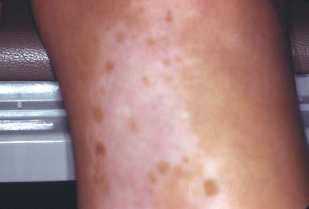

# Chapter 694: Hypopigmented Lesions
> **Course:** Vikkypaedia Pediatric Basic Course (*Nelson Textbook of Pediatrics, 22nd Edition (2025)*)  
> **Part XXIX:** The Skin  
> **Authors:** Joel C. Joyce  
> **Metrics:** 3,431 words · 3 tables/boxes · 2 figures · 28 genes · 8 flashcards · 5 MCQs  
> **Quick Navigation:** [🃏 Study 8 Flashcards](../flashcards/694_flashcards.md) · [📝 Take 5-Q MCQ Quiz](../mcqs/694_mcqs.md) · [📚 Part XXIX Guide](../parts/Part_XXIX.md) · [🧬 Syndrome & Genetics Atlas](../omim_gene_atlas.md) · [💊 Therapeutics Matrix](../therapies_matrix.md) · [🏠 Course Index](../../index.md)

## Key Genetic & Molecular Targets
`AR`, `ATM`, `BRAF`, `EDN3`, `FANCA`, `GNAS`, `HMGA2`, `HPS1`, `HPS4`, `HPS5`, `HPS6`, `LYST`, `MAP2K1`, `MC1R`, `NF1`, `NF2`

## ⚡ High-Yield Nelson Pediatric Board Pearls
- These disorders are autosomal recessive in inheri tance and result from pathogenic variants in genes related to mela nin synthesis or the transport and storage of melanin within cells.
- Oculocutaneous Albinism with Abnormal Melanin Production Oculocutaneous albinism type 1 (OCA1) is characterized by great reduction in or absence of tyrosinase activity caused by pathogenic gene variants in TYR.
- This is the most common form of albinism seen worldwide.
- It is characterized by red hair, reddish-brown skin, pigmented nevi, freckles, reddish-brown to brown eyes, nystagmus, photophobia, and decreased visual acuity.
- Oculocutaneous Albinism with Organelle Dysfunction Hermansky-Pudlak syndrome is a collection of autosomal reces sive genetic disorders characterized by OCA, ceroid accumula tion in lysosomes, and platelet dysfunction, resulting in prolonged bleeding time.
- Chédiak-Higashi syndrome is caused by pathogenic gene variants in the CHS1/LYST gene, which is a lysosomal trafficking regulatory gene.
- MELANOBLAST MIGRATION ABNORMALITIES Piebaldism A congenital autosomal dominant disorder, piebaldism is character ized by sharply demarcated amelanotic patches that occur most fre quently on the forehead, anterior scalp (producing a white forelock), ventral trunk, elbows, and knees.

---
## Full Chapter Text, Tables & Figures
# Chapter 694: Hypopigmented Lesions

*Joel C. Joyce*

<!-- p.5193 -->
**CONDITION GENE (INHERITANCE) ASSOCIATED FEATURES*******

**ADDITIONAL TESTING TO CONSIDER**

RSS 11p15 locus Chromosome 7 (sporadic) *CDKN1C, IGF2, PLAGL2,*

*HMGA2* (AD)

Growth restriction, relative macrocephaly, craniofacial

abnormalities, mild cognitive impairment, and delay

Molecular and methylation

testing of 11p15 and uniparental disomy 7 ± RSS gene panel testing

Tuberous sclerosis *TSC1, TSC2* (AD) Facial angiofibromas, ash leaf macules, thumbprint-

like macules, confetti-like skin lesions, shagreen patch, Koenen tumors, hamartomas, multisystem lymphangioleiomyomatosis, epilepsy, cognitive deficits

*TSC1* and *TSC2* gene testing

* All disorders listed have had multiple CALMs associated with them. AD, Autosomal dominant; AFP, alpha fetoprotein; AR, autosomal recessive; ATM, ataxia telangiectasia variant gene; BRAF, B-RAF proto-oncogene; CDKN1C, cyclin-dependent kinase

inhibitor 1C; EPCAM, epithelial cell adhesion molecule; FANCA, FA complementation group A; GNAS, GNAS complex locus; HMGA2, high mobility group AT-hook 2; IFG2, insulinlike growth factor 2; KIT, KIT proto-oncogene receptor tyrosine kinase; KITLG, KIT ligand; MAP2K1/2; mitogen-activated protein kinase 1, MLH1; MutL, Escherichia coli homolog of 1; MSH2; MutS, E. coli homolog of 2; MSH6, MutS , E. coli homolog of 6; NF1, neurofibromin 1; NF2, neurofibromin 2; PLAGL2, PLAG1-like zinc finger 2; PTEN, phosphate and tensin homolog; PMS2, postmeiotic segregation increased Saccharomyces cerevisiae 2; PTPN11, protein tyrosine phosphatase nonreceptor type 11; RSS, Russel-Silver syndrome; SPRED 1, sprouty-related EVH1 domain-containing protein 1; SOS2, SOS RAS/RAC guanine nucleotide exchange factor 2; TSC1, TSC1 gene; TSC2, TSC2 gene. From Albaghdadi M, Thibodeau ML, Lara-Corrales I. Updated approach to patients with multiple café au lait macules. Dermatol Clin. 2022;40:9–23, Table 2.

#### **Table 693.2** Conditions Featuring Café au Lait Macules—cont’d

**ALBINISM Congenital oculocutaneous albinism (OCA)** consists of partial or complete failure of melanin production in the skin, hair, and eyes despite the presence of normal number, structure, and distribution of melanocytes. These disorders are autosomal recessive in inheri tance and result from pathogenic variants in genes related to mela nin synthesis or the transport and storage of melanin within cells (Table 694.1). Tyrosinase is the copper-containing enzyme that cat alyzes multiple steps in melanin biosynthesis (see Chapter 105.2), and gene variants resulting in abnormal function of tyrosinase and associated transporter proteins result in various OCA phenotypes. Gene variants resulting in abnormal structure and function of sev eral cellular organelles may result in OCA with other extracutane ous complications.

**Oculocutaneous Albinism with Abnormal Melanin Production Oculocutaneous albinism type 1 (OCA1)** is characterized by great reduction in or absence of tyrosinase activity caused by pathogenic gene variants in *TYR*. OCA1-A, the most severe form, is character ized by a lack of visible pigment in hair, skin, and eyes (Fig. 694.1). This manifests as photophobia, nystagmus, defective visual acuity, white hair, and white skin. The irises are blue-gray in oblique light and prominent pink in reflected light. OCA1-B, or yellow **albinism**, manifests at birth as white hair, pink skin, and gray eyes. This type is particularly prevalent in Amish communities. Progressively the hair becomes yellow-red, the skin tans lightly on exposure to the sun, and the irises may accumulate some brown pigment, with a resultant improvement in visual acuity. Photophobia and nystag mus are present but mild. OCA-TS is a temperature-sensitive type of albinism. The abnormal tyrosinase has decreased activity at 35–37°C (95–98.6°F). Therefore cooler regions of the body such as the limbs and head pigment to some degree, whereas other areas remain depigmented.

*Joel C. Joyce*

**Oculocutaneous albinism type 2 (OCA2)** ranges from nearly normal to closely resembling type 1 albinism. This is the most common form of albinism seen worldwide. Little or no melanin is present at birth, but pigment, particularly red-yellow pigment, may accumulate during childhood to produce straw-colored or light brown skin in White individuals. Pigmented nevi may develop. Pro gressive improvement in visual acuity and nystagmus occurs with aging. Black individuals may have yellow-brown skin, dark-brown freckles in sun-exposed areas, and brown coloration of the irises. Brown OCA is an allelic variant of OCA2. Prader-Willi and Angel man syndromes, which include hypopigmentation, have deletions that include the gene *(OCA2)* involved in OCA2.

**Oculocutaneous albinism type 3 (OCA3)**, also known as *rufous albinism,* is seen predominantly in patients of African descent. It is characterized by red hair, reddish-brown skin, pigmented nevi, freckles, reddish-brown to brown eyes, nystagmus, photophobia, and decreased visual acuity. Vision abnormalities tend to be milder than in other forms of OCA. Abnormal gene variants in *TYRP1* are typically associated with development of OCA3.

**Oculocutaneous albinism type 4 (OCA4)** is a rare OCA with clini cal findings similar to those in OCA2. Gene variants in *SLC45A2* are known to cause OCA4.

Additional rare variants of OCA exist that may present with similar clinical features to those noted earlier. See Table 694.1.

**Cross-McKusick-Breen syndrome** consists of tyrosinase-positive albinism with ocular abnormalities, cognitive impairment, spasticity, and athetosis. The genetic defect is unidentified.

Because of the absence of normal protection by adequate amounts of epidermal melanin, persons with albinism are predisposed to develop ment of actinic keratoses and cutaneous carcinoma secondary to skin damage by ultraviolet light. Protective clothing and a broad-spectrum sunscreen (see Chapter 697) should be worn during exposure to sunlight.

**Oculocutaneous Albinism with Organelle Dysfunction Hermansky-Pudlak syndrome** is a collection of autosomal reces sive genetic disorders characterized by OCA, ceroid accumula tion in lysosomes, and platelet dysfunction, resulting in prolonged bleeding time (Table 694.2). Ceroid accumulation over time can cause damage to the lung, kidneys, and gastrointestinal tract, with risk of development of granulomatous colitis and/or pulmonary fibrosis. Abnormalities in the development of platelet-dense gran ules lead to platelet dysfunction.

<!-- p.5195 -->
**TYPE**

**PERCENTAGE OF PATIENTS WORLDWIDE GENETIC VARIANT FUNCTION OF AFFECTED GENE COMMENTS**

OCA1A 50% TYR (absence) =

tyrosinase negative

Rate-limiting steps in melanin formation;

hydroxylates L-tyrosine to L-DOPA and L-DOPA to DOPA-quinone

1:40,000; most severe cutaneous and ocular defects; highest risk of skin cancer; most common type in Whites

OCA1B TYR (decreased) Critical enzyme in melanin formation Subtypes: yellow (yellow hair); platinum

(metallic tinge); minimal pigment (only eyes darken)

OCA1-TS TYR (variant site

functions at higher temperatures)

Temperature sensitive Melanin at cooler sites (arms, legs) Occurs in Siamese cats

OCA2 30% P protein Transmembrane protein that is key for

melanosome biogenesis and normal processing and transport of TYR and *TRYP1*

1:36,000 (Whites); TYR-positive; includes brown albinism (1:3,900-1:10,000; most common form in patients of African origin; more pigment with advancing age); also includes red OCA2 with concomitant *MC1R* pathogenic variant and red hair

OCA3

(Rufous)

3% *TRYP1* Catalyzes oxidation of 5,6-dihydroxyindole-

2-carboxylic acid monomers into melanin and stabilizes TYR so it can leave endoplasmic reticulum for incorporation into melanosomes

1:8,500 Africans; reddish-bronze color to skin and hair

OCA4 17% *MATP/SLC45A2* Membrane transporter in melanosomes

and regulates pH

Rare (Whites); 27% of OCA in Japan;

resembles OCA2

OCA5 Unknown (4q24) — One Pakistani family

OCA6 *SLC24A5* Na+/K+/Ca+ + solute carrier protein

involved in melanosome maturation and melanin biosynthesis

Heterogeneous extent of pigmentation

OCA7 *LRMDA* Melanocyte differentiation Rare; skin color lighter only when

compared with relatives

LRMDA, Leucine-rich melanocyte differentiation associated protein; MATP, membrane-associated transporter protein; OCA, oculocutaneous albinism; P protein, pink-eyed dilution

protein; TS, temperature sensitive; TYR, tyrosinase; TRYP1, tyrosinase-related protein 1. From Paller AS, Mancini AJ. Hurwitz Clinical Pediatric Dermatology, 6th ed. Philadelphia: Elsevier; 2022: Table 11.1, p. 291.

**Fig. 694.1** White hair and skin in oculocutaneous albinism type 1

**Chédiak-Higashi syndrome** (see Chapter 170) is another genetic abnormality associated with dysfunction of lysosome-related organ elles. Patients with Chédiak-Higashi syndrome have hypopigmen tation of the skin, eyes, and hair; prolonged bleeding times and easy bruising; recurrent infections; abnormal natural killer cell function; and peripheral neuropathy. Chédiak-Higashi syndrome is caused by pathogenic gene variants in the *CHS1/LYST* gene, which is a lysosomal trafficking regulatory gene.

**MELANOBLAST MIGRATION ABNORMALITIES Piebaldism** A congenital autosomal dominant disorder, piebaldism is character ized by sharply demarcated amelanotic patches that occur most fre quently on the forehead, anterior scalp (producing a white forelock), ventral trunk, elbows, and knees. Islands of normal or darker-thannormal pigmentation may be present within the amelanotic areas (Fig. 694.2). The plaques are a result of a permanent localized absence of melanocytes as a result of a defect in the *KIT* protooncogene, which encodes the cell surface receptor transmembrane tyrosine kinase. The pattern of depigmentation arises from defective melanoblast migration from the neural crest during development. The reason that piebald ism is a localized and not a generalized process remains unknown. Pie baldism must be differentiated from vitiligo, which may be progressive and is not usually congenital, nevus depigmentosus, and Waardenburg syndrome.

**Waardenburg Syndrome** Waardenburg syndrome also manifests at birth as localized areas of depigmented skin and hair. There are four main types of Waarden burg syndrome with additional subtypes identified. The hallmark of **Waardenburg type 1** (WS1) is the white forelock, which is seen in

<!-- p.5196 -->
20–60% of patients. Only 15% of patients have areas of depigmented skin. Deafness occurs in 9–37%, heterochromia irides in 20%, and unibrow (synophrys) in 17–69% of those affected. Dystopia cantho rum (i.e., telecanthus) is seen in all patients with WS1. **Waarden burg type 2** is similar to type 1, except that patients with type 2 lack dystopia canthorum, but they also have a higher incidence of deaf ness. **Waardenburg type 3** is similar to WS1, except that patients also have limb abnormalities. It is also called *Klein-Waardenburg syndrome. *Waardenburg type 4** is also called *Shah-Waardenburg syndrome.* Patients with this type all have Hirschsprung dis ease. Dystopia canthorum is seldom seen in these patients. Mul tiple pathogenic variants in multiple genes have been identified as causative of the various types of **Waardenburg syndrome** (Table 694.3).

**Tuberous Sclerosis Complex (****TSC1, TSC2**** Genes)** See Chapter 636.2 for a discussion of this complex.

**Hypomelanosis of Ito** Hypomelanosis of Ito is a rare congenital skin disorder affecting chil dren that can have associated defects in several organ systems. There is no evidence for genetic transmission; chromosomal mosaicism and chromosomal translocations have been reported. Hypomelanosis of Ito is a descriptive diagnosis. Blaschkoid or mosaic hypomelanosis may be better descriptive terms. It is also known as *incontinentia pigmenti achromians.*

The skin lesions of hypomelanosis of Ito are generally present at birth but may be acquired in the first 2 years of life. The lesions are similar to a negative image of those present in incontinentia pigmenti, consisting of patterned, hypopigmented macules arranged over the body surface in sharply demarcated whorls, streaks, and patches that follow the lines of Blaschko (Fig. 694.3). The palms, soles, and mucous membranes are spared. The hypopigmentation remains unchanged throughout child hood but fades during adulthood. The degree of depigmentation varies from hypopigmented to achromic. Neither inflammatory nor vesicu lar lesions precede the development of the pigmentary changes as in incontinentia pigmenti. The hypopigmented areas demonstrate fewer and smaller melanocytes and a decreased number of melanin granules in the basal cell layer than normal. Inflammatory cells and pigment incontinence are lacking.

The majority of patients with hypomelanosis of Ito have no associ ated abnormalities, but involvement of other organ systems can rarely occur. The most commonly associated abnormalities involve the ner vous system, including intellectual disability (70%), seizures (40%), microcephaly (25%), and muscular hypotonia (15%). The musculo skeletal system is the second most frequently involved system, affected by scoliosis and thoracic and limb deformities. Minor ophthalmologic defects (strabismus, nystagmus) are present in 25% of patients, and 10% have cardiac defects. These frequencies are likely to be overesti mated because patients with isolated skin disease often do not seek fur ther evaluation. The differential diagnosis includes systematized nevus depigmentosus, which is a stable leukoderma not associated with sys temic manifestations. Differentiation from incontinentia pigmenti, particularly the hypopigmented fourth stage, is critical for genetic counseling because incontinentia pigmenti, unlike hypomelanosis of Ito, is inherited.

∼12% in non–Puerto Ricans) *HPS5* (∼9% in non–Puerto Ricans) *HPS6* (∼16% in non–Puerto Ricans)

#### **Table 694.2** Clinical Features of Hermansky-Pudlak Syndrome

| Category / Parameter | Clinical Details & Findings |
| --- | --- |
| **HPS-4** | HPS1 (82% of HPS in Puerto; Ricans; 37% in non–Puerto; Ricans) |
| **HPS4** | BLOC-3 deficiency: HPS1 and HPS4 associate; in a complex (BLOC-3) that regulates; biogenesis of melanosomes, platelet-dense; bodies, and the lung lamellar body; Nystagmus, decreased visual acuity; prolonged; bleeding; pulmonary fibrosis (typical onset in; young adults); granulomatous colitis (up to; one third of patients) |
| **HPS-10** | AP3B1 (∼10% of non–Puerto; Ricans) and AP3D1 (rare); AP-3 deficiency: AP3B1 and APSD1 encode; subunits of AP-3, which mediates protein; trafficking into transport vesicles of the; lysosome (and is thus also involved in; immune function); Nystagmus, decreased visual acuity; prolonged; bleeding; congenital neutropenia and; impaired NK cell cytotoxicity; recurrent; bacterial and viral infections; conductive; hearing loss; fibrosing lung disease (30–50%); beginning during childhood; seizures in |
| **HPS-6** | HPS3 (∼20% in Puerto Ricans and; BLOC-2 deficiency: HPS3, HPS5, and HPS6; are associated in a complex (BLOC-2) that; localizes tyrosinase and TRYP1, allowing; them to function normally; Nystagmus, decreased visual acuity; mild; extraocular manifestations (bleeding, skin; pigmentation) |
| **BLOC1S6/PLDN** | BLOC-1 deficiency: Dysbindin, BLOC1S3, and; BLOC1S6 are subunits of BLOC-1 and also; involved in skin melanosome biogenesis; and platelet function; Nystagmus, decreased visual acuity;; prolonged bleeding (may not be a feature; with BLOC1S6 pathogenic variant); BLOC, Biogenesis of lysosome-related organelles complex; DTNBP1, dystrobrevin binding protein 1; HPS, Hermansky-Pudlak syndrome.; From Paller AS, Mancini AJ. Hurwitz Clinical Pediatric Dermatology, 6th ed. Philadelphia: Elsevier; 2022: Table 11.2, p. 295. |

**Fig. 694.2** Depigmented macule with islands of hyperpigmentation in piebaldism.

<!-- p.5197 -->
**Vitiligo Epidemiology and Etiology Vitiligo** is an *acquired* macular depigmentation disorder associated with the destruction of melanocytes. The disorder represents a clini cal end-point resulting from a complex interaction of environmental, genetic, and immunologic factors. Autoimmune, genetic, autocyto toxic, and neural theories have been postulated. The prevalence is 0.5– 2% of most populations. There is an autoimmune component to vitiligo. Eighty percent of patients with active disease have anti-melanocyte antibodies to one of several antigens on melanocytes. These antibodies appear to be cytotoxic for melanocytes. There is also a correlation between disease activity and the titer of serum anti-melanocyte antibody. Melanocytespecific CD8+ T lymphocytes are also involved in the pathogenesis of vitiligo. These antibodies and T cells recognize a variety of melanocyte enzymatic and structural proteins.

The genetic epidemiology of vitiligo is part of a broader genetically determined autoimmune and autoinflammatory diathesis. Between 15 and 20% of patients with generalized vitiligo have one or more affected first-degree relatives. In these families the genetic pattern is suggestive of polygenic, multifactorial inheritance. In the other patients, the disease occurs sporadically. Genome-wide association studies in patients with vitiligo have identified a substantial num ber of associated genes, of which consistent association is seen with *DDR1, XBP1, NLRP1, PTPN22,* and *COMT,* although many other genes have been implicated.

#### **Table 694.3** Subtypes of Waardenburg Syndrome

| Category / Parameter | Clinical Details & Findings |
| --- | --- |
| **PAX3** | Most common form; dystopia canthorum |
| **MITF, SOX10, SLUG, KITLG, KIT** | No facial dysmorphism; high risk of hearing; loss; iris heterochromia |
| **PAX3** | Associated limb abnormalities |
| **EDNRB** | Aganglionic megacolon |
| **EDN3** | Aganglionic megacolon |
| **SOX10** | Aganglionic megacolon |
| **SOX10** | Severe hypotonicity with central nervous; system and peripheral nerve abnormalities; AD, Autosomal dominant; AR, autosomal recessive; EDN, endothelin; EDNRB, endothelin receptor beta; PCWH, peripheral demyelinating neuropathy, central dysmyelination,; Waardenburg syndrome, and Hirschsprung disease.; From Paller AS, Mancini AJ. Hurwitz Clinical Pediatric Dermatology, 6th ed. Philadelphia: Elsevier; 2022: Table 11.4, p. 298. |

**Fig. 694.3** Marbled hypopigmented streaks on the abdomen in hypomelanosis of Ito.

#### **Table 694.4** Vitiligo Subgroups

| Category / Parameter | Clinical Details & Findings |
| --- | --- |
| **NONSEGMENTAL** | Onset in childhood; Can begin in childhood; 50%; before 20 yr of age; Less common; More common; Rapid onset; stabilizes in ∼1 yr; Progressive, with flare-ups; lifelong; Involves hair after onset; Involves hair in later stages; Autoimmune diseases; uncommon; Personal or family history of; autoimmunity* common; Often occurs on the face or; upper extremities; Occurs at sites sensitive to; pressure, friction, or trauma;; Koebner phenomenon; Responsive to autologous; grafting, with repigmentation; Relapses after autologous grafting; Difficult to distinguish from; nevus depigmentosus; Associated with halo nevus; formation; *Autoimmune thyroid diseases, type 1 diabetes, psoriasis, pernicious anemia, systemic; lupus erythematosus, Addison disease, alopecia areata. |

**Fig. 694.4** Sharply demarcated, symmetric, depigmented areas of vitiligo.

<!-- p.5198 -->
Many authorities believe that the cause of melanocyte destruction in vitiligo is an interferon gamma–based immune destruction and melanocyte apoptosis. It has also been suggested that melanocytes are destroyed because of the accumulation of a toxic melanin synthesis intermediate and/or lack of protection from hydrogen peroxide and other oxygen radicals. There is in vitro evidence that some of these metabolites may be lethal to melanocytes.

**Clinical Manifestations** There are two subtypes of vitiligo, generalized (nonsegmental) and segmental, which likely are distinctly different diseases (Table 694.4). Generalized vitiligo (85–90% of cases) may be divided into widespread (type A) and localized (type B). Approximately 50% of all patients with vitiligo have onset before 18 years of age, and 25% demonstrate depigmentation before age 8 years. Most children have the generalized form, but the segmental type is more common among children than among adults. Patients with the generalized form usually present with a remarkably symmetric pattern of white macules and patches (Fig. 694.4); the margins may be somewhat hyperpigmented. The patches tend to be acral and/or periorificial. Occasionally, almost the entire skin surface becomes depigmented. Vitiligo lesions may develop in areas of traumatized skin (Koebner phenomenon) (Fig. 694.5).

There are several varieties of localized vitiligo. One form is halo nevus phenomenon, whereby benign moles develop depigmented rings at the periphery (see Chapter 692). Premature graying of scalp hair (canities) has also been considered a form of localized vitiligo. In segmental vit iligo, depigmented areas are typically limited to a dermatomal distribu tion. This type of vitiligo has a rapid onset and progression in a localized area without the development of depigmentation in other areas.

A number of **autoimmune diseases** occur in up to 20% of patients with vitiligo, including Addison disease, Hashimoto thyroiditis, perni cious anemia, diabetes mellitus, hypoparathyroidism, and polyglandular

autoimmune syndrome with selective immunoglobulin A deficiency. In addition, other diseases with possible immune defects, such as alopecia areata and morphea, have been seen in patients with vitiligo.

**Vogt-Koyanagi-Harada syndrome** is vitiligo associated with uve itis, dysacusia, meningoencephalitis, and depigmentation of the skin, scalp hair, eyebrows, and eyelashes. In **Alezzandrini syndrome**, vitil igo is associated with tapetoretinal degeneration and deafness. It is typ ically unilateral. Light microscopic examination of early lesions shows mild inflammatory change. Over time, degenerative changes occur in melanocytes, leading to their complete disappearance.

The differential diagnosis of vitiligo includes other causes of wide spread acquired leukoderma. The two most common alternative diag noses are pityriasis versicolor and postinflammatory hypopigmentation.

**Treatment** Localized areas of vitiligo may respond to a potent topical steroid (class I or II) and/or topical calcineurin inhibitor (tacrolimus or pimecrolimus), depending on the location of involvement. Therapy with Janus kinase inhibitors has been effective in adults with vitiligo. In patients with more extensive involvement, narrow-band ultravio let light B (NBUVB) [UVB311] is the treatment of choice. Treatment with NBUVB is often undertaken simultaneously with topical therapy. Systemic therapy and whole-body depigmentation are rarely used in children, although systemic corticosteroids can be given to slow the rate of change in rapidly progressive depigmentation. In all forms of vitiligo, response to therapy may be slow, taking many months to years. For those not interested in treatment, cover-up cosmetics may be used. All areas of vitiligo are susceptible to sun damage, and care should be taken to minimize sun exposure of affected areas. Spontaneous remis sion may be seen in a small percentage of cases.

*Visit Elsevier eBooks+ at eBooks.Health.Elsevier.com** for Bibliography.*

A

B

C

D

E

F

**Fig. 694.5** Koebner phenomenon in relation to daily living activities. A and B, Eye rubbing. C and D, Underwear print. E and F, Shoe print. (From Ezzedine K, Eleftheriadou V, Whitton M, van Geel N. Vitiligo. Lancet. 2015;386:74–82, Fig. 5.)

<!-- p.5199 -->
