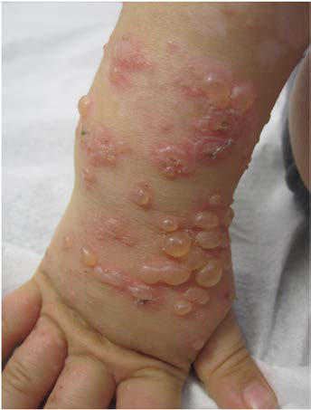

# Chapter 696: Eczematous Disorders
> **Course:** Vikkypaedia Pediatric Basic Course (*Nelson Textbook of Pediatrics, 22nd Edition (2025)*)  
> **Part XXIX:** The Skin  
> **Authors:** Julie M. Dhossche and Yvonne E. Chiu  
> **Metrics:** 4,516 words · 1 tables/boxes · 2 figures · 0 genes · 8 flashcards · 5 MCQs  
> **Quick Navigation:** [🃏 Study 8 Flashcards](../flashcards/696_flashcards.md) · [📝 Take 5-Q MCQ Quiz](../mcqs/696_mcqs.md) · [📚 Part XXIX Guide](../parts/Part_XXIX.md) · [🧬 Syndrome & Genetics Atlas](../omim_gene_atlas.md) · [💊 Therapeutics Matrix](../therapies_matrix.md) · [🏠 Course Index](../../index.md)

## Key Chapter Topics & Subchapters
`696.1 Contact Dermatitis` · `696.2 Nummular Eczema` · `696.3 Pityriasis Alba` · `696.4 Lichen Simplex Chronicus` · `696.5 Acute Palmoplantar Eczema` · `696.6 Seborrheic Dermatitis` · `696.1 Contact Dermatitis Julie M. Dhossche and Yvonne E. Chiu` · `696.2 Nummular Eczema Julie M. Dhossche and Yvonne E. Chiu` · `696.3 Pityriasis Alba Julie M. Dhossche and Yvonne E. Chiu` · `696.4 Lichen Simplex Chronicus Julie M. Dhossche and Yvonne E. Chiu` · `696.5 Acute Palmoplantar Eczema Julie M. Dhossche and Yvonne E. Chiu` · `696.6 Seborrheic Dermatitis Julie M. Dhossche and Yvonne E. Chiu`

## ⚡ High-Yield Nelson Pediatric Board Pearls
- DIFFERENTIAL DIAGNOSIS The eruption can be distinguished by histopathologic and immuno fluorescence studies from PV, BP, DH, scabies, and EM.
- Gram stain and culture preclude the diagnosis of bullous impetigo.
- Many types of eczema occur in children; the most common is atopic dermatitis, although seborrheic dermatitis, allergic and irritant contact dermatitis, nummular eczema, and acute palmoplantar eczema (dyshidrosis) are also relatively common in childhood.
- Once the diagnosis of eczema has been established, it is important to further classify the eruption more specifically for proper management.
- Histologic changes are relatively nonspecific, but all types of eczematous dermatitis are characterized by intraepidermal edema known as spongiosis.
- Dry skin dermatitis results from repetitive wet-to-dry behaviors such as lip licking, thumb sucking, frequent handwash ing, or excessive sweating.
- DIAPER DERMATITIS Diaper dermatitis refers to any rash in the diaper region; the most common of these is irritant diaper dermatitis.

---
## Full Chapter Text, Tables & Figures
# Chapter 696: Eczematous Disorders

*Julie M. Dhossche and Yvonne E. Chiu*

<!-- p.5218 -->
indistinguishable from those of DH. The infiltrate may also be largely eosinophilic, resembling that in BP. Therefore direct immunofluorescence studies are required for a definitive diagnosis of linear IgA dermatosis; per ilesional skin demonstrates linear deposition of IgA and sometimes IgG and C3 at the dermal-epidermal junction. Immunoelectron microscopy has localized the immunoreactants to the sublamina densa, although a combined sublamina densa and lamina lucida pattern has also been seen.

**DIFFERENTIAL DIAGNOSIS** The eruption can be distinguished by histopathologic and immuno fluorescence studies from PV, BP, DH, scabies, and EM. Gram stain and culture preclude the diagnosis of bullous impetigo.

**TREATMENT** Many cases of linear IgA dermatosis respond favorably to oral dap sone (see treatment of DH) or sulfapyridine. Other antibiotics, includ ing erythromycin and dicloxacillin, have been used, but the response is often transient. Children who show no response to dapsone may benefit from oral therapy with methylprednisolone (1 mg/kg/day) or a combination of these drugs. The usual course is 2-4 years, although some children have persistent or recurrent disease; there are typically no long-term sequelae. IgA nephropathy is a rare complication.

**Fig. 695.14** Erosion on an erythematous base after loss of blister roof in linear IgA dermatosis.

**Fig. 695.15** Linear IgA bullous dermatitis. (Modified from Gouveia AI, Teixeira A, Freitas JP, et al. Linear immunoglobulin A bullous dermato sis. J Pediatr. 2016;170:338, Fig. 1A.)

Eczematous disorders are a broad group of cutaneous eruptions character ized by erythema, edema, and pruritus. Acute eczematous lesions dem onstrate erythema, weeping, oozing, and the formation of microvesicles within the epidermis. Chronic lesions are generally thickened, dry, and scaly, with coarse skin markings (lichenification) and altered pigmenta tion. Many types of eczema occur in children; the most common is **atopic dermatitis** (see Chapter 186), although seborrheic dermatitis, allergic and irritant contact dermatitis, nummular eczema, and acute palmoplantar eczema (dyshidrosis) are also relatively common in childhood.

Once the diagnosis of eczema has been established, it is important to further classify the eruption more specifically for proper management. Pertinent historical data often provide the clue. In some instances, the subsequent course and character of the eruption permit classification. Histologic changes are relatively nonspecific, but all types of eczematous dermatitis are characterized by intraepidermal edema known as *spongiosis*.

## 696.1  Contact Dermatitis Julie M. Dhossche and Yvonne E. Chiu

The form of eczema known as contact dermatitis can be subdivided into irritant dermatitis, in which nonspecific injury to the skin causes immedi ate inflammation, and allergic contact dermatitis, resulting from a delayed hypersensitivity reaction. Irritant dermatitis is more frequent in children, particularly during the early years of life. Allergic reactions increase in fre quency upon maturation of the immune system.

**IRRITANT CONTACT DERMATITIS** Irritant contact dermatitis can result from prolonged or repetitive con tact with physical, chemical, or mechanical irritants, including saliva, urine, feces, fragrance, detergents, dyes, henna, plants, caterpillars, abrasive materials, and chafing.

Irritant contact dermatitis may be difficult to distinguish from atopic dermatitis or allergic contact dermatitis. A detailed history and con sideration of the sites of involvement, the age of the child, and contac tants usually provide clues to the etiologic agent. The propensity for development of irritant dermatitis varies considerably among children; some may respond to minimal injury, making it difficult to identify the offending agent through history. Children with atopic dermatitis are more prone to irritant contact dermatitis as an exacerbating factor. Irritant contact dermatitis usually clears after removal of the stimulus and temporary treatment with a topical corticosteroid preparation (see Chapter 687). Education of patients and parents about the causes of contact dermatitis is crucial to successful therapy.

**Dry skin dermatitis** results from repetitive wet-to-dry behaviors such as lip licking (Fig. 696.1), thumb sucking, frequent handwash ing, or excessive sweating. Involved skin is erythematous and fissured, localized to the area of exposure. Treatment of dry skin dermatitis begins with eliminating the offending wet-to-dry behavior. A thick moisturizer (cream or ointment based) applied twice daily decreases transepidermal water loss and replenishes skin lipids to improve hydra tion. A topical steroid is usually necessary to treat the inflammation.

**Juvenile plantar dermatosis** occurs mainly in prepubertal children with hyperhidrosis who wear occlusive synthetic footwear. Weight-bearing surfaces of the foot may be pruritic or painful and develop a fissured or glazed appearance (Fig. 696.2). Immediate application of a thick emol lient when socks and shoes are removed or immediately after swimming usually minimizes juvenile plantar dermatosis. Severe inflammatory cases may require short-term (1-2 weeks) application of a medium- to highpotency topical steroid.

*Julie M. Dhossche and Yvonne E. Chiu*

<!-- p.5220 -->

**Fig. 696.1** Perioral irritant contact dermatitis from lip licking.

**Fig. 696.2** Red, scaly juvenile plantar dermatosis.

**DIAPER DERMATITIS** Diaper dermatitis refers to any rash in the diaper region; the most common of these is irritant diaper dermatitis. Elevated pH in the dia per area and synergistic activity of urinary and fecal enzymes lead to inflammation, which disrupts the normal skin barrier and increases susceptibility to other irritants and organisms. Additional factors are occlusion, friction, and use of diaper wipes and topical preparations. Loose or frequent stooling predisposes an infant to diaper dermatitis. Diaper dermatitis presents with erythema and scaling in a patchy or confluent pattern and, in severe cases, may have papulovesicular or bullous lesions, fissures, and/or erosions (Fig. 696.3). The genitocrural folds are often spared because concave areas are relatively protected. Chronic hypertrophic, flat-topped papules and infiltrative nodules may occur. **Candidal infection** typically represents a secondary process. It is characterized by “beefy” red-pink, tender skin that has numerous 1to 2-mm pustules and satellite papules and involves both concave and convex areas. Discomfort may be marked because of intense inflam mation. Allergic contact dermatitis, seborrheic dermatitis, psoriasis, candidiasis, atopic dermatitis, child abuse, and rare disorders such as Langerhans cell histiocytosis, nutritional deficiencies, and acroderma titis enteropathica should be considered when the eruption is persis tent or is recalcitrant to simple therapeutic measures (Table 696.1).

Diaper dermatitis often responds to simple measures; some infants are predisposed to diaper dermatitis, and management may be difficult. The damaging effects of overhydration of the skin and prolonged contact with feces and urine can be obviated by frequent changing of the diapers and periods of “rest” free of diaper use. Cleansing of affected skin is best accomplished with a soft cloth and lukewarm water, patted dry. Overwash ing should be avoided because it leads to chapping and may worsen the dermatitis. Disposable diapers containing a superabsorbent material may help to maintain a relatively dry environment. First-line therapy for diaper dermatitis is application of a protective barrier agent (ointment or paste)

containing petroleum or zinc oxide at every diaper change. Topical sucral fate is an effective barrier with some antibacterial activity and is useful for recalcitrant cases. Low-potency nonhalogenated topical corticosteroids, such as 2.5% hydrocortisone, may be used for short periods (3-5 days). Treatment with a topical anticandidal agent is indicated for secondary can didal infection. Topical preparations containing triamcinolone-nystatin and betamethasone dipropionate-clotrimazole are generally inappropri ate for diaper dermatitis in infants because of the higher potency of the corticosteroid component. If using multiple topical agents, the protective barrier should be applied last. When diaper dermatitis does not respond to typical prevention and treatment strategies, non–diaper-associated causes must be considered.

**ALLERGIC CONTACT DERMATITIS** Allergic contact dermatitis is a delayed hypersensitivity cutaneous reac tion to environmental allergens and should be considered in any child with recalcitrant eczema. It has been estimated to affect 16.4% of all children in the United States, though children are likely underdiagnosed, especially those with concomitant atopic dermatitis. Children of all ages may develop allergic contact dermatitis, though it is more common in older children. Allergic contact dermatitis is a T-cell–mediated hypersensitivity reaction that is provoked by application of an antigen to the skin surface. The anti gen penetrates the skin, where it is conjugated with a cutaneous protein, and the hapten-protein complex is transported to the regional lymph nodes by antigen-presenting Langerhans cells. A primary immunologic response occurs locally in the nodes and becomes generalized, presum ably because of dissemination of sensitized T cells. Sensitization requires several days and, when followed by a fresh antigenic challenge, manifests as allergic contact dermatitis. Generalized distribution may also occur if enough antigen finds its way into the circulation, such as by consumption. Once sensitization has occurred, each new antigenic challenge may pro voke an inflammatory reaction within 8-12 hours; sensitization to a par ticular antigen usually persists for many years.

Acute allergic contact dermatitis is an erythematous, intensely pruritic, eczematous dermatitis. Acute cases may be edematous and vesiculobul lous. The chronic condition has the features of long-standing eczema: lichenification, scaling, fissuring, and pigmentary change. Distinguishing allergic contact dermatitis from other eczematous disorders can be chal lenging, especially with irritant contact dermatitis, which can be clinically identical. The distribution of the eruption often provides a clue to the diag nosis. Airborne sensitizers usually affect exposed areas, such as the face

**Fig. 696.3** Severe, erosive diaper dermatitis.

<!-- p.5221 -->
and even toilet seats cause dermatitis at points of contact. Careful evalu ation of environmental exposures, cultural customs, daily activity, ani mal exposures, ear piercing, tattooing, and personal product usage in the patient and all caregivers is essential. Other potential diagnoses to consider include herpes simplex virus, impetigo, cellulitis, and dermatophytoses.

**Rhus dermatitis** (poison ivy, poison sumac, poison oak), a response to the plant allergen urushiol, is the most common allergic contact der matitis. It is often vesiculobullous and may be distinguished by linear streaks of vesicles where the plant leaves have brushed against the skin (Fig. 696.4). Fluid from ruptured cutaneous vesicles does not spread the eruption; antigen retained on skin, clothing, or under fingernails ini tiates new plaques of dermatitis if not removed by washing with soap and water. Antigen may also be carried by animals on their fur. “Black spot” poison ivy dermatitis is a rare variant that results from oxida tion of concentrated urushiol left on the skin and manifests as small discrete black lacquer–like glossy papules with surrounding erythema and edema. Sensitization to one plant produces cross reactions with the others. Spontaneous resolution occurs in 1-3 weeks, with the most com mon complication being secondary bacterial infection with normal skin

mainstays for prevention. Barrier creams or organoclay compounds such as bentoquatam may be effective if applied before expected exposure.

**Nickel dermatitis** develops from contact with jewelry, metal closures on clothing, or even cell phones. Metal closures on pants frequently cause periumbilical dermatitis (Fig. 696.5). Some children are exquisitely sensi tive to nickel, with even the trace amounts found in gold jewelry provoking eruptions. The most frequently involved sites from jewelry are the earlobes from nickel-containing earrings. Early ear piercing increases risk of sensi tization, and it is recommended to delay piercing until after 10 years of age. Patch testing for nickel sensitivity is unreliable in infants and toddlers and should only be performed if there is high clinical suspicion.

**Shoe dermatitis** typically affects the dorsum or soles of the feet and toes, sparing the interdigital spaces; it is usually symmetric. Other forms of allergic contact dermatitis, in contrast to irritant dermatitis, rarely involve the palms and soles. Common allergens are the antioxi dants and accelerators in shoe rubber, adhesives, and the chromium salts in tanned leather or shoe dyes. Excessive sweating often leaches these substances from their source.

Apparel contains a number of sensitizers, including dyes, dye fixative,

#### **Table 696.1** Diaper Dermatitis

| Category / Parameter | Clinical Details & Findings |
| --- | --- |
| **TREATMENT** | Friction; Inner surface of thighs, genitalia, buttocks,; abdomen; Course waxes and wanes; Aggravated by talc; Responds well to diaper changes; Avoidance of diapers; Irritant; Mild erythema with shiny surface and; occasional papules; Confined to convex surfaces; Spares intertriginous areas; Exacerbated by heat, moisture, and; sweat retention; Gentle cleansing; Regular diaper changes; Barrier creams (zinc oxide, Vaseline); Low-potency topical steroids can; help; Allergic contact; Typically confined to convex surfaces; Skin involved is in direct contact with offending; agent; Mild cases: diffuse erythema, papules, vesicles,; scaling; Severe cases: papules, plaques, psoriasiform; lesions, ulcerations, infiltrative nodules; Often related to topical antibiotics; (neomycin, bacitracin); Certain emulsifiers in topical; products; Preservatives in wet wipes can be an; offender; Remove offending agent; Judicious use of low-potency; topical steroids; Barrier creams/ointments; Seborrheic; dermatitis; Salmon-colored patches; Often have yellow, greasy scale; Fissures, erosions, maceration, and weeping; can be seen; Axillae, ear creases, and neck are; often involved; “Cradle cap” on scalp; Hypopigmentation often seen in; patients with darker skin tones; Low-potency topical steroids; If coexistent infection—antifungal; or antibacterial agents; Candidiasis; Usually involves intertriginous areas and convex; surfaces; Bright-red papules and plaques; Satellite lesions on abdomen and thighs; Oral thrush may be present; Often occurs after treatment with; systemic antibiotics or local; topical steroid use; Topical anticandidal agent,; including nystatin; Intertrigo; Well-demarcated, macerated plaques with; weeping; Gluteal cleft and fleshy folds of thighs; May be associated with miliaria; Avoiding excessive heat; Cool clothing; Psoriasis; Bright red, scaly, well-demarcated plaques; Can persist for months; Less responsive to topical treatment; Red, sometimes scaly; Can be present on extremities or; trunk; Nail changes seen; Family history; Low-potency topical steroids; Moisturizers; Staphylococcal; infection; Many thin-walled pustules with pink-red base; Collarette of scale after rupturing; Antistaphylococcal therapy; Acrodermatitis; enteropathica; (zinc deficiency); Early lesions are vesicular and pustular; Become confluent, pink, dry, scaly, crusty; plaques; Perioral skin typically also involved; Irritability or listlessness; Failure to thrive, alopecia, diarrhea; Secondary to zinc deficiency or; inborn error of zinc transporter; Treat with zinc replacement; Langerhans cell; histiocytosis; May mimic candidiasis or seborrheic dermatitis; Persistent, does not improve with standard; treatments; Clusters of infiltrative, crusted, hemorrhagic; papules; Ulceration can be seen; Involvement of groin, axillae,; periauricular skin, hairline, and; scalp; Anemia, thrombocytopenia,; hepatosplenomegaly, and osseous; lesions; Chemotherapy; From Humphrey S. Congenital cutaneous lesions and infantile rashes. In: Kliegman RM, Toth H, Bordini BJ, Basel D, eds. Nelson Pediatric Symptom-Based Diagnosis, 2nd ed.; Philadelphia: Elsevier; 2023: Table 60.2, p. 1144. |

<!-- p.5222 -->
fixed to clothing and so may be leached out with sweating, as can par tially cured formaldehyde resins. The elastic in garments is a frequent cause of clothing dermatitis, and contact allergy to the ink “tag” of tagless baby clothing has been reported. Exposure to other items with fabric,

Topical medications and cosmetics may be unsuspected as aller gens, particularly if a medication is being used for a preexisting derma titis. The most common offenders are neomycin, topical antihistamines, topical anesthetics, fragrances, topical corticosteroids, oxybenzone and octocrylene in chemical sunscreens, preservatives, dye in temporary tat toos, and ethylenediamine, a stabilizer present in many medications. All types of cosmetics can cause facial dermatitis; involvement of the eyelids is characteristic for nail polish sensitivity. Another pediatric allergen has been methylisothiazolinone (MI), a chemical preservative found in rinseoff products including liquid soaps and shampoos, as well as paints and glues, which may be used in making homemade “slime” and lead to hand dermatitis.

Neomycin sulfate is present in many nonprescription topical antibiotic preparations, and thus children are frequently exposed at an early age. It is one of the most common causes of allergic contact dermatitis, and use of combination products of neomycin with other antibiotics, antifungals, or corticosteroids may induce co-reactivity with these chemically unrelated substances.

As mentioned previously, diagnosis of allergic contact dermatitis is usu ally based on history; however, patch testing may be helpful, especially in older children. Identification and avoidance of the offending agent is the mainstay of managing allergic contact dermatitis. First-line treatment for acute eruption is a mid-potency topical corticosteroid ointment for 2-3 weeks and symptom management with nonsensitizing and fragrancefree emollients/moisturizers, wet dressings, and sedating antihistamines to allow for sleep. Systemic corticosteroids are used when >10% of skin is involved (0.5-1.0 mg/kg prednisone to a maximum of 60 mg/day for 7-10 days, followed by a 7-10 day taper). More chronic allergic contact dermatitis is treated with low- to mid-potency topical corticosteroids. Desensitization therapy is rarely indicated. Topical calcineurin inhibitors, such as tacroli mus, may be a potential steroid-sparing alternative agent in select patients.

*Visit Elsevier eBooks+ at eBooks.Health.Elsevier.com** for Bibliography.*

## 696.2  Nummular Eczema Julie M. Dhossche and Yvonne E. Chiu

Nummular eczema is characterized by coin-shaped, severely pruritic, eczematous plaques, commonly involving the extensor surfaces of the extremities (Fig. 696.6), buttocks, and shoulders with facial sparing. The plaques are relatively discrete, boggy, vesicular, slightly scaly, and exuda tive; when chronic, they often become thickened and lichenified and may develop central clearing. Nummular eczema may be an atypical morphol ogy in someone with underlying atopic dermatitis or may be an inde pendent disorder. Flares are generally sporadic but may be precipitated by xerosis, irritants, allergens, or occult staphylococcal infection. Most frequently, these lesions are mistaken for tinea corporis, but plaques of nummular eczema are distinguished by the lack of a raised, sharply cir cumscribed border, the lack of fungal organisms on a potassium hydrox ide (KOH) preparation, and frequent weeping or bleeding when scraped. First-line treatment is with emollients, wet dressings, and potent topical corticosteroids. Steroid-impregnated tapes may simultaneously treat and provide barrier protection to these circumscribed eczematous plaques. An oral antihistamine may be helpful, particularly a sedating antihistamine at night. Antibiotics are indicated for secondary infection. Methotrexate and dupilumab have been described as systemic treatments.

*Visit Elsevier eBooks+ at eBooks.Health.Elsevier.com** for Bibliography.*

## 696.3  Pityriasis Alba Julie M. Dhossche and Yvonne E. Chiu

Pityriasis alba occurs mainly in children and causes lesions that are hypopigmented, ill-defined, round or oval patches (Fig. 696.7). They may be mildly erythematous and finely scaly. Lesions occur on the face, neck, upper trunk, and proximal portions of the arms and are most pro

**Fig. 696.4** Linear lesions in poison ivy.

**Fig. 696.5** Chronic periumbilical nickel dermatitis.

<!-- p.5223 -->

<!-- p.5224 -->

<!-- p.5225 -->
is minimal or absent. The cause is unknown, but the eruption appears to be exacerbated by dryness and is often regarded as a mild form of atopic dermatitis. Pityriasis alba is frequently misdiagnosed as vitiligo, tinea ver sicolor, or tinea corporis. The lesions wax and wane but eventually disap pear, and normal pigmentation often takes months to return. Application of a lubricant or emollient may ameliorate the condition, and avoidance of sun exposure and daily sunscreen use can help reduce the appearance of existing lesions by allowing for natural lightening of adjacent unaffected skin. If pruritus is troublesome or if the lesions are active with erythema and fine scale, a low-potency topical steroid or calcineurin inhibitor may be used.

*Visit Elsevier eBooks+ at eBooks.Health.Elsevier.com** for Bibliography.*

## 696.4  Lichen Simplex Chronicus Julie M. Dhossche and Yvonne E. Chiu

Lichen simplex chronicus is a secondary skin disorder resulting from excessive scratching or rubbing. It is characterized by a chronic pruritic, eczematous, circumscribed plaque that is usually lichenified and hyper pigmented (Fig. 696.8). All affected areas must be accessible to scratch ing, with the most common sites being the posterior neck, genitalia, wrists, ankles, and dorsal feet. Although the initiating event may be a transient lesion such as an insect bite, trauma from rubbing and scratch ing accounts for persistence of the plaque. Lichen simplex chronicus may also be seen in other chronic eczematous dermatoses such as atopic der matitis, typically when poorly controlled. Pruritus must be controlled to permit healing; thus a covering to prevent scratching may be necessary. A high-potency topical corticosteroid under occlusion is often helpful and hastens resolution. Second-line therapy includes adding 6% salicylic acid gel to the topical corticosteroid preparation.

## 696.5  Acute Palmoplantar Eczema Julie M. Dhossche and Yvonne E. Chiu

A recurrent, sometimes seasonal, blistering disorder of the hands and feet, acute palmoplantar eczema (also known as dyshidrotic eczema or pompholyx) occurs in all age-groups but is uncommon in infancy. The pathogenesis is unknown, although possible predisposing factors include a history of atopy, exposure to contact allergens (especially metals) or irritants, or IV immunoglobulin therapy. The disease is characterized by recurrent crops of small, deep-seated, “tapioca-like” vesicles, which are intensely pruritic and may coalesce into tense bullae (Fig. 696.9). Sites of predilection are the palms, soles, and lateral aspects of the fingers and toes. Primary lesions are noninflammatory and are filled with clear fluid, which, unlike sweat, has a physiologic pH and contains protein. Maceration and secondary infection are frequent because of scratching. The chronic phase is characterized by thickened, fissured plaques that

palmoplantar eczema is frequently seen in patients with hyperhidrosis, histologic examination reveals an eczematous reaction around sweat ducts, without any structural or functional abnormalities of the sweat ducts themselves. The diagnosis is made clinically. The disorder may be confused with allergic contact dermatitis, which usually affects the dor sal rather than the volar surfaces, and with dermatophytosis, which can be distinguished by a KOH preparation of the roof of a vesicle and by appropriate cultures.

Acute palmoplantar eczema responds to wet dressings, liberal emol lient use, and potent topical corticosteroid ointment applied twice daily for 2-4 weeks. Weeping skin benefits from twice-daily soaking in an astringent solution, such as aluminum subacetate. Second-line treat ment includes phototherapy and systemic immunomodulators. Severe disease may require oral corticosteroids with a 2-week taper. Second ary bacterial infection should be treated systemically with an appropri ate antibiotic. Patients should be told to expect recurrence and should protect their hands and feet from the damaging effects of excessive sweating, chemicals, harsh soaps, and adverse weather. Unfortunately, it is impossible to prevent recurrence or to predict its frequency.

*Visit Elsevier eBooks+ at eBooks.Health.Elsevier.com** for Bibliography.*

## 696.6  Seborrheic Dermatitis Julie M. Dhossche and Yvonne E. Chiu

**ETIOLOGY** Seborrheic dermatitis is a chronic inflammatory disease most common in infancy and adolescence that parallels the distribution, size, and activity of the sebaceous glands. The cause is unknown, as is the role of the sebaceous glands in the disease. *Malassezia furfur* is implicated as a causative agent,

**Fig. 696.6** Discrete, boggy plaque of nummular dermatitis.

**Fig. 696.7** Patchy hypopigmented lesions with diffuse borders char acteristic of pityriasis alba.

**Fig. 696.8** Thickened plaque of lichen simplex chronicus.

<!-- p.5226 -->

<!-- p.5227 -->

<!-- p.5228 -->
although it remains unclear whether dermatitis results from the action of the fungus, its by-products, or an exaggerated response of the host. In ado lescence, seborrheic dermatitis typically occurs after puberty, indicating a possible role for sex hormones.

It is also unknown whether infantile seborrheic dermatitis and ado lescent seborrheic dermatitis are the same or different entities. There is no evidence that children with infantile seborrheic dermatitis will experience seborrheic dermatitis as adolescents.

**CLINICAL MANIFESTATIONS** The disorder may begin in the first month of life and typically self-resolves by 1 year. Diffuse or focal scaling and crusting of the scalp, sometimes called *cradle cap* (Fig. 696.10), may be the initial and, at times the only, manifestation. A greasy, scaly, erythematous papular dermatitis, which is usually nonpruritic in infants, may involve the face, neck, retroau ricular areas, axillae, umbilicus, and diaper area. The dermatitis may be patchy and focal or may spread to involve almost the entire body (Fig. 696.11). Postinflammatory pigmentary changes are common, particu larly in infants with darker skin. When the scaling becomes pronounced, the condition may resemble psoriasis and, at times, can be distinguished only with difficulty. The possibility of coexistent atopic dermatitis must be considered when there is an acute weeping dermatitis with pruritus, and the two are often clinically inseparable at an early age. An intractable seborrhea-like dermatitis with chronic diarrhea and failure to thrive may reflect systemic dysfunction of the immune system. A chronic treatmentresistant seborrhea-like pattern may also result from cutaneous histiocytic infiltrates in infants with Langerhans cell histiocytosis. Seborrheic derma titis is a common cutaneous manifestation of AIDS in young adults and is characterized by thick, greasy scales on the scalp and large hyperkeratotic erythematous plaques on the face, chest, and genitals.

During adolescence, seborrheic dermatitis is more localized and may be confined to the scalp, chest, and intertriginous areas. Also noted may be marginal blepharitis and involvement of the external auditory canal. Scalp changes vary from diffuse, brawny scaling to focal areas of thick, oily, yellow crusts with underlying erythema. Loss of hair is uncommon, and pruritus may be absent to marked. When the derma titis is severe, erythema and scaling occur at the frontal hairline, the medial aspects of the eyebrows, and in the nasolabial and retroauricu lar folds. Red, scaly plaques may appear in the axillae, inguinal region, gluteal cleft, and umbilicus. On the extremities, seborrheic plaques may be more eczematous and less erythematous and demarcated. Unlike infantile seborrheic dermatitis, adolescent seborrheic dermatitis gener ally does not self-resolve and has a chronic relapsing course.

**DIFFERENTIAL DIAGNOSIS** The differential diagnosis of seborrheic dermatitis includes psoriasis, atopic dermatitis, dermatophytosis, Langerhans cell histiocytosis, and candidiasis. Secondary bacterial infections and superimposed candi diasis are common.

## TREATMENT

Emollients, baby oil, gentle shampooing with nonmedicated baby shampoo, and gentle use of a soft brush to remove scales are usu ally effective measures. Persistent lesions may be treated with lowpotency topical corticosteroids if inflamed (applied once daily for 1 week) and a topical antifungal (e.g., ketoconazole 2% cream twice daily). Antifungal shampoos such as ketoconazole 2% shampoo should be used cautiously because they are not tear-free.

First-line therapy for children and adolescents with scalp sebor rheic dermatitis is antifungal shampoo used several times weekly to daily (selenium sulfide, ketoconazole, ciclopirox, zinc pyrithi one, salicylic acid, or tar). Mid-potency topical corticosteroids such as fluocinolone 0.01% oil or triamcinolone 0.1% lotion may also be used for inflamed lesions, applied once daily for 2-4 weeks. Nonscalp lesions are treated with topical corticosteroid cream (low-potency for facial lesions, mid-potency elsewhere), as well as topical antifungals such as ketoconazole 2% cream or ketocon azole 2% shampoo used as a body or face wash. Second-line therapy for seborrheic dermatitis includes topical calcineurin inhibitors and keratolytic agents such as urea. Severe adult cases improve with oral antifungal agents; however, pediatric studies are lacking. Once acute disease is controlled, antifungal shampoo used on a twice-weekly basis is effective maintenance to reduce the risk of relapse.

**Fig. 696.9** Vesicular palmar lesions of acute palmoplantar eczema with large bullae.

**Fig. 696.10** Cradle cap in an infant.

**Fig. 696.11** Seborrheic dermatitis may occasionally be more wide spread. (From Tom WL, Eichenfield LF. Eczematous disorders. In: Eichenfield LF, Frieden IJ, eds. Neonatal and Infant Dermatology, 3rd ed. Philadelphia: Elsevier; 2015: Fig. 15.11, p. 225.)

<!-- p.5229 -->
