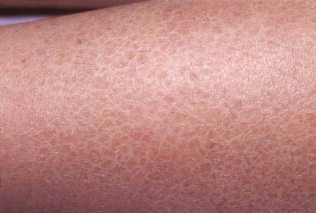

# Chapter 699: Disorders of Keratinization
> **Course:** Vikkypaedia Pediatric Basic Course (*Nelson Textbook of Pediatrics, 22nd Edition (2025)*)  
> **Part XXIX:** The Skin  
> **Authors:** Kari L. Martin  
> **Metrics:** 5,115 words · 4 tables/boxes · 2 figures · 37 genes · 8 flashcards · 5 MCQs  
> **Quick Navigation:** [🃏 Study 8 Flashcards](../flashcards/699_flashcards.md) · [📝 Take 5-Q MCQ Quiz](../mcqs/699_mcqs.md) · [📚 Part XXIX Guide](../parts/Part_XXIX.md) · [🧬 Syndrome & Genetics Atlas](../omim_gene_atlas.md) · [💊 Therapeutics Matrix](../therapies_matrix.md) · [🏠 Course Index](../../index.md)

## Key Genetic & Molecular Targets
`ABCA12`, `ABHD5`, `ADAM17`, `ALDH3A2`, `ALOX12B`, `ALOXE3`, `AP1S1`, `AR`, `CGI58`, `CLDN1`, `CYP4F22`, `DSG1`, `FLG`, `GBA`, `GJB2`, `GJB6`

## ⚡ High-Yield Nelson Pediatric Board Pearls
- The outcome is uncertain, and accurate prognosis depends on identification of the underlying ichthyosis.
- NONSYNDROMIC ICHTHYOSES Ichthyosis Vulgaris Etiology/Pathogenesis Autosomal dominant or recessive pathogenic variants in the filaggrin gene cause ichthyosis vulgaris.
- Clinical Manifestations Ichthyosis vulgaris is the most common of the disorders of keratiniza tion, with an incidence of 1/250 live births.
- X-Linked Ichthyosis Etiology/Pathogenesis X-linked ichthyosis involves a deficiency of steroid sulfatase, which hydrolyzes cholesterol sulfate and other sulfated steroids to cholesterol.
- These include Kallmann syndrome (KAL1 gene), which consists of hypogonadotrophic hypogonadism and anosmia, X-linked chondro plasia punctata (ARSE gene), short stature, and ocular albinism.
- AUTOSOMAL RECESSIVE CONGENITAL ICHTHYOSES Harlequin Ichthyosis Etiology/Pathogenesis Harlequin ichthyosis is caused by pathogenic variants in the ABCA12 gene.
- AD, Autosomal dominant; AR, autosomal recessive; XD, X-linked dominant; XR, X-linked recessive.

---
## Full Chapter Text, Tables & Figures
# Chapter 699: Disorders of Keratinization

*Kari L. Martin*

<!-- p.5259 -->
**DISORDERS OF CORNIFICATION** Mendelian disorders of cornification (ichthyoses) are a primary group of inherited conditions characterized clinically by patterns of scaling and histopathologically by hyperkeratosis. They are usually distin guishable by inheritance patterns, clinical features, associated defects, and histopathologic changes (Tables 699.1, 699.2, and 699.3). The two main categories of ichthyotic diseases are whether they are limited to the skin or have syndromic associations.

**COLLODION BABY** Collodion baby is not a single entity, but a newborn phenotype that is most often seen in babies who eventually demonstrate lamellar ichthy osis or congenital ichthyosiform erythroderma (CIE). Less commonly, collodion babies evolve into babies with Gaucher disease or neutral lipid storage disease with ichthyosis, Loricrin keratoderma, trichothio dystrophy, Sjögren-Larsson syndrome, Conradi-Hünerman syndrome, or harlequin ichthyosis. A small subset become otherwise healthy babies without chronic skin disease (self-healing collodion baby).

Collodion babies are covered at birth by a thick, taut membrane resembling oiled parchment or collodion (Fig. 699.1), which is subse quently shed. Affected neonates have ectropion (eversion of the eyelid away from the globe), flattening of the ears and nose, and fixation of the lips in an O-shaped configuration. Hair may be absent or may perforate the abnormal covering. The membrane cracks with initial respiratory efforts and, shortly after birth, begins to desquamate in large sheets. Admission to a neonatal intensive care unit and a high-humidity envi ronment and application of nonocclusive lubricants facilitate shedding of the membrane. Complete shedding may take several weeks, and a new membrane may occasionally form in localized areas.

Neonatal morbidity and mortality may be due to cutaneous infec tion, aspiration pneumonia (squamous material), hypothermia, or hypernatremic dehydration from excessive transcutaneous fluid losses as a result of increased skin permeability. The outcome is uncertain, and accurate prognosis depends on identification of the underlying ichthyosis.

**NONSYNDROMIC ICHTHYOSES Ichthyosis Vulgaris Etiology/Pathogenesis** Autosomal dominant or recessive pathogenic variants in the filaggrin gene cause ichthyosis vulgaris. Filaggrin is a filament-aggregating pro tein that assembles the keratin filament cytoskeleton, causing collapse of the granular cells into a classic flattened squamous cell shape. Patho genic variants in filaggrin lead to absence of or marked reductions in keratohyalin granules (see Table 699.2).

**Clinical Manifestations** Ichthyosis vulgaris is *the most common* of the disorders of keratiniza tion, with an incidence of 1/250 live births. Onset generally occurs in the first year of life. In most cases, it is trivial, consisting only of slight roughening of the skin surface. Scaling is most prominent on the extensor aspects of the extremities, particularly the legs (Fig. 699.2). Flexural surfaces are spared, and the abdomen, neck, and face are rela tively uninvolved. Keratosis pilaris—particularly on the upper arms and thighs, accentuated markings, and hyperkeratosis on the palms and soles—and atopy are relatively common. Scaling is most pro nounced during the winter months and may abate completely during

warm weather. There is no accompanying disorder of hair, teeth, muco sal surfaces, or other organ systems; however, patients are at increased risk of atopy.

**Treatment** Scaling may be diminished by daily applications of an emollient or a lubricant containing urea (10–40%), salicylic acid, or an alpha-hydroxy acid such as lactic acid (5–12%).

**X-Linked Ichthyosis Etiology/Pathogenesis** X-linked ichthyosis involves a deficiency of steroid sulfatase, which hydrolyzes cholesterol sulfate and other sulfated steroids to cholesterol. Cholesterol sulfate accumulates in the stratum corneum and plasma. In the epidermis this accumulation causes malformation of intercellular lipid layers, leading to barrier defects and delay of corneodesmosome degradation, resulting in corneocyte retention.

**Clinical Manifestations** Skin peeling may be present at birth but typically begins at 3-6 months of life. Scaling is most pronounced on the sides of the neck, lower face, preauricular areas, anterior trunk, and the limbs, particularly the legs. The elbow (Fig. 699.3) and knee flexures are generally spared but may be mildly involved. The palms and soles may be slightly thickened but are also usually spared. The condition gradually worsens in severity and extent. Keratosis pilaris is not present, and there is no increased incidence of atopy. Deep corneal opacities that do not interfere with vision develop in late childhood or adolescence and are a useful marker for the disease because they may also be present in carrier females. Some patients have larger deletions on the X chromosome that encom pass neighboring genes, generating *contiguous gene deletion syndromes*. These include Kallmann syndrome (*KAL1* gene), which consists of hypogonadotrophic hypogonadism and anosmia, X-linked chondro plasia punctata (*ARSE* gene), short stature, and ocular albinism. The rate of testicular cancer may be increased in patients with coexistent Kallmann syndrome. There is also an increased risk of attentiondeficit/hyperactivity disorder and autism owing to a contiguous gene defect in neuroligin 4.

Reduced steroid sulfatase enzyme activity can be detected in fibro blasts, keratinocytes, and leukocytes and, prenatally, in amniocytes or chorionic villus cells. In affected families, an affected male can be detected by restriction enzyme analysis of cultured chorionic villus cell DNA or amniocytes or by in situ hybridization, which identifies steroid sulfatase gene deletions prenatally in chorionic villus cells. A placental steroid sulfatase deficiency in carrier mothers may result in low uri nary and serum estriol values, prolonged labor, and insensitivity of the uterus to oxytocin and prostaglandins.

**Treatment** Daily application of emollients and a urea-containing lubricant (10– 40%) is usually effective. Glycolic or lactic acid (5–12%) in an emollient base and propylene glycol (40–60%) in water with occlusion overnight are alternative forms of therapy.

**AUTOSOMAL RECESSIVE CONGENITAL ICHTHYOSES Harlequin Ichthyosis Etiology/Pathogenesis** Harlequin ichthyosis is caused by pathogenic variants in the *ABCA12* gene. Pathogenic variants in the gene lead to defective lipid transport, and *ABCA12* activity is required for the generation of long-chain ceramides that are essential for the development of the normal skin barrier.

**Clinical Manifestations** At birth, markedly thickened, ridged, and cracked skin forms horny plates over the entire body, disfiguring the facial features and constrict ing the digits. Severe ectropion and chemosis obscure the orbits, the nose and ears are flattened, and the lips are everted and gaping. Nails

*Kari L. Martin*

<!-- p.5260 -->

#### **Table 699.1** Inherited Ichthyoses – Syndromic

| Category / Parameter | Clinical Details & Findings |
| --- | --- |
| **X-LINKED ICHTHYOSIS SYNDROMES** | RXLI (recessive X-linked; ichthyosis) syndromic; presentation; 308100 |
| **XR** | Large, dark scales; Sparing of body folds; Prolongation of labor; Cryptorchidism; Corneal opacities, asymptomatic |
| **STS** | Larger deletions with; contiguous gene; defects; Steroid sulfatase; IFAP syndrome; (ichthyosis-follicularis-; atrichia-photophobia); 398205 |
| **XR** | Spiny follicular ichthyosis; Nail dystrophy; Alopecia; Photophobia; Psychomotor delay; Short stature |
| **MBTPS2** | Membrane-bound; transcription; factor peptidase,; site 2; Conradi-Hünermann-; Happle syndrome |
| **(CDPX2)** | X-linked; chondrodysplasia; punctata (Conradi-; Hünermann; syndrome); 302960 |
| **XD** | Striated ichthyosiform; hyperkeratosis; Follicular atrophoderma; Alopecia; Cataracts; Frontal bossing; Short proximal limbs |
| **EBP** | Emopamil-binding; protein; CHILD syndrome; 308050 |
| **XD** | Unilateral ichthyosiform; erythroderma; Chondrodysplasia punctata; Cataracts; Limb reduction defects; Asymmetric organ hypoplasia |
| **NSDHL** | 3-β-hydroxysteroid-; Δ8,Δ7-isomerase |
| **AUTOSOMAL ICHTHYOSIS SYNDROMES WITH PROMINENT HAIR ABNORMALITIES** | NS (Netherton; syndrome); 256500 |
| **AR** | Erythroderma in infancy; Ichthyosis linearis; circumflexa; Alopecia; Atopic diathesis; Food allergies; Structural hair defects; (trichorrhexis invaginata); Growth delay |
| **LETKI** | IHS (ichthyosis; hypotrichosis; syndrome); 610765 |
| **AR** | Adherent platelike scale; Hypohidrosis; Hypotrichosis; Photophobia; Pingueculum |
| **ST14** | Serine protease 14; IHSC syndrome; (ichthyosis-; hypotrichosis-; sclerosing cholangitis); 607626 |
| **AR** | Fine thin scale; Hypotrichosis with coarse; thick hair; Sclerosing cholangitis; Congenital paucity of bile ducts |
| **CLDN1** | Claudin 1 |
| **TTD** | (trichothiodystrophy); 601675 |
| **AR** | May have collodion; membrane; Can vary from mild scaling; to marked adherent; plaques; Photosensitivity; Brittle hair with “tiger tail” pattern; Decreased fertility; Short stature; Susceptibility to infection |
| **XPB GTF2H5, TTDA** | Xeropigmentosum; group D protein; Xeropigmentosum; group B protein; TTD (not associated with; congenital ichthyosis); 234050 |
| **AR** | Delayed onset; Fine scale; Nonphotosensitive; Brittle hair; Short stature; Decreased fertility; C7Orf11, (TTDN1); M-phase–specific; PLK1-interacting; protein,; (TTD non-; photosensitive 1; protein) |
| **AUTOSOMAL ICHTHYOSIS SYNDROMES WITH FATAL DISEASE COURSE** | Gaucher syndrome,; type 2; 230900 |
| **AR** | Collodion baby, mild; scaling later; Hepatosplenomegaly retroflexion; of the head, strabismus,; dysphagia, choking spells,; hypertonicity; Death usually occurs in the first; year |
| **GBA** | Acid β-glucosidase; Continued |

<!-- p.5261 -->
**DISORDER PREVIOUS NAME MIM # INHERITANCE CUTANEOUS FINDINGS EXTRACUTANEOUS FINDINGS GENE DEFECT(S) PROTEIN(S)**

Multiple sulfatase

deficiency 272200 AR Mild scale Mental retardation

Mucopolysaccharidosis

Metachromatic leukodystrophy

Death within first year of life

*SUMF1* Sulfatase-

modifying

factor-1

CEDNIK syndrome

(cerebral dysgenesis-

neuropathy-ichthyosis-

palmoplantar

keratoderma)

609528 AR Coarse platelike white

scale

Fine, sparse hair

Sensorineural deafness

Cerebral dysgenesis

Neuropathy

Microcephaly

Neurogenic muscle atrophy

Optic nerve atrophy

Cachexia

Lethal within first decade

*SNAP29* Synaptosomal-

associated

protein, 29kDA

ARC syndrome

(arthrogryposis-

renal dysfunction-

cholestasis)

208085 AR Fine scale Arthrogryposis

Intrahepatic bile duct hypoplasia

with cholestasis

Renal tubular degeneration

Metabolic acidosis

Abnormal platelet function

Death within first year of life

*VPS33B* Vacuolar protein

sorting–

associated

protein 33B

AUTOSOMAL ICHTHYOSIS SYNDROMES WITH OTHER ASSOCIATED SIGNS

SLS (Sjögren-Larsson

syndrome) 270200 AR Fine lamellar scale Diplegia or tetraplegia

Retinal glistening white dots *ALDH3A2* Long-chain

aldehyde

dehydrogenase

RS (Refsum syndrome)

(HMSN4: hereditary

motor sensory

neuropathy type 4)

Refsum disease 266500 AR Late onset, fine scale Retinitis pigmentosa

Cardiac failure *PAHX* or *PHYH*

*PEX7* Phytanoyl-CoA

hydroxylase

Peroxin-7

KID syndrome

(keratitis-ichthyosis-

deafness syndrome)

KID; includes HID

syndrome 242150 602540 AD Verrucous plaques

Stippled pattern of

keratoderma

Keratitis

Sensorineural deafness *GJB2 (GJB6)* Connexin 26

Neutral lipid storage

disease with ichthyosis Chanarin-Dorfman

syndrome (also

termed NCIE2)

275630 AR Fine scales with occasional

background erythema Myopathy

Hepatosplenomegaly *ABHD5* CGI-58

IPS

(ichthyosis prematurity

syndrome)

608649 AR White caseous scale,

attenuated on scalp and

eyebrows

Follicular keratosis

Atopic manifestations *SLC27A4* Long-chain fatty

acid transport

protein 4

CHIME syndrome 280000 AR Ichthyotic erythema

Occasionally migratory

plaques

Colobomas

Conductive hearing loss

Mental retardation

NK NK

MEDNIK syndrome

(mental retardation-

enteropathy-deafness-

neuropathy-ichthyosis-

keratodermia)

Not on

OMIM AR Rough, thickened skin Congenital sensorineural deafness

Psychomotor and growth

retardation

Chronic diarrhea

*AP1S1* Adapter-related

protein complex

1 sigma-1A subunit

AD, Autosomal dominant; AR, autosomal recessive; XD, X-linked dominant; XR, X-linked recessive.

Modified from Foley CC, Paller AS, Irvine AD. Disorders of cornification (ichthyosis). In: Eichenfield LF, Frieden IJ, eds. Neonatal and Infant Dermatology, 3rd ed. Philadelphia: Elsevier; 2015: Table 19.1, p. 283–284.

#### **Table 699.1** Inherited Ichthyoses – Syndromic—cont’d

<!-- p.5262 -->

#### **Table 699.2** Inherited Ichthyoses – Nonsyndromic

| Category / Parameter | Clinical Details & Findings |
| --- | --- |
| **COMMON ICHTHYOSES** | IV (ichthyosis vulgaris); 146700; AD (autosomal; semidominant); Fine, white scale; Accentuated; palmoplantar; markings; Strong; association; with atopic; manifestations |
| **FLG** | Filaggrin; RXLI (recessive; X-linked ichthyosis); (nonsyndromic; presentation); 308100 |
| **XR** | Large, dark scales; Sparing of body; folds; Prolongation of; labor; Cryptorchidism; Corneal; opacities,; asymptomatic |
| **STS** | Steroid sulfatase |
| **MAJOR TYPES** | HI (harlequin; ichthyosis); 242500 |
| **AR** | Rigid plates; Severe erythema; Hypohidrosis; Scarring alopecia; Ectropion; Eclabion; Contractures; Failure to thrive; Short stature |
| **ABCA12** | ATP-binding; cassette,; subfamily a,; member 12; LI (lamellar ichthyosis); 242300; 601277; 604777 |
| **AR** | Large adherent; plates; Hypohidrosis; Ectropion; Eclabium; Short stature if; severe |
| **LIPN** | Transglutaminase |
| **1, ABCA12** | transporter,; PNPLA1, lipase N; CIE (congenital; ichthyosiform; erythroderma); 242100 |
| **AR** | Fine white scales; Background; erythema; Hypohidrosis; Mild PPK; White nails; Failure to thrive; Short stature if; severe; Occasional; neurologic; deficits |
| **NIPAL4** | Transglutaminase 1; Arachidonate; lipoxygenases,; cytochrome; P450 enzyme,; ichthyin, ABCA12; transporter |
| **MINOR VARIANTS** | SHCB (self-healing; collodion baby); 242300 |
| **AR** | Collodion baby; at birth, not; subsequent; ichthyotic; phenotype; None |
| **ALOXE3** | Keratinocyte; transglutaminase 1; Acral SHCB (self-; healing collodion; baby); 242300 |
| **AR** | Acral collodion; membranes that; heal; None |
| **TGM1** | Transglutaminase 1; BSI (bathing suit; ichthyosis); 242300 |
| **AR** | Collodion; membrane at birth,; extremities heal; None |
| **TGM1** | Transglutaminase 1 |
| **MAJOR TYPES** | EI (epidermolytic; ichthyosis) |
| **BCIE/EH** | 113800; AD, rarely AR; Widespread skin; blistering in; neonates; Warty; hyperkeratosis; Growth failure if; severe |
| **KRT1, KRT10** | Keratins 1 and 10; SEI (superficial EI); Ichthyosis; bullosa; of; Siemens; 146800 |
| **AD** | Mild flexural; hyperkeratosis; Adherent fine scale; Pruritus; None |
| **KRT2E** | Keratin 2 |
| **MINOR VARIANTS** | AEI (annular; epidermolytic; ichthyosis); 607602 |
| **AD** | Intermittent; annular, polycyclic; erythematous; scaly plaques |
| **KRT1, KRT10** | Keratins 1 and 10; ICM (ichthyosis Curth-; Macklin); Ichthyosis; hystrix; 146590; 146600 |
| **AD** | Spiky; hyperkeratosis; None |
| **KRT1** | Keratin 1; Epidermolytic; epidermal nevi; Not in |
| **OMIM** | Somatic; pathogenic; variants |
| **KRT1, KRT10** | Keratins 1 and 10 |

<!-- p.5263 -->

#### **Table 699.2** Inherited Ichthyoses – Nonsyndromic—cont’d

| Category / Parameter | Clinical Details & Findings |
| --- | --- |
| **OTHER FORMS** | LK (loricrin; keratoderma); 604117 |
| **AD** | Collodion baby; Mild, fine, white; scale; Diffuse PPK; None |
| **LOR** | Loricrin |
| **EKV** | (erythrokeratoderma; variabilis); 133200 |
| **AD** | Transient, migratory; erythematous; patches; Hyperkeratosis; Diffuse PPK; None |
| **GJB3, GJB4** | Connexins 31, 30.3; PSD (peeling skin; disease); 270300 |
| **AR** | None |
| **TGM5** | Corneodesmin,; Transglutaminase 5; CRIE (congenital; reticular; ichthyosiform; erythroderma); 609165; AD (isolated; cases); None |
| **KRT10** | Keratin; KLICK (keratosis; linearis-ichthyosis; congenita-; keratoderma); Not in |
| **AR** | Linear keratoses in; skin folds; Sclerosing PPK; None |
| **POMP** | Proteasome; maturation; protein; AD, Autosomal dominant; AR, autosomal recessive; XR, X-linked recessive.; Modified from Foley CC, Paller AS, Irvine AD. Disorders of cornification (ichthyosis). In: Eichenfield LF, Frieden IJ, eds. Neonatal and Infant Dermatology, 3rd ed. Philadelphia:; Elsevier; 2015: Table 19.2, p. 285–286. |

(Hereditary Disorders Only)*

#### **Table 699.3** Differential Diagnosis of Netherton Syndrome: Disorders with Ichthyosis and Alopecia

| Category / Parameter | Clinical Details & Findings |
| --- | --- |
| **NETHERTON SYNDROME** | SAM syndrome |
| **AR** | Loss-of-function; pathogenic; variants |
| **DSG1** | CIE with PPK, no collodion membrane;; failure to thrive; hypernatremia; barrier; defect; dermatitis; high IgE; malabsorption;; eosinophilic esophagitis; multiple food; allergies; recurrent infections; hypotrichosis;; hypoalbuminemia; May have microcephaly, growth; hormone deficiency, developmental; delay, cardiac defects; psoriasiform; dermatitis with acantholysis in skin; sections; absence of desmoglein; ADAM17 deficiency |
| **AR** | Loss-of-function; pathogenic; variants |
| **ADAM17** | Psoriasiform erythroderma/widespread; pustules; failure to thrive; malabsorption;; short, broken hair; recurrent infections; Bloody diarrhea; cardiomyopathy/; cardiomyositis; EGFR deficiency |
| **AR** | Loss-of-function; pathogenic; variants |
| **EGFR** | Erythema, scaling, and widespread pustules;; alopecia; failure to thrive, watery diarrhea,; high IgE and eosinophils, hypernatremia,; hypoalbuminemia; recurrent bronchiolitis; Cardiovascular issues; Trichothiodystrophy |
| **AR** | Loss-of-function; pathogenic; variants |
| **GTF2H5,** | C7Orf11; CIE-like ichthyosis; short, brittle hair; “tiger tail”; hair shaft defect under polarized microscopy; May have impaired intelligence,; decreased fertility, short stature,; and photosensitivity; IHS (also called; autosomal; recessive; ichthyosis with; hypotrichosis; [ARIH] syndrome) |
| **AR** | Loss-of-function; pathogenic; variants; ST14 (encodes; matriptase);; abnormal; filaggrin; processing; Generalized, congenital ichthyosis with sparing; of face, palms, and soles; diffuse nonscarring; alopecia of scalp, eyelashes, and eyebrows; from birth, but improves to sparse, unruly hair; during adolescence and merely recession of; the frontal hair line by adulthood; May have patchy follicular; atrophoderma and hypohidrosis;; photophobia from corneal; abnormalities; blepharitis; dental; abnormalities; hair microscopy may; show pili torti or pili bifurcati; IHSC (or NISCH); syndrome |
| **AR** | Loss-of-function; pathogenic; variants |
| **CLDN1** | (encodes; claudin 1,; structural; protein; of tight; junctions); Congenital generalized scaling, predominantly; on the limbs and abdomen and sparing; skinfolds, palms, and soles; coarse, curly hair; with frontotemporal cicatricial alopecia; Congenital paucity of bile ducts; or sclerosing cholangitis leads; to neonatal jaundice with; hepatomegaly; oligodontia, and; enamel dysplasia; blood smears; show small eosinophils and; keratinocyte vacuoles without lipid; contents; *Netherton syndrome must also be distinguished from severe atopic dermatitis and immunodeficiency disorders. |

<!-- p.5264 -->
and hair may be absent. Joint mobility is restricted, and the hands and feet appear fixed and ischemic. Affected neonates have respira tory difficulty, suck poorly, and are subject to severe cutaneous infec tion. Harlequin ichthyosis used to be uniformly fatal in the neonatal period, but with the use of oral retinoids, more patients survive (∼80%) beyond infancy and have severe ichthyosis usually resembling lamel lar ichthyosis or nonbullous CIE as adolescents and adults. Those with a compound heterozygous genotype have a better prognosis. Prenatal diagnosis has been accomplished by fetoscopy, fetal skin biopsy, and microscopic examination of cells from amniotic fluid.

**Treatment** Initial treatment includes high fluid intake to avoid dehydration from transepidermal water loss and use of a humidified heated incubator, emulsifying ointments, careful attention to hygiene, and oral retinoids.

Intubation may be required until nares are patent and parenteral nutrition required until eclabium has resolved. Consultation with ophthalmology is often required given the extensive ectropion. If constrictive bands are around the digits, debridement may be performed to prevent ischemia.

**Lamellar Ichthyosis and Congenital Ichthyosiform Erythroderma (Nonbullous Congenital Ichthyosiform Erythroderma)** Lamellar ichthyosis and CIE (nonbullous congenital ichthyosiform erythroderma; non-harlequin ichthyosis autosomal recessive congeni tal ichthyoses [ARCI]) are the most common types of autosomal reces sively inherited ichthyosis. Both forms are present at or shortly after birth. Most infants with these forms of ichthyosis present with erythro derma and scaling, but among collodion babies, most turn out to have one of these ichthyosis variants.

**Etiology/Pathogenesis** Six genes have been identified that cause non-harlequin ichthyosis ARCI: *TGM* (the gene encoding transglutaminase), *ABCA12, NIPAL4* (also known as *ICHTHYIN*), *CYP4F22,* and the lipoxygenase genes *ALOX12B* and *ALOXE3*. Transglutaminase pathogenic variants lead to abnormalities in the cornified envelope, whereas defects in *ABCA12* cause abnormal lipid transport and those in *CYP4F22* produce abnor mal lamellar granules. The lipoxygenases are likely to play a role in epi dermal barrier formation by affecting lipid metabolism.

**Clinical Manifestations** After shedding of the collodion membrane, if present, lamellar ichthyo sis evolves into large, quadrilateral, dark scales that are free at the edges and adherent at the center. Scaling is often pronounced and involves the entire body surface, including flexural surfaces (Fig. 699.4). The face is often markedly involved, including ectropion and small, crum pled ears. The palms and soles are generally hyperkeratotic. The hair may be sparse and fine, but the teeth and mucosal surfaces are normal. Unlike in CIE, there is little erythema.

In CIE, erythroderma tends to be persistent, and scales, although they are generalized, are finer and whiter than in lamellar ichthyo sis (Fig. 699.5). Hyperkeratosis is particularly noticeable around the knees, elbows, and ankles. Palms and soles are uniformly hyperkera totic. Patients have sparse hair, cicatricial alopecia, and nail dystrophy. Neither form includes blistering.

**Treatment** Pruritus may be severe and responds minimally to antipruritic ther apy. The unattractive appearance of the child and the bad odor from bacterial colonization of macerated scales may cause severe emotional distress. A high-humidity environment in winter and air condition ing in summer reduce discomfort. Generous and frequent applica tions of emollients and keratolytic agents such as lactic or glycolic acid (5–12%), urea (10–40%), tazarotene (0.1% gel), and retinoic acid (0.1% cream) may lessen the scaling to some extent, although these agents

**Fig. 699.1** Typical appearance of a collodion baby.

**Fig. 699.2** Scale over the shin in ichthyosis vulgaris.

**Fig. 699.3** Sparing of the antecubital fossa in X-linked ichthyosis.

**Fig. 699.4** Generalized scaling of lamellar ichthyosis.

<!-- p.5265 -->
produce stinging if applied to fissured skin. Oral retinoids have a ben eficial effect in these conditions but do not alter the underlying defect and therefore must be administered indefinitely. The long-term risks of these compounds (teratogenic effects and toxicity to bone) may limit their usefulness. Ectropion requires ophthalmologic care and, at times, plastic surgical procedures.

**KERATINOPATHIC ICHTHYOSES Epidermolytic Ichthyosis (Bullous Congenital Ichthyosiform Erythroderma; Epidermolytic Hyperkeratosis) Etiology/Pathogenesis** Epidermolytic ichthyosis is an autosomal dominant trait that has been shown to be due to defects in either keratin 1 or keratin 10. These kera tins are required to form the keratin-intermediate filaments in cells of the suprabasilar layers of the epidermis.

**Clinical Manifestations** The clinical manifestations are initially characterized by the onset at birth of widespread blisters and erosions on a background of generalized erythroderma (Fig. 699.6). Recurrent blistering may be widespread in neonates and may cause diagnostic confusion with other blistering disorders. With time, the blister formation ceases, erythema decreases, and generalized hyperkeratosis develops. The scales are small, hard, and verrucous. Distinctive, parallel hyperker atotic ridges develop over the joint flexures, including the axillary, popliteal, and antecubital fossae, and on the neck and hips. Pal moplantar keratoderma (PPK) is associated with keratin 1 defects. The hair, nails, mucosa, and sweat glands are normal. Malodorous secondary bacterial infection is common and requires appropriate antibiotic therapy.

**Histopathology** The histopathology is diagnostic of epidermolytic ichthyosis, consisting of hyperkeratosis, degeneration of the epidermal granular layer with an increased number of keratohyalin granules, clear spaces around nuclei, and indistinct cellular boundaries of cells in the upper epidermis. On electron microscopic examination, keratin-intermediate filaments are clumped, and many desmosomes are attached to only one keratinocyte instead of connecting neighboring keratinocytes. Localized forms of the disease may resemble epidermal nevi or keratoderma of the palms and soles but share the distinctive histopathologic changes of epider molytic ichthyosis.

**Treatment** Treatment of epidermolytic ichthyosis is difficult. Morbidity is increased in the neonatal period as a result of prematurity, sepsis, and fluid and electrolyte imbalance. Bacterial colonization of macerated scales produces a distinctive bad odor that can be controlled somewhat by use of an antibacterial cleanser. Intermittent oral antibiotics are generally necessary. Keratolytic agents are often poorly tolerated. Oral retinoids may produce significant improvement. Prenatal diagnosis for affected families is possible by examination of DNA extracts from cho rionic villus cells or amniocytes, provided that the specific pathogenic variant in the affected parent is known.

**OTHER NONSYNDROMIC ICHTHYOSES Erythrokeratoderma Variabilis Etiology/Pathogenesis** An autosomal dominant disorder, erythrokeratoderma variabilis (EKV), is caused by pathogenic variants in connexins 31 and 30.3. Connexins are proteins that form gap junctions between cells that allow for transport and signaling between neighboring epidermal cells.

**Clinical Manifestations** EKV usually manifests in the early months of life, progresses in childhood, and stabilizes in adolescence. It is characterized by two distinctive man ifestations: sharply demarcated, hyperkeratotic plaques (Fig. 699.7A)

**Fig. 699.5** Prominent erythema and scale in congenital ichthyosiform erythroderma.

**Fig. 699.6** Superficial erosions and hyperkeratosis in epidermolytic hyperkeratosis.

A

B

**Fig. 699.7** Erythrokeratoderma variabilis. A, Fixed, hyperkeratotic plaques. B, Migratory, erythematous lesion.

<!-- p.5266 -->
and transient figurate erythema (see Fig. 699.7B). The distribution is generalized but sparse; sites of predilection are the face, buttocks, axil lae, and extensor surfaces of the limbs. The palms and soles may be thickened, but hair, teeth, and nails are normal.

**Treatment** There are case reports that topical tazarotene gel 0.1% and oral reti noids are effective for treatment of EKV.

**Symmetric Progressive Erythrokeratoderma Etiology/Pathogenesis** Symmetric progressive erythrokeratoderma is an autosomal dominant disorder caused by pathogenic variants in the gene encoding loricrin. Loricrin is a major component of the epidermal cornified cell envelope.

**Clinical Manifestations** The disorder manifests in childhood as large, fixed, geographic and symmetric, fine, scaling, hyperkeratotic, erythematous plaques primar ily on the extremities, buttocks, face, ankles, and wrists. The primary feature distinguishing this disorder from EKV is the lack of variable erythema seen in the latter condition.

**Treatment** Symmetric progressive erythrokeratoderma is a very rare disorder, but reports of response to topical and oral retinoids exist.

**SYNDROMIC ICHTHYOSES Sjögren-Larsson Syndrome Etiology/Pathogenesis** The autosomal recessive inborn error of metabolism known as Sjögren-Larsson syndrome is an abnormality of fatty alcohol oxida tion that results from a deficiency of fatty aldehyde dehydrogenase *(FALDH3A2)*, a component of the fatty alcohol–nicotinamide adenine dinucleotide oxidoreductase enzyme complex (see Table 699.1).

**Clinical Manifestations** The clinical picture of Sjögren-Larsson syndrome consists of ichthyo sis, cognitive impairment, and spasticity. The ichthyosis is generalized but is accentuated on the flexures and the lower abdomen and consists of erythroderma, fine scaling, larger platelike scales, and dark hyper keratosis. The degree of scale varies markedly from patient to patient. Most individuals have palmoplantar hyperkeratosis. The skin changes may be identical to the other forms of ichthyosis, and diagnosis is often delayed until the onset of neurologic symptoms. Pruritus is severe, and hypohidrosis is common. Glistening dots in the foveal area are a car dinal ophthalmologic sign. About half the patients have primary reti nal degeneration. Motor and speech developmental delays are usually noted before 1 year of age, and spastic diplegia or tetraplegia, epilepsy, and intellectual disability generally become evident in the first to third years of life. Some patients may walk with the aid of braces, but most are confined to wheelchairs. This deficiency can be demonstrated in cultured skin fibroblasts of affected patients and carriers and, prena tally, in cultured chorionic villus cells and amniocytes from affected fetuses. Elevation of urinary leukotriene B4 (LTB4) may provide an easier approach to diagnosis.

**Treatment** Treatment is similar to the other forms of ichthyosis (humectants, emollients, topical or oral retinoids); 5-lipoxygenase inhibitors have been used to decrease pruritus.

**Netherton Syndrome Etiology/Pathogenesis** A rare autosomal recessive disorder, Netherton syndrome is caused by pathogenic variants in the *SPINK 5* gene, which encodes a serine pro tease inhibitor *(LEKT1)*.

**Clinical Manifestations** Netherton syndrome is characterized by ichthyosis (usually ichthyosis linearis circumflexa, but occasionally the lamellar or congenital types

of ichthyosiform erythroderma), trichorrhexis invaginata and other hair shaft anomalies, and atopic diathesis. The disorder manifests at birth or in the first few months of life as generalized erythema and scaling. The trunk and limbs have diffuse erythema and superimposed migratory, polycyclic, and serpiginous hyperkeratotic lesions (Fig. 699.8), some with a distinctive double-edged margin of scale. Licheni fication or hyperkeratosis tends to persist in the antecubital and pop liteal fossae. The face and scalp may remain erythematous and scaling. Many hair shaft deformities, most notably trichorrhexis invaginata, have been described in most patients with Netherton syndrome.

The ichthyosis is present in the first 10 days of life and may be especially marked around the eyes, mouth, and perineal area. The erythroderma is often intensified after infection. Infants may suffer from failure to thrive, recurrent bacterial and candidal infections, elevated serum immunoglobulin IgE values, and marked hyperna tremic dehydration. The most frequent allergic manifestations are urticaria, angioedema, atopic dermatitis, and asthma. Scalp hair is sparse and short and fractures easily (Fig. 699.9); eyebrows, eye lashes, and body hair are also abnormal. The characteristic hair abnormality can be identified with light microscopy; in the new born, it may best be identified in eyebrow hair. The differential diagnosis is noted in Table 699.3.

**Fig. 699.8** Serpiginous, erythematous, hyperkeratotic lesions of ichthyosis linearis circumflexa.

**Fig. 699.9** Very short scalp hair and thick scale in Netherton syndrome.

<!-- p.5267 -->
**Treatment** Owing to the inflammatory nature of the skin disease, oral antihista mines and topical steroids, as used in the treatment of atopic dermati tis, are helpful for Netherton syndrome.

**Refsum Syndrome** See Chapters 106.2 and 653.5.

**Etiology/Pathogenesis** There are two types of Refsum syndrome. The classic form is autoso mal recessive and caused by pathogenic variants in the *PAHX* gene that result in an increase in phytanic acid. The infantile forms of Ref sum syndrome are also autosomal recessive and caused by pathogenic variants in the *PEX1, PEX2,* or *PEX26* genes. These are peroxisomal abnormalities that lead to an increase in very long-chain fatty acids, di- and tri-hydroxycholestanoic acid, and pipecolic acid, as well as phytanic acid.

**Clinical Manifestations** Refsum syndrome is a multisystem disorder that becomes symp tomatic in the second or third decade of life. The ichthyosis may be generalized, is relatively mild, and resembles ichthyosis vulgaris. The ichthyosis may also be localized to the palms and soles. Chronic poly neuritis with progressive paralysis and ataxia, retinitis pigmentosa, anosmia, deafness, bony abnormalities, and electrocardiographic changes are the most characteristic features. The condition is diag nosed through lipid analysis of the blood or skin, which shows ele vated phytanic acid values.

The infantile form begins, as suggested by the name, early in life, and in addition to the changes seen in the classic form, affected patients have hepatomegaly, abnormal bile acid profiles, developmental delay, and cognitive impairment.

**Treatment** Phytanic acid is exclusively derived from dietary chlorophyll. Lifelong dietary avoidance of phytanic acid–containing products leads to clini cal improvement in classic Refsum syndrome.

**Chondrodysplasia Punctata** See Chapter 106.2.

**Etiology/Pathogenesis** Chondrodysplasia punctata (CPD) is a clinically and genetically heterogeneous condition. X-linked dominant CPD, also known as *Conradi-Hünermann syndrome,* is the best-characterized form. There is also an X-linked recessive form caused by a pathogenic variant in the *ARSE* gene. Rhizomelic CPD type 1 is an autosomal recessive disorder caused by pathogenic variants in the *PEX7* gene, which encodes the *PTS2* receptor. CPD can also be caused by maternal vitamin K defi ciency or warfarin teratogenicity.

**Clinical Manifestations** These heterogeneous disorders are marked by ichthyosis and bone changes. Nearly all patients with the X-linked dominant form and approximately 25% of those with the recessive type have cutaneous lesions, ranging from severe, generalized erythema and scaling to mild hyperkeratosis. Rhizomelic CPD is associated with cataracts, hypertelorism, optic nerve atrophy, disproportionate shortening of the proximal extremities, psychomotor retardation, failure to thrive, and spasticity; most affected patients die in infancy. Patients with the X-linked dominant form have asymmetric, variable shortening of the limbs and a distinctive ichthyosiform eruption at birth. Thick, yellow, tightly adherent, keratinized plaques are distributed in a whorled pat tern over the entire body. The eruption typically resolves in infancy and may be superseded by a follicular atrophoderma and patchy alopecia.

Additional features in all variants include cataracts and abnormal facies with saddle nose and frontal bossing. The pathognomonic defect, termed CPD, is stippled epiphyses in the cartilaginous skeleton. This

defect, which is seen in various settings and inherited disorders, often in association with peroxisomal deficiency and disturbance of choles terol biosynthesis, disappears by 3-4 years of age.

**OTHER SYNDROMES WITH ICHTHYOSIS** A number of other rare syndromes with ichthyosis as a consistent fea ture include the following: keratitis with ichthyosis and deafness (KID syndrome, connexin 26 gene), ichthyosis with defective hair having a banded pattern under polarized light and a low sulfur content (tricho thiodystrophy), multiple sulfatase deficiency, neutral lipid storage dis ease with ichthyosis (Chanarin-Dorfman syndrome; *CGI58* gene), and CHILD syndrome (Fig. 699.10; congenital hemidysplasia with ichthyo siform erythroderma and limb defects; *NSDHL* gene).

**Palmoplantar Keratodermas** Excessive hyperkeratosis of the palms and soles may occur as a mani festation of a focal or generalized congenital hereditary skin disorder or may result from such chronic skin diseases as psoriasis, eczema, pityriasis rubra pilaris, lupus erythematosus, or postinfectious arthritis syndrome.

**Diffuse Hyperkeratosis of Palms and Soles 
 (Unna-Thost, Vorner)** Unna-Thost and Vorner type PPKs, although clinically insepa rable, were thought to be separate entities. They were separated histologically by the presence (Vorner) or absence (Unna-Thost) of epidermolytic hyperkeratosis. They represent the clinical spectrum of the same disease caused by pathogenic variants in keratin (*KRT1* and *KRT9* genes). This autosomal dominant dis order manifests in the first few months of life as erythema that

**Fig. 699.10** Limb dysplasia and ichthyosiform eruption in CHILD (congenital hemidysplasia with ichthyosiform erythroderma and limb defects) syndrome.

**Fig. 699.11** Palmar keratoderma with epidermolytic changes seen on biopsy.

<!-- p.5269 -->
