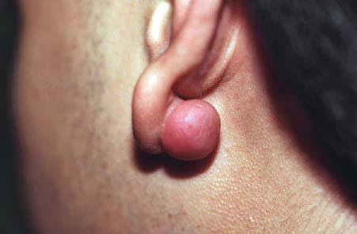
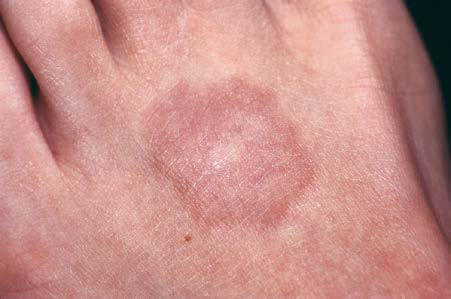

# Chapter 700: Diseases of the Dermis
> **Course:** Vikkypaedia Pediatric Basic Course (*Nelson Textbook of Pediatrics, 22nd Edition (2025)*)  
> **Part XXIX:** The Skin  
> **Authors:** Jacquelyn R. Sink and Yvonne E. Chiu  
> **Metrics:** 7,772 words · 5 tables/boxes · 2 figures · 4 genes · 8 flashcards · 5 MCQs  
> **Quick Navigation:** [🃏 Study 8 Flashcards](../flashcards/700_flashcards.md) · [📝 Take 5-Q MCQ Quiz](../mcqs/700_mcqs.md) · [📚 Part XXIX Guide](../parts/Part_XXIX.md) · [🧬 Syndrome & Genetics Atlas](../omim_gene_atlas.md) · [💊 Therapeutics Matrix](../therapies_matrix.md) · [🏠 Course Index](../../index.md)

## Key Chapter Topics & Subchapters
`700.1 Mast Cell Activation Syndrome` · `700.1 Mast Cell Activation Syndrome James J. Nocton`

## Key Genetic & Molecular Targets
`ABCC6`, `DSG1`, `DSP`, `KRT1`

## ⚡ High-Yield Nelson Pediatric Board Pearls
- Mal De Meleda (SLURP-1 Gene) A rare, progressive autosomal recessive condition, mal de Meleda is characterized by erythema and thick scales on the palms, fingers, soles, and flexor aspects of the wrists, knees, and elbows.
- Vohwinkel PPK with ichthyo sis is caused by pathogenic variants in the loricrin gene, and Vohwinkel PPK with deafness by pathogenic variants in connexin 26.
- Papillon-Lefèvre Syndrome (Cathepsin C Gene) An autosomal recessive erythematous hyperkeratosis of the palms and soles, Papillon-Lefèvre syndrome sometimes extends to the dor sal hands and feet, elbows, and knees later in childhood.
- Richner-Hanhart syndrome is an autosomal recessive focal PPK with corneal ulcers, progressive mental impairment, and a deficiency of tyrosine aminotransferase, which leads to tyrosinemia.
- Pachyonychia congenita is transmitted as an autosomal dominant trait with variable expressivity.
- Oral reti noids are the treatment of choice for severe cases unresponsive to topical therapy.
- Differential Diagnosis Keloids should be differentiated from hypertrophic scars, which remain confined to the site of injury and may involute over time.

---
## Full Chapter Text, Tables & Figures
# Chapter 700: Diseases of the Dermis

*Jacquelyn R. Sink and Yvonne E. Chiu*

<!-- p.5268 -->
gradually progresses to sharply demarcated, hyperkeratotic, scal ing plaques over the palms (Fig. 699.11) and soles. The margins of the plaques often remain red; plaques may extend along the lateral aspects of the hands and feet and onto the volar wrists and the heels. Hyperhidrosis is usually present, but hair, teeth, and nails are usually normal. Striate (*DSG1*, *DSP*, *KRT1* genes) and punctate forms of palmar and plantar hyperkeratosis represent dis tinct entities.

**Mal De Meleda (****SLURP-1**** Gene)** A rare, progressive autosomal recessive condition, mal de Meleda is characterized by erythema and thick scales on the palms, fingers, soles, and flexor aspects of the wrists, knees, and elbows. Hyperhi drosis, nail thickening or koilonychia, and eczema may also occur.

**Vohwinkel Palmoplantar Keratoderma (Mutilating Keratoderma)** Vohwinkel PPK is a progressive autosomal dominant disease consist ing of honeycombed hyperkeratosis of palms and soles, sparing the arches; starfish-like and linear keratoses on the dorsum of the hands, fingers, feet, and knees; and ainhum-like constriction of the digits that sometimes leads to autoamputation. Varying degrees of alopecia may be seen. Two forms have been identified. Vohwinkel PPK with ichthyo sis is caused by pathogenic variants in the loricrin gene, and Vohwinkel PPK with deafness by pathogenic variants in connexin 26.

**Papillon-Lefèvre Syndrome (Cathepsin C Gene)** An autosomal recessive erythematous hyperkeratosis of the palms and soles, Papillon-Lefèvre syndrome sometimes extends to the dor sal hands and feet, elbows, and knees later in childhood. The PPK may be either diffuse, striate, or punctuate. This syndrome is charac terized by periodontal inflammation, leading to loss of teeth by age 4-5 years if untreated.

**Other Syndromes** Keratoderma of palms and soles also occurs as a feature of some forms of ichthyosis and ectodermal dysplasia. Richner-Hanhart syndrome is an autosomal recessive focal PPK with corneal ulcers, progressive mental impairment, and a deficiency of tyrosine aminotransferase, which leads to tyrosinemia. **Pachyonychia congenita** is transmitted as an autosomal dominant trait with variable expressivity. The classic type I form (Jadassohn-Lewandowski syndrome) is due to pathogenic variants in the gene for keratin 16. Major features of the syndrome are onychogryphosis; PPK; follicular hyperkeratosis, especially of the elbows and knees; and oral leukokeratosis. The nail dystrophy is the most striking feature and may be present at birth or develop early in life. The nails are thickened and tubular, projecting upward at the free edge to form a conical roof over a mass of subungual keratotic debris. Repeated paronychial inflammation may result in shedding of the nails. The feature seen most consistently among patients with this condition is keratoderma of the palms and soles. Additional associated features include hyperhidrosis of the palms and soles and bullae and erosions on the palms and soles. Some patients have shown a selective cell-mediated defect in recognition and processing of *Candida.* Surgi cal removal of the nails and excision of the nail matrix have been help ful in some patients.

**Treatment** Treatment for PPK is the same no matter what its cause. In mild cases, emollient therapy may suffice. Keratolytic agents such as sali cylic acid, lactic acid, and urea creams may be required. Oral reti noids are the treatment of choice for severe cases unresponsive to topical therapy.

*Visit Elsevier eBooks+ at eBooks.Health.Elsevier.com** for Bibliography.*

**KELOID Etiology and Pathogenesis** Keloids are usually induced by trauma and commonly follow ear piercing, burns, scalds, and surgical procedures. The resulting keloid is larger than the initial area of trauma to the skin. Certain individuals are predisposed to keloid formation; a familial tendency (recessive or dominant inheritance) or the presence of foreign mate rial in the wound may have a pathogenic role. Keloids are a rare fea ture of Ehlers-Danlos syndrome, Rubinstein-Taybi syndrome, and pachydermoperiostosis. Keloids result from an abnormal fibrous wound-healing response in which tissue repair and regenerationregulation control mechanisms are lost. Collagen production is 20 times that seen in normal scars, and the type I:III collagen ratio is abnormally high. In keloids, tissue levels of tumor growth factor-β and platelet-derived growth factor are elevated; fibroblasts are more sensitive to their effects, and their degradation rate is decreased.

**Clinical Manifestations** A *keloid* is a sharply demarcated, benign, dense growth of connec tive tissue that forms in the dermis after trauma. The lesions are firm, raised, pink to hyperpigmented, and rubbery; they may be tender or pruritic. Sites of predilection are the face, earlobes (Fig. 700.1), neck, shoulders, upper trunk, sternum, and lower legs. Unlike hypertrophic scars, keloids frequently recur after attempted removal and outgrow the original boundaries of the wound.

**Histology** A keloid consists of whorled and interlaced hyalinized collagen fibers.

**Differential Diagnosis** Keloids should be differentiated from *hypertrophic scars,* which remain confined to the site of injury and may involute over time.

*Jacquelyn R. Sink and Yvonne E. Chiu*

**Fig. 700.1** Keloid of earlobe after piercing.

<!-- p.5270 -->
**Treatment** Treatment of keloids is difficult. Young keloids may diminish in size if injected intralesionally at 4-week intervals with triamcinolone sus pension (10-40 mg/mL). At times, a more concentrated suspension is required. Large or old keloids may require surgical excision fol lowed by serial intralesional injections of corticosteroid; however, recurrence rates are high. Earlobe keloids may respond favorably to surgical excision followed by use of pressure earrings and serial intra lesional steroid injections. Silicone scar sheeting may help in some patients. Other therapeutic modalities that have been used with vari able success include laser therapy, radiation therapy, and intralesional injection of bleomycin, interferon, verapamil, or fluorouracil.

**STRIAE CUTIS DISTENSAE (STRETCH MARKS) Etiology and Pathogenesis** Striae formation is common in adolescence. The most frequent causes are rapid growth, pregnancy, obesity, Cushing disease, and prolonged use of systemic or topical corticosteroid therapy. They may also be seen in patients with Ehlers-Danlos syndrome. The pathogenesis is unknown, but alterations in collagen and elastic fibers are thought to play a role.

**Clinical Manifestations** Striae appear as linear, depressed, pink bands of atrophic skin that eventually become silvery, opalescent, and smooth. They occur most frequently in areas subject to distention, such as the lower back (Fig. 700.2), buttocks, thighs, breasts, abdomen, and shoulders.

**Differential Diagnosis** Striae distensae resemble atrophic scars.

**Treatment** Striae tend to spontaneously become less conspicuous as the color fades with time, and treatment is not necessary.

**CORTICOSTEROID-INDUCED ATROPHY Etiology and Pathogenesis** Both topical and systemic corticosteroid treatment can result in cutane ous atrophy. This is particularly common when a potent or superpotent topical corticosteroid is applied under occlusion or to an intertriginous area for a prolonged period. Keratinocyte growth is decreased, but epidermal maturation is accelerated, resulting in thinning of the epi dermis and stratum corneum. Fibroblast growth and function are also decreased, leading to dermal changes. The mechanism involves inhibi tion of synthesis of collagen type I, noncollagenous proteins, and total protein content of the skin, along with progressive reduction of dermal proteoglycans and glycosaminoglycans.

**Clinical Manifestations** Affected skin is thin, fragile, smooth, and semitransparent, with telan giectasia, prominent veins, and loss of normal skin markings.

**Histology** On histology, thinning of the epidermis is present. Spaces between der mal collagen and elastic fibers are small, producing a more compact yet thin dermis.

**Treatment** Optimal treatment is prevention by monitoring and educating on the proper use of topical steroids to avoid side effects.

**GRANULOMA ANNULARE Etiology and Pathogenesis** The cause of granuloma annulare (GA) is unknown. A possible asso ciation with diabetes mellitus has been proposed, particularly with the generalized form of GA; however, this hypothesis is controversial and has not been confirmed in children.

**Clinical Manifestations** This common dermatosis occurs predominantly in healthy children and young adults. Typical lesions begin as firm, smooth, erythema tous papules. They gradually enlarge to form annular plaques with a papular border and a normal, slightly atrophic or discolored central area up to several centimeters in size. Lesions may occur anywhere on the body, but mucous membranes are notably spared. Favored sites include the dorsum of the hands (Fig. 700.3) and feet. The dis seminated papular form is rare in children. Subcutaneous GA tends to develop on the scalp and limbs, particularly in the pretibial area. These lesions are firm, usually nontender, skin-colored nodules. Perforating GA is characterized by the development of grouped papules, some with a yellowish, crusted, or scaly center, and occur because of transepidermal elimination of altered collagen.

**Differential Diagnosis** Annular lesions are often mistaken for tinea corporis due to the ele vated, advancing border; however, GA characteristically lacks scale. Papular lesions may simulate rheumatoid nodules, particularly when grouped on the fingers and elbows.

**Histology** The lesions of GA demonstrate granuloma formation on histology with a central area of necrotic collagen, mucin deposition, and a periph eral palisading infiltrate of lymphocytes, histiocytes, and foreign body giant cells. The pattern resembles that of necrobiosis lipoidica and rheumatoid nodules, but subtle histologic differences usually permit differentiation.

**Treatment** The eruption persists for months to years, but spontaneous resolu tion without residual change is typical; approximately 50% of lesions clear within 2 years. Application of a potent or superpotent topical corticosteroid preparation or intralesional injections (5-10 mg/mL)

**Fig. 700.3** Annular lesion with a raised papular border and depressed center, characteristic of granuloma annulare.

**Fig. 700.2** Striae on the back of an adolescent.

<!-- p.5271 -->
of corticosteroid may hasten involution, but nonintervention is also appropriate.

**NECROBIOSIS LIPOIDICA Etiology and Pathogenesis** The cause of necrobiosis lipoidica (NL) is unclear, but 50–75% of patients have diabetes mellitus, though NL occurs in less than 1% of all diabetic patients. NL has also been noted in patients with obesity, hypertension, and dyslipidemias. Its presence may signify a higher risk for diabetic complications such as nephropathy and retinopathy.

**Clinical Manifestations** This disorder manifests as erythematous papules that evolve into irreg ularly shaped, sharply demarcated, erythematous to yellow, sclerotic plaques with central telangiectasias and a violaceous border. Scaling, crusting, and ulceration may occur. Lesions develop most commonly on the anterior tibial surfaces (Fig. 700.4). Slow extension of a given lesion over the years is usual, but long periods of quiescence or com plete healing with scarring may occur.

**Histology** Poorly defined areas of necrobiotic collagen are seen on micro scopic evaluation, primarily low in the dermis with mucin depo sition. Surrounding the necrobiotic, disordered areas of collagen is a palisading lymphohistiocytic granulomatous infiltrate. Some lesions are more characteristically granulomatous, with limited necrobiosis of collagen.

**Differential Diagnosis** NL must be differentiated clinically from xanthomas, morphea, GA, erythema nodosum, and pretibial myxedema.

**Treatment** The lesions of NL usually persist despite good control of the diabetes but may improve minimally after applications of high-potency topical steroids or local injection of a corticosteroid. Ulcerated areas should be managed with meticulous wound care. Pentoxifylline and antiplatelet therapy with aspirin have also been used.

**LICHEN SCLEROSUS Etiology and Pathogenesis** Lichen sclerosus (LS) is a chronic inflammatory dermatosis whose cause is largely unknown. Several studies have identified the presence of autoantibodies against the glycoprotein extracellular matrix protein 1 (ECM-1).

**Clinical Manifestations** Lichen sclerosus (LS) manifests as shiny, ivory-colored, flat-topped papules, often with a violaceous halo. The surface shows prominent dilated pilosebaceous or sweat duct orifices that may contain yellow

or brown follicular plugs. The papules coalesce to form irregular plaques of variable size, and hemorrhagic bullae can be seen in the margins. In the later stages, atrophy results in a depressed plaque with a wrinkled surface. This disorder occurs more commonly in girls than in boys. Sites of predilection in girls are the vulvar (Fig. 700.5), perianal, and perineal skin. Extensive involvement may produce an atrophic plaque of hourglass configuration; shrinkage of the labia and stenosis of the introitus may result. Erythema and purpura are possible. Vaginal discharge precedes vulvar lesions in approximately 20% of patients. In boys, the prepuce and glans penis are often involved, usually in association with phimosis *(balanitis xerotica obliterans)*; most boys with the disorder were not circum cised early in life. Commonly involved extragenital sites include the upper trunk, neck, axillae, flexor surfaces of wrists, and areas around the umbilicus and the eyes. Pruritus, pain, and dysuria may be severe, and constipation due to withholding may occur.

**Differential Diagnosis** In children, LS is most frequently confused with focal morphea (see Chapter 201), with which it may coexist. In the genital area, it may be mistakenly attributed to sexual abuse, irritant dermatitis, or vulvovaginitis. The vitiligoid form associated with depigmen tation must be differentiated from vitiligo or postinflammatory hypopigmentation.

**Histology** Biopsy is rarely necessary but shows hyperkeratosis with follicular plugging, hydropic degeneration of basal cells, a bandlike dermal lym phocytic infiltrate, homogenized collagen, and thinned elastic fibers in the upper dermis.

**Treatment** Vulvar LS in childhood usually improves with puberty but does not always resolve completely, and symptoms can recur throughout life. Long-term observation for the development of squamous cell carci noma is necessary in patients with later disease onset or persistence beyond puberty. Superpotent topical corticosteroids are the treat ment of choice, including for the genital area, providing relief from pruritus and producing clearing of lesions. Topical tacrolimus and pimecrolimus have also been used. It is not known how response to treatment affects long-term cancer risk.

**MORPHEA Etiology and Pathogenesis** Morphea is an autoimmune sclerosing condition of the dermis and subcutaneous tissue of unknown etiology.

**Clinical Manifestations** Morphea is characterized by solitary, multiple, or linear circumscribed areas of erythema that evolve into indurated, sclerotic, atrophic plaques, with or without a lilac border (Fig. 700.6). Affected areas may resolve

**Fig. 700.5** Ivory-colored perivaginal plaque with hemorrhage.

**Fig. 700.4** Yellow sclerotic plaque of necrobiosis lipoidica on the shin.

<!-- p.5272 -->
without sequelae or with subsequent atrophy and/or pigment change. Morphea is seen more commonly in females. Five types of morphea have been described: circumscribed, linear, generalized, mixed, and panscle rotic; the most common types in children are circumscribed and linear. Morphea can affect any area of skin. When confined to the frontal scalp, forehead, and midface in a linear band, it is referred to as **en coup de sabre**. When located on one side of the face, it is termed **progressive hemifa cial atrophy**, also known as **Parry-Romberg syndrome**. These forms of morphea carry a poorer prognosis because of the associated underlying central nervous system involvement or musculoskeletal atrophy that can be cosmetically disfiguring. Linear morphea over a joint may lead to limb undergrowth or restriction of mobility (Fig. 700.7). Pansclerotic morphea is a rare, severe, disabling variant.

**Differential Diagnosis** The differential diagnosis of morphea includes GA, NL, LS, and latestage European Lyme borreliosis (acrodermatitis chronica atrophicans).

**Histology** Thickening or sclerosus of the dermis with collagen degeneration is seen.

**Treatment** Morphea tends to persist, with gradual outward expansion for months to years until spontaneous cessation of the inflammatory phase occurs. Topical calcipotriene, alone or in combination with high-potency to superpotency topical steroids or topical tacrolimus, has been used for less severe disease. For severe morphea, methotrexate with or with out pulsed intravenous or oral glucocorticosteroids may halt progres sion and help shorten the disease course. Ultraviolet A-1 (UVA-1)

phototherapy, mycophenolate mofetil, and other therapies are also used. Physical therapy is recommended in linear morphea involving a joint to maintain mobility. Significant postinflammatory pigment alteration may persist for years.

**SCLEREDEMA (SCLEREDEMA ADULTORUM, SCLEREDEMA OF BUSCHKE) Etiology and Pathogenesis** The cause of scleredema is unknown. There are three types. **Type 1** (55% of cases) is preceded by a febrile illness, often related to an upper or lower respiratory infection (most commonly streptococcus). **Type 2** (25%) is associated with paraproteinemia, including multiple myeloma. **Type 3** (20%) is seen in diabetes mellitus.

**Clinical Manifestations** Fifty percent of patients with scleredema are younger than 20 years old. Onset of type 1 is sudden, with brawny edema of the face and neck that spreads rapidly to involve the thorax and arms in a sweater distribution; the abdomen and legs are usually spared. The face acquires a waxy, masklike appearance. The involved areas feel indurated and woody, are nonpitting, and are not sharply demar cated from normal skin. The overlying skin is normal in color and is not atrophic.

Type 2 and type 3 scleredema may occur insidiously. Systemic involvement, which is uncommon and usually associated with types 2 and 3, is marked by thickening of the tongue, dysarthria, dyspha gia, restriction of eye and joint movements, and pleural, pericardial, and peritoneal effusions. Electrocardiographic changes may also be observed. Laboratory data are not helpful.

**Differential Diagnosis** Scleredema must be differentiated from scleroderma (see Chapter 201), morphea, myxedema, trichinosis, dermatomyositis, sclerema neonatorum, and subcutaneous fat necrosis.

**Histology** Skin biopsy demonstrates an increase in dermal thickness due to swelling and homogenization of the collagen bundles, which are separated by large interfibrous spaces. Special stains can iden tify increased amounts of mucopolysaccharides in the dermis of patients with scleredema.

**Treatment** In type 1 scleredema, the active phase of the disease persists for 2-8 weeks. Spontaneous and complete resolution usually occurs after 6 months to 2 years. Recurrent attacks are unusual. In types 2 and 3, the disease is slowly progressive. There is no specific therapy.

**LIPOID PROTEINOSIS (URBACH-WIETHE DISEASE, HYALINOSIS CUTIS ET MUCOSAE) Etiology and Pathogenesis** Lipoid proteinosis is an autosomal recessive disorder caused by patho genic variants in the *ECM-1* gene, which encodes ECM-1. ECM-1 has a functional role in the structural organization of the dermis by bind ing to perlecan, matrix metalloproteinase 9, and fibulin. Pathogenesis involves infiltration of hyaline material into the skin, oral cavity, lar ynx, and internal organs.

**Clinical Manifestations** Lipoid proteinosis presents initially in early infancy as hoarseness due to vocal cord involvement. Skin lesions appear during childhood and consist of yellowish papules and nodules that may coalesce to form plaques. The classic sign is a string of beaded papules on the eyelids. Lesions also occur on the face, forearms, neck, genitals, dor sum of the fingers, and scalp, where they result in patchy alopecia. Similar deposits are found on the lips, leading to eversion of the lips, as well as the undersurface of the tongue, fauces, uvula, epiglottis,

**Fig. 700.6** Erythematous, hyperpigmented plaque of early morphea.

**Fig. 700.7** Linear morphea with involvement over the ankle.

<!-- p.5273 -->
and vocal cords. The tongue becomes enlarged and feels firm on pal pation. The patient may be unable to protrude the tongue. Pocklike, atrophic scars may develop on the face. Hypertrophic, hyperkeratotic nodules and plaques occur at sites of friction, such as the elbows and knees; the palms may be diffusely thickened. The disease progresses until early adult life, but the prognosis is good. Symmetric calcifica tion lateral to the sella turcica in the medial temporal region, iden tifiable roentgenographically as bilateral bean-shaped opacities, is pathognomonic but is not always present. Involvement of the larynx can lead to respiratory compromise, particularly in infancy, neces sitating tracheostomy. Associated anomalies include dental abnor malities, epilepsy, and recurrent parotitis because of infiltrates in the Stensen duct. Virtually any organ can be involved.

**Histology** The distinctive histologic pattern in lipoid proteinosis includes dilation of dermal blood vessels and infiltration of homogeneous eosinophilic extracellular hyaline material along capillary walls and around sweat glands. Hyaline material in homogeneous bundles, diffusely arranged in the upper dermis, produces a thickened dermis. The infiltrates appear to contain both lipid and mucopolysaccharide substances.

**Treatment** There is no specific treatment for lipoid proteinosis.

**MACULAR ATROPHY (ANETODERMA) Etiology and Pathogenesis** Anetoderma is characterized by circumscribed areas of slack skin asso ciated with loss of dermal substance. This disorder may have no asso ciated underlying disease (primary macular atrophy) or may develop after an inflammatory skin condition. Secondary macular atrophy may be a result of direct destruction of dermal elastin or elastolysis on an immunologic basis, especially in the presence of antiphospholipid anti bodies, which are related to autoimmune disorders. The elastolysis may then be a result of release of elastase from inflammatory cells.

**Clinical Manifestations** Lesions vary from 0.5 to 1.0 cm in diameter and, if inflammatory, may initially be erythematous. They subsequently become thin, wrinkled, and blue-white or hypopigmented. The lesions often protrude as small out pouchings that, on palpation, may be readily indented into the subcutane ous tissue because of the dermal atrophy. Sites of predilection include the trunk, thighs, upper arms, and, less commonly, the neck and face. Lesions remain unchanged for life; new lesions often continue to develop for years.

**Histology** All types of macular atrophy show focal loss of elastic tissue on histo pathologic examination, a change that may not be recognized unless special stains are used.

**Differential Diagnosis** Lesions of anetoderma occasionally resemble morphea, LS, focal der mal hypoplasia, atrophic scars, or end-stage lesions of chronic bullous dermatoses.

**Treatment** There is no effective therapy for macular atrophy.

**PSEUDOXANTHOMA ELASTICUM Etiology and Pathogenesis** Pseudoxanthoma elasticum (PXE) is a genetic metabolic disease linked to pathogenic variants in the *ABCC6* gene. The primary abnormality seen in PXE is mineralization of tissue in the skin, Bruch membrane in the retina, and vessel walls. Cutaneous manifestations of PXE may be present in generalized arterial calcification of infancy.

**Clinical Manifestations** Onset of skin manifestations often occurs during childhood, but the changes produced by early lesions are subtle and may not be recog nized. The characteristic pebbly, “plucked chicken skin” cutaneous lesions are 1- to 2-mm, asymptomatic, yellow papules arranged in a lin ear or reticulated pattern or in confluent plaques. Preferred sites are the flexural neck (Fig. 700.8), axillary and inguinal folds, umbilicus, thighs, and antecubital and popliteal fossae. As the lesions become more pro nounced, the skin acquires a velvety texture and droops in lax, inelas tic folds. The face is usually spared. Mucous membrane lesions may involve the lips, buccal cavity, rectum, and vagina. There is involvement of the connective tissue of the media and intima of blood vessels, Bruch membrane of the eye, and endocardium or pericardium, which may result in visual disturbances, angioid streaks in the Bruch membrane, irregular mottling of the retinal epithelium, intermittent claudication, cerebral and coronary occlusion, hypertension, and hemorrhage from the gastrointestinal tract, uterus, or mucosal surfaces. Women with PXE have an increased risk of miscarriage in the first trimester. Arte rial involvement generally manifests in adulthood, but claudication and angina have occurred in early childhood.

**Pathology** Histopathologic examination shows fragmented, swollen, and clumped elastic fibers in the middle and lower third of the dermis. The fibers stain positively for calcium. Collagen near the altered elastic fibers is reduced in amount and is split into small fibers. Aberrant calcification of the elastic fibers of the internal elastic lamina of arteries in PXE leads to narrowing of vessel lumina.

**Treatment** There is no effective treatment for PXE, although laser therapy, with or without intravitreal injection of vascular endothelial growth factor antag onists, may help prevent retinal hemorrhage. The use of oral phosphate binders has shown mixed results in decreasing calcification of elastic fibers.

**ELASTOSIS PERFORANS SERPIGINOSA Etiology and Pathogenesis** Elastosis perforans serpiginosa (EPS) is characterized by the extrusion of altered elastic fibers through the epidermis. The primary abnormal ity is probably in the dermal elastin, which provokes a cellular response that ultimately leads to extrusion of the abnormal elastic tissue.

**Clinical Manifestations** This is an unusual skin disorder in which 1- to 3-mm, firm, skincolored, keratotic papules tend to cluster in arcuate and annular patterns on the posterolateral neck and limbs (Fig. 700.9) and occa sionally on the face and trunk. Onset usually occurs in childhood or

**Fig. 700.8** Confluent plaque of pebbly skin in pseudoxanthoma elas ticum.

<!-- p.5274 -->
adolescence. A papule consists of a circumscribed area of epidermal hyperplasia that communicates with the underlying dermis by a nar row channel. There is a great increase in the amount and size of elastic fibers in the upper dermis, particularly in the dermal papillae. Approxi mately 30% occur in association with osteogenesis imperfecta, Mar fan syndrome, PXE, Ehlers-Danlos syndrome, Rothmund-Thomson syndrome, scleroderma, acrogeria, and Down syndrome. EPS has also occurred in association with penicillamine therapy.

**Histology** Histopathology reveals a hyperplastic epidermis with extrusion of abnormal elastic fibers and a lymphocytic superficial infiltrate.

**Differential Diagnosis** The differential diagnosis of EPS includes tinea corporis, perforating GA, reactive perforating collagenosis, lichen planus, creeping eruption, and porokeratosis of Mibelli.

**Treatment** Treatment of EPS is ineffective; however, the lesions are asymptomatic and may disappear spontaneously.

**REACTIVE PERFORATING COLLAGENOSIS Etiology and Pathogenesis** The primary process in reactive perforating collagenosis represents transepidermal elimination of altered collagen. A familial autosomal recessive form has been described.

**Clinical Manifestations** Reactive perforating collagenosis usually manifests in early child hood as small papules on the dorsal areas of the hands and fore arms, elbows, knees, and, sometimes, the face and trunk. Over a period of several weeks, the papules enlarge to 5-10 mm, become umbilicated, and develop keratotic plugs centrally (Fig. 700.10). Individual lesions resolve spontaneously in 2-4 months, leaving hypopigmented macules or scars. Lesions may recur in crops, lin early as a part of the Koebner phenomenon, or in response to cold temperatures or superficial trauma such as abrasions, insect bites, and acne lesions.

**Histology** Collagen in the papillary dermis is engulfed within a cup-shaped per foration in the epidermis. The central crater contains pyknotic inflam matory cells and keratinous debris.

**Differential Diagnosis** EPS and Kyrle disease may mimic reactive perforating collagenosis.

**Treatment** Reactive perforating collagenosis resolves spontaneously in 6-8 weeks. Narrow-band ultraviolet B (UVB) light may help with pruritus and hasten resolution.

**XANTHOMAS** See Chapter 105.

**FABRY DISEASE** See Chapter 653.6.

**MUCOPOLYSACCHARIDOSES** See Chapter 109.

Several of the mucopolysaccharidoses are characterized by thick ened, rough, inelastic skin, particularly on the extremities, and gen eralized hypertrichosis but are nonspecific features. Extensive and persistent dermal melanocytosis has been described in children with Hurler and Hunter syndromes. Telangiectasias on the face, fore arms, trunk, and legs have been observed in Scheie and Morquio syndromes. In some patients with Hunter syndrome, ivory-colored, distinctive, firm dermal papules and nodules with corrugated sur face texture are grouped into symmetric plaques on the upper trunk (Fig. 700.11), arms, and thighs. Onset of these unusual lesions occurs in the first decade of life, and spontaneous disappearance has been noted.

**MASTOCYTOSIS Etiology and Pathogenesis** Mastocytosis encompasses a clinical spectrum of disorders that range from solitary cutaneous nodules to diffuse infiltration of skin associated with involvement of internal organs (Table 700.1). All of the disorders are characterized by aggregates of mast cells in the dermis. There are four types of mastocytosis: mastocytomas (three or fewer lesions), urticaria pigmentosa (more than three lesions, also known as *maculopapular cutaneous mastocytosis*), diffuse cutaneous mastocytosis, and telangiectasia macularis eruptiva per stans (TMEP). Increased expression of stem cell factor (also called *kit ligand* or *mast cell growth factor*) stimulates the proliferation of mast cells and increases the production of melanin by melanocytes. Some forms of mastocytosis are associated with activating patho genic variants (most commonly the *D816V* variant) in the *KIT* gene. The local and systemic manifestations of the disease are at least partly a result of the release of histamine and heparin from mast cell granules; although heparin is present in significant amounts in mast cells, coagulation disturbances occur only rarely. The vasodi lator prostaglandin D2 or its metabolite appears to exacerbate the flushing response. Serum tryptase values may be elevated, but not consistently.

**Fig. 700.10** Hyperkeratotic papules in reactive perforating collagen osis.

**Fig. 700.9** Arcuate keratotic papule of elastosis perforans serpigi nosa.

<!-- p.5275 -->
**Clinical Manifestations Mastocytomas** are usually 1-5 cm in diameter. Lesions may be present at birth or may arise in early infancy at any site. The lesions may mani fest as recurrent, evanescent wheals or bullae; in time, an infiltrated, pink, yellow, or tan, rubbery plaque develops at the site of whealing or blistering (Fig. 700.12). The surface acquires a pebbly, orange peel–like texture, and hyperpigmentation may become prominent. Mechanical irritation of the lesion may lead to urtication (Darier sign) within a few minutes due to local histamine release; rarely, systemic signs of hista mine release become apparent.

**Urticaria pigmentosa** is the most common form of mastocytosis in children. In the first type of urticaria pigmentosa, the **classic infantile type**, lesions may be present at birth but more often erupt in crops in the first several months to 2 years of age. New lesions seldom arise after age 3-4 years. In some cases, early bullous or urticarial lesions fade, only to recur at the same site, ultimately becoming fixed and hyperpig mented. In others, the initial lesions are hyperpigmented. Vesiculation usually abates by 2 years of age. Individual lesions range in size from a few millimeters to several centimeters and may be macular, papu lar, or nodular. They range in color from yellow-tan to red-brown and often have ill-defined borders (see Fig. 700.12). Larger nodular lesions, like solitary mastocytomas, may have a characteristic *peau d’orange* (orange peel–like) texture. Lesions of urticaria pigmentosa may be sparse or numerous and are often symmetrically distributed. Palms, soles, and face are usually spared, as are the mucous membranes. The rapid appearance of erythema and wheals in response to vigorous

stroking of a lesion can usually be elicited; dermographism of inter vening normal skin is also common. Affected children can have intense pruritus. Systemic signs of histamine release, such as anaphylaxis-like episodes, hypotension, syncope, headache, episodic flushing, tachy cardia, wheezing, colic, and diarrhea, are uncommon and occur most frequently in the more severe types of mastocytosis. Flushing is by far the most common symptom.

The **second type** of urticaria pigmentosa may begin in childhood but typically develops in adulthood. This type does not resolve, and new lesions continue to develop throughout life. Patients with this type of mastocytosis may develop systemic involvement.

**Systemic mastocytosis** is marked by an abnormal increase in the number of mast cells in numerous organ systems and is uncommon in children. Bone lesions are often silent (but may be painful) and are detectable radiologically as osteoporotic or osteosclerotic areas, principally in the axial skeleton. Gastrointestinal tract involvement may lead to abdominal pain, nausea, vomiting, diarrhea, steator rhea, and bloating. Mucosal infiltrates may be detectable by barium studies or by small bowel biopsy. Peptic ulcers also occur. Hepa tosplenomegaly due to mast cell infiltrates and fibrosis has been described, as has mast cell proliferation in lymph nodes, kidneys, periadrenal fat, and bone marrow. Abnormalities in the peripheral blood, such as anemia, leukocytosis, and eosinophilia, are noted in approximately 30% of patients. Mast cell leukemia may occur.

**Diffuse cutaneous mastocytosis** is characterized by diffuse involvement of the skin rather than discrete hyperpigmented lesions. Affected patients are usually normal at birth and demonstrate features of the disorder after the first few months of life. Rarely, the condi tion may present with intense generalized pruritus in the absence of visible skin changes. The skin usually appears thickened, pink to yel low in color, doughy, or with a *peau d’orange* texture. Surface changes are accentuated in flexural areas. Recurrent bullae (see Fig. 700.12), intractable pruritus, and flushing attacks are common, as is systemic involvement.

**Telangiectasia macularis eruptiva perstans (TMEP)** is a variant of mastocytosis that consists of telangiectatic, hyperpigmented macules usually localized to the trunk. These lesions do not urticate when stroked. This form of the disease is seen primarily in adolescents and adults.

**Differential Diagnosis** The differential diagnosis of solitary mastocytomas includes recurrent bullous impetigo, herpes simplex, congenital melanocytic nevi, and juvenile xanthogranuloma.

Urticaria pigmentosa can be confused with drug eruptions, postin flammatory pigmentary change, juvenile xanthogranuloma, pigmented nevi, ephelides, xanthomas, chronic urticaria, insect bites, and bullous impetigo. Diffuse cutaneous mastocytoma may be confused with epi dermolytic hyperkeratosis. TMEP must be differentiated from other causes of telangiectasia.

The systemic manifestations of mastocytosis may mimic pheo chromocytoma, carcinoid syndrome, vasoactive intestinal peptide– secreting tumors, vasculitis, autoinflammatory diseases, hyper-IgE syndrome, somatization disorder, autonomic dysfunction, angio edema, chronic urticaria, and anaphylaxis.

**Prognosis** Spontaneous involution usually occurs in patients with solitary mas tocytomas and classic infantile urticaria pigmentosa. The incidence of systemic manifestations in these patients is very low. The mean dura tion of urticaria pigmentosa is around 10 years. A larger number of lesions early in life may lead to later resolution.

**Treatment** Solitary mastocytomas usually do not require treatment. Lesions that blister may be treated with topical steroids after each blistering episode.

In urticaria pigmentosa, flushing can be precipitated by excessively hot baths, vigorous rubbing of the skin, and certain drugs, such as

**Fig. 700.11** Ivory-colored papules on the upper back in Hunter syn drome.

#### **Table 700.1** Mastocytosis Classification

| Category / Parameter | Clinical Details & Findings |
| --- | --- |
| **CUTANEOUS MASTOCYTOSIS** | Urticaria pigmentosa/maculopapular cutaneous mastocytosis; Diffuse cutaneous mastocytosis; Solitary mastocytoma |
| **SYSTEMIC MASTOCYTOSIS** | Indolent mastocytosis; Smoldering mastocytosis; Aggressive mastocytosis; Systemic mastocytosis with associated hematologic non–mast cell; lineage (AHN) disease; Mast cell leukemia |
| **MAST CELL SARCOMA** | Modified from Valent P, Akin C, Metcalfe D. Mastocytosis: 2016 Updated WHO; classification and novel emerging treatment concepts. Blood. 2017;129:1420–1427,; Table 2. |

<!-- p.5276 -->
codeine, aspirin, morphine, atropine, ketorolac, alcohol, tubocura rine, iodine-containing radiographic dyes, and polymyxin B (Table 700.2). Avoidance of these triggering factors is advisable; it is notable that general anesthesia may be safely performed with appropriate precautions.

For patients who are symptomatic, oral antihistamines may be pal liative. H1 receptor antagonists are the initial drugs of choice for sys temic signs of histamine release. If H1 antagonists are unsuccessful, H2 receptor antagonists may be helpful in controlling pruritus or gastric

hypersecretion. Topical steroids are of benefit in controlling skin urtication and blistering. Oral mast cell–stabilizing agents, such as cromolyn sodium or ketotifen, may also be effective for diarrhea or abdominal cramping and with systemic symptoms such as headache or muscle pain. Midostaurin, an inhibitor of receptor tyrosine kinase KIT, may be effective in patients with systemic mastocytosis associated with hematologic malignancy. A premeasured epinephrine pen kit may be considered for those individuals at higher risk for anaphylaxis such as systemic disease, extensive cutaneous disease, high baseline tryptase levels, and known allergies.

For patients with diffuse cutaneous mastocytosis, treatment is simi lar to urticaria pigmentosa. Phototherapy with narrow-band UV (UVB or UVA-1) or psoralen with UVA treatment may be useful.

Lesions of TMEP may be cautiously treated with vascular pulsed dye lasers.

*Visit Elsevier eBooks+ at eBooks.Health.Elsevier.com** for Bibliography.*

## 700.1  Mast Cell Activation Syndrome James J. Nocton

Mast cell activation (MCA) occurs in several defined conditions, including primary mast cell disorders, allergic reactions, systemic inflammatory diseases, and drug reactions, and results in the release of multiple proinflammatory mediators, including tryptase, histamine, prostaglandins, and leukotrienes. The effects of these mediators lead to the clinical symptoms of MCA, which may range from mild to severe and may involve multiple organ systems, including the cutaneous, gas trointestinal, respiratory, and cardiovascular systems (Table 700.3). The term *mast cell activation syndrome (MCAS)* has been used to describe a condition associated with symptoms, signs, and laboratory abnormali ties that are consistent with the effects of mast cell mediators; it is recur rent, usually severe, and involves multiple organ systems and responds to treatment with medications that are known to inhibit mast cells or secreted mast cell mediators. Consensus criteria for the diagnosis and

that May Exacerbate Mast Cell Mediator Release in Patients with Mastocytosis

#### **Table 700.2** Pharmacologic Agents and Physical Stimuli

| Category / Parameter | Clinical Details & Findings |
| --- | --- |
| **General** | Venoms (bee stings, jellyfish stings, snake bites); Complement-derived anaphylatoxins; Biologic peptides (substance P, somatostatin, vasoactive intestinal; polypeptide); Polymers (dextran); Physical stimuli (heat, cold, exertion, friction, trauma, vibration, sunlight); Acetylsalicylic acid (aspirin), ibuprofen, and related nonsteroidal; analgesics*; Alcohol; General anesthetics (D-tubocurarine, scopolamine, decamethonium,; gallamine, pancuronium); Polymyxin B; Local anesthetics (lidocaine, tetracaine procaine, methylparaben; preservative); Sympathomimetics; Opiates (codeine, morphine)*; Radiographic dyes (iodine-containing); Other drugs (papaverine, dipyridamole, trimethaphan, amphotericin; B, quinine, thiamine, dextromethorphan, lactam, antibiotics,; vancomycin); Stress (sleep deprivation, anxiety, pain); *Appears to be a problem in <10% of patients.; Modified from Carter MC, Metcalfe DD. Paediatric mastocytosis. Arch Dis Child.; 2002;86:315–319, Table 4. |

A B C D E F G

H I J K L M N

**Fig. 700.12** Clinical features and histologic findings in childhood mastocytosis. Diagnosis of mastocytosis in children is often obvious, and skin biopsy is rarely performed. The histologic diagnosis of cutaneous mastocytosis must consider the increased number and proportion of mast cells compared to other inflammatory cells. Mast cells can be rounded, cuboidal, fusiform, or histiocyte-like. Eosinophils may be observed in all mastocy tosis subtypes. The epidermis may be hyperpigmented in urticaria pigmentosa (UP) and diffuse cutaneous mastocytosis (DCM), whereas it is normal in mastocytoma. A-E, Types of urticaria pigmentosa. A, Maculopapular UP. B, Plaque-type UP. C, Extensive UP with plaques and macules. D, Skin biopsy: increased number and proportion of mast cells around the vessels or scattered into the dermis, dilatation of the capillaries of the superficial dermis. E, c-Kit staining. F-J, Mastocytoma. F, Mastocytoma localized on the hand. G, Mastocytoma localized on the forearm. H, I, Skin biopsy: abundant and diffuse infiltration of mast cells throughout the dermis. Mast cells are always recognizable, with a large, pink, and granular cytoplasm and a round, dense, central nucleus. J, c-Kit staining. K-N, DCM. K, Diffuse infiltration of skin. L, Extensive bullous lesions associated with infiltration on the back. M, Skin biopsy: diffuse dermal infiltration of mast cells associated with some fibrosis and dilated capillaries. N, c-Kit staining. (From Méni C, Bruneau J, Georgin-Lavialle S, et al. Paediatric mastocytosis: a systematic review of 1747 cases. Br J Dermatol. 2015;172:642–651, Fig. 1, p. 643.)

<!-- p.5277 -->

<!-- p.5278 -->
Additional biochemical markers have been proposed but remain either of unknown or questionable reliability as markers of MCA.

MCAS has been classified into three groups: primary, secondary, and idiopathic. Primary MCAS refers to patients with *clonal prolifera tion* of mast cells resulting from pathogenic variants in the *KIT* gene and is usually associated with systemic or cutaneous mastocytosis. A small percentage of those with primary MCAS have clonal prolifera tion of mast cells but may not completely fulfill the criteria to diag nose systemic or cutaneous mastocytosis. Secondary MCAS refers to patients with either an IgE-dependent allergy, a non–IgE-mediated hypersensitivity disorder, or another inflammatory disease associ ated with MCA. Idiopathic MCAS refers to patients who do not have clonal mast cells and who do not have an underlying disorder but who nonetheless fulfill the consensus criteria for MCAS with char acteristic clinical symptoms and signs, specific abnormal laboratory test results, and a response to treatment that inhibits mast cells or the effect of mast cell mediators.

The **differential diagnosis** of MCAS is broad, reflecting the pro tean symptoms and signs that have been associated with the syn drome. Cardiovascular conditions may be considered in those with syncope; thyroid disease, adrenal insufficiency, infectious diseases, intoxications, chronic pain syndromes, somatization secondary to anxiety or depression, hypereosinophilic syndromes, hereditary angioedema, and dysautonomias are also considerations in patients with symptoms that appear to be potentially related to MCA. There is also an overlap with idiopathic anaphylaxis and MCAS (see Chap ter 190 and Fig. 190.4).

When episodes of cutaneous flushing are the primary symptom and sign, the differential diagnosis is likewise broad. Flushing refers to tran sient episodes of erythema, most commonly on the face, accompanied by a sensation of warmth. Wet flushing is associated with *increased sweating* and is typical of autonomic nervous system activation, whereas dry flushing occurs without sweating. Wet flushing is more likely caused by panic attacks, pain syndromes, dysautonomia, medica tions, or toxins. Dry flushing is associated with a more extensive list of

Cell Mediator Disorders

#### **Table 700.3** Common Symptoms in Patients with Mast

| Category / Parameter | Clinical Details & Findings |
| --- | --- |
| **Cardiovascular: chest pain, hypotension, hypotensive syncope,** | tachycardia |
| **Dermatologic: angioedema, dermatographism, flushing, pruritus,** | urticaria pigmentosa |
| **Gastrointestinal: abdominal cramping/pain, bloating, diarrhea,** | esophagitis, nausea, vomiting |
| **Musculoskeletal: bone/muscle pain, degenerative disc disease,** | osteoporosis/osteopenia |
| **Neurologic: headache, memory and concentration difficulties (brain** | fog), paresthesia, peripheral neuropathy |
| **Respiratory: hoarseness, sore throat, stridor, throat swelling,** | wheezing |
| **Systemic: anaphylaxis, fatigue** | From Theoharides TC, Tsilioni I, Ren H. Recent advances in our understanding of mast; cell activation – or should it be mast cell mediator disorders? Expert Rev Clin Immunol.; 2019;15(6):639–656, Table 1. |

Cell Activation Syndrome (MCAS)*

#### **Table 700.4** Consensus Criteria for the Diagnosis of Mast

| Category / Parameter | Clinical Details & Findings |
| --- | --- |
| **Criterion A: Typical clinical signs of severe, recurrent (episodic)** | systemic MCA are present (often in the form of anaphylaxis); (definition of systemic: involving at least two organ systems) |
| **Criterion B: Involvement of MC is documented by biochemical** | studies: preferred marker: increase in serum tryptase level from the; individual’s baseline to plus 20% + 2 ng/mL† |
| **Criterion C: Response of symptoms to therapy with MC-stabilizing** | agents, drugs directed against MC mediator production or drugs; blocking mediator release or effects of MC-derived mediators‡; *All three MCAS criteria (A + B + C) must be fulfilled to call a condition MCAS.; †Other MC-derived markers of MCA (histamine and histamine metabolites, PGD2; metabolites, and heparin) have also been proposed but are less specific compared; to tryptase.; ‡Example: histamine receptor blockers.; From Valent P, Akin C, Bonadonna P, et al. Proposed diagnostic algorithm for patients; with suspected mast cell activation syndrome (MCAS). J Allergy Clin Immunol Pract.; 2019;7(4):1125–1133, Table I, p. 1126. |

#### **Table 700.5** Facial Flushing Etiologies

| Category / Parameter | Clinical Details & Findings |
| --- | --- |
| **FLUSHING WITH FOOD** | • Alcohol; • Monosodium glutamate (MSG); • Sulfites; • Scrombroidosis; • Auriculotemporal syndrome (Frey syndrome gustatory flushing); • Postherpetic gustatory flushing; • Nitrates; • Capsaicin; • Tyramine-containing foods |
| **ENDOCRINE** | • Carcinoid; • Pheochromocytoma and paraganglioma; • Medullary thyroid carcinoma; • Pancreatic neuroendocrine tumors (VIP); • Cushing syndrome; • Perimenopause; • Thyrotoxicosis |
| **OTHER** | • Mastocytosis; • Urticaria pigmentosa; • Mast cell activation syndrome; • Harlequin syndrome; • Congenital Horner syndrome; • Idiopathic anaphylaxis; • Panic attacks; • Blushing/anxiety; • Spinal cord injury/autonomic dysregulation; • Niacin supplements |

classification of MCAS have been developed (Table 700.4). Under this classification, MCAS is designated primary when it is associated with a defined mast cell disorder such as systemic or cutaneous **mastocy tosis**; it is termed secondary when it is recognized in the context of an allergen or another disease known to be associated with MCA; and it is designated idiopathic when neither a primary mast cell disorder nor another associated disease is present.

Patients fulfilling the consensus criteria for MCAS must have *recurrent* clinical manifestations *consistent with MCA*. Cutaneous symptoms have included urticaria, angioedema, itching, and fre quent skin **flushing** (Table 700.5). Gastrointestinal symptoms such as abdominal pain, nausea, vomiting, and diarrhea are common. Tachycardia, sometimes with hypotension and syncope, may be frequent, and some patients have wheezing episodes and rhinitis. Nonspecific and constitutional symptoms have also been described, including headache, fatigue, chronic pain, paresthesias, anxiety, and depression. These nonspecific symptoms most likely represent comorbidities.

Patients diagnosed with MCAS have biochemical evidence indicat ing mast cell mediator release. **Laboratory abnormalities** that might indicate MCA include elevated serum tryptase and increases in 24hour urinary histamine metabolites (N-methylhistamine), the pros taglandin D2 metabolite 2,3-dinor-11-β-PGF2-α, or the leukotriene metabolite LTE4. The current consensus criteria for the diagnosis of MCAS includes an increase in serum tryptase as the preferred mea surement documenting mast cell mediator release (see Table 700.4).

<!-- p.5279 -->
Patient with flushing, itching, intestinal, and neurologic symptoms following reactions to contrast media, exercise,

foods, insect stings, latex, medications, stress, and

temperature extremes

• Basal tryptase ≥20 ng/mL and/or • Event-related tryptase increase by 20% of baseline + 2 ng/mL

Basal serum tryptase normal or slightly elevated (11.5-20 ng/mL)*

± diagnostic increase in event-related tryptase

History of: 1. Anaphylaxis to Hymenoptera stings 2. Hypotensive anaphylaxis with or without angioedema or urticaria

Skin lesions present (up)

Skin biopsy

Cutaneous mastocytosis

Serum measurements: •  lL-6, IL-31, CCL2, CXCL8 Urine measurements: (24 hr refrigerated) •  Methyl histamine, MIA •  PGD2 •  11-á Prostaglandin F2Ü •  LCT4

MCMD without elevated tryptase or MC

proliferation

Flow cytometry of peripheral blood cells

for CD117, CD25, CD2

Bone marrow biopsy

SM check for D816V *KIT* pathogenic variant†

MCMD with elevated tryptase and MC proliferation§

+ –

MCMD with elevated

tryptase

**Fig. 700.13** Diagnostic algorithm for mast cell disorders. Diagrammatic representation of a proposed diagnostic rubric for mast cell mediator disor ders with emphasis on clonal and nonclonal subtypes and the presence or absence of elevated serum tryptase. MC, Mast cells; MCMD, mast cell me diator disorder; SM, systemic mastocytosis. *This range varies among different laboratories. †KIT pathogenic variants should be investigated. §A patient with elevated basal tryptase should also have BM biopsy; most of these patients have SM. (From Theoharides TC, Tsilioni I, Ren H. Recent advances in our understanding of mast cell activation – or should it be mast cell mediator disorders? Expert Rev Clin Immunol. 2019;15[6]:639–656, Fig. 1.)

possible diagnoses, including MCAS, thyroid disease, foods and other ingestions, some interferonopathies and channelopathies, and tumors such as pheochromocytoma, neuroendocrine tumors, and medullary carcinoma of the thyroid.

When evaluating a patient with symptoms consistent with MCA, if the symptoms are severe, episodic, and respond to mast cell–directed therapy, then the likelihood of MCAS is high. In this setting, further evaluation with serum tryptase measurements should be performed. If the patient fulfills all three diagnostic criteria for MCAS (see Table 700.4), a potential underlying cause should then be sought. This investigation might include genetic analysis of the *KIT* gene in those suspected of having clonal disease such as cutaneous or systemic mas tocytosis, a search for potential allergens, or further evaluation for an underlying chronic inflammatory disease (Fig. 700.13). The MCAS can

then be classified as primary, secondary, or idiopathic and appropriate management initiated.

The management of MCAS includes medications that interfere with the effects of mast cell mediators, such as the antihistamines cetirizine, loratadine, and fexofenadine; the antileukotrienes montelukast and zafirlukast; and medications that interfere with degranulation such as the mast cell stabilizer cromolyn. Recently, the tyrosine kinase inhibi tor midostaurin has also demonstrated efficacy by inhibiting histamine release and increasing apoptosis of mast cells. Management of any identified associated disease is paramount. Prognosis is favorable for most individuals with MCAS but is also dependent on potential associ ated disease and comorbidities.

*Visit Elsevier eBooks+ at eBooks.Health.Elsevier.com** for Bibliography.*

<!-- p.5280 -->
