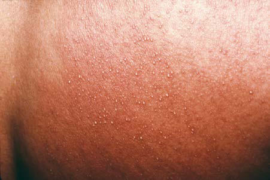
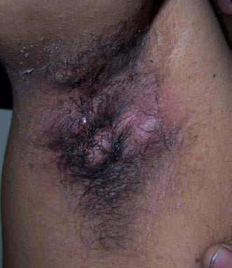

# Chapter 702: Disorders of the Sweat Glands
> **Course:** Vikkypaedia Pediatric Basic Course (*Nelson Textbook of Pediatrics, 22nd Edition (2025)*)  
> **Part XXIX:** The Skin  
> **Authors:** Kari L. Martin  
> **Metrics:** 2,487 words · 1 tables/boxes · 2 figures · 7 genes · 8 flashcards · 5 MCQs  
> **Quick Navigation:** [🃏 Study 8 Flashcards](../flashcards/702_flashcards.md) · [📝 Take 5-Q MCQ Quiz](../mcqs/702_mcqs.md) · [📚 Part XXIX Guide](../parts/Part_XXIX.md) · [🧬 Syndrome & Genetics Atlas](../omim_gene_atlas.md) · [💊 Therapeutics Matrix](../therapies_matrix.md) · [🏠 Course Index](../../index.md)

## Key Genetic & Molecular Targets
`FGFR2`, `GJB2`, `MEFV`, `MVK`, `NLRP3`, `NOD2`, `PSTPIP1`

## ⚡ High-Yield Nelson Pediatric Board Pearls
- ANHIDROSIS Neuropathic anhidrosis results from a disturbance in the neural path way from the control center in the brain to the peripheral efferent nerve fibers that activate sweating.
- Peripheral or segmental neuropathies, caused by leprosy, amyloidosis, diabetes mellitus, alco holic neuritis, or syringomyelia, may be associated with anhidrosis of the innervated skin.
- Anhidrosis may be complete, but in many cases, what appears clini cally to be anhidrosis is actually hypohidrosis caused by anhidrosis of many, but not all, eccrine glands.
- MILIARIA Etiology and Pathogenesis Miliaria results from retention of sweat in occluded eccrine sweat ducts.
- The eruption is most often induced by hot, humid weather, but it may also be caused by high fever.
- Miliaria rubra is a less superficial eruption characterized by ery thematous, minute papulovesicles that may impart a prickling sensa tion.
- Repeated attacks of miliaria rubra may lead to miliaria profunda, which is caused by rupture of the sweat duct deeper in the skin, at the level of the dermal-epidermal junction.

---
## Full Chapter Text, Tables & Figures
# Chapter 702: Disorders of the Sweat Glands

*Kari L. Martin*

<!-- p.5288 -->
Eccrine glands are found over nearly the entire skin surface and pro vide the primary means, through evaporation of the water in sweat, of cooling the body. These glands, which have no anatomic relationship to hair follicles, secrete a relatively large amount of odorless aqueous sweat. In contrast, apocrine sweat glands are limited in distribution to the axillae, anogenital skin, mammary glands, ceruminous glands of the ear, Moll glands in the eyelid, and selected areas of the face and scalp. Each apocrine gland duct enters the pilosebaceous follicle at the level of the infundibulum and secretes a small amount of a complex, viscous fluid that, on alteration by microorganisms, produces a distinc tive body odor. Some disorders of these two types of sweat glands are similar pathogenetically, whereas others are unique to a given gland.

**ANHIDROSIS** Neuropathic anhidrosis results from a disturbance in the neural path way from the control center in the brain to the peripheral efferent nerve fibers that activate sweating. Disorders in this category, which are char acterized by generalized anhidrosis, include **congenital insensitivity to pain with anhidrosis (CIPA)**, tumors of the hypothalamus, and damage to the floor of the third ventricle. Pontine or medullary lesions may produce anhidrosis of the ipsilateral face or neck and ipsilateral or contralateral anhidrosis of the rest of the body. Peripheral or segmental neuropathies, caused by leprosy, amyloidosis, diabetes mellitus, alco holic neuritis, or syringomyelia, may be associated with anhidrosis of the innervated skin. Various autonomic disorders are also associated with altered eccrine sweat gland function.

At the level of the sweat gland, anticholinergics (drugs such as atro pine and scopolamine) may paralyze the sweat glands. Acute intoxi cation with barbiturates or diazepam has produced necrosis of sweat glands, resulting in anhidrosis with or without erythema and bullae. Eccrine glands are largely absent throughout the skin or are present in a localized area among patients with **hypohidrotic ectodermal dyspla sia (HED)** or **localized congenital absence of sweat glands**, respec tively. Infiltrative or destructive disorders that may produce atrophy of sweat glands by pressure or scarring include scleroderma, acroderma titis chronica atrophicans, radiodermatitis, burns, Sjögren syndrome, multiple myeloma, and lymphoma. Obstruction of sweat glands may occur in miliaria and in a number of inflammatory and hyperkeratotic disorders, such as the ichthyoses, psoriasis, lichen planus, pemphigus, porokeratosis, atopic dermatitis, and seborrheic dermatitis. Occlusion of the sweat pore may also occur with the topical agents aluminum and zirconium salts, formaldehyde, or glutaraldehyde.

Diverse disorders that are associated with anhidrosis by unknown mechanisms include dehydration, uremia, cirrhosis, endocrine disor ders such as Addison disease, diabetes mellitus, diabetes insipidus, and hyperthyroidism, toxic overdose with lead, arsenic, thallium, fluorine, or morphine, and inherited conditions such as autonomic neuropa thies, Fabry disease, Franceschetti-Jadassohn syndrome, which com bines features of incontinentia pigmenti and HED, CIPA, and familial anhidrosis with neurolabyrinthitis.

Anhidrosis may be complete, but in many cases, what appears clini cally to be anhidrosis is actually hypohidrosis caused by anhidrosis of many, but not all, eccrine glands. Compensatory, localized hyperhidro sis of the remaining functional sweat glands may occur, particularly in diabetes mellitus and miliaria. The primary complication of anhidrosis is *hyperthermia,* seen primarily in anhidrotic ectodermal dysplasia or

in otherwise normal preterm or full-term neonates who have imma ture eccrine glands.

**HYPERHIDROSIS Etiology and Pathogenesis** Hyperhidrosis is excessive sweating beyond what is physiologically necessary for temperature control and occurs in 3% of the population, with about half having axillary hyperhidrosis. The numerous disor ders that can be associated with increased production of eccrine sweat may also be classified into those with neural mechanisms involving an abnormality in the pathway from the neural regulatory centers to the sweat gland and those that are nonneurally mediated and occur by direct effects on the sweat glands (Table 702.1).

**Clinical Manifestations** The average age at onset of hyperhidrosis is 14-25 years. The excess sweating may be continuous or may occur in response to emotional stimuli. In severe cases, sweat may be seen to drip constantly from the hands.

**Treatment** Excessive sweating of the palms and soles (volar hyperhidrosis) and axillary sweating may respond to 20% aluminum chloride in anhy drous ethanol applied under occlusion for several hours, iontophore sis, injection with botulinum toxin, therapy with oral anticholinergics and antimuscarinic drugs (oxybutynin), or in severe, refractory cases, cervicothoracic or lumbar sympathectomy. Reports of successful treat ment of hyperhidrosis with ultrasound and microwave technology are available, but studies are faulted with small sample size and/or lack of controls.

**MILIARIA Etiology and Pathogenesis** Miliaria results from retention of sweat in occluded eccrine sweat ducts. The eruption is most often induced by hot, humid weather, but it may also be caused by high fever. Infants who are dressed too warmly may demonstrate this eruption indoors, even during the winter.

**Clinical Manifestations** In miliaria crystallina, asymptomatic, noninflammatory, pinpoint, clear vesicles may suddenly erupt in profusion over large areas of the body surface, leaving brawny desquamation on healing (Fig. 702.1). This type of miliaria occurs most frequently in newborn infants because of the relative immaturity and delayed patency of the sweat duct and the tendency for infants to be nursed in relatively warm, humid conditions. It may also occur in older patients with hyperpyrexia or hypernatremia.

Miliaria rubra is a less superficial eruption characterized by ery thematous, minute papulovesicles that may impart a prickling sensa tion. The lesions are usually localized to sites of occlusion or to flexural areas, such as the neck, groin, and axillae, where friction may have a role in their pathogenesis. Involved skin may become macerated and eroded. However, lesions of miliaria rubra are extrafollicular.

Repeated attacks of miliaria rubra may lead to miliaria profunda, which is caused by rupture of the sweat duct deeper in the skin, at the level of the dermal-epidermal junction. Severe, extensive miliaria rubra or miliaria profunda may result in disturbance of heat regulation. Lesions of miliaria rubra may become infected, particularly in mal nourished or debilitated infants, leading to development of **periporitis staphylogenes**, which involves extension of the process from the sweat duct into the sweat gland.

**Histology** Histologically, miliaria crystallina reveals an intracorneal or subcor neal vesicle in communication with the sweat duct, whereas in miliaria rubra, one sees focal areas of spongiosis and spongiotic vesicle forma tion in close proximity to sweat ducts that generally contain a kerati nous plug.

*Kari L. Martin*

<!-- p.5289 -->
**Differential Diagnosis** The clarity of the fluid, superficiality of the vesicles, and absence of inflammation permit differentiation of miliaria crystalline from other blistering disorders. Miliaria rubra may be confused with or super imposed on other diaper area eruptions, including candidiasis and folliculitis.

**Treatment** All forms of miliaria respond dramatically to cooling of the patient by regulation of environmental temperatures and by removal of excessive clothing; administration of antipyretics is also beneficial to patients with fever. Topical agents are usually ineffective and may exacerbate the eruption.

**BROMHIDROSIS** Bromhidrosis, characterized by excessive odor, may result from alteration of either apocrine or eccrine sweat. Apocrine bromhidrosis develops after puberty as a result of the formation of short-chain fatty acids and ammonia by the action of anaerobic diphtheroids on axil lary apocrine sweat. Eccrine bromhidrosis is caused by microbiologic degradation of stratum corneum that has become softened by exces sive eccrine sweat. The soles of the feet and the intertriginous areas are the primary affected sites. Hyperhidrosis, warm weather, obesity, intertrigo, and diabetes mellitus are predisposing factors. Treatments that may be helpful include cleansing with germicidal soaps, topi cal clindamycin or erythromycin, or topical application of aluminum or zirconium. In addition, more invasive surgical and laser treat ments have been used. Treatment of any associated hyperhidrosis is mandatory.

**HIDRADENITIS SUPPURATIVA Etiology and Pathogenesis** Hidradenitis suppurativa (HS) is a disease of the apocrine gland– bearing areas of the skin. The pathogenesis of hidradenitis suppurativa is controversial. It is believed that it is a primary inflammatory disorder of the hair follicle and not solely an alteration of apocrine glands. It is considered a part of the follicular occlusion tetrad, along with acne conglobata, dissecting cellulitis of the scalp, and pilonidal sinus. The natural history of the disease involves progressive dilation below the follicular obstruction, leading to rupture of the duct, inflammation, sinus tract formation, and destructive scarring. It has been associated with Sjögren syndrome, inflammatory bowel disease, obesity, smok ing, diabetes mellitus, and thyroid disease. It is also known to occur in other family members and may be associated with loss-of-function pathogenic variants in multiple genes in some patients (Fig. 702.2). HS has been one manifestation of autoinflammatory syndromes, includ ing pyoderma gangrenosum-acne-HS (PASH) (*PSTPIP1* promoter), pyoderma gangrenosum-acne-pyogenic arthritis-HS (PAPASH) *(PSTPIP1)*, and psoriatic arthritis-pyoderma gangrenosum-acne-HS (PsAPASH).

**Clinical Manifestations** HS is a chronic, inflammatory, suppurative disorder of the follicular units in the axillae, anogenital area, and, occasionally, the scalp, pos terior aspect of the ears, inframammary folds (female), and perium bilical area (Fig. 702.3). Onset of clinical manifestations is sometimes preceded by pruritus or discomfort and usually occurs during puberty or early adulthood. Solitary or multiple painful erythematous nod ules, deep abscesses, and contracted scars are sharply confined to areas of skin containing apocrine glands. When the disease is severe and chronic, sinus tracts, ulcers, and thick, linear fibrotic bands develop. HS tends to persist for many years, punctuated by relapses and partial remissions. Complications include cellulitis, ulceration, and burrow ing abscesses that may perforate adjacent structures, forming fistulas to the urethra, bladder, rectum, or peritoneum. Episodic inflamma tory arthritis develops in some patients. Obesity and smoking may worsen or trigger symptoms. Patients with HS have an increased risk of adverse cardiovascular outcomes and a long-term risk of squamous cell carcinoma.

The autoinflammatory associated disorders present with fever, joint pain, cutaneous lesions (severe painful acne), and elevated inflamma tory markers (ESR, CRP).

**Differential Diagnosis** Early lesions of HS are often mistaken for infected epidermal cysts, furuncles, scrofuloderma, actinomycosis, cat-scratch disease, granu loma inguinale, or lymphogranuloma venereum. However, sharp localization to areas of the body that bear apocrine glands should suggest hidradenitis. When involvement is limited to the anogeni tal region, the condition may be difficult to distinguish from Crohn’s disease.

**Fig. 702.1** Superficial clear vesicles of miliaria crystallina.

Cardiovascular

Heart failure Shock Vasomotor Cold injury Raynaud phenomenon Rheumatoid arthritis Neurologic

Abscess Familial dysautonomia Postencephalitic Tumor Absence of corpus callosum Miscellaneous

Chédiak-Higashi syndrome Compensatory Lymphoma Phenylketonuria Vitiligo Frey syndrome

MEDULLARY Physiologic gustatory sweating Encephalitis Granulosis rubra nasi Syringomyelia Thoracic sympathetic trunk

injury

SPINAL Cord transection Syringomyelia

CHANGES IN BLOOD FLOW Maffucci syndrome Arteriovenous fistula Klippel-Trénaunay syndrome Glomus tumor Blue rubber-bleb nevus

syndrome

#### **Table 702.1** Causes of Hyperhidrosis

| Category / Parameter | Clinical Details & Findings |
| --- | --- |
| **CORTICAL** | Emotional; Familial dysautonomia; Congenital ichthyosiform; erythroderma; Epidermolysis bullosa; Nail-patella syndrome; Jadassohn-Lewandowsky; syndrome; Pachyonychia congenita; Palmoplantar keratoderma; Stroke |
| **Drugs** | Alcohol; Antipyretics; Cocaine; Emetics; Insulin; Opiates (including; withdrawal); Ciprofloxacin; Exercise |
| **Infection** | Defervescence; Chronic illness |
| **Metabolic** | Carcinoid syndrome; Debility; Diabetes mellitus; Hyperpituitarism; Hyperthyroidism; Hypoglycemia; Obesity; Pheochromocytoma; Porphyria; Pregnancy; Rickets; Infantile scurvy |

<!-- p.5290 -->
**Treatment** Conservative management includes cessation of smoking, weight loss, and avoidance of irritation of the affected area. Warm com presses and topical antiseptic or antibacterial soaps may also be

helpful. For mild, early disease, topical clindamycin 1% may be helpful. For more severe disease, therapy may be initiated with dox ycycline (100 mg bid) or minocycline (100 mg bid) in adolescents and young adults. Some patients require intermittent or long-term antibiotic treatment. Combination therapy with clindamycin and rifampin is helpful in some patients. Oral retinoids for 5-6 months may also be effective, although disease may recur. Oral contracep tive agents, which contain a high estrogen:progesterone ratio and low androgenicity of the progesterone, are another alternative along with spironolactone. Laser hair ablation has proven helpful in some studies as well. Systemic immunosuppressants (infliximab, adalim umab, cyclosporine, anakinra) and medications targeted at glucose metabolism and metabolic syndrome (metformin) have been help ful in patients resistant to more traditional measures. Adalimumab, a tumor necrosis factor-alpha (TNF-α) inhibitor, is the only FDAapproved medication for the treatment of moderate-to-severe HS. Surgical measures, including deroofing procedures and full exci sion, may be a helpful adjuvant to medical therapy, especially in recalcitrant cases.

**FOX-FORDYCE DISEASE Etiology and Pathogenesis** The cause of Fox-Fordyce disease is unknown, but it is related to block age of apocrine sweat glands.

**Clinical Manifestations** This disease is most common in females and manifests during puberty to the third decade of life as pruritus primarily in the axillae, although the areolae, pubic, and perineal regions can also be affected. Pruritus is exacerbated by emotional stress and stimuli that induce apocrine sweating. Dome-shaped, skin-colored to slightly hyperpigmented, fol licular papules develop in the pruritic areas.

**Treatment** Fox-Fordyce disease is difficult to treat. Oral contraceptive pills and topical treatments, including corticosteroids, antibiotics, or retinoids, may help some patients. Systemic isotretinoin and abla tive lasers have shown varying efficacy. Mechanical destruction and removal of apocrine glands have been used in recalcitrant cases. Partial response has been seen in one study using botulinum toxin type A.

*Visit Elsevier eBooks+ at eBooks.Health.Elsevier.com** for Bibliography.*

Inflammation precedes keratinization Keratinization precedes inflammation

Keratinization

Follicular occlusion Cyst formation

Keratinization

Follicular occlusion Cyst formation

AIKD (in the narrow sense)

AIKD (in the broad sense)

Autoinflammation

Autoinflammation

NCSTN, PSENEN, PSEN1, POFUT1, POGLUT1, KRT17, KRT6A, FGFR2, GJB2

Causative genes

MEFV, NOD2, LPIN2, NLRP3, NLRP12, PSMB8, MVK, IL1RN, PSTPIP1, (NCSTN?)

**Pathogenic variants (+)**

Hidradenitis suppurativa

**Fig. 702.2** Hidradenitis suppurativa and autoinflammatory keratiniza tion disease (AIKD). Genes responsible for hidradenitis suppurativa can be divided into two groups. One includes NCSTN, PSENEN, PSEN1, POFUT1, POGLUT1, KRT17, KRT6A, FGFR2, and GJB2, whose patho genic variants result in autoinflammation preceded by keratinization. This hidradenitis suppurativa subtype can be regarded as an autoin flammatory keratinization disease in the broad sense. The other group includes MEFV, NOD2, LPIN2, NLRP3, NLRP12, PSMB8, MVK, IL1RN, PSTPIP1, and possibly NCSTN, whose pathogenic variants lead to keratinization preceded by autoinflammation. This hidradenitis suppu rativa subtype can be regarded as an autoinflammatory keratinization disease in the narrow sense. (From Nomura T. Hidradenitis suppurativa as a potential subtype of autoinflammatory keratinization disease. Front Immunol. 2020;11:847, Fig. 1.).

A

B

**Fig. 702.3** Hidradenitis suppurativa. A, This young man had recurrent inflammatory papules and nodulocystic lesions in the axillae and groin for 5 years. Although lesions initially improved with oral antibiotics, he subsequently developed draining sinus tracts. B, This young woman had multiple indurated sinus tracts, nodules, and ulcers with purulent and necrotic drainage in her axillae. (From Rachidi S, Bender AM, Cohen BA. Disorders of the hail and nails. In: Cohen BA, ed. Pediatric Dermatology, 5th ed. Philadelphia: Elsevier; 2022, Fig. 8.42.)

<!-- p.5291 -->
