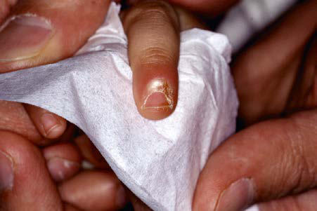
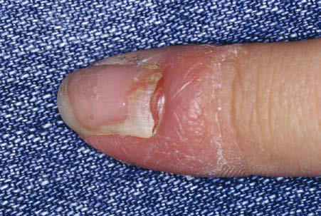

# Chapter 705: Disorders of the Mucous Membranes
> **Course:** Vikkypaedia Pediatric Basic Course (*Nelson Textbook of Pediatrics, 22nd Edition (2025)*)  
> **Part XXIX:** The Skin  
> **Authors:** Leah Lalor  
> **Metrics:** 2,142 words · 0 tables/boxes · 2 figures · 1 genes · 8 flashcards · 5 MCQs  
> **Quick Navigation:** [🃏 Study 8 Flashcards](../flashcards/705_flashcards.md) · [📝 Take 5-Q MCQ Quiz](../mcqs/705_mcqs.md) · [📚 Part XXIX Guide](../parts/Part_XXIX.md) · [🧬 Syndrome & Genetics Atlas](../omim_gene_atlas.md) · [💊 Therapeutics Matrix](../therapies_matrix.md) · [🏠 Course Index](../../index.md)

## Key Genetic & Molecular Targets
`PTEN`

## ⚡ High-Yield Nelson Pediatric Board Pearls
- Periungual fibromas that appear in late childhood should suggest a diagnosis of tuberous sclerosis.
- ANGULAR CHEILITIS Angular cheilitis (perlèche) is characterized by inflammation and fissuring at the corners of the mouth, often with associated erosion, maceration, and crusting.
- The etiology of aphthous stomatitis is multifactorial; the con dition probably represents an oral manifestation of a number of conditions, including viral infection, inflammatory bowel disease, cyclic neutropenia, and others.
- It is a common misconception that aphthous stomatitis is a manifestation of herpes simplex virus infection.
- BLACK HAIRY TONGUE Black hairy tongue is a dark coating on the dorsum of the tongue caused by hyperplasia and elongation of the filiform papillae; over growth of chromogenic bacteria and fungi and entrapped pigmented residues that adsorb to microbial plaque and desquamating keratin may contribute to the dark coloration.
- The condition is most common in adults but may also manifest during adolescence.
- The condition is caused by Epstein- Barr virus, which is present in the upper layer of the affected epithe lium.

---
## Full Chapter Text, Tables & Figures
# Chapter 705: Disorders of the Mucous Membranes

*Leah Lalor*

<!-- p.5303 -->
the lateral nail fold. Erythema, edema, and pain, most often involving the lateral great toes, are noted acutely; recurrent episodes may lead to formation of granulation tissue. Predisposing factors include (1) congenital malalignment (especially of the great toes) (Fig.704.13); (2) compression of the side of the toe from poorly fitting shoes, particu larly if the great toes are abnormally long and the lateral nail folds are

**Fig. 704.11** Acute paronychia secondary to Staphylococcus aureus.

**Fig. 704.12** Chronic paronychia with erythema and lateral nail fold separation.

**Fig. 704.13** Clinical features of an 8-yr-old boy upon initial presen tation to a dermatology clinic. Findings included yellowish-brown dis coloration, hyperkeratosis, transverse ridging, and lateral deviation of the bilateral great toenails. (From Pollack K, Zlotoff B, Wilson B. Hyper keratosis and discoloration of the toenails in an 8-year-old. J Pediatr. 2017;189:233.)

prominent; and (3) improper cutting of the nail in a curvilinear man ner rather than straight across. Management includes proper fitting of shoes; allowing the nail to grow out beyond the free edge before cutting it straight across; warm water soaks; oral antibiotics if cellulitis affects the lateral nail fold; and, in severe, recurrent cases, application of sil ver nitrate to granulation tissue, nail avulsion, or excision of the lateral aspect of the nail followed by matricectomy.

**PARONYCHIAL TUMORS** Tumors in the paronychial area include pyogenic granulomas, mucous cysts, subungual exostoses, and junctional nevi. Periungual fibromas that appear in late childhood should suggest a diagnosis of tuberous sclerosis.

*Visit Elsevier eBooks+ at eBooks.Health.Elsevier.com** for Bibliography.*

The mucous membranes may be involved in developmental disor ders, genodermatoses, infections, acute and chronic skin diseases, and benign or malignant tumors. This chapter includes some of the more common and more distinctive conditions of the mucous membranes, but is not exhaustive (see also Chapter 695 for erythema multiforme, Stevens-Johnson syndrome, and reactive infectious mucocutaneous eruption [RIME]).

**ANGULAR CHEILITIS** Angular cheilitis **(perlèche)** is characterized by inflammation and fissuring at the corners of the mouth, often with associated erosion, maceration, and crusting (Fig. 705.1). Chapping or moisture collection at the angles of the mouth predispose children to developing angular cheilitis. Children who are chronic lip lickers or who have excessive salivation or drooling related to neurologic deficits, orthodontic appli ances, or mouth breathing are at increased risk. Atopic dermatitis or contact dermatitis related to toothpaste, chewing gum, mouthwash, or cosmetics are also common causes. Nutritional deficiencies are a less frequent etiology. Protection can be provided by frequent applica tion of a bland ointment such as petrolatum. Candidiasis should be treated with an appropriate antifungal agent, and contact dermatitis of the perioral skin should be treated with a low-potency topical cor ticosteroid ointment preparation and frequent use of petrolatum or a similar emollient along with avoidance of the offending agent. Correc tion of the underlying predisposing factors (if possible) will prevent recurrence.

**APHTHOUS STOMATITIS (CANKER SORES)** Aphthous stomatitis consists of solitary or multiple painful ulcerations occurring on the labial (Fig. 705.2), buccal, lingual, sublingual, palatal, or gingival mucosa (see Chapter 361). Lesions may manifest initially as erythematous, indurated papules that erode rapidly to form sharply cir cumscribed, necrotic ulcers with a gray fibrinous exudate and an ery thematous halo. Minor aphthous ulcers are 2-10 mm in diameter and heal spontaneously in 7-10 days. Major aphthous ulcers are >10 mm in diameter, take from 10 to 30 days to heal, and may heal with scar ring. A third type of aphthous ulceration is herpetiform in appearance,

*Leah Lalor*

<!-- p.5305 -->

**Fig. 705.1** Angular cheilitis.

**Fig. 705.2** Aphthous ulceration on lower lip.

manifesting as a few to numerous grouped 1- to 2-mm lesions, which tend to coalesce into plaques and heal over 7-10 days. Approximately 30% of patients with recurrent lesions have a family history of the dis order (see Chapter 361 for the differential diagnosis).

The etiology of aphthous stomatitis is multifactorial; the con dition probably represents an oral manifestation of a number of conditions, including viral infection, inflammatory bowel disease, cyclic neutropenia, and others. Altered local regulation of the cellmediated immune system, after activation and accumulation of cytotoxic T cells, may contribute to the localized mucosal break down. It is a common misconception that aphthous stomatitis is a manifestation of herpes simplex virus infection. Recurrent herpes infections remain localized to the lips and rarely cross the muco cutaneous junction; involvement of the oral mucosa occurs only in primary infections.

Treatment of aphthous stomatitis is supportive. The majority of mild cases do not require therapy. Relief of pain, particularly before eating, may be achieved with the use of a topical anesthetic such as viscous lidocaine or an oral rinse with a combined solution of elixir of diphenhydramine, viscous lidocaine, and an oral antacid. Caution must be taken to avoid hot food and drink after topical anesthetic use. A superpotent topical corticosteroid in a mucosa-adhering agent may help to reduce inflammation, and topical tetracycline mouth wash may also hasten healing. In severe, debilitating cases, systemic therapy with corticosteroids, colchicine, dapsone, or thalidomide may be helpful.

**FORDYCE SPOTS** Fordyce spots (Fordyce granules) are clusters of asymptomatic, 1- to 3-mm, yellow-white macules and papules on the vermilion lips and

buccal mucosa. They are a common clinical finding and represent a normal anatomic variant of sebaceous glands. They can present in either sex from infancy to adulthood and may become more promi nent during puberty due to the influence of androgens. No therapy is required.

**EPSTEIN PEARLS (GINGIVAL CYSTS OF THE NEWBORN)** Epstein pearls are white, keratin-containing cysts on the palatal or alveolar mucosa of approximately 60–85% of neonates. They are epidermal inclusion cysts that form when the soft and hard palates fuse and are analogous to facial milia. They cause no symptoms and are generally shed within a few weeks; no therapy is necessary.

**MUCOCELE** Mucus retention cysts are painless, fluctuant, tense, 2- to 10-mm, blu ish papules on the lips (Fig. 705.3), tongue, palate, or buccal mucosa. Traumatic severance of the duct of a minor salivary gland leads to submucosal retention of mucus secretion. Lesions on the floor of the mouth are known as *ranulas* when the sublingual or submandibular salivary gland ducts are involved. Fluctuations in size are typical, and the lesions may disappear temporarily after traumatic rupture. Recur rence is prevented by surgical excision of the mucus deposit and associ ated salivary gland(s).

**FISSURED TONGUE** Fissured tongue (scrotal tongue, or lingua plicata) is a common benign developmental anomaly of the tongue. The dorsal tongue has many folds with deep grooves and a pebbled appearance. Fissured tongue can be seen in individuals with Melkersson-Rosenthal syn drome and Down syndrome, and it is often seen in association with geographic tongue. Food particles and debris may become trapped in the fissures, resulting in irritation, inflammation, and halitosis. Careful cleansing with a mouth rinse and soft-bristled toothbrush is recommended.

**GEOGRAPHIC TONGUE (BENIGN MIGRATORY GLOSSITIS)** Geographic tongue consists of single or multiple sharply demarcated, irregular, smooth, red patches surrounded by an elevated yellowishwhite serpiginous border on the dorsum of the tongue. Onset is rapid, and the pattern may change over hours to days. The smooth patches correspond to atrophic filiform papillae, and the elevated margins rep resent hypertrophic papillae (Fig. 705.4). The etiology of this condi tion remains unclear, though it is associated with some inflammatory disorders of the skin like psoriasis. Lesions are typically asymptomatic, but some patients may experience a burning sensation or sensitiv ity to spicy, hot, or cold foods. No therapy other than reassurance is necessary.

**Fig. 705.3** Mucocele on lower lip.

<!-- p.5306 -->

**Fig. 705.4** Geographic tongue.

**BLACK HAIRY TONGUE** Black hairy tongue is a dark coating on the dorsum of the tongue caused by hyperplasia and elongation of the filiform papillae; over growth of chromogenic bacteria and fungi and entrapped pigmented residues that adsorb to microbial plaque and desquamating keratin may contribute to the dark coloration. Changes often begin pos teriorly and extend anteriorly on the dorsum of the tongue. The condition is most common in adults but may also manifest during adolescence. Poor oral hygiene, lack of oral feeding, treatment with systemic antibiotics such as tetracycline (which promote the growth of *Candida* spp.), and smoking are predisposing factors. Improved oral hygiene and brushing with a soft-bristled toothbrush may be all that is necessary for treatment.

**ORAL HAIRY LEUKOPLAKIA** Oral hairy leukoplakia occurs in approximately 25% of patients with AIDS but is rare in the pediatric population. It manifests as corrugated and shaggy white plaques on the lateral margins of the tongue, which cannot be removed by rubbing. The lesions occasion ally may spread to the ventral tongue surface, floor of the mouth, tonsillar pillars, and pharynx. The condition is caused by Epstein- Barr virus, which is present in the upper layer of the affected epithe lium. The plaques have no malignant potential. The disorder occurs predominantly in HIV-infected patients but may also be found in individuals who are immunosuppressed for other reasons, such as organ transplantation, leukemia, chemotherapy, and long-term use of inhaled steroids. The condition is generally asymptomatic and does not require therapy.

**ACUTE NECROTIZING ULCERATIVE GINGIVITIS (VINCENT STOMATITIS, FUSOSPIROCHETAL GINGIVITIS, TRENCH MOUTH)** Acute necrotizing ulcerative gingivitis manifests as painful, punchedout ulceration, necrosis, and bleeding of the interdental papillae. A grayish-white pseudomembrane may cover the ulcerations. Lesions may spread to involve the buccal mucosa, lips, tongue, tonsils, and pharynx and may be associated with dental pain, a bad taste, low-grade fever, and lymphadenopathy. It occurs most commonly in the second or third decade, particularly in the context of poor dental hygiene, poor nutrition, smoking, and stress.

**NOMA** Noma is a severe form of fusospirillary gangrenous stomatitis that occurs primarily in malnourished, impoverished children 2-5 years of age who have had a preceding illness such as measles, scarlet fever, tuberculosis, malignancy, or immunodeficiency. The disease

is most prevalent in Africa but also occurs in Asia and Latin Amer ica. Sporadic cases associated with immunodeficiency have been reported in developed countries. It manifests as a painful, red, indurated papule on the alveolar margin, followed by ulceration and mutilating gangrenous destruction of tissue in the oronasal region. The process may also involve the scalp, neck, shoulders, perineum, and vulva. Noma neonatorum manifests in the first month of life as gangrenous lesions of the lips, nose, mouth, and anal regions. Affected infants are usually small for gestational age, malnourished, premature, and frequently ill (particularly with *Pseudomonas aeruginosa* sepsis). Care consists of nutritional sup port, conservative debridement of necrotic soft tissues, empirical broad-spectrum antibiotics such as penicillin and metronidazole, and, in the case of noma neonatorum, antipseudomonal antibiotics (see Chapter 62).

**PTEN HAMARTOMA SYNDROME (COWDEN SYNDROME)** PTEN hamartoma syndrome is an autosomal dominant condition caused by loss-of-function pathogenic variants in the *PTEN* tumorsuppressor gene. Mucocutaneous lesions typically appear in the second or third decade. Oral papillomas are 1- to 3-mm, smooth, pink or whitish papules on the palatal, gingival, buccal, and labial mucosae and may coalesce into a cobblestone appearance. Numer ous flesh-colored papules also develop on the face, particularly around the mouth, nose, and ears. These papules are most com monly trichilemmomas, a benign neoplasm of the hair follicle. Associated findings may include acral keratoses, thyroid adenoma, goiter, gastrointestinal polyps, fibrocystic breast nodules, and carci noma of the breast or thyroid.

**Herpes Simplex Virus Infection** Herpes simplex virus (HSV) types 1 and 2 commonly cause primary and recurrent infection, resulting in grouped vesicles on oral, nasal, and genital mucosae.

**Erythema Multiforme** Erythema multiforme (EM) is an uncommon disorder of mucocutane ous blistering typically on the labial mucosa and acral skin as a reaction to HSV infection. Please see Chapter 695.1 for more detail.

**Stevens-Johnson Syndrome** Stevens-Johnson syndrome (SJS) is an uncommon disorder of skin sloughing that occurs primarily after exposure to a medication. It can have extensive mucosal involvement in addition to skin. Please see Chapter 695.3 for more detail.

**Reactive Infectious Mucocutaneous Eruption (Formerly Mycoplasma-Induced Rash and Mucositis)** This condition is on the spectrum of SJS and toxic epidermal necrolysis (TEN), but tends to be triggered by various infections and has more mucosal involvement than cutaneous. Please see Chapter 695.2 for more detail.

**Lichen Sclerosus** Lichen sclerosus is a rare disorder of genital mucosa typically seen in young girls and elderly women. It manifests as pink and white atrophic genital mucosa that can be associated with pain, dys uria, constipation, and bleeding. Please see Chapter 586 for more details.

*Visit Elsevier eBooks+ at eBooks.Health.Elsevier.com** for Bibliography.*

<!-- p.5307 -->
