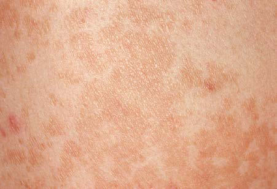

# Chapter 707: Cutaneous Fungal Infections
> **Course:** Vikkypaedia Pediatric Basic Course (*Nelson Textbook of Pediatrics, 22nd Edition (2025)*)  
> **Part XXIX:** The Skin  
> **Authors:** Stephen R. Humphrey  
> **Metrics:** 5,540 words · 1 tables/boxes · 2 figures · 9 genes · 8 flashcards · 5 MCQs  
> **Quick Navigation:** [🃏 Study 8 Flashcards](../flashcards/707_flashcards.md) · [📝 Take 5-Q MCQ Quiz](../mcqs/707_mcqs.md) · [📚 Part XXIX Guide](../parts/Part_XXIX.md) · [🧬 Syndrome & Genetics Atlas](../omim_gene_atlas.md) · [💊 Therapeutics Matrix](../therapies_matrix.md) · [🏠 Course Index](../../index.md)

## Key Genetic & Molecular Targets
`ADA`, `AIRE`, `DOCK8`, `IL2RG`, `JAK3`, `NEMO`, `RAG1`, `RAG2`, `STAT3`

## ⚡ High-Yield Nelson Pediatric Board Pearls
- Diagnosis is made by culturing the organism at 32–33°C (89.6–91.4°F).
- Treatment of choice is an 8-week course of rifampin and streptomycin with surgi cal debridement for larger lesions.
- TINEA VERSICOLOR A common, innocuous, chronic fungal infection of the stratum cor neum, tinea versicolor is most often caused by the dimorphic yeast Malassezia globosa, with Malassezia furfur and Malassezia sympodia lis as less frequent causative agents.
- Differential Diagnosis Examination with a Wood lamp discloses a yellowish gold fluorescence.
- Skin biopsy, including culture and special stains for fungi (periodic acid– Schiff), are often necessary to make the diagnosis in cases of primar ily follicular involvement.
- DERMATOPHYTOSES Dermatophytoses are caused by a group of closely related filamentous fungi with a propensity for invading the stratum corneum, hair, and nails.
- Trichophyton rubrum is the most common dermato phyte pathogen.

---
## Full Chapter Text, Tables & Figures
# Chapter 707: Cutaneous Fungal Infections

*Stephen R. Humphrey*

<!-- p.5321 -->
abscess. Sporotrichoid erythematous nodules along lymphatics may also suppurate and drain. Lesions are most common on the elbows, knees, and feet of swimmers and on the hands and fingers in persons with aquarium-acquired infection. Systemic signs and symptoms are absent. Regional lymph nodes occasionally become slightly enlarged but do not break down. Rarely, the infection becomes disseminated, particularly in an immunosuppressed host. A biopsy specimen of a fully developed lesion demonstrates a granulomatous infiltrate with tuberculoid architecture. Treatment with two active agents is generally recommended, with a combination of clarithromycin and ethambutol providing a reasonable balance between effectiveness and tolerability. Rifampin should be added to clarithromycin and ethambutol for deep tissue involvement. Other agents with activity against *M. marinum* include trimethoprim-sulfamethoxazole, doxycycline, minocycline, and ciprofloxacin. Although azithromycin has been used as an alterna tive to clarithromycin for some mycobacterial infections, its effective ness against *M. marinum* is not known. Treatment should continue for 1-2 months after resolution of lesions with a minimum treatment dura tion of 6 months. The application of heat to the affected site may be a useful adjunctive therapy (see Chapter 263).

*Mycobacterium kansasii* primarily causes pulmonary disease; skin disease is rare, often occurring in an immunocompromised host. Most commonly, sporotrichoid nodules develop after inoculation of trauma tized skin. Lesions may develop into ulcerated, crusted, or verrucous plaques. The organism is relatively sensitive to antituberculous medi cations, which should be chosen on the basis of susceptibility testing.

*Mycobacterium scrofulaceum* causes cervical lymphadenitis (scrofu loderma) in young children, typically in the submandibular region. Nodes enlarge over several weeks, ulcerate, and drain. The local reaction is nontender and circumscribed, constitutional symptoms are absent, and there generally is no evidence of lung or other organ involvement. Other atypical mycobacteria may cause a similar pre sentation, including *Mycobacterium avium* complex, *M. kansasii,* and *Mycobacterium fortuitum.* Treatment is accomplished by excision and administration of antituberculous drugs (see Chapter 263).

*Mycobacterium ulcerans* (Buruli ulcer or Bairnsdale ulcers) causes a painless subcutaneous nodule after inoculation of abraded skin. Most infections occur in children in tropical rainforests. The nodule usu ally ulcerates, develops undermined edges, and may spread over large areas, most commonly on an extremity. Local necrosis of subcutane ous fat, producing a septal panniculitis, is characteristic. Ulcers per sist for months to years before healing spontaneously with scarring, sometimes with contractures (if over a joint) and lymphedema. Con stitutional symptoms and lymphadenopathy are absent. Diagnosis is made by culturing the organism at 32–33°C (89.6–91.4°F). **Treatment of choice** is an 8-week course of rifampin and streptomycin with surgi cal debridement for larger lesions. Local heat therapy and oral chemo therapy may benefit some patients.

*M. avium* complex, composed of more than 20 subtypes, most commonly causes chronic pulmonary infection. Cervical lymphad enitis and osteomyelitis occur occasionally, and papules or purulent

**Fig. 706.13** Violaceous, warty plaque of Mycobacterium marinum infection.

leg ulcers occur rarely by primary inoculation. Skin lesions may be an early sign of disseminated infection. The lesions may take various forms, including erythematous papules, pustules, nodules, abscesses, ulcers, panniculitis, and sporotrichoid spread along lymphatics. For treatment, see Chapter 263.

*M. fortuitum* complex causes disease in an immunocompetent host principally by primary cutaneous inoculation after traumatic injury, injection, or surgery. A nodule, abscess, or cellulitis develops 4-6 weeks after inoculation. In an immunocompromised host, numerous subcu taneous nodules may form, break down, and drain. Treatment is based on identification and susceptibility testing of the organism. Isolates are usually susceptible to fluoroquinolones, doxycycline, minocycline, sul fonamides, cefoxitin, and imipenem; macrolides should be used with caution because many *M. fortuitum* isolates have the erythromycin methylase *(erm)* gene, which confers inducible resistance to macrolides despite “susceptible” minimum inhibitory concentrations.

*Visit Elsevier eBooks+ at eBooks.Health.Elsevier.com** for Bibliography.*

**TINEA VERSICOLOR** A common, innocuous, chronic fungal infection of the stratum cor neum, tinea versicolor is most often caused by the dimorphic yeast *Malassezia globosa,* with *Malassezia furfur* and *Malassezia sympodia lis* as less frequent causative agents*.* The synonyms *Pityrosporum ovale* and *Pityrosporum orbiculare* were used previously to identify the causal organism.

**Etiology* M. globosa* is part of the normal indigenous skin flora, predominantly in the yeast form, and is found particularly in areas of skin that are rich in sebum production. Proliferation of filamentous forms occurs in the disease state. Predisposing factors include a warm, humid envi ronment, excessive sweating, occlusion, high plasma cortisol levels, immunosuppression, malnourishment, and genetically determined susceptibility. The disease is most prevalent in adolescents and young adults.

**Clinical Manifestations** The lesions of tinea versicolor vary widely in color. In lighter skin, they are typically reddish brown, whereas in darker skin, they may be either hypopigmented or hyperpigmented. The characteristic macules are covered with a fine scale. They often begin in a perifollicular location, enlarge, and merge to form confluent patches, most commonly on the neck, upper chest, back, and upper arms (Fig. 707.1). Facial lesions are common in adolescents; lesions occasionally appear on the forearms, dorsum of the hands, and pubis. There may be little or no pruritus. Involved areas do not tan after sun exposure. A papulopustular perifol licular variant of the disorder may occur on the back, chest, and some times the extremities. These pustules tend to be monomorphic.

**Differential Diagnosis** Examination with a Wood lamp discloses a yellowish gold fluorescence. A potassium hydroxide (KOH) preparation of scrapings is diagnostic, demonstrating groups of thick-walled spores and myriad short, thick,

*Stephen R. Humphrey*

<!-- p.5323 -->

**Fig. 707.1** Hyperpigmented, sharply demarcated macules of varying sizes on the upper trunk characteristic of tinea versicolor.

angular hyphae resembling macaroni/spaghetti and meatballs. Skin biopsy, including culture and special stains for fungi (periodic acid– Schiff), are often necessary to make the diagnosis in cases of primar ily follicular involvement. Microscopically, organisms and keratinous debris can be seen within dilated follicular ostia.

Tinea versicolor must be distinguished from dermatophyte infec tions, seborrheic dermatitis, pityriasis alba, pityriasis rosea, and sec ondary syphilis. Tinea versicolor may mimic nonscaling pigmentary disorders, such as postinflammatory pigmentary change, if a patient has removed the scales by scrubbing. *M. globosa* folliculitis must be distinguished from the other forms of folliculitis.

**Treatment** Many therapeutic agents can be used to treat this disease successfully. The causative agent, a normal human saprophyte, is not eradicated from the skin, however, and the disorder recurs in predisposed indi viduals. Appropriate topical therapy may include one of the follow ing: selenium 2% shampoo applied for 10 minutes before rinsing for 1 week, ketoconazole 2% shampoo once daily for 3 days, and terbinafine spray once to twice daily for 1-2 weeks. Antifungal creams are avail able and can be used; however, these can be impractical to apply given the large surface of skin involved. Oral therapy may be more conve nient and may be achieved successfully with fluconazole 300 mg/wk for 2-4 weeks or itraconazole 200 mg/24 hr for 5-7 days. Recurrent episodes continue to respond promptly to these agents. Oral therapy is particularly helpful in those with severe disease or recurrent disease or in those where topical therapies have failed. Maintenance therapy with selenium sulfide shampoo or ketoconazole 2% shampoo once a week may be used.

**DERMATOPHYTOSES** Dermatophytoses are caused by a group of closely related filamentous fungi with a propensity for invading the stratum corneum, hair, and nails. The three principal genera responsible for infections are *Tricho phyton, Microsporum,* and *Epidermophyton.*

**Etiology* Trichophyton* spp. cause lesions of all keratinized tissue, including skin, nails, and hair. *Trichophyton rubrum* is the most common dermato phyte pathogen. *Microsporum* spp. principally invade the hair, and the *Epidermophyton* spp. invade the intertriginous skin. Dermatophyte infections are designated by the word **tinea** followed by the Latin word for the anatomic site of involvement. The dermatophytes are also clas sified according to source and natural habitat. Fungi acquired from the soil are called *geophilic*. They infect humans sporadically, inciting an inflammatory reaction. Dermatophytes that are acquired from animals are *zoophilic*. Transmission may be through direct contact or indirectly by infected animal hair or clothing. Infected animals are frequently

asymptomatic. Dermatophytes acquired from humans are referred to as *anthropophilic*. These infestations range from chronic low-grade to acute inflammatory disease. *Epidermophyton* infections are transmit ted only by humans, but various species of *Trichophyton* and *Microspo rum* can be acquired from both human and nonhuman sources.

**Epidemiology** Host defense has an important influence on the severity of the infec tion. Disease tends to be more severe in individuals with diabetes mel litus, lymphoid malignancies, immunosuppression, and states with high plasma cortisol levels, such as Cushing syndrome. Some derma tophytes, most notably the zoophilic species, tend to elicit more severe, suppurative inflammation in humans. Some degree of resistance to reinfection is acquired by most infected persons and may be associated with a delayed hypersensitivity response. However, no relationship has been demonstrated between antibody levels and resistance to infection. The frequency and severity of infection are also affected by the geo graphic locale, the genetic susceptibility of the host, and the virulence of the strain of dermatophyte. Additional local factors that predispose to infection include trauma to the skin, hydration of the skin with mac eration, occlusion, and elevated temperature.

Occasionally, a secondary skin eruption, referred to as a derma tophytid or “id” reaction, appears in sensitized individuals and has been attributed to circulating fungal antigens derived from the pri mary infection. The eruption is characterized by grouped papules (Fig. 707.2) and vesicles and, occasionally, by sterile pustules. Sym metric urticarial lesions and a more generalized maculopapular erup tion also can occur. Id reactions are most often associated with tinea pedis, but they also occur with tinea capitis.

**Tinea Capitis Clinical Manifestations** Tinea capitis is a dermatophyte infection of the scalp most often caused by *Trichophyton tonsurans,* occasionally by *Microsporum canis*, and, much less commonly, by other *Microsporum* and *Trichophyton* spp. It is particularly common in children age 3-7 years old. In *Microspo rum* and some *Trichophyton* infections, the spores are distributed in a sheathlike fashion around the hair shaft (**ectothrix** infection), whereas *T. tonsurans* produces an infection within the hair shaft (endothrix). **Endothrix** infections may continue past the anagen phase of hair growth into telogen and are more chronic than infections with ecto thrix organisms that persist only during the anagen phase. *T. tonsurans* is an anthropophilic species acquired most often by contact with infected hairs and epithelial cells that are on such surfaces as theater seats, hats, and combs. Dermatophyte spores may also be airborne within the immediate environment, and high carriage rates have been demonstrated in noninfected schoolmates and household members. *M. canis* is a zoophilic species that is acquired from cats and dogs.

The clinical presentation of tinea capitis varies with the infecting organ ism. Endothrix infections such as those caused by *T. tonsurans* create a

**Fig. 707.2** Id reaction. Papular eruption of the face associated with severe tinea infection of the hand.

<!-- p.5324 -->
pattern known as “black-dot ringworm,” characterized initially by many small circular patches of alopecia in which hairs are broken off close to the hair follicle (Fig. 707.3). Another clinical variant manifests as diffuse scal ing, with minimal hair loss secondary. It strongly resembles seborrheic dermatitis, psoriasis, or atopic dermatitis (Fig. 707.4). *T. tonsurans* may also produce a chronic and more diffuse alopecia. Lymphadenopathy is common (Fig. 707.5). A severe inflammatory response produces elevated, boggy granulomatous masses **(kerion)**, which are often studded with pustules (Fig. 707.6A). Fever, pain, and regional adenopathy are com mon, and permanent scarring and alopecia may result (see Fig. 707.6B). The zoophilic organism *M. canis* or the geophilic organism *Microspo rum gypseum* also may cause kerion formation. The pattern produced by

*Microsporum audouinii*, the most common cause of tinea capitis in the 1940s and 1950s, is characterized initially by a small papule at the base of a hair follicle. The infection spreads peripherally, forming an erythema tous and scaly circular plaque **(ringworm)** within which the infected hairs become brittle and broken. Numerous confluent patches of alope cia develop, and patients may complain of severe pruritus. *M. audouinii* infection is no longer common in the United States. **Favus** is a chronic form of tinea capitis that is rare in the United States and is caused by the fungus *Trichophyton schoenleinii.* Favus starts as yellowish red papules at the opening of hair follicles. The papules expand and coalesce to form cup-shaped, yellowish, crusted patches that fluoresce dull green under a Wood lamp. Other species, such as *Trichophyton violaceum* and *Tricho phyton soudanense* are becoming more common with resettlement and emigration.

**Differential Diagnosis** Tinea capitis can be confused with seborrheic dermatitis, psoriasis, alope cia areata, trichotillomania, and certain dystrophic hair disorders. When inflammation is pronounced, as in kerion, primary or secondary bacterial infection must also be considered. In adolescents, the patchy, moth-eaten type of alopecia associated with secondary syphilis may resemble tinea capitis. If scarring occurs, discoid lupus erythematosus and lichen plano pilaris must also be considered in the differential diagnosis.

The important diagnostic procedures for the various dermatophyte diseases include examination of infected hairs with a Wood lamp, microscopic examination of KOH preparations of infected material, and identification of the etiologic agent by culture. Hairs infected with common *Microsporum* spp. fluoresce a bright blue-green. Most *Trichophyton*-infected hairs do not fluoresce.

Microscopic examination of a KOH preparation of infected hair from the active border of a lesion discloses tiny spores surrounding the hair shaft in *Microsporum* infections and chains of spores within the hair shaft in *T. tonsurans* infections. Fungal elements are not usu ally seen in scales. A specific etiologic diagnosis of tinea capitis may be obtained by planting broken-off infected hairs on Sabouraud medium with reagents to inhibit growth of other organisms. Such identification may require 2 weeks or more.

A

B

**Fig. 707.6** A, Kerion. Boggy granulomatous mass of the scalp. B, Scarring after kerion.

**Fig. 707.3** Black-dot ringworm with hairs broken off at the scalp.

**Fig. 707.4** Tinea capitis mimicking seborrheic dermatitis.

**Fig. 707.5** Lymphadenopathy associated with tinea capitis.

<!-- p.5325 -->
**Treatment** Oral administration of griseofulvin microcrystalline (20-25 mg/kg/ day with a maximum daily dose of 1000 mg, or 10-15 mg/kg/day with a maximum daily dose of 750 mg if the ultramicrosize form is used) is typically the recommended treatment for all forms of tinea capitis. Absorption of griseofulvin is enhanced by the ingestion of a fatty meal and should be recommended for the patient. A minimum of 8 weeks of treatment is usually required, though longer courses are sometimes needed. Repeat fungal cultures may help guide treatment length. Treat ment for 1 month after a negative culture result minimizes the risk of recurrence. Adverse reactions to griseofulvin are rare but include nau sea, vomiting, headache, blood dyscrasias, phototoxicity, and hepa totoxicity. Terbinafine dosing is weight-based. Off-label use is 125 mg daily for 6 weeks if under 25 kg. From 25 to 35 kg, the dose is 187.5 mg daily for 6 weeks. For patients greater than 35 kg, the dose is 250 mg daily for 6 weeks. It is possibly effective in pulse therapy, although it has limited activity against *M. canis*, but better activity than griseo fulvin for *T. tonsurans.* The oral granule formulation of terbinafine is approved by the U.S. Food and Drug Administration (FDA) for tinea capitis in children 4 years of age and older. Oral itraconazole is useful in instances of griseofulvin resistance, intolerance, or allergy. Itraconazole is given for 4-6 weeks at a dosage of 5 mg/kg/24 hr with food. This is offlabel and length of course depends on organism. Capsules are preferable to the syrup, which may cause diarrhea. Itraconazole is not approved by the FDA for treatment of dermatophyte infections in the pediatric popu lation. Topical therapy alone is ineffective, but it may be an important adjunct because it may decrease the shedding of spores and should be recommended in all patients. Asymptomatic dermatophyte carriage in family members is common. Because one in three families have at least one member who is a carrier, treatment of both patient and potential car riers with a sporicidal shampoo may hasten clinical resolution. Vigorous shampooing with a 2.5% selenium sulfide, zinc pyrithione, or ketocon azole shampoo is helpful. It is not necessary to shave the scalp.

**Tinea Corporis Clinical Manifestations** Tinea corporis, defined as infection of the glabrous skin, excluding the palms, soles, and groin, can be caused by most of the dermatophyte species, although *T. rubrum* and *Trichophyton mentagrophytes* are the most prevalent etiologic organisms. In children, infections with *M. canis* are also common. Tinea corporis can be acquired by direct con tact with infected persons or by contact with infected scales or hairs deposited on environmental surfaces. *M. canis* infections are usually acquired from infected pets.

The most typical clinical lesion begins as a dry, mildly erythematous, elevated, scaly papule or plaque that spreads centrifugally and clears centrally to form the characteristic annular lesion responsible for the designation of ringworm (Fig. 707.7). At times, plaques with advanc ing borders may spread over large areas. Grouped pustules are another variant. Most lesions clear spontaneously within several months, but some may become chronic. Central clearing does not always occur (Fig. 707.8), and differences in host response may result in wide vari ability in the clinical appearance; for example, granulomatous lesions called **Majocchi granuloma**, which are caused by the penetration of organisms along the hair follicle to the level of the dermis, produce a fungal folliculitis and perifolliculitis (Fig. 707.9) and the kerion-like lesions referred to as *tinea profunda.* Majocchi granuloma is more common after inappropriate treatment with topical corticosteroids, especially the superpotent class.

**Differential Diagnosis** Many skin lesions, both infectious and noninfectious, must be dif ferentiated from the lesions of tinea corporis. Those most frequently confused are granuloma annulare, nummular eczema, pityriasis rosea, psoriasis, seborrheic dermatitis, erythema chronicum migrans, and tinea versicolor. Microscopic examination of KOH wet mount prepara tions and cultures should always be performed when fungal infection is considered. Tinea corporis usually does not fluoresce with a Wood lamp.

**Treatment** Tinea corporis usually responds to treatment with one of the topical antifungal agents (e.g., imidazoles, terbinafine, butenafine, naftifine) twice daily for 2-4 weeks. In unusually severe or extensive disease, a course of therapy with oral griseofulvin microcrystalline may be required for 4 weeks. Terbinafine for 2 weeks can also be used. Itracon azole has produced excellent results in many cases with a 1- to 2-week course of oral therapy. Combination topical corticosteroid/antifungal preparations should not be used, as they may result in worsening or persistent infection.

**Fig. 707.7** Annular plaque of tinea corporis with central clearing.

**Fig. 707.8** Minimal central clearing with tinea corporis.

**Fig. 707.9** Follicular papule and pustule in Majocchi granuloma after use of a superpotent topical steroid.

<!-- p.5326 -->
**Tinea Cruris Clinical Manifestations** Tinea cruris, or infection of the groin, occurs most often in adolescent males and is usually caused by the anthropophilic species *Epidermoph yton floccosum* or *T. rubrum,* but occasionally by the zoophilic species *T. mentagrophytes.*

The initial clinical lesion is a small, raised, scaly, erythematous patch on the inner aspect of the thigh. This spreads peripherally, often developing numerous tiny vesicles at the advancing margin. It eventually forms bilateral, irregular, sharply bordered patches with hyperpigmented scaly centers. In some cases, particularly in infec tions with *T. mentagrophytes,* the inflammatory reaction is more intense and the infection may spread beyond the crural region. The scrotum and labia are usually not involved in the infection, which is an important distinction from candidiasis. Pruritus may be severe initially but abates as the inflammatory reaction subsides. Bacterial superinfection may alter the clinical appearance, and erythrasma or candidiasis may coexist. Tinea cruris is more prevalent in obese per sons and in persons who perspire excessively and wear tight-fitting clothing. It is a good idea to examine a patient’s feet, which can be a source for tinea cruris.

**Differential Diagnosis** The diagnosis of tinea cruris is confirmed by culture and by demonstra tion of septate hyphae on a KOH preparation of epidermal scrapings. The disorder must be differentiated from intertrigo, allergic contact dermatitis, candidiasis, and erythrasma. Bacterial superinfection must be precluded when there is a severe inflammatory reaction.

**Treatment** Patients should be advised to wear loose cotton underwear. Topical treatment with an imidazole twice a day for 3-4 weeks is recommended for severe infection, especially because these agents are effective in mixed candidal-dermatophytic infections. Oral treatments, as men tioned earlier, may also be used.

**Tinea Pedis Clinical Manifestations** Tinea pedis (athlete’s foot), infection of the toe webs and soles of the feet, is uncommon in young children but occurs with some frequency in preadolescent and adolescent males. The usual etiologic agents are *T. rubrum, T. mentagrophytes,* and *E. floccosum.*

Most commonly, the lateral toe webs (third to fourth and fourth to fifth interdigital spaces) and the subdigital crevice are fissured, with maceration and peeling of the surrounding skin (Fig. 707.10). Severe tenderness, itching, and a persistent foul odor are characteristic. These lesions may become chronic. This type of infection may involve over growth by bacterial flora, including *Kytococcus sedentarius, Brevibac terium epidermidis,* and gram-negative organisms. Less commonly, a chronic diffuse hyperkeratosis of the sole of the foot occurs with only

mild erythema (Fig. 707.11). In some cases, two feet and one hand are involved. This type of infection is more refractory to treatment and tends to recur. An inflammatory vesicular type of reaction may occur with *T. mentagrophytes* infection. This type is most common in young children. The lesions involve any area of the foot, including the dorsal surface, and are usually circumscribed. The initial papules progress to vesicles and bullae that may become pustular (Fig. 707.12). A number of factors, such as occlusive footwear and warm, humid weather, pre dispose to infection. Tinea pedis may be transmitted in shower facili ties and swimming pool areas.

**Differential Diagnosis** Tinea pedis must be differentiated from simple maceration and peeling of the interdigital spaces, which is common in children. Infection with *Candida albicans* and various bacterial organisms (erythrasma) may cause confusion or may coexist with primary tinea pedis. Contact der matitis, vesicular foot dermatitis, atopic dermatitis, and juvenile plan tar dermatitis also simulate tinea pedis. Fungal mycelia can be seen on microscopic examination of a KOH preparation or by culture.

**Treatment** Treatment for mild infections includes simple measures such as avoid ance of occlusive footwear, careful drying between the toes after bathing, and the use of an absorbent antifungal powder such as zinc undecylenate. Topical therapy with an imidazole is curative in most cases. Each of these agents is also effective against candidal infection. Several weeks of therapy may be necessary, and low-grade, chronic infections, particularly those caused by *T. rubrum,* may be refractory. In refractory cases, oral griseofulvin therapy may effect a cure, but recurrences are common.

**Fig. 707.12** Vesicobullous tinea pedis.

**Fig. 707.10** Interdigital tinea pedis.

**Fig. 707.11** Diffuse, minimally erythematous tinea pedis.

<!-- p.5327 -->
**Tinea Unguium Clinical Manifestations** Tinea unguium (onychomycosis) is a dermatophyte infection of the nail plate. It occurs most often in patients with tinea pedis, but it may occur as a primary infection. It can be caused by a number of der matophytes, of which *T. rubrum* and *T. mentagrophytes* are the most common.

The most superficial form of tinea unguium (i.e., white superficial onychomycosis) is caused by *T. mentagrophytes.* It manifests as irregu lar single or numerous white patches on the surface of the nail unas sociated with paronychial inflammation or deep infection. *T. rubrum* generally causes a more invasive, subungual infection that is initiated at the lateral distal margins of the nail and is often preceded by mild paro nychia. The middle and ventral layers of the nail plate, and perhaps the nail bed, are the sites of infection. The nail initially develops a yellow ish discoloration and slowly becomes thickened, brittle, and loosened from the nail bed (Fig. 707.13). In advanced infection, the nail may turn dark brown to black and may crack or break off.

**Differential Diagnosis** Tinea unguium must be differentiated from various dystrophic nail dis orders. Changes as a result of trauma, psoriasis, lichen planus, eczema, and trachyonychia can all be confused with tinea unguium. Nails infected with *C. albicans* have several distinguishing features; most prominently, a pronounced paronychial swelling. Thin shavings taken from the infected nail, preferably from the deeper areas, should be examined microscopically with KOH and cultured. Repeated attempts may be required to demonstrate the fungus. Histologic evaluation of nail clippings with special stains for dermatophytes can be diagnostic.

**Treatment** Systemic antifungals are more effective at treating onychomycosis than topical antifungals. The long half-life of itraconazole in the nail has led to promising trials of intermittent short courses of therapy (double the normal dose for 1 week of each month for 3-4 months). Oral terbin afine is also used for the treatment of onychomycosis. Terbinafine once daily for 12 weeks is more effective than itraconazole pulse therapy. Pulse terbinafine treatment has also been used in adults and has been effective. Topical antifungals may be an acceptable treatment for mild disease without matrix involvement, and typically children have a better response to topical therapy than adults, likely because of faster growth of the nails. Several topical agents have been FDA approved for the treatment of onychomycosis in adults, including ciclopirox, efinaconazole, and tavaborole. Small clinical trials have demonstrated efficacy of ciclopirox in children. Efinaconazole and tavaborole can be used in children 6 and older as well.

**Tinea Nigra Palmaris** Tinea nigra palmaris is a rare but distinctive superficial fungal infec tion that occurs principally in children and adolescents. It is caused by the dimorphic fungus *Phaeoannellomyces werneckii,* which imparts

a gray-black color to the affected palm. The characteristic lesion is a well-defined hyperpigmented macule. Scaling and erythema are rare, and the lesions are asymptomatic. Tinea nigra is often mistaken for a junctional nevus, melanoma, or staining of the skin by contactants. Treatment is with an imidazole antifungal. *Keratolytic agents, such as salicylic acid, once to twice daily* can also be used.

**CANDIDAL INFECTIONS (CANDIDIASIS AND MONILIASIS)** See Chapter 280.

The dimorphic yeasts of the genus *Candida* are ubiquitous in the environment, but *C. albicans* usually causes candidiasis in children. This yeast is not part of the indigenous skin flora, but it is a frequent transient on skin and may colonize the human alimentary tract and the vagina as a saprophytic organism. Certain environmental condi tions, notably elevated temperature and humidity, are associated with an increased frequency of isolation of *C. albicans* from the skin. Many bacterial species inhibit the growth of *C. albicans,* and alteration of normal flora by the use of antibiotics may promote overgrowth of the yeast.

Chronic mucocutaneous candidiasis is associated with a diverse group of primary immunodeficiency diseases (Table 707.1). Chronic mucocutaneous candidiasis is characterized by chronic or recur rent *Candida* infections of the oral cavity, esophagus, genitals, nails, and skin. Chronic mucocutaneous candidiasis may also be seen as an acquired infection in patients with HIV infection and during immuno suppressive treatments.

**Oral Candidiasis (Thrush)** See Chapter 280.

**Vaginal Candidiasis** See Chapters 163 and 280.

*C. albicans* is an inhabitant of the vagina in 5–10% of women, and vaginal candidiasis is not uncommon in adolescent girls. A number of factors can predispose to this infection, including antibiotic therapy, corticosteroid therapy, diabetes mellitus, pregnancy, and the use of oral contraceptives. The infection manifests as cheesy white plaques on an erythematous vaginal mucosa and a thick white-yellow discharge. The disease may be relatively mild or may produce pronounced inflam mation and scaling of the external genitals and surrounding skin with progression to vesiculation and ulceration. Patients often complain of severe itching and burning in the vaginal area. Before treatment is ini tiated, the diagnosis should be confirmed by microscopic examination and/or culture. The infection may be eradicated by insertion of nystatin or imidazole vaginal tablets, suppositories, creams, or foam. If these products are ineffective, the addition of one dose of fluconazole (150 mg) is effective for adolescents.

**Congenital Cutaneous Candidiasis** See Chapter 280.

**Candidal Diaper Dermatitis** Candidal diaper dermatitis is a ubiquitous problem in infants and, although relatively benign, is often frustrating because of its tendency to recur. Predisposed infants usually carry *C. albicans* in their intestinal tracts, and the warm, moist, occluded skin of the diaper area provides an optimal environment for its growth. A seborrheic, atopic, or primary irritant contact dermatitis usually provides a portal of entry for the yeast.

The primary clinical manifestation consists of an intensely erythem atous, confluent plaque with a scalloped border and a sharply demar cated edge. It is formed by the confluence of numerous papules and vesicular pustules. Satellite pustules, those that stud the contiguous skin, are a hallmark of localized candidal infections. The perianal skin, inguinal folds, perineum, and lower abdomen are usually involved (Fig. 707.14). In males, the entire scrotum and penis may be involved, with an erosive balanitis of the perimeatal skin. In females, the lesions may be found on the vaginal mucosa and labia. In some infants, the pro cess is generalized, with erythematous lesions distant from the diaper

**Fig. 707.13** Hyperkeratotic nail in onychomycosis.

<!-- p.5328 -->
area. In some cases, the generalized process may represent a fungal id (hypersensitivity) reaction.

The differential diagnosis of candidal diaper dermatitis includes other eruptions of the diaper area that may coexist with candidal infec tion. For this reason, it is important to establish a diagnosis by means of KOH preparation or culture.

Treatment consists of applications of an imidazole cream 2 times daily. The combination of a corticosteroid and an antifungal agent

may be justified if inflammation is severe but may confuse the situation if the diagnosis is not firmly established. Corticosteroids should not be continued for more than a few days. Protection of the diaper area by an application of thick zinc oxide paste overlying the anticandidal preparation may be helpful. The paste is more easily removed with mineral oil than with soap and water. Fungal id reac tions gradually abate with successful treatment of the diaper derma titis or may be treated with a mild corticosteroid preparation. When

#### **Table 707.1** Primary Immunodeficiencies Underlying Candida and Other Fungal Infections

| Category / Parameter | Clinical Details & Findings |
| --- | --- |
| **SCID** | Bacteria, viruses, fungi,; mycobacteria; No T cells, with or without B and/; or NK cell lymphopenia; >30 genes:; IL2RG, X-linked; JAK3, autosomal; recessive; RAG1, autosomal; recessive; RAG2, autosomal; recessive; ARTEMIS, autosomal; recessive; ADA, autosomal; recessive; CD3, autosomal; recessive, etc. |
| **CID** | CD25 deficiency; Viruses and bacteria; T-cell defect; IL2RA, autosomal recessive; NEMO or iκBγ deficiency; Pyogenic bacteria, mycobacteria,; viruses; NEMO or IKBG X-linked; IκBα GOF pathogenic variant; IKBA, autosomal dominant; DOCK8 deficiency; Viruses, bacteria and fungi; DOCK8, autosomal recessive; TCR-α deficiency; Viruses and bacteria; TCRA, autosomal recessive; CRACM1 deficiency; Viruses, mycobacteria, bacteria; and fungi; CRACM1, autosomal recessive; MST1/STK4 deficiency; Viruses and bacteria; MST1/STK4, autosomal recessive; MHC class II deficiency; Viruses, bacteria and fungi; CIITA, RFXANK, RFXC, RFXAP, all; autosomal recessive; Idiopathic CD4 lymphopenia; Pneumocystis, Cryptococcus, virus; CD4 T cells <300 cells/mm3; UNC119, autosomal dominant,; MAGT1 X-linked, RAG1,; autosomal recessive |
| **SYNDROMIC CMC** | Interleukin-12Rβ1 and interleukin-; 12p40 deficiencies; Mycobacteria, Salmonella; Deficit of interleukin-17–; producing T cells; IL12RB1, autosomal recessive,; IL12B, autosomal recessive; STAT3 deficiency (autosomal; dominant-HIES); Staphylococcus aureus,; Aspergillus; Hyperimmunoglobulin E, deficit of; interleukin-17–producing T cells; STAT3, autosomal dominant |
| **APECED/APS-1** | No; Neutralizing antiinterleukin-17A,; antiinterleukin-17F, and/or; antiinterleukin-22 autoantibodies; AIRE, autosomal recessive; CARD9 deficiency; Dermatophytes, Candida, brain; abscess; Deficit of interleukin-17–; producing T cells; CARD9, autosomal recessive |
| **CMCD** | Complete interleukin-17RA; deficiency; S. aureus; No interleukin-17 response; IL17RA, autosomal recessive; Partial interleukin-17F deficiency; S. aureus; Impaired interleukin-17F,; interleukin-17A/F function; IL17F, autosomal dominant; STAT1 GOF pathogenic variants; Bacteria, viruses, fungi,; mycobacteria; Low interleukin-17–producing T; cells; STAT1, autosomal dominant; CMC, Chronic mucocutaneous candidiasis; SCID, severe combined immunodeficiency; NK, natural killer; CID, combined immunodeficiency; NEMO, nuclear factor κβ essential; modulator; iκBγ, inhibitor of nuclear factor of kappa light polypeptide gene enhancer in B cells, gamma; IκBα, inhibitor of nuclear factor of kappa light polypeptide gene enhancer; in B cells, alpha; GOF, gain-of-function; DOCK8, dedicator of cytokinesis 8; TCR, T-cell receptor; CRACM1, calcium release-activated calcium modulator 1; MST1, macrophage; stimulating 1; STK4, serine/threonine protein kinase 4; MHC, major histocompatibility complex; STAT, signal transducer and activator of transcription; HIES, hyperimmunoglobulin E; syndrome; APECED, autoimmune polyendocrinopathy–candidiasis–ectodermal dystrophy; APS-1, autoimmune polyendocrinopathy syndrome type 1; AIRE, autoimmune regulator;; CARD9, caspase recruitment domain-containing protein 9; CMCD, chronic mucocutaneous candidiasis disease.; From Lanternier F, Cypowyj S, Picard, C, et al. Primary immunodeficiencies underlying fungal infections. Curr Opin Pediatr. 2013;25:736–747. |

<!-- p.5330 -->
