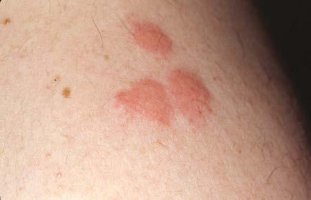
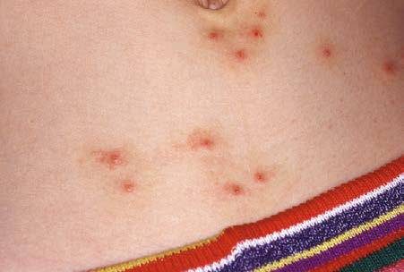

# Chapter 709: Arthropod Bites and Infestations
> **Course:** Vikkypaedia Pediatric Basic Course (*Nelson Textbook of Pediatrics, 22nd Edition (2025)*)  
> **Part XXIX:** The Skin  
> **Authors:** Nelson 22e Contributors  
> **Metrics:** 5,590 words · 5 tables/boxes · 2 figures · 0 genes · 8 flashcards · 5 MCQs  
> **Quick Navigation:** [🃏 Study 8 Flashcards](../flashcards/709_flashcards.md) · [📝 Take 5-Q MCQ Quiz](../mcqs/709_mcqs.md) · [📚 Part XXIX Guide](../parts/Part_XXIX.md) · [🧬 Syndrome & Genetics Atlas](../omim_gene_atlas.md) · [💊 Therapeutics Matrix](../therapies_matrix.md) · [🏠 Course Index](../../index.md)

## Key Chapter Topics & Subchapters
`709.1 Arthropod Bites` · `709.2 Scabies` · `709.3 Pediculosis` · `709.4 Seabather’s Eruption` · `709.1 Arthropod Bites Lamiaa Hamie and Stephen R. Humphrey` · `709.2 Scabies Lamiaa Hamie and Stephen R. Humphrey` · `709.3 Pediculosis Lamiaa Hamie and Stephen R. Humphrey`

## ⚡ High-Yield Nelson Pediatric Board Pearls
- Arthropod bites are a common affliction of children and occasionally pose a problem in diagnosis.
- In these cases, knowledge of the habits, life cycle, and clinical signs of the more common arthropod pests of humans may help lead to a correct diagnosis.
- This is the most common reaction seen in young children.
- The most common culprits are species of fleas, mites, bed bugs, gnats, mosquitoes, chiggers, and animal lice.
- Fipronil is effective as a topical agent for the prevention of flea infestation.
- Scabies is caused by burrowing and release of toxic or antigenic sub stances by the female mite Sarcoptes scabiei var. hominis.
- DIFFERENTIAL DIAGNOSIS The differential diagnosis of scabies can often be made clinically but is confirmed by microscopic identification of mites, ova, and scybala in epithelial debris.

---
## Full Chapter Text, Tables & Figures
# Chapter 709: Arthropod Bites and Infestations

<!-- p.5335 -->

## 709.1  Arthropod Bites Lamiaa Hamie and Stephen R. Humphrey

Arthropod bites are a common affliction of children and occasionally pose a problem in diagnosis. A patient may be unaware of the source of the lesions or may deny being bitten, making interpretation of the eruption difficult. In these cases, knowledge of the habits, life cycle, and clinical signs of the more common arthropod pests of humans may help lead to a correct diagnosis (Table 709.1).

**CLINICAL MANIFESTATIONS** The type of reaction that occurs after an arthropod bite depends on the insect species and the age-group and reactivity of the human host. Arthropods may cause injury to a host by various mechanisms, including mechanical trauma, such as the lacerating bite of a tsetse fly; invasion of host tissues, as in myiasis; contact dermatitis, as seen with repeated exposure to cockroach antigens; granulomatous reac tion to retained mouthparts; transmission of systemic disease; injec tion of irritant cytotoxic or pharmacologically active substances, such as hyaluronidase, proteases, peptidases, and phospholipases in sting venom; and induction of anaphylaxis. Most reactions to arthropod bites depend on antibody formation to antigenic substances in saliva or venom. The type of reaction is determined primarily by the degree of previous exposure to the same or a related species of arthropod. When someone is bitten for the first time, no reaction develops. An

immediate petechial reaction is occasionally seen. After repeated bites, sensitivity develops, producing a pruritic papule (Fig. 709.1) approxi mately 24 hours after the bite. This is the most common reaction seen in young children. With prolonged, repeated exposure, a wheal develops within minutes after a bite, followed 24 hours later by papule, vesicle, or bullae formation. By adolescence or adulthood, only a wheal may form, unaccompanied by the delayed papular reaction. Thus adults in the same household as affected children may be unaffected. Ultimately, as a person becomes insensitive to the bite, no reaction occurs at all. This stage of nonreactivity is maintained only as long as the individual continues to be bitten regularly. Individuals in whom papular urticaria develops are in the transitional phase between development of a pri marily delayed papular reaction and development of an immediate urticarial reaction.

Arthropod bites may occur as solitary, numerous, or profuse lesions, depending on the feeding habits of the perpetrator. Fleas tend to sample their host several times within a small localized area, whereas mosqui toes tend to attack a host at more randomly scattered sites. Delayed

#### **Table 709.1** Bed Bugs Versus Other Arthropod Bites: Main Clinical and Epidemiologic Features*

| Category / Parameter | Clinical Details & Findings |
| --- | --- |
| **CONTEXT** | Bed bugs; 3-4 bites in a line or curve; Uncovered areas; Morning; Traveling; Fleas; 3-4 bites in a line or curve; Legs and buttocks; Daytime; Pet owners or rural living; Mosquitoes; Nonspecific urticarial; papules; Potentially anywhere; Anopheles spp. night;; Culex spp. night; Aedes; spp. day; Worldwide distribution; Head lice; Live lice on the head; associated with itchy,; scratched lesions; Scalp, ears, and neck; Any; Children, parents, or; contact with children; Body lice; Excoriated papules and; hyperpigmentation; live; lice inside clothes; Back; Any; Unhoused people; Sarcoptes scabiei mites; (scabies); Vesicles, burrows,; nodules, and nonspecific; secondary lesions; Interdigital spaces,; forearms, breasts,; genitals; Night; Sexually transmitted,; households or; institutions; Ticks; Erythema migrans or ulcer; Potentially anywhere; Asymptomatic; Pet owners or hikers; Pyemotes ventricosus; Comet sign, a linear,; erythematous, macular; tract; Under clothes; Any time when inside; habitat; People exposed; to woodworm-; contaminated furniture; (Pediculoides ventricosus; is a woodworm parasite); Spiders; Necrosis (uncommon); Face and arms; Immediate pain, no itching; Rural living; *It is difficult to diagnose a bite. Diagnosis relies on an array of arguments, none of which is specific by itself; it is the association of elements that is suggestive. Any arthropod bite; can be totally asymptomatic.; From Bernardeschi C, Le Cleach L, Delaunay P, Chosidow O. Bed bug infestation [published correction appears in BMJ. 2013;346:F1044]. BMJ. 2013;346:f138. |

**Fig. 709.1** Pruritic papules after bed bug bites.

<!-- p.5336 -->
hypersensitivity reactions to insect bites—the predominant lesions in the young and uninitiated—are characterized by firm, persistent papules that may become hyperpigmented and are often excoriated and crusted. Pruritus may be mild or severe, transient or persistent. A central punc tum is usually visible but may disappear as the lesion ages or is scratched. The immediate hypersensitivity reaction is characterized by an evanes cent, erythematous wheal. If edema is marked, a tiny vesicle may sur mount the wheal. Certain beetles produce bullous lesions through the action of cantharidin, and various insects, including beetles and spiders, may cause hemorrhagic nodules and ulcers. Bites on the lower extremi ties are more likely to be severe or persistent or become bullous than those located elsewhere. Complications of arthropod bites include devel opment of impetigo, folliculitis, cellulitis, lymphangitis, and severe ana phylactic hypersensitivity reactions, particularly after the bite of certain hymenopterans. The histopathologic changes are variable, depending on the arthropod, the age of the lesion, and the reactivity of the host. Acute urticarial lesions tend to show central vesiculation in which eosinophils are numerous. Papules most commonly show dermal edema and a mixed superficial and deep perivascular inflammatory infiltrate, often includ ing a number of eosinophils. At times, however, the dermal cellular infil trate is so dense that a lymphoma is suspected. Many young children demonstrate extensive dermal but nonerythematous, nontender edema in response to mosquito bites **(Skeeter syndrome)**, which responds to oral antihistamines; this must be distinguished from cellulitis, which tends to be painful, tender, and red. Retained mouthparts may stimulate a foreign body type of granulomatous reaction.

**Papular urticaria** occurs principally in the first decade of life. It may occur at any time of the year. The most common culprits are species of fleas, mites, bed bugs, gnats, mosquitoes, chiggers, and animal lice. Individuals with papular urticaria have predominantly transitional lesions in various stages of evolution between delayed-onset papules and immediate-onset wheals. The most characteristic lesion is an edematous, red-brown papule (Fig. 709.2). An individual lesion fre quently starts as a wheal that, in turn, is replaced by a papule. A given bite may incite an id reaction at distant sites of quiescent bites in the form of erythematous macules, papules, or urticarial plaques. After a season or two, the reaction progresses from a transitional to a primarily immediate hypersensitivity urticarial reaction.

One of the most commonly encountered arthropod bites is that resulting from human, cat, or dog fleas (family Pulicidae). Eggs, which are generally laid in dusty areas and cracks between floorboards, give rise to larvae that then form cocoons. The cocoon stage can persist for up to 1 year, and the flea emerges in response to vibrations from foot steps, accounting for the assaults that frequently befall the new own ers of a recently reopened dwelling. Adult dog fleas can live without a blood meal for approximately 60 days. Attacks from fleas are more likely to occur when the fleas do not have access to their usual host; cat or dog fleas are more voracious and problematic when one visits an area frequented by the pet than when the pet is encountered directly. Flea bites tend to be grouped in lines or irregular clusters on the lower extremities. Fleas are often not seen on the body of a pet. Diagnosis of

flea bites is aided by examination of debris from the animal’s bedding material. The debris is collected by shaking the bedding into a plastic bag and examining the contents for fleas or their eggs, larvae, or feces.

**TREATMENT** Treatment is directed at alleviation of pruritus by oral antihistamines and cool compresses. Potent topical corticosteroids are helpful. Topical antihistamines are potent immunologic sensitizers and have no role in the treatment of insect bite reactions. A short course of systemic ste roids may be helpful if many severe reactions occur, particularly around the eyes. Insect repellents containing *N,N*-diethyl-3-methylbenzamide (DEET) may afford moderate protection against mosquitoes, fleas, flies, chiggers, and ticks, but are relatively ineffective against wasps, bees, and hornets. DEET must be applied to exposed skin and cloth ing to be effective. The most effective protection against mosquitoes, the human body louse, and other blood-feeding arthropods is the use of DEET and permethrin-impregnated clothing. However, these measures are not effective against the phlebotomine sand fly, which transmits leishmaniasis. Because of the potential for toxicity, the lowest effective DEET dose should be selected. Additional insect repellents include picaridin (flies, mosquitoes, chiggers, ticks), IR3535 (mosqui toes), oil of lemon, eucalyptus (mosquitoes), and citronella (mosqui toes). Table 709.2 lists methods to eliminate bed bugs.

An effort should be made to identify and eradicate the etiologic agent. Pets should be carefully inspected. Crawl spaces, eaves, and other sites of the house or outbuildings frequented by animals and birds should be decontaminated, and baseboard crevices, mattresses, rugs, furniture, and animal sleeping quarters should be decontaminated. Agents that are effective for ridding the home of fleas include lindane, pyrethroids, and organic thiocyanates. Flea-infested pets may be treated with pow ders containing rotenone, pyrethroids, malathion, or methoxychlor. Lufenuron, an agent that prevents fleas from reproducing, is effective for animals in oral and injectable formulations. Fipronil is effective as a topical agent for the prevention of flea infestation.

*Visit Elsevier eBooks+ at eBooks.Health.Elsevier.com** for Bibliography.*

## 709.2  Scabies Lamiaa Hamie and Stephen R. Humphrey

Scabies is caused by burrowing and release of toxic or antigenic sub stances by the female mite *Sarcoptes scabiei* var. *hominis*. The most

**Fig. 709.2** Red-brown papules in papular urticaria.

#### **Table 709.2** Patient Education to Eliminate Bed Bugs

| Category / Parameter | Clinical Details & Findings |
| --- | --- |
| **DETECTION** | • Look for brown insects no bigger than apple seeds on the; mattress, sofa, and curtains and in darker places in the room; (especially cracks in the walls, crevices in box springs, and; furniture); • Look for black spots on the mattress or blood traces on the sheets |
| **ELIMINATION** | • Contact a pest management company; • Wash clothes at 60°C (140°F) or freeze delicate clothing, vacuum,; and clean your home before the pest manager visits; • Collaborate with professionals who are used to dealing with bed; bug infestation to increase eradication efficacy |
| **PREVENTION** | • Carefully examine secondhand furniture to assure the absence of; bed bugs before purchase so as not to contaminate your home; • When sleeping in a hotel, even an upmarket establishment, lift; mattresses to look for bed bugs or black spots; • Do not leave luggage in dark places, near furniture, or close to; your bed. Before going to bed, close suitcases and put them in; the bathroom—in the bathtub or shower stall; From Bernardeschi C, Le Cleach L, Delaunay P, Chosidow O. Bed bug infestation; [published correction appears in BMJ. 2013;346:F1044]. BMJ. 2013;346:f138. |

<!-- p.5337 -->

<!-- p.5338 -->
important factor that determines spread of scabies is the extent and dura tion of physical contact with an affected individual. Children and sexual partners of affected individuals are most at risk. Scabies is transmitted only rarely by fomites because the isolated mite dies within 2-3 days.

**ETIOLOGY AND PATHOGENESIS** An adult female mite measures approximately 0.4 mm in length; has four sets of legs; and has a hemispheric body marked by transverse corrugations, brown spines, and bristles on the dorsal surface. A male mite is approxi mately half her size and is similar in configuration. After impregnation on the skin surface, a gravid female exudes a keratolytic substance and bur rows into the stratum corneum, often forming a shallow well within 30 minutes. She gradually extends this tract by 0.5-5.0 mm/24 hours along the boundary with the stratum granulosum. She deposits 10-25 oval eggs and numerous brown fecal pellets (scybala) daily. When egg laying is com pleted, in 4-5 weeks, she dies within the burrow. The eggs hatch in 3-5 days, releasing larvae that move to the skin surface to molt into nymphs. Maturity is achieved in approximately 2-3 weeks. Mating occurs, and the gravid female invades the skin to complete the life cycle.

**CLINICAL MANIFESTATIONS** In an immunocompetent host, scabies is frequently heralded by intense pruritus, particularly at night (Table 709.3). The first sign of the infesta tion often consists of 1- to 2-mm red papules, some of which are exco riated, crusted, or scaling. Threadlike burrows are the classic lesion of scabies (Figs. 709.3 and 709.4) but may not be seen in infants. In infants, bullae and pustules are relatively common. The eruption may also include wheals, papules, vesicles, and a superimposed eczematous dermati tis (Fig. 709.5). The palms, soles, and scalp are often affected. In older

children and adolescents, the clinical pattern is similar to that in adults, in whom preferred sites are the interdigital spaces; wrist flexors; anterior axillary folds; ankles, buttocks, umbilicus and belt line; groin; genitals in men; and areolas in women. The head, neck, palms, and soles are gener ally spared. Infants will often have a diffuse eczematous eruption that will involve the scalp, neck, and face. Red-brown nodules, most often located in covered areas such as the axillae, groin, and genitals, predominate in the less common variant called *nodular scabies.* Additional clues include facial sparing, affected family members, poor response to topical antibiot ics, and transient response to topical steroids. Untreated, scabies may lead to eczematous dermatitis, impetigo, ecthyma, folliculitis, furunculosis,

#### **Table 709.3** Different Presenting Forms of Scabies

| Category / Parameter | Clinical Details & Findings |
| --- | --- |
| **DIAGNOSES** | Classic scabies (scabies vulgaris); Infants and children; sexually; active adults; men who have sex; with men; Intense generalized pruritus,; worse at night; inflammatory; pruritic papules localized to; finger webs, flexor aspects of; wrists, elbows, axillae, buttocks,; genitalia, female breasts; lesions; and pruritus spare the face,; head, and neck; secondary; lesions include eczematization,; excoriation, impetigo; Dermatitis herpetiformis, drug; reactions, eczema, pediculosis; corporis, lichen planus, pityriasis; rosea; Scalp scabies; Infants and children;; institutionalized older adults;; AIDS patients; patients with; preexisting crusted scabies; Atypical crusted papular lesions of; the scalp, face, palms, and soles; Dermatomyositis, ringworm,; seborrheic dermatitis; Crusted scabies (Norwegian; scabies, scabies norvegica,; scabies crustosa); Institutionalized older; adults; institutionalized; developmentally disabled; (Down syndrome); unhoused; persons, especially HIV-positive;; all immunocompromised; patients, particularly those; with AIDS or positive for HIV or; HTLV-1; transplant recipients;; patients on prolonged; systemic corticosteroids and; chemotherapy; Psoriasiform hyperkeratotic; papular lesions of the scalp,; face, neck, hands, feet, with; extensive nail involvement;; eczematization and impetigo; common; Contact dermatitis, drug; reactions, eczema,; erythroderma, ichthyosis,; psoriasis; Nodular scabies; Sexually active adults; men who; have sex with men; HIV-positive; men > HIV-positive women; Violaceous pruritic nodules; localized to male genitalia,; groin, axillae, representing; hypersensitivity reaction to mite; antigens; Acropustulosis, atopic dermatitis,; Darier disease, lupus; erythematosus, lymphomatoid; papulosis, papular urticaria,; necrotizing vasculitis, secondary; syphilis; HTLV-1, Human T-cell lymphotropic virus type 1.; From Bennett JE, Blaser MJ, Dolin R, et al., eds. Mandell, Douglas, and Bennett’s Principles and Practice of Infectious Diseases, 8th ed. Philadelphia: Saunders; 2015: Table 295.1, p.; 3252. |

**Fig. 709.3** Classic scabies burrow.

<!-- p.5339 -->
cellulitis, lymphangitis, and id reaction. Glomerulonephritis has developed in children from streptococcal impetiginization of scabies lesions. In some tropical areas, scabies is the predominant underlying cause of pyoderma. A latent period of approximately 1 month follows an initial infestation. Thus itching may be absent and lesions may be relatively inapparent in contacts who are asymptomatic carriers. However, on reinfestation, reactions to mite antigens are noted within hours.

**DIFFERENTIAL DIAGNOSIS** The differential diagnosis of scabies can often be made clinically but is confirmed by microscopic identification of mites (Fig. 709.6A), ova, and scybala (see Fig. 709.6B) in epithelial debris. Scrapings most often test positive when obtained from burrows or fresh papules. A reliable method is application of a drop of mineral oil on the selected lesion, scraping of it with a No. 15 blade, and transferring the oil and scrapings to a glass slide.

The differential diagnosis depends on the types of lesions present. **Burrows** are virtually pathognomonic for human scabies. **Papulove sicular lesions** are confused with papular urticaria, canine scabies, chickenpox, viral exanthems, drug eruptions, dermatitis herpetiformis, and folliculitis. **Eczematous lesions** may mimic atopic dermatitis and

seborrheic dermatitis, and the less common bullous disorders of child hood may be suspected in infants with predominantly bullous lesions. **Nodular scabies** is frequently misdiagnosed as urticaria pigmentosa and Langerhans cell histiocytosis. The histopathologic appearance of nodular scabies, consisting of a deep, dense, perivascular infiltrate of lymphocytes, histiocytes, plasma cells, and atypical mononuclear cells, may mimic malignant lymphoid neoplasms.

**TREATMENT** The treatment of choice for scabies is permethrin 5% cream (Elimite) applied to the entire body from the neck down, with particular attention to intensely involved areas, which is also standard therapy (Table 709.4). Scabies is frequently found above the neck in infants (younger than 2

**Fig. 709.4** Scabies. Felt-tipped ink pen has penetrated and high lighted a burrow. The ink is retained after the surface is wiped clean with an alcohol swab. (From Habif TP, ed. Clinical Dermatology, 6th ed. Philadelphia: Mosby; 2016: Fig 15-16.)

**Fig. 709.5** A, Diffuse scabies on an infant. The face is clear. The lesions are most numerous around the axil lae, chest, and abdomen. B, Scabies. Infestation of the palms and soles is common in infants. The vesicular le sions have all ruptured. (From Habif TP, ed. Clinical Dermatology, 4th ed. Philadelphia: Mosby; 2004: Figs. 15.8 and 15.9.)

A B

A

B

**Fig. 709.6** A, Human scabies mite obtained from scraping. B, Scabies ova and scybala.

<!-- p.5340 -->
years old), necessitating treatment of the scalp. The medication is left on the skin for 8-12 hours and should be reapplied in 1 week for another 8to 12-hour period. Additional therapies include sulfur ointment 5–10%, and crotamiton 10% lotion or cream. Lindane 1% lotion or cream should only be used as an alternative therapy, given the risk of systemic toxicity. For severe infestations or in immunocompromised patients, ivermectin 200 μg/kg per dose given orally for two doses 2 weeks apart can be used (off-label use). Single-dose ivermectin (200 μg/kg) has also been effective in immunocompetent patients, with improvement (cure) noted in 60% at 2 weeks and 89% at 4 weeks after treatment (see Table 709.4).

Transmission of mites is unlikely more than 24 hours after treat ment. Pruritus, which is a result of hypersensitivity to mite antigens, may persist for a number of days to weeks, and may be alleviated by a topical corticosteroid preparation. If pruritus persists for >2 weeks after treatment and new lesions are occurring, the patient should be reexamined for mites. Nodules are extremely resistant to treatment and may take several months to resolve. The entire family should be treated, as should caretakers of the infested child. Clothing, bed linens, and towels should be washed in hot water and dried using high heat. Clothing or other items (e.g., stuffed animals) that cannot be washed may be dry cleaned or stored in bags for 3 days to 1 week, as the mite will die when separated from the human host.

**CRUSTED SCABIES** The Norwegian variant of human scabies is highly contagious and occurs mainly in individuals who are cognitively and physically debili tated, particularly those who are institutionalized and those with Down syndrome; in patients with poor cutaneous sensation (leprosy, spina bifida); in patients who have severe systemic illness (leukemia, dia betes); and in immunosuppressed patients (HIV infection). Affected individuals are infested by a myriad of mites that inhabit the crusts and exfoliating scales of the skin and scalp (Fig. 709.7). The nails may become thickened and dystrophic. The subungual debris is densely populated by mites. The infestation is often accompanied by general ized lymphadenopathy and eosinophilia. There is massive orthokerato sis and parakeratosis with numerous interspersed mites, psoriasiform epidermal hyperplasia, foci of spongiosis, and neutrophilic abscesses. Norwegian scabies is thought to represent a deficient host immune response to the organism. Management is difficult, requiring scru pulous isolation measures, removal of the thick scales, and repeated but careful applications of permethrin 5% cream. Ivermectin (200-250 μg/kg) has been used successfully as single-dose therapy in refractory cases, particularly in HIV-infected patients. A second dose may be needed a week later. The U.S. Food and Drug Administration has not approved this agent for the treatment of scabies.

#### **Table 709.4** Currently Recommended Treatment for Scabies

| Category / Parameter | Clinical Details & Findings |
| --- | --- |
| **CONTRAINDICATIONS** | 5% Permethrin; cream (Actin,; Nix, Elimite); Yes |
| **B** | Apply from neck down; wash; off after 8-14 hr; good; residual activity, but second; application recommended; after 1 wk; Excellent; itching and; stinging on application; Prior allergic reactions;; infants <2 mo of age;; breastfeeding; 1% Lindane lotion; or cream; Yes |
| **B** | Apply 30-60 mL from neck; down; wash off after 8-; 12 hr; no residual activity;; increasing drug resistance; Potential for central nervous; system toxicity from; organochloride poisoning,; usually manifesting as; seizures, with overapplication; and ingestions; Preexisting seizure; disorder; infants; and children <6 mo; of age; pregnancy;; breastfeeding; 10% Crotamiton; cream or lotion; (Eurax); Yes |
| **C** | Apply from neck down on 2; consecutive nights; wash; off 24 hr after second; application; Excellent; not very effective;; exacerbates pruritus; None; 2–10% Sulfur; in petrolatum; ointments; No |
| **C** | Apply for 2-3 days, then wash; Excellent; not very effective; Preexisting sulfur allergy; 10–25% Benzoyl; benzoate lotion; No; None; Two applications for 24 hr; with 1-day to 1-wk interval; Irritant; exacerbates pruritus;; can induce contact irritant; dermatitis and pruritic; cutaneous xerosis; Preexisting eczema; 0.5% Malathion; lotion (Ovide),; 1% malathion; shampoo; (unavailable; in the United; States); No |
| **B** | 95% ovicidal; rapid (5 min); killing; good residual; activity; increasing drug; resistance; Flammable 78% isopropyl; alcohol vehicle stings; eyes, skin, mucosa;; increasing drug resistance;; organophosphate poisoning; risk with overapplication and; ingestions; Infants and children <6 mo; of age; pregnancy;; breastfeeding; Ivermectin; (Stromectol); Yes |
| **C** | 200-μg/kg single PO dose,; may be repeated in 14-15; days; not ovicidal, second; dose on day 14 or 15; highly recommended;; recommended for endemic; or epidemic scabies in; institutions and refugee; camps; Excellent; may cause nausea; and vomiting; take on; empty stomach with water; Safety in pregnancy; uncertain; probably safe; during breastfeeding;; not recommended for; children younger than; 5 yr of age or weighing; <15 kg; *U.S. Food and Drug Administration safety in pregnancy categories: A, safety established; B, presumed safe; C, uncertain safety; D, unsafe; X, highly unsafe.; From Bennett JE, Blaser MJ, Dolin R, et al., eds. Mandell, Douglas, and Bennett’s Principles and Practice of Infectious Diseases, 8th ed. Philadelphia: Saunders; 2015: Table 295.2, p. 3253. |

<!-- p.5341 -->
**CANINE SCABIES** Canine scabies is caused by *S. scabiei* var. *canis,* the dog mite that is associated with mange. The eruption in humans, which is most fre quently acquired by cuddling an infested puppy, consists of tiny pap ules, vesicles, wheals, and excoriated eczematous plaques. Burrows are not present because the mite infrequently inhabits human stratum cor neum. The rash is pruritic and has a predilection for the arms, chest, and abdomen, the usual sites of contact with dogs. Onset is sudden and usually follows exposure by 1-10 days, possibly resulting from develop ment of a hypersensitivity reaction to mite antigens. Recovery of mites or ova from scrapings of human skin is rare. The disease is self-limited because humans are not a suitable host. Bathing and changing clothes are generally sufficient. Removal or treatment of the infested animal is necessary. Symptomatic therapy for itching is helpful. In rare cases in which mites are demonstrated in scrapings from an affected child, they can be eradicated by the same measures applicable to human scabies.

**OTHER TYPES OF SCABIES** Other mites that occasionally bite humans include the chigger or har vest mite *(Eutrombicula alfreddugesi),* which prefers to live on grass, shrubs, vines, and stems of grain. Larvae have hooked mouthparts, which allow the chigger to attach to the skin, but not to burrow, to obtain a blood meal, most commonly on the lower legs. Avian mites may affect those who come into close contact with chickens or pet ger bils. Humans may occasionally be assaulted by avian mites that have infested a nest outside a window, an attic, heating vents, or an air con ditioner. The dermatitis is variable, including grouped papules, wheals, and vesicular lesions on the wrists, neck, breasts, umbilicus, and ante rior axillary folds. A prolonged investigation is often undertaken before the cause and source of the dermatitis are discovered.

*Visit Elsevier eBooks+ at eBooks.Health.Elsevier.com** for Bibliography.*

## 709.3  Pediculosis Lamiaa Hamie and Stephen R. Humphrey

Three types of lice are obligate parasites of the human host: body or clothing lice *(Pediculus humanus corporis),* head lice *(Pediculus huma nus capitis),* and pubic or crab lice *(Phthirus pubis).* Only the body louse serves as a vector of human disease (typhus, trench fever, relapsing fever). Body and head lice have similar physical characteristics. They are approximately 2-4 mm in length. Pubic lice are only 1-2 mm in length and are greater in width than in length, giving them a crablike appear ance. Female lice live for approximately 1 month and deposit 3-10 eggs daily on the human host. However, body lice generally lay eggs in or near the seams of clothing. The ova or nits are glued to hairs or fibers of cloth ing but not directly on the body. Ova hatch in 1-2 weeks and require another week to mature. Once the eggs hatch, the nits remain attached to the hair as empty sacs of chitin. Freshly hatched larvae die unless a meal is obtained within 24 hours and every few days thereafter. Both nymphs

and adult lice feed on human blood, injecting their salivary juices into the host and depositing their fecal matter on the skin. Symptoms of infes tation do not appear immediately but develop as an individual becomes sensitized. The hallmark of all types of pediculosis is pruritus.

**Pediculosis corporis** is rare in children except under conditions of poor hygiene, especially in colder climates when the opportunity to change clothes on a regular basis is lacking. The parasite is transmitted mainly on contaminated clothing or bedding. The primary lesion is a small, intensely pruritic, red macule or papule with a central hemorrhagic punctum, located on the shoulders, trunk, or buttocks. Additional lesions include excoriations, wheals, and eczematous, secondarily infected plaques. Mas sive infestation may be associated with constitutional symptoms of fever, malaise, and headache. Chronic infestation may lead to “vagabond’s skin,” which manifests as lichenified, scaling, hyperpigmented plaques, most commonly on the trunk. Lice are found on the skin only transiently when they are feeding. At other times, they inhabit the seams of clothing. Nits are attached firmly to fibers in the cloth and may remain viable for up to 1 month. Nits hatch when they encounter warmth from the host’s body when the clothes are worn again. Therapy consists of improved hygiene and hot water laundering of all infested clothing and bedding. A uniform temperature of 65°C (149°F), wet or dry, for 15-30 minutes kills all eggs and lice. Alternatively, eggs hatch and nymphs starve if clothing is stored for 2 weeks at 23.9–29.4°C (75–85°F).

**Pediculosis capitis** is an intensely pruritic infestation of lice in the scalp hair. It is the most common form of lice to affect children, in par ticular those between the ages of 3 and 12 years. Fomites and head-tohead contact are important modes of transmission. In summer months in many areas of the United States and in the tropics at all times of the year, shared combs, brushes, or towels have a more important role in louse transmission. Translucent 0.5-mm eggs are laid near the proxi mal portion of the hair shaft and become adherent to one side of the shaft (Fig. 709.8). A nit cannot be moved along or knocked off the hair shaft with the fingers. Secondary pyoderma, after trauma from scratch ing, may result in matting together of the hair and cervical and occipi tal lymphadenopathy. Hair loss does not result from pediculosis but may accompany the secondary pyoderma. Head lice are a major cause of numerous pyodermas of the scalp, particularly in tropical environ ments. Lice are not always visible, but nits are detectable on the hairs, most commonly in the occipital region and above the ears, rarely on beard or pubic hair. Dermatitis may also be noted on the neck and pin nae. An **id reaction**, consisting of erythematous patches and plaques, may develop, particularly on the trunk.

In cases of resistance (which is common) of head lice to pyrethroids, malathion 0.5% in isopropanol is the treatment of choice and should be applied to dry hair until hair and scalp are wet and left on for 12 hours. A second application 7-9 days after the initial treatment may be necessary. This product is flammable, so care should be taken to avoid open flames. Malathion, like lindane shampoo, is not indicated for use in neonates and infants; however, additional approved therapies include spinosad (if >6 months), benzyl alcohol lotion (if >6 months), and ivermectin for difficult-to-treat head lice (Table 709.5). All house hold members should be treated at the same time. Nits can be removed

**Fig. 709.7** Norwegian scabies. A and B, Right side of the head and neck and right leg before treatment showing diffuse, scaly hyperkeratotic rash, crusts, and fis sures with areas of skin erythema (arrow) caused by hyperinfestation after infection with Sarcoptes scabiei in a patient with Down syndrome. (Modified from Lee K, Heresi G, Hammond RA. Norwegian sca bies in a patient with Down syndrome. J Pediatr. 2019;209:253.)

A B

<!-- p.5342 -->

<!-- p.5343 -->

**Fig. 709.8** Phthiriasis palpebrarum. Dermoscopy examination of eyelashes in a 27-mo-old boy, showing nits and parasites (arrow). (From Oue draogo M, Ventejou S, Leducq S, et al. Crusts on the eyelashes. J Pediatr. 2019;209:254.)

#### **Table 709.5** Drugs for Head Lice

| Category / Parameter | Clinical Details & Findings |
| --- | --- |
| **COST*/SIZE** | Ivermectin 0.5% lotion—; Sklice (Arbor); No; 6 mo; Apply to dry hair and scalp for 10 min,; then rinse†; $297.60/4 oz; Ivermectin tablets‡—; Stromectol (MSD); No; 15 kg§; 200-400 μg/kg PO once; repeat 7-10; days later; $9.30#; Spinosad 0.9%; suspension—Natroba; (ParaPro); No; 6 mo; Apply to dry hair for 10 min, then; rinse; repeat 7 days later if; necessary¶; $246.10/4 oz; Benzyl alcohol 5% lotion—; Ulesfia (Lachlan); No; 6 mo; Apply to dry hair for 10 min, then; rinse; repeat 7 days later**; $181.30/8 oz; Pyrethrins with piperonyl; butoxide shampoo‡—; Generic Rid (Bayer); Yes; 2 yr; Apply to dry hair for 10 min, then; shampoo; repeat 7-10 days later; $15.00/8 oz‡‡; $20.00/8 oz‡‡; Permethrin 1% creme; rinse‡—Generic Nix; (Insight); Yes; 2 mo; Apply to shampooed, towel-dried; hair for 10 min, then rinse; repeat 7; days later; $18.00/4 oz‡‡; $21.00/4 oz‡‡; Malathion 0.5% lotion—; Generic Ovide (Taro); Not in the United; States; 6 yr§§; Apply to dry hair for 8-12 hr, then; shampoo; repeat 7-9 days later if; necessary##,¶¶; $221.70/2 oz; $246.40/2 oz; Abametapir lotion 0.74%; (Xeglyze); No; 6 mo; Apply to dry hair for 10 min on; day 0 and then rinse with water; Not available yet; *Approximate WAC for the indicated size. WAC represents a published catalogue or list price and may not represent an actual transactional price. Source: AnalySource Monthly.; November 5, 2016. Reprinted with permission by First Databank, Inc. All rights reserved. Copyright 2016. www.fdbhealth.com/policies/drug-pricing-policy. Total cost of treatment; may vary based on hair length and number of applications required to completely eradicate lice.; †The manufacturer recommends using up to one single-use, 4-oz tube of topical ivermectin lotion per application.; ‡Not FDA approved for treatment of head lice.; §The safety and effectiveness of oral ivermectin have not been established in children weighing <15 kg.; #Cost of two 3-mg tablets (one dose for a 30-kg child at the lowest dosage).; ¶The manufacturer recommends using up to one 4-oz (120-mL) bottle of spinosad 0.9% suspension per application.; **The amount of benzoyl alcohol 5% lotion recommended per application depends on hair length.; ‡‡Approximate cost according to Walgreens.com. Accessed November 10, 2016.; §§The safety and effectiveness of malathion lotion have not been established in children <6 yr old; it is contraindicated in children <24 mo old.; ##In clinical trials, patients used a maximum of 2 fl oz of malathion lotion per application.; ¶¶One or two 20-min applications have also been effective (Meinking TL, Vicaria M, Eyerdam DH, et al: Efficacy of a reduced application time of Ovide lotion [0.5% malathion]; compared to Nix creme rinse [1% permethrin] for the treatment of head lice. Pediatr Dermatol 21:670–674, 2004.); ††Available without a prescription.; FDA, U.S. Food and Drug Administration; MSD, Merck Sharp Dohme; WAC, wholesaler acquisition cost or manufacturer’s published price to wholesalers.; From The Medical Letter. Drugs for head lice. Med Lett Drugs Ther. 2016;58:150–152. |

<!-- p.5345 -->
