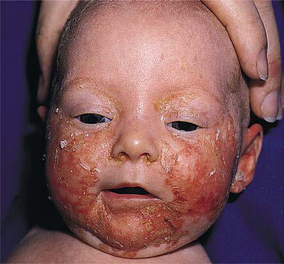

# Chapter 712: Nutritional Dermatoses
> **Course:** Vikkypaedia Pediatric Basic Course (*Nelson Textbook of Pediatrics, 22nd Edition (2025)*)  
> **Part XXIX:** The Skin  
> **Authors:** Joel C. Joyce  
> **Metrics:** 2,370 words · 1 tables/boxes · 2 figures · 2 genes · 8 flashcards · 5 MCQs  
> **Quick Navigation:** [🃏 Study 8 Flashcards](../flashcards/712_flashcards.md) · [📝 Take 5-Q MCQ Quiz](../mcqs/712_mcqs.md) · [📚 Part XXIX Guide](../parts/Part_XXIX.md) · [🧬 Syndrome & Genetics Atlas](../omim_gene_atlas.md) · [💊 Therapeutics Matrix](../therapies_matrix.md) · [🏠 Course Index](../../index.md)

## Key Genetic & Molecular Targets
`RET`, `SLC39A4`

## ⚡ High-Yield Nelson Pediatric Board Pearls
- The facies of patients with this syndrome are characterized by tem poroparietal bossing, prominent supraorbital ridges, a broad nasal root, ocular hypertelorism or dystopia canthorum, and prognathism.
- MUCOSAL NEUROMA SYNDROME (MULTIPLE ENDOCRINE NEOPLASIA TYPE IIB) Mucosal neuroma syndrome, an autosomal dominant trait, is charac terized by an asthenic or marfanoid habitus with scoliosis, pectus exca vatum, pes cavus, and muscular hypotonia.
- The syndrome is caused by pathogenic variants in the tyrosine kinase domain of the RET gene.
- ACRODERMATITIS ENTEROPATHICA Acrodermatitis enteropathica is a rare autosomal recessive disorder caused by an inability to absorb sufficient zinc from the diet.
- The diagnosis is established by the constellation of clinical findings and detection of a low plasma zinc concentration.
- Oral therapy with zinc compounds is the treatment of choice.
- Hartnup disease, caused by a pathogenic gene variant in SLC6A19, which encodes a neutral amino acid transporter, is a rare autosomal recessive disorder that presents in infancy with a “pellagra-like syndrome” as a result of decreased absorption of tryptophan.

---
## Full Chapter Text, Tables & Figures
# Chapter 712: Nutritional Dermatoses

*Joel C. Joyce*

<!-- p.5358 -->
carcinogenesis. Consequently, the syndrome includes a wide spectrum of defects involving the skin, eyes, central nervous and endocrine sys tems, and bones. The predominant features are early-onset basal cell carcinomas and mandibular cysts. Approximately 20% of those in whom a basal cell carcinoma develops before age 19 years have this syndrome. Basal cell carcinomas appear between puberty and age 35 years, erupting in crops of tumors that vary in size, color, and number; they may be difficult to distinguish from other types of skin lesions. Sites of predilection are the periorbital skin, nose, malar areas, and upper lip, but the lesions can also develop on the trunk and limbs and are not restricted to sun-exposed areas. Ulceration, bleeding, crusting, and local invasion can occur. Small milia, epidermal cysts, pigmented lesions, hirsutism, and palmar and plantar pits are additional cutane ous findings.

The facies of patients with this syndrome are characterized by tem poroparietal bossing, prominent supraorbital ridges, a broad nasal root, ocular hypertelorism or dystopia canthorum, and prognathism. Keratinized cysts (odontogenic keratocysts) in the maxilla and man dible occur in most patients. These cysts range in size from a few millimeters to several centimeters; may result in maldevelopment of the teeth; and cause pain, swelling of the jaw, facial deformity, bone erosion, pathologic fractures, and suppurating sinus tracts. Osseous defects such as anomalous rib development, spina bifida, kyphosco liosis, and brachymetacarpalism occur in 60% of patients, and ocular abnormalities—including cataracts, glaucoma, coloboma, strabismus, and blindness—occur in approximately 25%. Some males have hypo gonadism, and the testes are absent or undescended. Kidney malfor mations have also been reported. Neurologic manifestations include calcification of the falx, seizures, mental retardation, partial agenesis of the corpus callosum, hydrocephalus, and nerve deafness. The incidence of medulloblastoma, ameloblastoma of the oral cavity, fibrosarcoma of the jaw, teratoma, cystadenoma, cardiac fibroma, ovarian fibroma, and fetal-onset rhabdomyoma is higher in patients with nevoid basal cell carcinoma syndrome.

Treatment of these patients requires the participation of various specialists according to individual clinical problems. Basal cell carci nomas should not be treated with irradiation. Most of the basal cell carcinomas have a clinically benign course, and it is often impossible to remove them all. Those with an aggressive growth pattern and those on the central areas of the face, however, should be removed promptly. Treatment options include surgery, Mohs micrographic surgery, laser ablation, cryotherapy, photodynamic therapy, topical 5% imiquimod and oral retinoids (0.5-1.0 mg/kg/day). Vismodegib, which inhibits smoothened protein in the hedgehog pathway, is a targeted therapy available for unresectable basal cell carcinomas. Genetic counseling is also indicated.

**MELANOMA** See Chapter 692.

**MUCOSAL NEUROMA SYNDROME (MULTIPLE ENDOCRINE NEOPLASIA TYPE IIB)** Mucosal neuroma syndrome, an autosomal dominant trait, is charac terized by an asthenic or marfanoid habitus with scoliosis, pectus exca vatum, pes cavus, and muscular hypotonia. The syndrome is caused by pathogenic variants in the tyrosine kinase domain of the *RET* gene. Patients have thick, patulous lips and soft tissue prognathism simulat ing acromegaly. Multiple mucosal neuromas or neurofibromas appear as pink, pedunculated, or sessile nodules on the anterior third of the tongue, at the commissures of the lips, and on the buccal mucosa and palpebral conjunctiva. Various ophthalmologic defects and intestinal ganglioneuromatosis with recurrent diarrhea are additional common findings. There is a high incidence of medullary thyroid carcinoma in association with high calcitonin levels, pheochromocytoma, and hyperparathyroidism in patients with this syndrome. Periodic screen ing tests for the associated malignant tumors are mandatory.

*Visit Elsevier eBooks+ at eBooks.Health.Elsevier.com** for Bibliography.*

**OVERVIEW** There are many cutaneous manifestations of nutritional deficiencies (Table 712.1). For more details see Chapters 64-72.

**ACRODERMATITIS ENTEROPATHICA Acrodermatitis enteropathica** is a rare autosomal recessive disorder caused by an inability to absorb sufficient zinc from the diet. The genetic variant is in the intestinal zinc-specific transporter gene *SLC39A4.* Initial signs and symptoms usually occur in the first few months of life, often after weaning from breast milk to cow’s milk. The cutaneous eruption consists of vesiculobullous, eczematous, dry, scaly, or pso riasiform skin lesions symmetrically distributed in the perioral, acral, and perineal areas (Fig. 712.1) and on the cheeks, knees, and elbows (Fig. 712.2). The hair often has a peculiar, reddish tint, and alopecia of some degree is characteristic. Ocular manifestations include pho tophobia, conjunctivitis, blepharitis, and corneal dystrophy detectable by slit-lamp examination. Associated manifestations include chronic diarrhea, stomatitis, glossitis, paronychia, nail dystrophy, growth retar dation, irritability, delayed wound healing, intercurrent bacterial infec tions, and superinfection with *Candida albicans*. Lymphocyte function and free radical scavenging are impaired. Without treatment the course is chronic and intermittent but often relentlessly progressive. When the disease is less severe, only growth retardation and delayed development may be apparent.

The diagnosis is established by the constellation of clinical findings and detection of a low plasma zinc concentration. A serum zinc level less than 50 μg/dL is suggestive, but not diagnostic, of **acrodermati tis enteropathica**. Levels of alkaline phosphatase, a zinc-dependent enzyme, may also be decreased. Histopathologic changes in the skin are nonspecific and include parakeratosis and pallor of the upper epi dermis. The variety of manifestations of the syndrome may stem from the fact that zinc has a role in numerous metabolic pathways—includ ing those of copper, protein, essential fatty acids, and prostaglandins— and that zinc is incorporated into many zinc metalloenzymes. Other nutritional deficiencies may produce similar findings (see Table 712.1), although the classic findings are highly suggestive of acrodermatitis enteropathica.

Oral therapy with zinc compounds is the treatment of choice. Replacement for individuals with inherited acrodermatitis entero pathica is with elemental zinc 3 mg/kg/24 hr in the form of zinc sul fate, gluconate, or acetate (i.e., 220 mg of zinc sulfate contains 50 mg of elemental zinc). Zinc gluconate carries less risk of gastrointestinal distress. However, plasma zinc levels should be monitored every 3-6 months so as to individualize the dosage. Zinc therapy rapidly abol ishes the manifestations of the disease. Supplementation is for life*.* A syndrome resembling acrodermatitis enteropathica has been observed in patients with secondary zinc deficiency resulting from long-term total parenteral nutrition without supplemental zinc or to chronic mal absorption syndromes. A rash similar to acrodermatitis enteropathica has also been reported in infants fed breast milk that is low in zinc and in those with maple syrup urine disease, organic aciduria, methylma lonic acidemia, biotinidase deficiency, essential fatty acid deficiency, severe protein malnutrition (kwashiorkor), and cystic fibrosis. Cuta neous manifestations tend to appear in more severe forms. For those individuals with acquired zinc deficiency, oral replacement with ele mental zinc, 0.5-1.0 mg/kg/24 hr, should be undertaken and the cause of underlying malnutrition should be addressed.

*Joel C. Joyce*

<!-- p.5360 -->

#### **Table 712.1** Distinctive Skin Changes of Nutritional Disorders and Selected Differential Diagnosis

| Category / Parameter | Clinical Details & Findings |
| --- | --- |
| **SELECTED DIFFERENTIAL DIAGNOSIS** | Exfoliative erythroderma; Kwashiorkor; Atopic dermatitis, psoriasis, staphylococcal; scalded skin syndrome; Phrynoderma; Vitamin A deficiency, vitamin B–complex; deficiencies, vitamin C deficiency, essential; fatty acid deficiency; Keratosis pilaris, pityriasis rubra pilaris; Petechiae, purpura; Vitamin K deficiency, vitamin C deficiency; (perifollicular petechiae); Consumptive coagulopathy, coagulation; disorder, thrombocytopenia, vascular; fragility syndrome (Ehlers-Danlos), cutaneous; vasculitis (e.g., Henoch-Schoenlein purpura); Yellow-orange discoloration; Carotenemia; Jaundice, quinacrine-induced; Hyperpigmentation; Vitamin B12 deficiency, folate deficiency; Addison disease; Photodistributed dermatitis; Vitamin B3 deficiency (pellagra), vitamin B6; deficiency; Connective tissue disease (systemic; lupus erythematosus, dermatomyositis),; polymorphous light eruption; Seborrheic dermatitis–like changes; Vitamin B–complex deficiencies; Seborrheic dermatitis, psoriasis; Angular stomatitis; Vitamin B–complex deficiencies, iron; deficiency; Angular cheilitis with candidal overgrowth; Glossitis; Vitamin B–complex deficiencies, zinc; deficiency, iron deficiency; Sjogren syndrome, oral lichen planus, syphilis; Diaper dermatitis; Zinc deficiency, vitamin B–complex; deficiencies; Irritant or allergic contact dermatitis,; seborrheic dermatitis, inverse psoriasis,; Langerhans cell histiocytosis; Lightening of hair; Kwashiorkor, marasmus, vitamin B–complex; deficiencies, copper deficiency; Poliosis, vitiligo; Corkscrew hairs; Vitamin C deficiency; Nail changes; Koilonychia: iron deficiency; Longitudinal hyperpigmented streaks: vitamin; B3 deficiency (pellagra); Koilonychia: chronic irritant, lichen planus,; psoriasis, Plummer–Vinson syndrome,; transient in young children; Longitudinal hyperpigmented streaks:; physiologic, drug-induced, trauma; From Wong CY, Chu DH. Cutaneous signs of nutritional disorders. Inter J Women Dermatol. 2021;7:647–652: Table 1, p. 649. |

**ESSENTIAL FATTY ACID DEFICIENCY** Essential fatty acid deficiency causes a generalized scaly dermatitis composed of thickened, erythematous, desquamating plaques. Indi viduals may also show failure to thrive, growth retardation, alopecia, thrombocytopenia, and poor wound healing. The eruption has been induced experimentally in animals fed a fat-free diet and has been observed in patients with chronic severe malabsorption, as in short-gut syndrome, and in those sustained on a fat-free diet or fat-free paren teral alimentation. Linoleic acid (18:2 n-6) and arachidonic acid (20:4 n-6) are deficient, and an abnormal metabolite, 5,8,11-eicosatrienoic acid (20:3 n-9), is present in the plasma. Alterations in the triene/tet raene ratio are diagnostic (arachidonic acid/eicosatrienoic acid ratio >0.4 or linoleic acid/arachidonic acid ratio >2.3). The horny layer of the skin contains microscopic cracks, the barrier function of the skin is disturbed, and transepidermal water loss is increased. Topical applica tion of linoleic acid, which is present in sunflower seed and safflower oils, may ameliorate the clinical and biochemical skin manifestations, although absorption can be inconsistent. Oral and/or parenteral ther apy can also be considered. Appropriate nutrition should be provided, with the recommendation that 1–4% of total calories should be from linoleic acid.

**KWASHIORKOR** Severe protein and essential amino acid deprivation in association with adequate caloric intake can lead to **kwashiorkor**, particularly at the time of weaning to a diet that consists primarily of corn, rice (or rice

milk), or beans (see Chapter 64). Children can be fed such a restricted diet for cultural reasons or because of misdiagnosis on the part of the child’s parents or healthcare providers of perceived food allergies. Diffuse, fine, reddish-brown scaling (enamel/flaky paint sign) is the classic cutaneous finding. In severe cases, erosions and linear fissures develop (Fig. 712.3). Nails are thin and soft, and hair is sparse, thin, and depigmented, sometimes displaying a “flag sign” consisting of alternat ing light and dark bands that reflect alternating periods of adequate and inadequate nutrition. The cutaneous manifestations may closely resemble those of acrodermatitis enteropathica; however, edema of the extremities and face (“moon facies”) and a protuberant abdomen (“pot belly”) are key features uniformly observed in kwashiorkor. The serum zinc level is often deficient; in some cases, skin lesions of kwashiorkor heal more rapidly when zinc is applied topically. See Chapter 64 for treatment recommendations.

**CYSTIC FIBROSIS** See Chapter 454.

Protein-calorie malnutrition develops in 5–10% of patients with cystic fibrosis. Rash in infants with cystic fibrosis and malnutrition is rare but may appear by age 6 months. The initial eruption con sists of scaling, erythematous papules and progresses in 1-3 months to extensive desquamating plaques. The rash is accentuated around the mouth and perineum and on the extremities (lower greater than upper). Alopecia may be present, but mucous membranes and nails are uninvolved.

<!-- p.5361 -->

**Fig. 712.3** Erosions and scaling in kwashiorkor.

**PELLAGRA** See Chapter 67.3.

Pellagra manifests as edema, erythema, and burning of sun-exposed skin on the face, neck, and dorsal aspects of the hands, forearms, and feet. Lesions of pellagra may also be provoked by burns, pressure, fric tion, and inflammation. The eruption on the face frequently follows a butterfly distribution, and the dermatitis encircling the neck has been termed “Casal’s necklace.” Blisters and scales develop, and the skin increasingly becomes dry, rough, thickened, cracked, and hyperpig mented. Skin infections may be unusually severe. Pellagra develops in patients with insufficient dietary intake or malabsorption of niacin and/or tryptophan. Administration of isoniazid, 6-mercaptopurine, or 5-fluorouracil may also produce **pellagra**. **Hartnup disease** (see Chapter 105), caused by a pathogenic gene variant in *SLC6A19,* which encodes a neutral amino acid transporter, is a rare autosomal recessive disorder that presents in infancy with a “pellagra-like syndrome” as a result of decreased absorption of tryptophan. Nicotinamide supple mentation and sun avoidance are the mainstays of therapy in pellagra. See Chapter 67.3 for treatment recommendations.

A

B

**Fig. 712.1** A, Periorificial eruption. B, Diaper rash. The skin findings are typical of zinc deficiency, in this case caused by low levels of zinc in breast milk. (From Eichenfield LF, Frieden IJ, Esterly NB. Textbook of Neonatal Dermatology. Philadelphia: Saunders; 2001: Fig. 14.14.)

**Fig. 712.2** A, Psoriasiform le sion of zinc deficiency dermatitis on the ankles. B, Similar lesions on the elbows.

A B

<!-- p.5362 -->
**SCURVY (VITAMIN C OR ASCORBIC ACID DEFICIENCY)** See Chapter 68.

Scurvy manifests initially as follicular hyperkeratosis, or coiling of the hair on the upper arms, back, buttocks, and lower extremities (Fig. 712.4). Other features are perifollicular erythema and hemor rhage, particularly on the legs and advancing to involve large areas of hemorrhage; swollen, erythematous gums (Fig. 712.5); stomatitis; and subperiosteal hematomas. In children, the most common risk factors are behavioral or psychiatric disease resulting in poor nutrition. The best method of confirmation of a clinical diagnosis of scurvy is a trial of vitamin C supplementation. Treatment is with 100-200 mg/day of vitamin C supplementation orally or parenterally for up to 3 months.

**VITAMIN A DEFICIENCY** See Chapter 66.

Vitamin A deficiency manifests initially as impairment of visual adaptation to the dark. Cutaneous changes include xerosis and hyper keratosis and hyperplasia of the epidermis, particularly the lining of hair follicles and sebaceous glands. In severe cases, desquamation may be prominent. See Chapter 66 for treatment recommendations.

*Visit Elsevier eBooks+ at eBooks.Health.Elsevier.com** for Bibliography.*

**Fig. 712.4** Scurvy. (Photo courtesy Albert Yan, MD.)

**Fig. 712.5** Clinical photograph showing inflamed marginal gingiva in scurvy. (From Agarwal A, Shaharyar A, Kumar A, et  al. Scurvy in pediatric age group – a disease often forgotten? J Clin Ortho Trauma. 2015;6:101–107, Fig. 1, p. 103.)

<!-- p.5363 -->
