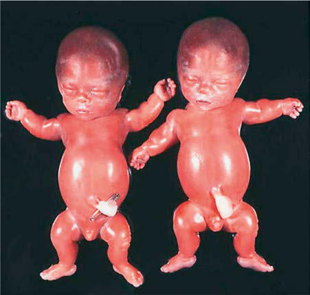

# Chapter 737: Disorders Involving Transmembrane Receptors
> **Course:** Vikkypaedia Pediatric Basic Course (*Nelson Textbook of Pediatrics, 22nd Edition (2025)*)  
> **Part XXX:** Bone and Joint Disorders  
> **Authors:** Daniah Albokhari and Julie E. Hoover-Fong  
> **Metrics:** 1,717 words · 1 tables/boxes · 1 figures · 2 genes · 8 flashcards · 5 MCQs  
> **Quick Navigation:** [🃏 Study 8 Flashcards](../flashcards/737_flashcards.md) · [📝 Take 5-Q MCQ Quiz](../mcqs/737_mcqs.md) · [📚 Part XXX Guide](../parts/Part_XXX.md) · [🧬 Syndrome & Genetics Atlas](../omim_gene_atlas.md) · [💊 Therapeutics Matrix](../therapies_matrix.md) · [🏠 Course Index](../../index.md)

## Key Genetic & Molecular Targets
`FGFR3`, `PTHR1`

## ⚡ High-Yield Nelson Pediatric Board Pearls
- Although this distress can be treated by intense respiratory care, the long-term prognosis is poor.
- Because the variant codons in TD are pathogenic for unknown reasons and because of the theoretical risk of germ cell mosaicism, parents are offered prenatal diagnosis for subsequent pregnancies.
- Diagnosis Skeletal radiographs confirm the diagnosis.
- Achondroplasia behaves as an autosomal dominant condition; most cases arise from a new pathogenic variant to average stature parents.

---
## Full Chapter Text, Tables & Figures
# Chapter 737: Disorders Involving Transmembrane Receptors

*Daniah Albokhari and Julie E. Hoover-Fong*

<!-- p.5588 -->
Heterozygous pathogenic variants of genes encoding *FGFR3* (fibroblast growth factor receptor 3) and *PTHR1* (parathyroid hormone-1 recep tor) result in disorders involving transmembrane receptors. The patho genic variants cause the receptors to become activated in the absence of physiologic ligands, which accentuates normal receptor function of negatively regulating bone growth. The pathogenic variants act by gain of negative function. In the *FGFR3* pathogenic variant group, in which the clinical phenotypes range from severe to mild, the severity appears to correlate with the extent to which the receptor is activated. *PTHR1* and especially *FGFR3* pathogenic variants tend to recur in unrelated individuals (Table 737.1; see also Table 735.1).

**FGFR3 CHONDRODYSPLASIA GROUP** The achondroplasia group represents a substantial percentage of patients with chondrodysplasias and contains thanatophoric dysplasia (TD), the most common lethal chondrodysplasia, with a birth preva lence of 1 in 35,000 births and achondroplasia, the most common non lethal chondrodysplasia, with a birth prevalence of 1 in 15,000–25,000 births. Also in this group are severe achondroplasia with developmen tal delay and acanthosis nigricans (SADDAN), hypochondroplasia, and camptodactyly, tall stature, and hearing loss syndrome (CATSHL). All five have pathogenic variants in a small number of locations in the *FGFR3* gene. There is a strong correlation between the pathogenic vari ant site and the clinical phenotype.

**Thanatophoric Dysplasia TD** manifests before or at birth. In the former situation, ultraso nographic examination in mid-gestation or later reveals a large head and very short limbs; the pregnancy is often accompanied by

polyhydramnios and premature delivery. Very short limbs, short neck, long narrow thorax, and large head with midfacial hypoplasia dominate the clinical phenotype at birth (Fig. 737.1). The cloverleaf skull deformity known as **kleeblattschädel** is sometimes found. If the affected fetus survives pregnancy, the newborn will have severe respi ratory distress because of the small thorax. Although this distress can be treated by intense respiratory care, the long-term prognosis is poor.

Skeletal radiographs distinguish two slightly different forms called TD I and TD II. In the more common TD I, radiographs show large calvarium with a small cranial base, marked thinning and flattening of vertebral bodies (platyspondyly) visualized best on lateral view, very short ribs, severe hypoplasia of pelvic bones, and very short and bowed tubular bones with flared metaphyses (Fig. 737.2). The femurs are curved and shaped like a telephone receiver. TD II differs mainly in that there are longer and straighter femurs.

The TD II clinical phenotype is associated with pathogenic variants that map to codon 650 of *FGFR3*, causing the substitution of a lysine with glutamic acid. This activates the tyrosine kinase activity of a recep tor that transmits signals to intracellular pathways. The pathogenic variant of the same lysine 650 to methionine is also associated with a clinical phenotype intermediate between TD and achondroplasia, referred to as **SADDAN (severe achondroplasia with developmen tal delay and acanthosis nigricans)**, where affected cases often do not require ventilatory support and survive beyond infancy. Pathogenic variants of the TD I phenotype mainly map to two regions in the extra cellular domain of the receptor, where they substitute cysteine residues for other amino acids. Free cysteine residues are thought to form disul fide bonds promoting dimerization of receptor molecules, leading to activation and signal transmission. TD I and TD II typically present as new pathogenic variants in offspring born to unaffected, average stat ure parents. The recurrence risk is low. Because the variant codons in TD are pathogenic for unknown reasons and because of the theoretical risk of germ cell mosaicism, parents are offered prenatal diagnosis for subsequent pregnancies.

**Achondroplasia** Achondroplasia is the prototype chondrodysplasia. It typically manifests at birth with short limbs, a long narrow trunk, and a large head with midfacial hypoplasia and prominent forehead (Fig. 737.3). The limb shortening is greatest in the proximal segments (rhizomelia), and the fingers often display a trident configuration. Most joints are hyperextensible, but extension is restricted at the elbow. A thoracolumbar gibbus is typically found in newborns but improves as they start walking with no intervention in 90% of the cases. Birth length may be slightly less than normal but often plots within the lownormal range.

**Diagnosis** Skeletal radiographs confirm the diagnosis (Fig. 737.4; see also Fig. 737.3). The calvarial bones are large, whereas the cranial base and facial bones are small. The vertebral pedicles are short throughout the spine as noted on a lateral radiograph. The interpedicular distance, which normally increases from the first to the fifth lumbar vertebra, decreases in achondroplasia. The iliac bones are short and round, and the acetab ular roofs are flat. The tubular bones are short with mildly irregular and flared metaphyses. The fibula is disproportionately long compared with the tibia, which is often bowed, causing genu varum.

**Clinical Manifestations** Infants usually exhibit delayed motor milestones, often not walking alone until 18-24 months. This is because of hypotonia and mechanical difficulty balancing the large head on a normal-sized trunk and short extremities. Intelligence is normal unless central nervous system com plications develop. As the child begins to walk, the gibbus usually gives way to an exaggerated lumbar lordosis.

Infants and children with achondroplasia progressively fall below normal standards for length and height. They can be plotted against standards established for achondroplasia. Adult heights typically are 118-145 cm for men and 112-136 cm for women. C-type natriuretic

*Daniah Albokhari and Julie E. Hoover-Fong*

#### **Table 737.1** FGFR3 Chondrodysplasia Group

| Category / Parameter | Clinical Details & Findings |
| --- | --- |
| **GENE** | Thanatophoric dysplasia; type I (TD I) |
| **AD** | 187600 |
| **FGFR3** | Thanatophoric dysplasia; type II (TD II) |
| **AD** | 187601 |
| **FGFR3** | Severe achondroplasia; with developmental; delay and acanthosis; nigricans (SADDAN) |
| **AD** | 616482 |
| **FGFR3** | Achondroplasia |
| **AD** | 100800 |
| **FGFR3** | Hypochondroplasia |
| **AD** | 146000 |
| **FGFR3** | Camptodactyly, tall; stature, and hearing; loss syndrome |
| **AD** | 610474 |
| **FGFR3** | Please also refer to group 33 from Mortier et al nosology for craniosynostoses; syndromes linked to FGFR3 pathogenic variants, as well as LADD syndrome in group; 41 for another FGFR3-related phenotype.; OMIM, Online Mendelian Inheritance in Man (omim.org).; From Campeau P, Schlesinger AE: Skeletal dysplasias. [Updated 2017 Jan 30]. In: De; Groot LJ, Chrousos G, Dungan K, et al. (eds). Endotext [internet]. South Dartmouth,; MA, 2000, MDText.com, Inc. Available from https://www.ncbi.nlm.nih.gov/books/N |

<!-- p.5589 -->
peptide analogue (vosoritide), administered as a daily subcutaneous injection is the first approved treatment for children ≥5 years of age with achondroplasia; treatment with vosoritide produced an increase of annual growth velocity with no significant side effect. In addition, vosoritide maintains this annual growth velocity up to 2 years along with an improvement in body segment proportion. Clinical trials are underway to study other compounds such as soluble FGFR3 decoy receptors, and tyrosine kinase inhibitors, which may restore bone growth in achondroplasia based on studies in animal models. Other possible future treatments of achondroplasia include fibroblast growth factor aptamers and meclizine, which showed improvement of the skeletal phenotype of the mutant mice. Surgical limb lengthening and human growth hormone treatment have been used to increase height; however, both are controversial.

Virtually all infants and children with achondroplasia have large heads, although only a fraction have true hydrocephalus. Head circum ference should be carefully monitored using standards developed for achondroplasia, as should neurologic function in general. The spinal canal is stenotic, and spinal cord compression can occur at the foramen magnum and in the lumbar spine. The former usually occurs in infants and small children and may be associated with hypotonia, failure to

thrive, quadriparesis, central and obstructive apnea, and sudden death. Surgical correction may be required for severe stenosis. Lumbar spi nal stenosis usually does not occur until early adulthood. Symptoms include paresthesias, numbness, and claudication in the legs. Loss of bladder and bowel control may be late complications. Bowing of the legs is common in patients with achondroplasia and might need to be corrected surgically. Other common problems include dental crowd ing, articulation difficulties, obesity, and frequent episodes of otitis media, which can contribute to hearing loss.

**Genetics** All patients with typical achondroplasia have pathogenic variants at *FGFR3* codon 380. This pathogenic variant is located in the trans membrane domain of the receptor and is thought to stabilize recep tor dimers that enhance receptor signals, the consequences of which inhibit linear bone growth. Achondroplasia behaves as an autosomal dominant condition; most cases arise from a new pathogenic variant to average stature parents.

**Fig. 737.1** Identical twins with type I thanatophoric dysplasia. Dis proportionately large head, bell-shaped chest, and micromelia. (From Gilbert-Barness E, Kapur RP, Oligny LL, Siebert JR, eds. Potter’s Pathol ogy of the Fetus, Infant and Child, 2nd ed. Philadelphia: Elsevier, 2007. Fig. 20-47.)

**Fig. 737.2** Thanatophoric dysplasia type I. Severe platyspondyly, very short ribs, narrow thorax, short broad pelvis, large skull, very short and bent long bones. (From Campeau P, Schlesinger AE. Skel etal dysplasias. [Updated 2017 Jan 30]. In De Groot LJ, Chrousos G, Dungan K, et al., eds. Endotext [internet]. South Dartmouth, MA, 2000, MDText.com, Inc., Fig. 1. Available from https://www.ncbi.nlm.nih.gov /books/NBK279130/.)

B

C

A

**Fig. 737.3** Achondroplasia phenotype at different ages. A, Infant with achondroplasia with macrocephaly, frontal bossing, midface hy poplasia, small chest, rhizomelic shortening of all the limbs, redundant skinfolds, and extreme joint laxity. Note the trident hand with short fin gers and abducted hips. B, Typical radiographic findings from a child with achondroplasia. All of the tubular bones are short, but the fibula is relatively long compared with the tibia. There is protrusion of the epiphysis into the metaphysis of the distal femur, creating the chev ron deformity, and—to a lesser extent—of the proximal tibia. The iliac bones are rounded, the acetabular roof is horizontal, and the sacro sciatic notches are small. C, A 3-yr-old with achondroplasia with the typical features shown in (A). Note that the redundant skinfolds are no longer present and that joint laxity has improved. Rhizomelic shorten ing of the extremities is more pronounced and accompanied by tibial bowing. (From Horton WA, Hall JG, Hecht JT. Achondroplasia. Lancet. 2007;370:162–172.)

<!-- p.5591 -->
