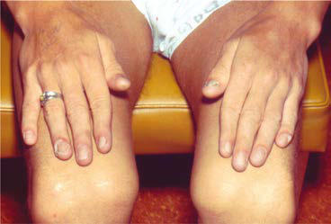
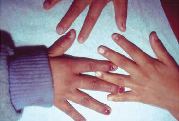

# Chapter 740: Osteopetrosis and Other Disorders Involving Defective Bone Resorption
> **Course:** Vikkypaedia Pediatric Basic Course (*Nelson Textbook of Pediatrics, 22nd Edition (2025)*)  
> **Part XXX:** Bone and Joint Disorders  
> **Authors:** Julie E. Hoover-Fong and Daniah Albokhari  
> **Metrics:** 2,150 words · 2 tables/boxes · 2 figures · 11 genes · 8 flashcards · 5 MCQs  
> **Quick Navigation:** [🃏 Study 8 Flashcards](../flashcards/740_flashcards.md) · [📝 Take 5-Q MCQ Quiz](../mcqs/740_mcqs.md) · [📚 Part XXX Guide](../parts/Part_XXX.md) · [🧬 Syndrome & Genetics Atlas](../omim_gene_atlas.md) · [💊 Therapeutics Matrix](../therapies_matrix.md) · [🏠 Course Index](../../index.md)

## Key Genetic & Molecular Targets
`CA2`, `CLCN7`, `CSF1R`, `IKBKG`, `LRRK1`, `OSTM1`, `PLEKHM1`, `SHOX`, `SLC4A2`, `TNFRSF11A`, `TNFSF11`

## ⚡ High-Yield Nelson Pediatric Board Pearls
- Diagnosis is based on clinical presentation, and molecular confir mation is available with a 95% detection rate.
- Management includes treatment of orthopedic complications, surveillance and treatment of renal disease, and ophthalmologic follow-up.
- Osteopetrosis is marked by increased bone mass caused by abnormal osteoclast formation or function.
- Pathogenic variants in CLCN7 may cause disease in an autosomal dominant or reces sive fashion and variants in IKBKG are X-linked, whereas all oth ers here cause recessive osteopetrosis.
- CLCN7-related autosomal dominant osteopetrosis occurs in 1 in 20,000 births, while collec tively, the recessive form of osteopetrosis occurs in 1 in 250,000 births.
- Pathogenic variants in CLCN7 are the most common cause of osteopetrosis overall, causing a wide spectrum of disease severity ranging from late childhood/adolescent-onset autosomal dominant osteopetrosis II (ADOII) to more involved intermediate autosomal osteopetrosis (IAO) to the most severe autosomal recessive osteo petrosis (ARO) with onset at birth.
- The autosomal dominant form of osteopetrosis (Albers-Schönberg disease, osteopetrosis tarda, or marble bone disease) usually mani fests during childhood or adolescence with fractures and mild anemia and, less often, as cranial nerve dysfunction, dental abnormalities, or osteomyelitis of the mandible.

---
## Full Chapter Text, Tables & Figures
# Chapter 740: Osteopetrosis and Other Disorders Involving Defective Bone Resorption

*Julie E. Hoover-Fong and Daniah Albokhari*

<!-- p.5595 -->
with CD can collapse to meet in the midline because of hypoplasia or absence of the clavicles. Radiographs will reveal the abnormal clavicles, delayed ossification of cranial bones with multiple ossifi cation centers (Wormian bones), and delayed ossification of pelvic bones. The anterior fontanelle is wide and may remain open into adulthood. The course is relatively uncomplicated except for dislo cations and variable diffuse joint pain (especially of the shoulders), dental anomalies (e.g., supernumerary and/or retained primary teeth) that require dental treatment, and risk of hearing loss because of infections. Affected individuals are shorter than unaffected sib lings and have an increased risk of genu valgum, pes planus, and scoliosis. Diagnosis is based on clinical and radiographic presenta tion, but molecular confirmation is available with a detection rate of >70%. The proportion of cases caused by de novo pathogenic variants is high. Management includes prevention of ear infections, speech therapy, dental, and orthopedic interventions as indicated.

**SHOX**** GENE-RELATED CONDITIONS** The *SHOX* gene is located on the pseudoautosomal region of the X and Y chromosomes (i.e., Xp22.33/Yp11.32). Because of crossover during meiotic replication, a *SHOX* variant can segregate on both sex chromosomes, thereby allowing inheritance to occur from male to male, male to female, female to female, and female to male (i.e., sex chromosome gene location while appearing to have autosomal inheritance; pseudoautosomal). Haploinsufficiency of the *SHOX* gene (i.e., loss of one copy of the gene) through deletion, single nucleotide variant, or abnormal regulation of adjacent genes causes Leri-Weill dyschondrosteosis (LWD) and idiopathic short stature (ISS) and contributes to Turner syndrome features when included in the absent X-chromosome material. Features of LWD include short stature, mesomelia, and Madelung deformity of the wrists. ISS does not have other phenotypic features of an abnormal *SHOX* gene other than short stature. This distinguishes ISS from Turner syndrome in which the entire X chromosome is typically missing in affected females, causing short stature, pubertal delay/absence, cardiac anomalies, nuchal folds, and other anomalies. Growth hor mone injections can provide effective treatment for short stature associated with a *SHOX* gene abnormality.

**NAIL-PATELLA SYNDROME** Dysplasia of the nails, absence or hypoplasia of the patella, abnor malities of the elbow, and spurs or “horns” extending from the iliac bones characterize NPS, also called *osteo-onychodysostosis.* Penetrance is high, but clinical presentation is extremely variable with a wide spectrum of severity. Some patients present in early childhood, whereas others are asymptomatic as adults. Nail abnor malities are almost universal with a wide variety of manifestations,

A B C

**Fig. 739.3** Nail-patella syndrome. A, Adolescent showing nail hypoplasia, especially of thumbs, and displacement of small patellae. B, Two af fected children showing nail dysplasia. C, Incomplete extension of the elbows. (From Jones KL, Jones MC, Del Campo M, eds. Smith’s Recognizable Patterns of Human Malformation, 7th ed. Philadelphia: Saunders, 2013. Fig. 1, p. 574.)

including absence, hypoplasia, clefts, ridged, thin, or hypertropic nails, all of which may worsen in severity moving in the ulnar to radial direction. Elbow abnormalities include limitation of move ment, cubits valgus, and pterygium. The patella can be hypoplastic or absent (Fig. 739.3). Iliac horns project posterior-laterally from the center of the iliac bone. A total of 30% of patients have nephritis that resembles chronic glomerulonephritis that presents with pro teinuria with or without hematuria; 5% of cases progress to endstage renal disease. There is an increased risk of glaucoma for NPS patients. NPS is often inherited with 12% of cases being *de novo*. Diagnosis is based on clinical presentation, and molecular confir mation is available with a 95% detection rate. Management includes treatment of orthopedic complications, surveillance and treatment of renal disease, and ophthalmologic follow-up.

*Visit Elsevier eBooks+ at eBooks.Health.Elsevier.com** for Bibliography.*

Bone dysplasias displaying increased bone density are rare. Osteopetro sis, which has many subtypes, pycnodysostosis, and dysosteosclerosis are the principal members of this disease category. The clinical features and complications of these conditions are the result of abnormal osteo clast formation and function, resulting in defective bone resorption (Table 740.1).

*Julie E. Hoover-Fong and Daniah Albokhari*

<!-- p.5597 -->

#### **Table 740.1** Osteopetrosis and Related Osteoclast Disorders

| Category / Parameter | Clinical Details & Findings |
| --- | --- |
| **GENE OR LOCUS** | Osteopetrosis, neonatal or infantile form |
| **TCIRG, CLCN, SNX10** | Osteopetrosis, infantile form, with nervous system; involvement |
| **OSTM1** | Osteopetrosis, infantile form, osteoclast-poor with; immunoglobulin deficiency |
| **TNFRSF11A** | Osteopetrosis, intermediate form |
| **TCIRG1, TNFSF11, PLEKHM1, CLCN7** | Osteopetrosis, late-onset, dominant form |
| **CLCN7** | Osteopetrosis with renal tubular acidosis |
| **CA2** | Osteopetrosis with ectodermal dysplasia and immune; defect (OLEDAID); Osteopetrosis, moderate form |
| **SLC4A2** | Osteopetrosis, moderate form with defective leucocyte; adhesion |
| **FERMT3, RASGRP2** | Osteosclerotic metaphyseal dysplasia |
| **LRRK1** | Pyknodysostosis |
| **CTSK** | Dysosteosclerosis |
| **SLC29A3, TNFRSF11A** | Dysosteosclerosis with degenerative encephalopathy and; brain malformation |
| **CSF1R** | Data from Unger S, Ferreira CR, Mortier GR, et al. Nosology of genetic skeletal disorders: 2023 revision. Am J Med Genet 2023;191A:1164-1209 (Table 1, Group 24, pp 1184-1185). |

**OSTEOPETROSIS** The term *osteopetrosis* derives from the Greek root “osteo,” mean ing bone, and “petrosis,” meaning stone. Osteopetrosis is marked by *increased* bone mass caused by abnormal osteoclast formation or function. The dense bone in osteopetrosis invades the marrow space, causing anemia and pancytopenia, and impinges on nerves traversing cranial and other skeletal foramina, causing deafness, blindness, and palsies. Although the skeleton is dense in osteope trosis, the bone quality is poor and may be prone to fracture because of imbalanced bone turnover.

To date, genes known to cause osteopetrosis include: *CLCN7, TCIRG1, OSTM1, SNX10, CA2, PLEKHM1, TNFRSF11A, TNFSF11, IKBKG, SLC4A2, FERMT3, and RASGRP2.* Pathogenic variants in *CLCN7, TCIRG1, OSTM1, SNX10, CA2,* and *PLEKHM1* prevent normal osteoclast function to resorb bone while *TNFRSF11A, TNFSF11* encode proteins (RANK and RANKL, respectively) that are essential to the formation of osteoclasts. Pathogenic variants in *CLCN7* may cause disease in an autosomal dominant or reces sive fashion and variants in *IKBKG* are X-linked, whereas all oth ers here cause recessive osteopetrosis. CLCN7-related autosomal dominant osteopetrosis occurs in 1 in 20,000 births, while collec tively, the recessive form of osteopetrosis occurs in 1 in 250,000 births. Pathogenic variants in *CLCN7* are the most common cause of osteopetrosis overall, causing a wide spectrum of disease severity ranging from late childhood/adolescent-onset autosomal dominant osteopetrosis II (ADOII) to more involved intermediate autosomal osteopetrosis (IAO) to the most severe autosomal recessive osteo petrosis (ARO) with onset at birth. In general, the other recessive forms of osteopetrosis are also severe, usually detected in infancy because of macrocephaly, hepatosplenomegaly, deafness, blindness, and severe anemia.

**CLINICAL MANIFESTATIONS** Most of the manifestations of osteopetrosis are because of failure to remodel growing bones. This leads to narrowing of cranial nerve foramina and encroachment on marrow spaces, which results in secondary complications, such as optic and facial nerve dysfunc tion, and anemia accompanied by compensatory extramedullary hematopoiesis in the liver and spleen (Table 740.2). The unusually dense bones are weak, leading to increased risk of fractures.

In the severe recessive infancy-onset form, patients present with macrocephaly, hepatosplenomegaly, deafness, blindness, and severe anemia. Radiographs reveal diffuse bone sclerosis and *hypocal cemia* may be present. Later radiographs show the characteristic bone-within-bone appearance throughout the skeleton (Figs. 740.1 and 740.2). With time, infants typically fail to thrive and show psy chomotor delay and worsening of cranial neuropathies and anemia. Dental problems, osteomyelitis of the mandible, and pathologic fractures are common. The most severely affected patients die dur ing infancy; less severely affected patients rarely survive beyond the second decade but often only after treatment with bone marrow transplant. Those who survive beyond infancy usually have learn ing disabilities but might have normal intelligence despite hearing and vision loss.

The autosomal dominant form of osteopetrosis (Albers-Schönberg disease, osteopetrosis tarda, or marble bone disease) usually mani fests during childhood or adolescence with fractures and mild anemia and, less often, as cranial nerve dysfunction, dental abnormalities, or osteomyelitis of the mandible. Skeletal radiographs reveal a general ized increase in bone density and clubbing of metaphyses. Alternating lucent and dense bands produce a sandwich appearance to vertebral bodies. The radiographic changes are sometimes incidental findings in otherwise asymptomatic adolescents and adults.

<!-- p.5598 -->
**TREATMENT** Most of the bone manifestations in severe osteopetrosis caused by intrinsic osteoclast defects can be prevented or reversed by hema topoietic stem cell transplantation (HSCT), if carried out before development of irreversible secondary complications, such as visual impairment. RANKL replacement therapy may be useful in patients

with RANKL deficiency caused by *TNFSF11* bi-allelic pathogenic variants, who do not benefit from HSCT. Interferon-γ is used to delay progression in patients with severe malignant infantile osteo petrosis. Symptomatic care, such as dental care, transfusions for anemia, and antibiotic treatment of infections, is important for patients who survive infancy.

#### **Table 740.2** Complications of Osteopetrosis by Subspeciality

| Category / Parameter | Clinical Details & Findings |
| --- | --- |
| **Endocrinology** | Osteopetrorickets; Hypocalcemia |
| **Ophthalmology** | Papilledema; Ptosis; Strabismus; Paralysis of extraocular muscles; Optic nerve atrophy; Exophthalmos; Nystagmus; Retinal degeneration; Tearing (from nasolacrimal duct obstruction) |
| **Dentistry** | Delay/failure of tooth eruption; Malformed crowns/roots; Periodontal ligament defects; Odontoma; Tooth agenesis; Enamel hypoplasia; Tooth decay/caries; Thickened lamina dura; Osteomyelitis (most frequently of the mandible) |
| **Orthopedics** | Skeletal deformities; Scoliosis; Spondylolisthesis; Fractures (particularly of the long bones); Delayed union/nonunion; Degenerative arthritis; Spondylolysis |
| **Neurology/ neurosurgery** | Compressive cranial neuropathies (often optic and facial nerves, but can involve any of cranial nerves I–VIII); Increased intracranial pressure; Craniosynostosis; Arnold–Chiari I malformation; Neuromuscular scoliosis; Developmental delay/regression, seizures (OSTM1 mutation); Calcifications of the basal ganglia, thalami (CAII deficiency); Hydrocephalus; Cerebrovascular stenosis/occlusion; Acquired encephalocele |
| **Otolaryngology** | Conductive hearing loss; Recurrent otitis media; Chronic congestion (poorly pneumatized sinuses); Rhinorrhea; Choanal atresia; Rhinosinusitis; Obstructive sleep apnea |
| **Hematology** | Thrombocytopenia with bleeding; Anemia; Leukopenia with frequent infections; Hepatosplenomegaly; Transfusion dependence |
| **Nephrology** | Renal tubular acidosis, nephrocalcinosis, and nephrolithiasis (CAII deficiency); From Wu CC, Econs MJ, DiMeglio LA, et al. Diagnosis and management of osteopetrosis: consensus guidelines from the osteopetrosis working group. J Clin Endocrinol Metab; 2017;102(9):3111-3123 (Table 2, p. 3116). |

<!-- p.5599 -->

**Fig. 740.2** Osteopetrosis. Right-hand radiograph obtained at 2 weeks of age. Note metaphyseal lucent bands in the distal ulna and radius (arrows) and short tubular bones. (From Stark Z, Savarirayan R. Osteopetrosis. Orphanet J Rare Dis. 2009;4:5.)

**Fig. 740.1** Osteopetrosis. Thick dense bones, alternating bands of sclerosis, and normal density bone in long bones, rugger jersey spine, dense base of skull. (From Campeau P, Schlesinger AE. Skeletal dysplasias. [Updated 2017, Jan 30]. In De Groot LJ, Chrousos G, Dungan K, et al, eds. Endotext [internet]. South Dartmouth, MA, 2000, MDText.com, Inc. Fig. 14. Available at https://www.ncbi.nlm.nih.gov/books/NBK279130/.)

**PYCNODYSOSTOSIS AND DYSOSTEOSCLEROSIS Pycnodysostosis** An autosomal recessive bone dysplasia related to osteopetrosis, pycnodysostosis manifests in early childhood with short limbs, characteristic facies, an open anterior fontanel, a large skull with frontal and occipital bossing, acroosteolysis, and dental abnormali ties. The hands and feet are short and broad, and the nails may be dysplastic. The sclerae may be blue. Minimal trauma often leads to fractures. Treatment is symptomatic and focused mainly on the

management of dental problems and fractures. Although some patients have a persistently open anterior fontanelle (i.e., even into adulthood), others with pycnodysostosis have craniosynostosis. The overall prognosis for these patients is generally good, and they typically reach 130-150 cm in height. Skeletal radiographs show a generalized increase in bone density. In contrast to many disorders in this group, the metaphyses are normal. Other changes include wide sutures and Wormian bones in the skull, a small mandible, and osteolysis of the distal phalanges. Homozygous or compound heterozygous missense, nonsense, insertions, deletions, and splic ing variants have been described in the gene *CTSK,* which encodes cathepsin K. This is a lysosomal protease that is involved in bone resorption and remodeling. *CTSK* is highly expressed in osteoclasts, and pathogenic variants prevent degradation of bone matrix pro teins (e.g., type I and II collagen), which is necessary for normal bone remodeling and resorption. Growth hormone therapy has been used to improve growth.

**Dysosteosclerosis** Dysosteosclerosis is another rare bone disease with generalized increased bone density plus widening of tubular bones and vertebral flattening. It is caused by pathogenic variants in three genes: *SLC9A3, CSF1R,* and *TNFRSF11A* (which is allelic with osteopetrosis). Affected individuals have short stature and cranial nerve involvement caused by impingement of the foramina by the abnormally dense bone. No disease-specific treatment has been developed.

There are several other conditions marked by hyperostotic and frag ile bones but also other anomalies or conditions distinguishing them from osteopetrosis, pycnodysostosis, and dysosteosclerosis (Table 740.3).

*Visit Elsevier eBooks+ at eBooks.Health.Elsevier.com** for Bibliography.*

<!-- p.5601 -->
