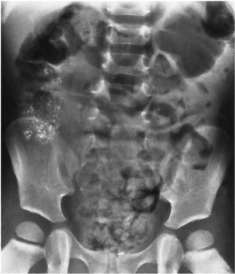

# Chapter 761: Lead Poisoning
> **Course:** Vikkypaedia Pediatric Basic Course (*Nelson Textbook of Pediatrics, 22nd Edition (2025)*)  
> **Part XXXII:** Environmental Health  
> **Authors:** Morri Markowitz  
> **Metrics:** 6,457 words · 5 tables/boxes · 1 figures · 0 genes · 7 flashcards · 5 MCQs  
> **Quick Navigation:** [🃏 Study 7 Flashcards](../flashcards/761_flashcards.md) · [📝 Take 5-Q MCQ Quiz](../mcqs/761_mcqs.md) · [📚 Part XXXII Guide](../parts/Part_XXXII.md) · [🧬 Syndrome & Genetics Atlas](../omim_gene_atlas.md) · [💊 Therapeutics Matrix](../therapies_matrix.md) · [🏠 Course Index](../../index.md)

## ⚡ High-Yield Nelson Pediatric Board Pearls
- The blood lead level (BLL) is the gold standard for determining risk of health effects.
- In 2021, the Centers for Disease Control and Prevention (CDC) designated 3.5 μg/dL as the “reference value based on the 97.5th percen tile of the population of US children aged 1-5 years.” It is the BLL that identifies the 2.5% of children with the highest BLLs.
- METABOLISM The nonnutritive hand-to-mouth activity of young children is the most common pathway for lead to enter the body.
- DIAGNOSIS Screening It is estimated that 99% of lead-poisoned children are identified by screening procedures rather than through clinical recognition of leadrelated symptoms.
- Other Tools for Assessment BLL determinations remain the gold standard for evaluating children because of ready availability and its correlation with health outcomes in populations.
- During health maintenance visits a limited risk assessment is war ranted, which includes questions pertaining to the most common sources of lead exposure: the condition of old paint, secondary occu pational exposure via an adult living in the home, and/or proximity to an industrial source of pollution.

---
## Full Chapter Text, Tables & Figures
# Chapter 761: Lead Poisoning

*Morri Markowitz*

<!-- p.5707 -->
Lead is a metal that exists in four isotopic forms. Clinically it is purely a toxicant; no organism has an essential function that is lead dependent. Chemically its low melting point and ability to form stable compounds have made it useful in the manufacture of hundreds of products; this commercial attractiveness has resulted in the processing of millions of tons of lead ore, leading to widespread dissemination of lead in the human environment.

The **blood lead level (BLL)** is the gold standard for determining risk of health effects. The threshold level at which lead begins to cause biochemical, subclinical, or clinical disturbance remains to be deter mined. In 2021, the Centers for Disease Control and Prevention (CDC) designated 3.5 μg/dL as the *“reference value based on the 97.5th percen tile of the population of US children aged 1-5 years.”* It is the BLL that identifies the 2.5% of children with the highest BLLs. As a measure of the distribution of BLLs in young American children rather than a toxicity threshold, this number will change in a manner dependent on the epidemiology of BLLs. Surveillance by the CDC has shown that the prevalence of elevated BLLs has declined markedly. Approximately 500,000 U.S. children ages 1-5 years currently have BLLs ≥3.5 μg/dL. Fortunately, children with levels high enough to be life-threatening (>100 μg/dL) are rarely seen in the United States, though deaths con tinue to occur in other areas of the world. Although BLL ≥3.5 μg/dL is stated as a reference value, it is likely that clinicians and departments of health will consider this a threshold for action.

**PUBLIC HEALTH HISTORY** In the late 1970s, nearly all preschool-age children in the United States had BLLs above the current reference value of 3.5 μg/dL. Over the next 25 years, government regulations resulted in the significant reduction of three main contributors to lead exposure by means of (1) the elimi nation of the use of tetraethyl lead as a gasoline additive, (2) the ban ning of lead-containing solder to seal food- and beverage-containing cans, and (3) the application of a federal rule that limited the amount of lead allowed in paint intended for household use to less than 0.06% by weight (further reduced by the Consumer Product Safety Commission to 0.009% in 2008). Factors identified by the CDC in the late 1970s that indicate increased risk of lead poisoning, in addition to preschool age, include low socioeconomic status; living in older housing, built pri marily before 1960; urban location; and Black race. Another high-risk group that has been identified consists of recent immigrants from less wealthy countries, including adoptees. These risk factors largely persist currently, as indicated by an analysis of over 1 million BLLs obtained from U.S. children between October 2018 and February 2020 and ana lyzed in a commercial lab. In addition, these data indicated that over half of the children still have measurable BLLs, i.e., ≥1 μg/dL.

Progress is also being made globally. In Mexico, the introduction of unleaded gasoline in 1990 was associated with a decline in BLLs among first-grade students, from 17 μg/dL in 1990 to 6.2 μg/dL in 1997. Alge ria, the last country to use leaded gasoline for cars and trucks, phased out its use in 2021. In Malta, after the import of red lead paint was banned and the use of lead-treated wood for fuel in bakeries was pro hibited, mean BLLs of pregnant women and newborns decreased by 45%. After it was documented that children living in the neighborhood of a battery factory in Nicaragua had a mean BLL of 17.2 μg/dL, but children in the control community had a mean BLL of 7.4 μg/dL, the factory was closed. Despite these advances, in 2021 the World Health Organization (WHO), citing research for UNICEF by the Institute for Health Metrics and Evaluation, estimated that 815 million children globally may have elevated BLLs above 5 mg/dL. The majority live in developing countries, where in some regions BLLs may be 10- to 20-fold higher than in developed countries.

Unfortunately, local lead-related harms continue to occur. When the water source for Flint, Michigan, was changed (2014) to the Flint River and utilized a water treatment plant with poor corrosion control, the lead level of Flint tap water increased, as did the BLLs of children <5 years of age. Flint is not unique; many other cities have lead pipes that can result in water contamination. In 2021 the US government allo cated $15 billion for lead pipe removal.

In 2010, the CDC and WHO identified numerous lead-contaminated villages in northern Nigeria. The grinding of ore to extract gold caused widespread leaded dust dissemination. It is likely that hundreds of chil dren died because of this activity, and all remaining children in some of the villages assessed were lead poisoned, with 97% having a BLL ≥45 μg/dL, the threshold for chelation therapy in the United States. Unfor tunately, such disasters continue to occur in Nigeria and neighboring countries from similar metal extraction activities.

**SOURCES OF EXPOSURE** Lead poisoning may occur in utero because lead readily crosses the placenta from maternal blood. The spectrum of toxicity is similar to that experienced by children after birth. The source of maternal blood lead content is either redistribution from endogenous stores (i.e., the mother’s skeleton) or lead newly acquired from ongoing environmen tal exposure.

Several hundred products contain lead, including paint, batteries, cable sheathing, cosmetics, mineral supplements, plastics, toys (Table 761.1), and traditional medicines (Table 761.2). Major sources of expo sure vary among and within countries; the major source of exposure in the United States remains old lead-based paint. Approximately 34.6 million homes, mainly built before 1950, have lead-based paint (2021 estimate), of which the CDC has estimated that 22.3 million are in a haz ardous state. As paint deteriorates, it chalks, flakes, and turns to dust. Improper rehabilitation work of painted surfaces (e.g., sanding) can result in dissemination of lead-containing dust throughout a home. The dust can coat all surfaces, including children’s hands. All of these forms of lead can be ingested. If heat is used to strip paint, then lead vapor con centrations in the room can reach levels sufficient to cause lead poison ing via inhalation. There is an increased awareness that tap water in both homes and schools may have substantial amounts of lead. The latter arose from the discovery of contaminated water in most New York City public schools. Moreover, this occurrence raised questions about the safety of the US Environmental Protection Agency (EPA) lead-in-water-standard of 15 parts per billion (ppb; μg of Pb/L of water) that water distribution companies must meet in at least 90% of homes in their service areas. This standard was not based on achieving health safety but rather on what the water companies felt was financially feasible. After review, in 2021 the EPA recommended lowering the “trigger” level to 10 ppb. Breaching this value requires water companies to prepare an intervention plan should the level subsequently go over 15 ppb. It does not require action to reduce the amount of lead in that water supply. Even 10 ppb is still much greater than the 1 ppb recommended by the American Academy of Pediatrics as the limit for allowable lead in drinking water. It should be noted that the EPA lead in water standard does not apply to schools, although many states have set their own standards.

In other parts of the world, especially in poorer countries, additional sources can be found. These include contaminated neighborhoods as the result of car/truck battery lead recycling, aluminum cookware made with recycled metals, spices, and traditional medicines.

**METABOLISM** The nonnutritive hand-to-mouth activity of young children is the most common pathway for lead to enter the body. In most cases, lead is ingested either as a component of dust licked off of surfaces or in swal lowed paint chips, through water contaminated by its flow through lead pipes or brass fixtures, or from otherwise contaminated foods or liq uids. Cutaneous contamination with inorganic lead compounds, such as those found in pigments, does not result in a substantial amount of absorption. Organic lead compounds, such as tetraethyl lead, may penetrate through skin; however, these are rarely encountered.

The percentage of lead absorbed from the gut depends on several fac tors: particle size, pH, other material in the gut, and nutritional status of

*Morri Markowitz*

<!-- p.5708 -->
essential elements. Large paint chips are difficult to digest and are mainly excreted; this chemical characteristic of lead compounds is fortunate, as a single chip may contain a potentially lethal dose of lead. Fine dust can be dissolved more readily, especially in an acid medium. Lead eaten on an empty stomach is better absorbed than that taken with a meal. The presence of **calcium** and **iron** may decrease lead absorption by direct competition for binding sites; iron (and probably calcium) deficiency results in enhanced lead absorption, retention, and toxicity.

After absorption, lead is disseminated throughout the body via blood. It circulates bound to erythrocytes; approximately 97–99% of lead in blood is bound on or in the red blood cells. The plasma frac tion is too small to be measured by conventional techniques employing atomic absorption spectroscopy or anodic stripping voltammetry; it is presumably the plasma portion that may leave the blood compartment to enter cells and induce toxicity. Thus clinical laboratories report the BLL, not the serum or plasma lead level. The increasing availability and decreasing cost of inductively coupled plasma mass spectrometry, which is capable of measuring lead in ng/dL quantities, may eventually

result in clinical availability of tools to measure plasma lead, a more proximal measure to where toxicity is actually occurring.

Most retained lead accumulates in bone, where it resides for years. But in all cells, lead has multiple effects. It binds to enzymes, particularly those with available sulfhydryl groups, changing the contour and dimin ishing function. For example, three of eight enzymes in the ubiquitously distributed heme pathway are susceptible to lead inhibitory effects. The accumulation of excess amounts of heme precursors is also toxic. The last enzyme in this pathway, ferrochelatase, enables protoporphyrin to chelate iron, thus forming heme. **Erythrocyte protoporphyrin (EP)** lev els higher than 35 μg/dL (laboratory dependent) are abnormal and are consistent with lead poisoning, iron deficiency, or recent inflammatory disease. Measurement of the EP level is thus a useful tool for monitoring biochemical lead toxicity. EP levels begin to rise several weeks after BLLs have reached 20 μg/dL in a susceptible portion of the population and are elevated in nearly all children with BLLs higher than 50 μg/dL. A drop in EP levels also lags behind a decline in BLLs by several weeks because it depends on both cell turnover and cessation of further overproduction by marrow red blood cell precursors. The test can be ordered either as the free EP or the zinc protoporphyrin. Results are reported in μg/dL. When reported in μmol/mmol this likely indicates that the analysis has been standardized to a hematocrit of 45, an unwarranted assumption in young children.

A second mechanism of lead toxicity works via its competition with calcium. Many calcium-binding proteins have a higher affinity for lead than for calcium. Lead bound to these proteins may alter function, resulting in abnormal intracellular and intercellular signaling. Neu rotransmitter release is, in part, a calcium-dependent process that is adversely affected by lead.

Although these two mechanisms of toxicity may be reversible, a third mechanism prevents the development of the normal tertiary brain structure. In immature mammals the normal neuronal prun ing process that results in elimination of multiple intercellular brain connections is affected by lead. Failure to construct the appropriate tertiary brain structure during infancy and childhood may result in a permanent abnormality. In a longitudinal study of childhood lead poisoning, MRI examinations of the participants when in their 20s found smaller areas of brain in the prefrontal cortex and hip pocampus regions, areas involved in decision-making and memory formation.

**CLINICAL EFFECTS** The BLL is the best-studied measure of the lead burden in children. Although subclinical and clinical findings correlate with BLLs in popu lations, there is considerable interindividual variability in this relation ship. **Lead encephalopathy** is more likely to be observed in children with BLLs higher than 100 μg/dL; however, one child with a BLL of 300 μg/dL may have no symptoms, whereas another with the same level may be comatose. Susceptibility may be associated with polymorphisms in genes coding for lead-binding proteins, such as Δ-aminolevulinic acid dehydratase, an enzyme in the heme pathway.

Several **subclinical effects** of lead have been demonstrated in crosssectional epidemiologic studies. Hearing and height are inversely related to BLLs in children; in neither case, however, does the lead effect reach a level that would bring an individual child to medical attention. As BLLs increase in the study populations, more sound (at all frequencies) is needed to reach the hearing threshold. Children with higher BLLs are shorter than those with lower levels; for every 10 μg increase in the BLL, the children are 1 cm shorter. Chronic lead expo sure also may delay puberty.

Several longitudinal studies have followed cohorts of children for decades after birth and examined the relationship between BLLs and cognitive test scores over time. In general, there is agreement that BLLs, expressed either as levels obtained concurrently with cognitive testing or as a measure that integrates multiple BLLs drawn from subjects over time, are inversely related to cognitive test scores. From these stud ies, no BLL above 0 μg/dL appears safe. On average, for each 1 μg/dL elevation in BLL, the cognitive score is approximately 0.25-0.50 points lower, though the relationship is not linear across the BLL spectrum.

with Traditional Medicines by Type of Medication

#### **Table 761.2** Cases of Lead Encephalopathy Associated

| Category / Parameter | Clinical Details & Findings |
| --- | --- |
| **MEDICATION** | Ayurveda; 5 (7); 1 (20); Ghasard; 1 (1); 1 (100); Traditional Middle; Eastern practices; 66 (87); 66 (100); Azarcon and Greta; 2 (3); 2 (100); Traditional Chinese; medicine; 2 (3); 2 (100); Total; 76 (100); 72 (95); CAM, Complementary and alternative medicines.; From Karri SK, Saper RB, Kales SN. Lead encephalopathy due to traditional medicines.; Curr Drug Saf. 2008;3:54–59. |

#### **Table 761.1** Sources of Lead

| Category / Parameter | Clinical Details & Findings |
| --- | --- |
| **General** | Paint chips; Dust; Soil; Parent’s or household contact’s occupational exposure (auto repair,; smelting, construction, remodeling, plumbing, gun/bullet (firing; range) exposure, painting, e-scrap); Glazed ceramics; Herbal remedies (e.g., Ayurvedic medications); Home remedies, including antiperspirants, deodorants (litargirio); Jewelry (toys or parents’); Stored battery casings or recycling (or living near a battery smelter); Lead-based gasoline (in aviation fuel for propeller planes); Moonshine alcohol; Mexican candies; Ecuadorian chocolates; Ceremonial spices; Indoor firing ranges; Retained bullet fragments; Imported spices (svanuri marili, zafron, kuzhambu); Lead-based cosmetics (kohl, surma, kajal); Lead plumbing (water); Imported foods in lead-containing cans; Domestic foods (applesauce pouches, others); Imported toys; Home renovations; Antique toys or furniture; Kratom |

<!-- p.5709 -->
Because the BLLs from early childhood are predictors of the cognitive test results performed years later, this finding implies that the effects of lead can be permanent.

The effect of in utero lead exposure is less clear. Scores on the Bayley Scale of Mental Development were obtained repeatedly every 6 months for the first 2 years of life in a cohort of infants born to middle-class families. Results correlated inversely with cord BLLs, a measure of in utero exposure. However, after 2 years of age, all other cognitive tests performed on the cohort over the next 10 years correlated with the BLLs at age 2 years but not with cord BLLs, indicating that the effects of prenatal lead exposure on brain function were superseded by early childhood events and later BLLs. Later studies, performed in cohorts of Mexican children monitored from the prenatal period, confirm the association between in utero lead exposure and later cognitive out comes. In these studies, maternal plasma lead levels, obtained espe cially during the first trimester, were more strongly associated with cognitive scores in the offspring than with the traditionally measured maternal whole BLLs.

**Behavior** also is adversely affected by lead exposure. Hyperac tivity is noted in young school-age children with histories of lead poisoning or with concurrent elevations in BLL. Older children with higher bone lead content are more likely to be aggressive and to have behaviors that are predictive of later juvenile delinquency. One report supports the concept of long-term effects of early lead exposure. In this longitudinal study, the mothers of a cohort were enrolled during their pregnancies. BLLs were obtained early in pregnancy, at birth, and then multiple times in the offspring dur ing the first 6 years. The investigators report that the later relative rate of arrests, especially for violent crimes, increased significantly in relationship to the presence of these BLLs early in life. For every 5 μg/dL increase in BLL, the adjusted arrest rate was 1.40 for pre natal BLLs and 1.27 for 6-year BLLs. Epidemiologic data support the findings in this observational study. In an analysis that com bined two national datasets, total annual leaded gasoline use (U.S. Geological Survey) and total reported violent criminal acts (U.S. Department of Justice), the amount of leaded gasoline used yearly was found to be strongly associated with violent criminal behavior with a lag time of 23 years; that is, early childhood exposure was followed two decades later by violent behavior rising and falling in close tandem. A similar association was found, this time between urban air lead levels and later violent crime, with a similar best-fit model employing a lag of approximately 22 years.

An intervention study, in which children with moderate lead poi soning and initial BLLs of 20-55 μg/dL were aggressively managed over 6 months, addressed the issue of the effects of treatment on cognitive development. Components of treatment included education regard ing sources of lead and its abatement, nutritional guidance, multiple home and clinic visits, and for a subset, chelation therapy. Average BLLs declined, and cognitive scores were inversely related to the change in BLLs. For every 1 μg/dL fall in BLLs, cognitive scores were 0.25 point higher. A randomized placebo-controlled treatment study of 2-year-old children with initial BLLs of 20-44 μg/dL that employed the chelating agent succimer administered over 6 months found no difference in mean cognitive scores at age 4 years. However, as in the earlier treatment study, regression analysis did find an inverse relation between *change* scores; that is, a change in BLLs was associated with an inverse change in cognitive scores.

Whether the behavioral effects of lead are reversible is unclear. In one small, short-term study, 7-year-old hyperactive children with BLLs in the 20s were randomly allocated to receive a chelating agent (penicillamine), methylphenidate, or placebo. Teacher and parent ratings of behavior improved for the first two groups but not the pla cebo group. BLLs declined only in the chelated group. Two-year-old lead-poisoned children enrolled in a placebo-controlled trial of the chelating agent succimer showed no mean difference in behavior at 4 or 7 years of age. However, mean BLLs were also not different in the two groups at those ages.

These studies support the concept that early exposure to lead can result in long-term deficits in cognition and behavior; they also hold

out the possibility that reductions in lead burden may be associated with improvement in cognitive test scores.

**CLINICAL SYMPTOMS Gastrointestinal** symptoms of lead poisoning include anorexia, abdominal pain, vomiting, and constipation, often occurring and recurring over a period of weeks. Children with BLLs higher than 20 μg/dL are twice as likely to have gastrointestinal complaints as those with lower BLLs. **Central nervous system** symptoms are related to worsening cerebral edema and increased intracranial pressure. Head aches, change in mentation, lethargy, papilledema, seizures, and coma leading to death are rarely seen at levels lower than 100 μg/dL but have been reported in children with a BLL as low as 70 μg/dL. The lastreported death directly attributable to lead toxicity in the United States was in 2006 in a child with a BLL of 180 μg/dL. There is no clear cutoff BLL value for the appearance of hyperactivity, but it is more likely to be observed in children who have levels higher than 20 μg/dL.

**Other organs** also may be affected by lead toxicity, but symptoms usually are not apparent in children. At high levels (>100 μg/dL), renal tubular dysfunction is observed. Lead may induce reversible Fanconi syndrome. In addition, at high BLLs, red blood cell survival is short ened, possibly contributing to a hemolytic anemia, although most cases of anemia in lead-poisoned children are a result of other factors, such as iron deficiency and hemoglobinopathies. Older patients may develop peripheral neuropathy leading to wrist drop and foot drop, as well as hypertension.

**DIAGNOSIS Screening** It is estimated that 99% of lead-poisoned children are identified by screening procedures rather than through clinical recognition of leadrelated symptoms. Until 1997, universal screening by blood lead testing of all children at ages 12 and 24 months was the standard in the United States. Given the national decline in the prevalence of lead poisoning, the recommendations have been revised to target blood lead testing of high-risk populations. High risk is based on an evaluation of the likelihood of lead exposure. Departments of health are responsible for determining the local prevalence of lead poisoning, as well as the per centage of housing built before 1950, the period of peak leaded paint use. When this information is available, informed screening guidelines for practitioners can be issued. For instance, in New York State, where a large percentage of housing was built before 1950, the Department of Health mandates that all children be tested for lead poisoning via blood analyses. *In the absence of such data, the practitioner should continue to test all children at both 12 and 24 months*. In areas where the prevalence of lead poisoning and old housing is low, targeted screening may be performed on the basis of a risk assessment. Three questions form the basis of most published questionnaires (Table 761.3), and items that are pertinent to the locale or individual may be added. If there is a lead-based industry in the child’s neighborhood, the child is a recent immigrant from a country that until recently still permitted the use of leaded gasoline, or the child has **pica** (pattern of eating non-food materials) or developmental delay, blood lead testing would be appro priate. All Medicaid-eligible children should be screened by blood lead testing. Venous sampling is preferred to capillary sampling because the chances of false-positive and false-negative results are less with the former. However, capillary screening can be performed rapidly in the office with a point of care (POC) instrument; use of such instruments in primary care offices substantially increases screening rates. Other screening guidelines vary by federal, state, and even local governmen tal agencies. Contacting your local Department of Health is one way to determine local primary care obligations.

The threshold for lead effects and the reference level for risk manage ment purposes are not the same. Laboratory issues make the interpre tation of values more difficult at low levels. Most labs achieve quality control of ±2 μg/dL for reports of BLL, but federal regulations allow laboratories that perform BLL testing to operate with an allowable error of ±4 μg/dL. A capillary screening value ≥3.5 μg/dL requires a venous sample for confirmation (Table 761.4). If the diagnostic (venous) test

<!-- p.5710 -->
confirms that the BLL is elevated, then further testing is required by the recommended schedule (Table 761.5). A confirmed venous BLL of 45 μg/dL or higher requires prompt chelation therapy.

**Other Tools for Assessment** BLL determinations remain the gold standard for evaluating children because of ready availability and its correlation with health outcomes in populations. Techniques are available to measure lead in other tis sues and body fluids. Experimentally, the method of x-ray fluorescence (XRF) allows direct and noninvasive assessment of bone lead stores. XRF methodology was used to evaluate a population that had longterm exposure to lead from a polluting battery-recycling factory. The study found that the school-age children had elevated lead levels in bone but not in venous blood, a finding that is consistent with our understanding of the slow turnover of lead in bone, which is measur able in years, in contrast to that in blood, which is measurable in weeks. It also indicates that children may have substantial lead in their bodies that is not detected by routine blood lead testing. This stored lead may be released to toxic levels if bone resorption rates suddenly increase, as occurs with prolonged immobilization of longer than a week and during pregnancy. Thus children with histories of elevated BLLs are potentially at risk for recrudescence of lead toxicity long after ingestion has stopped and may pass this lead to the next generation. XRF meth odology is not available for clinical use in children.

Lead also can be measured in urine. Spontaneous excretion, even in children with high BLLs, is usually low. Lead excretion may be stim ulated by treatment with chelating agents, and this property of these drugs forms the basis of their use as a component of lead treatment. It also has been used to develop a test that differentiates children with lead burdens responsive to chelation therapy, the **lead mobilization test**. In this test, a timed urine collection follows one or two doses of chelating agent, and the lead content is determined. However, this test is no longer recommended.

Lead in hair, nails, and saliva also is measurable but has problems of contamination and interpretability; thus these have no clinical utility. Radiographs of long bones may show dense bands at the metaphyses (“**lead lines**”), which may be difficult to distinguish from growth arrest

lines but, if caused by lead, are indicative of months to years of expo sure (Fig. 761.1). For children with acute symptoms, when a BLL result is not immediately available, a **kidneys-ureters-bladder (KUB) radio graph** may reveal **radiopaque flecks** in the intestinal tract, a finding that is consistent with recent ingestion of lead-containing plaster or paint chips (see Fig. 761.1). However, the absence of radiographic find ings does not rule out lead poisoning.

Because BLLs reflect recent ingestion or redistribution from other tis sues but do not necessarily correlate with the body burden of lead or lead toxicity in an individual child, tests of lead effects also may be useful. After several weeks of lead accumulation and a BLL higher than 20 μg/ dL, increases in EP values to more than 35 μg/dL may occur. An elevated EP value that cannot be attributed to iron deficiency or recent inflam matory illness is both an indicator of lead effect and a useful means of assessing the success of the treatment; the EP level will begin to fall a few weeks after successful interventions that reduce lead ingestion and increase lead excretion. Because EP is light sensitive, whole blood sam ples should be covered in aluminum foil (or equivalent) until analyzed.

#### **Table 761.3** Minimum Personal Risk Questionnaire

| Category / Parameter | Clinical Details & Findings |
| --- | --- |
| **General** | 1.	 Does the child live in or regularly visit a house that was built; before 1950? (Include settings such as daycare, babysitter’s, or; relative’s home.); 2.	 Does the child live in or regularly visit a house built before; 1978 with recent (past 6 months) or ongoing renovations or; remodeling?; 3.	 Does the child have a sibling or playmate who has or did have; lead poisoning?; From Screening young children for lead poisoning. Guidance for state and local public; health officials. Atlanta: Centers for Disease Control and Prevention, 1997. |

Confirmatory Venous Sample

≥3.5-9 Within 3 mo

≥45 Within 48 hr

#### **Table 761.4** Recommended Schedule for Obtaining a

| Category / Parameter | Clinical Details & Findings |
| --- | --- |
| **TESTING*** | 10-19; Within 1 mo; 20-44; Within 2 wk; *The higher the blood lead level is on the initial screening capillary test, the more; urgent it is to get a venous sample for confirmatory testing.; Courtesy Centers for Disease Control and Prevention, 2022. https://www.cdc.gov/nceh/l; ead/advisory/acclpp/actions-blls.htm#anchor_86654 |

≥3.5-9 3 mo* 6-9 mo

≥45 As soon as possible As soon as

#### **Table 761.5** Schedule for Follow-Up Blood Lead Testing

| Category / Parameter | Clinical Details & Findings |
| --- | --- |
| **DECLINING** | 10-19; 1-3 mo*; 3-6 mo; 20-44; 2 wk to 1 mo; 1-3 mo; possible; BLL, Blood lead level.; Courtesy Centers for Disease Control and Prevention, 2022. https://www.cdc.gov/nceh/l; ead/advisory/acclpp/actions-blls.htm |

**Fig. 761.1** Anteroposterior radiograph of the abdomen demonstrates retention of radiopaque lead-based paint chips within bowel, predomi nantly clustered in the ascending colon. Other etiologies resembling “paint chips” include certain medications, eggshells, other heavy met als including iron- and calcium-containing supplements. Dense “lead lines” are noted in the proximal femoral metaphyses. (From Swenson DW, Walters MM. Musculoskeletal imaging. In: Walters MM, Robertson RL, eds. Pediatric Radiology: The Requisites, 4th ed. Philadelphia: Else vier; 2017: Fig. 7.50, p. 214.)

<!-- p.5711 -->
**TREATMENT** All BLLs ≥3 μg/dL should be reported to state or local health depart ments. Once lead is in bone, it is released slowly and is difficult to remove even with chelating agents. Because the cognitive/behavioral effects of lead may be irreversible, the main effort in treating lead poi soning is to prevent it from occurring and to prevent further inges tion by already-poisoned children. The main components in the effort to eliminate lead poisoning are universally applicable to all children (and adults) and are as follows: (1) identification and elimination of environmental sources of lead exposure, (2) behavioral modification to reduce nonnutritive hand-to-mouth activity, and (3) dietary counsel ing to ensure sufficient intake of the essential elements calcium and iron and their supporting vitamins, D and C. For the small minority of children with more severe lead poisoning, drug treatment is available that enhances lead excretion. How effective these interventions may be at reducing BLLs or improving cognitive function remains unclear at the lower BLLs commonly observed currently in young children in the United States.

During health maintenance visits a limited risk assessment is war ranted, which includes questions pertaining to the most common sources of lead exposure: the condition of old paint, secondary occu pational exposure via an adult living in the home, and/or proximity to an industrial source of pollution. If such a source is identified, its elimination usually requires the assistance of public health and hous ing agencies as well as education for the parents. It would be safest for the family to move out of a lead-contaminated apartment until repairs are completed. During repairs, repeated washes of surfaces and the use of high-efficiency particle accumulator (HEPA) vacuum cleaners help reduce exposure to lead-containing dust. Careful selection of a contractor who is certified to perform lead abatement work is neces sary. Sloppy work can cause dissemination of lead-containing dust and chips throughout a home or building and result in further elevation of a child’s BLL. After the work is completed, dust wipe samples should be collected from floors and windowsills or wells to verify that the risk from lead has abated. The standards for what are considered acceptable lead dust levels have recently been modified by the EPA to lower limits that are more protective.

A single case of lead poisoning is often discovered in a household with multiple family members, including other young children, and even in a household with a common source of exposure such as peeling lead-based paint. The mere presence of lead in an environment does not produce lead poisoning. Parental efforts at reducing the hand-tomouth activity of the affected child are necessary to reduce the risk of lead ingestion. Handwashing with soap and water effectively removes lead, but in a home with lead-containing dust, lead rapidly begins to reaccumulate on the child’s hands after washing. Therefore handwash ing is best limited to the period immediately before nutritive hand-tomouth activity occurs.

Because there is competition between lead and essential metals, it is reasonable to promote a healthy diet that is sufficient in calcium and iron. The recommended daily intakes of these metals vary somewhat with age. In general, for children 1 year of age and up, a calcium intake of about 1 g/day is sufficient and convenient to remember (roughly the calcium content of a quart of milk [∼1,200 mg/qt] or calcium-fortified orange juice). Calcium absorption is vitamin D dependent; milk is for tified with vitamin D, but other nutritional sources of calcium often are not. A multivitamin containing vitamin D may be prescribed for chil dren who do not drink sufficient milk or who have inadequate sunlight exposure. Iron requirements also vary with age, ranging from 6 mg/ day for infants to 12 mg/day for adolescents. For children identified biochemically as being iron deficient, therapeutic iron at a daily dose of up to 5-6 mg/kg/day for 3 months is appropriate. Iron absorption from vegetables is enhanced when iron is ingested with vitamin C (ascorbic acid), which is found in citrus juices. Giving additional calcium or iron above the recommended daily intake to mineral-sufficient children has not been shown to be of therapeutic benefit in the treatment of lead poisoning.

For children with BLLs of ≥20 μg/dL, an abdominal x-ray should be considered to check for lead-based paint chips or leaded foreign bod ies, if not already obtained. If radiopaque fragments are visualized on imaging, bowel decontamination (typically with whole bowel irriga tion) should be initiated (see Chapter 94).

**Drug treatment** to remove lead is lifesaving for children with lead encephalopathy. In nonencephalopathic children, it prevents symp tom progression and further toxicity. Guidelines for **chelation** are based on the BLL. *A child with a venous BLL of 45 μ**g/dL or higher should be treated.* Four drugs have been used in the United States: 2,3-dimercaptosuccinic acid (DMSA [**succimer**]), CaNa2EDTA (verse nate), British anti-lewisite (BAL [dimercaprol]), and penicillamine. DMSA and penicillamine can be given orally, whereas CaNa2EDTA and BAL can be administered only parenterally. The choice of agent is guided by the severity of the lead poisoning, the effectiveness of the drug, and the ease of administration (Table 761.6). Children with BLLs of 44-70 μg/dL may be treated with a single drug, preferably DMSA. Those with BLLs of 70 μg/dL or greater require two-drug treatment: CaNa2EDTA in combination with either DMSA or BAL for those with out evidence of encephalopathy, or CaNa2EDTA and BAL for those with encephalopathy. Published data on the combined treatment with CaNa2EDTA and DMSA for children with BLLs higher than 100 μg/ dL are very limited. However, anecdotal information derived from the treatment of hundreds of severely lead-poisoned children in northern Nigeria indicates that single-drug treatment with DMSA is lifesaving, although the degree of long-term residual damage in survivors has not been reported.

Drug-related toxicities are minor and reversible. These include gastro intestinal distress, transient elevations in transaminases, active urinary sediment, and neutropenia. These types of events are least common for CaNa2EDTA and DMSA, and more common for BAL and penicilla mine. All of the drugs are effective in reducing BLLs when given in suf ficient doses and for the prescribed time. These drugs also may increase lead absorption from the gut and should be administered to children in lead-free environments. Some authorities also recommend the adminis tration of a cathartic immediately before or concomitant with the initia tion of chelation to eliminate any lead already in the gut.

None of these agents removes all lead from the body. Within days to weeks after completion of a course of therapy, the BLL rises, even in the absence of new lead ingestion. The source of this rebound in the BLL is believed to be release from bone. Serial examinations of bone lead content have shown that chelation with CaNa2EDTA is associated with a decline in bone lead levels, but that residual bone lead remains detectable even after multiple courses of treatment.

*Repeat chelation is indicated if the BLL rebounds to 45 μ**g/dL or higher.* Children with initial BLLs higher than 70 μg/dL are likely to require more than one course. A minimum of 3 days between courses is rec ommended to prevent treatment-related toxicities, especially in the kidney.

The indication for chelation therapy for children with BLLs <45 μg/dL is less clear. Although use of these drugs in children with BLLs from 20- 45 μg/dL will result in transiently lowered BLLs, and in some cases rever sal of lead-induced enzyme inhibition, few such children increase their excretion of lead significantly during chelation, raising the question of whether any long-term benefit is achieved. A study of 2-year-old children with BLLs of 20-44 μg/dL who were randomized to receive either DMSA or placebo found that the drop in BLLs was greater in the first 6 months after enrollment in the DMSA-treated group, but the levels converged by 1 year of follow-up. Mean cognitive test scores obtained at 4 and 7 years of age were not statistically different between the groups. Chelation with DMSA (and CaNa2EDTA) is not recommended for all children with BLLs <45 μg/dL. Further work needs to be done to determine whether there are subgroups of children with BLLs <45 μg/dL who might benefit from chelation. It also remains to be demonstrated whether other che lating agents available in the United States or elsewhere are effective at either substantially reducing body stores (bone) of lead or reversing the cognitive deficits attributable to lead at these BLLs.

<!-- p.5713 -->
