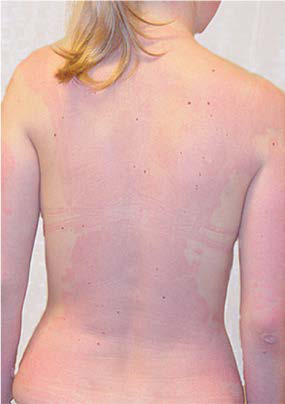

# Chapter 762: Nonbacterial Food Poisoning
> **Course:** Vikkypaedia Pediatric Basic Course (*Nelson Textbook of Pediatrics, 22nd Edition (2025)*)  
> **Part XXXII:** Environmental Health  
> **Authors:** Nelson 22e Contributors  
> **Metrics:** 4,768 words · 4 tables/boxes · 2 figures · 0 genes · 8 flashcards · 5 MCQs  
> **Quick Navigation:** [🃏 Study 8 Flashcards](../flashcards/762_flashcards.md) · [📝 Take 5-Q MCQ Quiz](../mcqs/762_mcqs.md) · [📚 Part XXXII Guide](../parts/Part_XXXII.md) · [🧬 Syndrome & Genetics Atlas](../omim_gene_atlas.md) · [💊 Therapeutics Matrix](../therapies_matrix.md) · [🏠 Course Index](../../index.md)

## Key Chapter Topics & Subchapters
`762.1 Mushroom Poisoning` · `762.2 Solanine Poisoning` · `762.3 Seafood Poisoning` · `762.4 Melamine Poisoning` · `762.1 Mushroom Poisoning` · `762.2 Solanine Poisoning Katherine Baranowski and Diane P. Calello` · `762.3 Seafood Poisoning Diane P. Calello and Katherine Baranowski`

## ⚡ High-Yield Nelson Pediatric Board Pearls
- The symptoms are caused by the principal toxin present in the ingested mushrooms.
- In the late phase of the disease, management of renal and hepatic failure is also necessary.
- Cortinarius poisoning is characterized by delayed onset of nausea, vomiting, and diarrhea that manifest 36-48 hours after ingestion.
- The onset of symptoms is rapid (30 minutes to 2 hours after con sumption), and intoxication is characterized by symptoms of cho linergic excess: diaphoresis, excessive lacrimation, salivation, miosis, bradycardia, hypotension, urinary and fecal incontinence, and vom iting.
- Respiratory distress caused by bronchospasm and increased bronchopulmonary secretions is the most serious complication.
- The most common symptoms are vomiting, abdominal pain, and diarrhea; in more severe instances of poisoning, neurologic symptoms, including drowsiness, apathy, confu sion, weakness, and vision disturbances, are rarely followed by coma or death.
- The diagnosis of ciguatera fish poison ing is based on clinical presentation and a compatible epidemiologic history; the diagnosis is confirmed by testing the ingested fish for toxin.

---
## Full Chapter Text, Tables & Figures
# Chapter 762: Nonbacterial Food Poisoning

<!-- p.5712 -->
With successful intervention, BLLs decline, with the greatest fall in BLL occurring in the first 2 months after therapy is initiated. Sub sequently, the rate of change in BLL declines slowly, so that by 6-12 months after identification, the BLL of the average child with moder ate lead poisoning (BLL >20 μg/dL) will be 50% lower. Children with more markedly elevated BLLs may take years to reach the current CDC reference level, 3.5 μg/dL, even if all sources of lead exposure have been eliminated, behavior has been modified, and nutrition has been maxi mized. Early screening remains the best way of avoiding and therefore obviating the need for the treatment of lead poisoning.

*Visit Elsevier eBooks+ at eBooks.Health.Elsevier.com** for Bibliography.*

#### **Table 761.6** Chelators Used for Lead Poisoning

| Category / Parameter | Clinical Details & Findings |
| --- | --- |
| **ADVERSE EFFECTS** | Succimer |
| **(DMSA)** | 1050 mg/m2/day divided into 3 doses for 5; days, then 700 mg/m2/day divided into 2; doses for 14 days (maximum 500 mg per; dose for children); BLL >45 µg/dL; None; Nausea, vomiting; Diarrhea; Metallic taste; Transient increase in AST/ALT; CaNa2EDTA; 1,500 mg/mm2/day continuous intravenous; (IV) infusion for encephalopathy; Otherwise:; 1,000 mg/m2/day divided in 2 to 4 doses; for up to 5 days, IV or IM; BLL >70 µg/dL; (starting after first; dose of BAL or; succimer); May substitute; for succimer if; that drug is not; tolerated; Severe renal disease; Hepatitis; Nephrotoxicity; Transient increase in AST/ALT; Arrythmia (bradycardia); Dimercaprol |
| **(BAL)** | 4 mg/kg deep IM injection every 4 hours for; 5 days in children and adults; BLL >70 µg/dL and; encephalopathy; Consider succimer as; alternative; Peanut allergy; Organic mercury; poisoning; Hepatic insufficiency; Pain at injection site; Hypertension and; tachycardia; Nausea, vomiting; Headache; Fever (especially in children); Nephrotoxicity in the setting; of an acidic urine; d-Penicillamine; 1-1.5 g/day (children: 20-30 mg/kg/day), in 3; or 4 divided doses for 1-6 months; To minimize adverse reactions, start at 250; mg/day (children: 10 mg/kg/day) and; increase to 50% during week 2 and to a; full dose by week 3; Maximum adult daily dose is 2 g; BLL of 45 to 69 µg/dL; AND succimer not; tolerated; Penicillin allergy; Leukopenia; Thrombocytopenia; Enuresis; Abdominal pain; Rashes; Note: Indications for chelation and dosing regimens may change. Consult with a medical toxicologist or regional poison center for the most up-to-date recommendations.; BAL, British antilewisite; BLL, blood lead level; CaNa2EDTA, calcium disodium ethylenediaminetetraacetic acid; DMSA, 2,3-dimercaptosuccinic acid; IM, intramuscular; AST, alanine; transaminase; ALT, aspartate transaminase.; Modified from Theobald JL, Mycyk MB. Iron and heavy metals. In: Walls RM, ed. Rosen’s Emergency Medicine, 10th ed. Philadelphia: Elsevier; 2023: Table 146.5. |

## 762.1  Mushroom Poisoning

*Diane P. Calello and Katherine Baranowski*

Mushrooms are an ideal food. They are low in calories, fat free, and high in protein, making them a great source of nutrition. Unfortu nately, some are highly toxic if ingested. Picking (foraging) and con sumption of wild mushrooms are increasingly popular in the United

States. This rise in popularity has led to increased reports of severe and fatal mushroom poisonings.

The clinical syndromes produced by mushroom poisoning are divided according to the rapidity of onset of symptoms and the pre dominant system involved (Table 762.1). The symptoms are caused by the principal toxin present in the ingested mushrooms. The eight major toxins produced by mushrooms are categorized as cyclopep tide *(amatoxin and phallotoxin),* gyromitrin, muscarine, coprine, ibo tenic acid and muscimol, psilocybin, orellanine, and gastrointestinal tract–specific irritants. The edible wild mushroom *Tricholoma equestre* is associated with delayed rhabdomyolysis, and *Clitocybe amoenolens* and *Clitocybe acromelalga* have been reported to cause erythromelal gia, although toxins responsible for these effects are unknown.

Symptoms after eating mushrooms may not be the direct effect of a toxin but may be an allergic reaction or a toxic effect of pesticides or other contaminants. In addition, all who ate the same mushroom may not become sick, or if they do, they may become sick at different intervals. Table 762.2 lists general principles of management. Wherever possible, identification of the implicated mushroom is encouraged via mycologist or regional Poison Control Center.

**GASTROINTESTINAL Rapid Onset** Many mushrooms from various genera (such as *Chlorophyllum* spe cies) produce local gastrointestinal manifestations. The causative toxins are diverse and largely unknown. Within 1 hour of ingestion, patients experience acute abdominal pain, nausea, vomiting, and diar rhea. Symptoms may last hours to days, depending on the species of mushroom.

Treatment is mainly supportive. Children with large fluid losses may require parenteral fluid therapy. It is imperative to differentiate ingestion of mushrooms of this class from ingestion of *Amanita* and

<!-- p.5714 -->
Saper RB, Phillips RS, Sehgal A, et al. Lead, mercury, and arsenic in US- and Indian-

manufactured ayurvedic medicines sold via the Internet. JAMA. 2008;300:915– 922. Schnaas L, Rothenberg SJ, Flores MF, et  al. Reduced intellectual development in

children with prenatal lead exposure. Environ Health Perspect. 2006;114:791–797. Selevan SG, Rice DC, Hogan KA, et al. Blood lead concentration and delayed puberty

in girls. N Engl J Med. 2003;348:1527–1536. Solon O, Riddell TJ, Quimbo SA, et  al. Associations between cognitive function,

blood lead concentrations, and nutrition among children in central Philippines. J Pediatr. 2008;152:237–243. Tellez-Rojo MM, Bellinger DC, Arroyo-Quiroz C, et al. Longitudinal associations

between blood lead concentrations lower than 10 microg/dL and neurobehavio ral development in environmentally exposed children in Mexico City. Pediatrics. 2006;118:323–330. U.S. Department of Housing and Urban Development Office of Healthy Homes and Lead

Hazard Control. American Healthy Homes Survey Lead and Arsenic Findings; 2011.

Weiss D, Tomasallo CD, Meiman JG, et al. Elevated blood lead levels associated with

retained bullet fragments – United States, 2003-2012. MMWR Morb Mortal Wkly Rep. 2017;66(5):130–132. Woolf AD, Goldman R, Bellinger DC. Update on the clinical management of child

hood lead poisoning. Pediatr Clin North Am. 2007;54:271–294. Woolf AD, Woolf NT. Childhood lead poisoning in 2 families associated with spices

used in food preparation. Pediatrics. 2005;116:e314–e318. World Health Organization: WHO guidance to reduce illness due to lead exposure.

Oct 2021. https://www.who.int/news/item/27-10-2021-who-guidance-to-reduceillness-due-to-lead-exposure Wright JP, Detrich KN, Ris MD, et  al. Association of prenatal and childhood

blood lead concentrations with criminal arrests in early adulthood. PLoS Med. 2008;5:e101–e266.

<!-- p.5715 -->

#### **Table 762.1** Summary of Common Mushroom-Associated Syndromes

| Category / Parameter | Clinical Details & Findings |
| --- | --- |
| **MUSHROOM(S)** | Cyclopeptides,; principally amatoxins; Delayed gastroenteritis; followed by hepatic failure; Stage 1: 6-24 hr after ingestion: onset of; nausea, vomiting, profuse cholera-like; diarrhea, abdominal pain, hematuria; Stage 2: 12-48 hr after ingestion: apparent; recovery; levels of hepatic enzymes are; rising during this stage; Stage 3: 24-72 hr after ingestion: progressive; hepatic and renal failure, coagulopathy,; cardiomyopathy, encephalopathy,; convulsions, coma, death; “Deadly Amanitas,” (A. phalloides,; A. bisporigera); Galerina species; General gastrointestinal; irritants; Early gastroenteritis, may be; severe; 30 min to 2 hr after ingestion: nausea,; vomiting, abdominal cramping, diarrhea;; may recover without treatment; Chlorophyllum molybdites,; backyard mushrooms (“little brown; mushrooms”), many others; Gyromitrin; Delayed gastroenteritis with; central nervous system; toxicity, seizures; 6-24 hr after ingestion: nausea, vomiting,; diarrhea, abdominal pain, muscle cramps,; delirium, convulsions, coma; hemolysis, and; methemoglobinemia may occur; Gyromitra esculenta (“false morel”); Orellanine; Delayed onset gastroenteritis; and renal failure; Abdominal pain, anorexia, vomiting starting; over 30 hr after ingestion, followed by; progressive renal failure 3-14 days later; Cortinarius species; Muscarine; Cholinergic syndrome; 30 min to 2 hr after ingestion: bradycardia,; bronchorrhea, bronchospasm, salivation,; perspiration, lacrimation, convulsions, coma; Clitocybe species, Inocybe species,; Boletus species, some Amanita; species; Coprine; Disulfiram-like reaction with; ethanol; 30 min after drinking ethanol (may occur up; to 1 week after eating coprine-containing; mushrooms): flushing of skin of face and; trunk, hypotension, tachycardia, chest; pain, dyspnea, nausea, vomiting, extreme; apprehension; Coprinus atramentarius; Ibotenic acid and; muscimol; Hyperactivity, delirium, coma; 30 min to 2 hours after ingestion: delirium,; hallucinations, and coma; Amanita muscaria, Amanita; pantherina; Psilocybin; Hallucinations; 30 min to 3 hr after ingestion: hallucinations,; euphoria, drowsiness, compulsive behavior,; agitation; Psilocybe species; Modified from Brent J, Palmer RB: Mushrooms. In: Shannon MW, Borron SW, Burns MJ, eds. Haddad and Winchester’s Clinical Management of Poisoning and Drug Overdose, 4th; ed. Philadelphia: WB Saunders; 2007: Table 23-1. |

Ingestion

#### **Table 762.2** General Management of Mushroom

| Category / Parameter | Clinical Details & Findings |
| --- | --- |
| **General** | 1.	 Determine history of ingestion: how many types of mushrooms; ingested, what time, if anyone else ate them, and what symptoms; are present.; 2.	 Attempt to determine which of the possible syndromes (see |

#### **Table 762.1** ) the patient may have. For example, gastrointestinal symptoms occurring more than 6 hr after ingestion strongly suggest cyclopeptide, gyromitrin, or Cortinarius poisoning. 3.	 Administer activated charcoal. If the patient has diarrhea, do

| Category / Parameter | Clinical Details & Findings |
| --- | --- |
| **General** | not give a cathartic. If a cathartic is used, give it only with the; first dose of activated charcoal. Use repeated doses of activated; charcoal for suspected amatoxin poisonings.; 4.	 If feasible and when indicated, send gastric aspirate or emesis,; along with any remaining mushrooms, to a mycologist for; identification.; 5.	 Try to perform a preliminary identification of mushroom and; spores. Start to develop a spore print as soon as possible.; 6.	 Maintain supportive measures, including airway support,; intravenous fluids, and vasopressors (if needed). Monitor volume; status.; 7.	 Avoid antispasmodics for gastrointestinal symptoms.; 8.	 Anticipate the clinical course.; From Brent J, Palmer RB: Mushrooms. In: Shannon MW, Borron SW, Burns MJ, eds.; Haddad and Winchester’s Clinical Management of Poisoning and Drug Overdose, 4th |

*Galerina* species containing cyclopeptide toxins, which present with symptoms after 6 hours of ingestion.

**Delayed Onset Cyclopeptide (Amatoxin****)**** Poisoning** Poisonings by species of *Amanita* (death cap mushroom) and *Gale rina* account for 95% of the fatalities from mushroom intoxication; the mortality rate for this group is 5–10%. Most species produce two classes of **cyclopeptide toxins:** (1) **phallotoxins,** which are heptapep tides believed to be responsible for the early symptoms of *Amanita* poisoning, and (2) **amatoxins,** octapeptides that inhibit nuclear RNA polymerase II and subsequent production of messenger RNA leading to impaired protein synthesis and cell death. Cells with high turnover rates, such as those in the gastrointestinal mucosa, kidneys, and liver, are the most severely affected. Other suggested toxin effects are induc tion of apoptosis, glutathione depletion in the liver, and oxygen free radical formation. Acute yellow atrophy of the liver and necrosis of the proximal renal tubules are found in lethal cases.

The clinical course of poisoning with *Amanita* or *Galerina* spe cies is biphasic. Nausea, vomiting, and severe abdominal pain ensue 6-24 hours after ingestion. Profuse watery diarrhea follows shortly thereafter and may last for 12-24 hours or longer. During this time, patients become severely dehydrated. From 24 to 48 hours

<!-- p.5716 -->
after poisoning, jaundice, hypertransaminasemia (peaking at 72-96 hours), renal failure, and coma occur. Death occurs 4-7 days after the ingestion. A prothrombin time less than 10% of control is a poor prognostic factor. Of note, there are species of Amanita mushrooms that may present with earlier onset of symptoms and confound diagnosis, such as *Amanita smithiana,* which grows in the Pacific Northwest.

**Treatment** Treatment for *Amanita* poisoning is both supportive and specific. Fluid loss from severe diarrhea during the early course of the illness is pro found, requiring aggressive correction of fluid loss, electrolytes, and acid-base disturbances. In the late phase of the disease, management of renal and hepatic failure is also necessary.

Specific therapy for *Amanita* poisoning is designed to remove the toxin rapidly and to block binding at its target site. Oral activated charcoal is recommended as part of the initial treatment for chil dren with *Amanita* poisoning. For significant ingestions, intrave nous silibinin or intravenous penicillin G may be considered after discussion with a toxicologist or Poison Control Center. Silibinin and penicillin G inhibit binding of both toxins, interrupt enterohe patic recirculation of amatoxin, and protect the liver from further injury, although their effectiveness is controversial. *N-a*cetylcysteine should be given for hepatoprotective effect. Hemodialysis or hemo perfusion may be beneficial in removing toxin. Orthotopic liver transplantation may be required for children with severe hepatic failure.

**Gyromitrin Poisoning** Species of *Gyromitra* contain **gyromitrin,** which decomposes in the stomach to form **monomethylhydrazine** (CH3NHNH2) and inhibits central nervous system (CNS) enzymatic production of γaminobutyric acid (GABA). Monomethylhydrazine also oxidizes iron in hemoglobin, resulting in methemoglobinemia. Children with *Gyromitra* poisoning often experience vomiting, diarrhea, and abdominal pain within 6-24 hours of ingestion of the toxin. CNS symptoms such as vertigo, diplopia, headache, ataxia, and seizures develop later in the clinical course. Hemolysis and methemoglobin emia (see Chapter 511.6) are rare but potential life-threatening com plications of gyromitrin poisoning.

**Treatment** Hypovolemia from gastrointestinal fluid losses and seizures require supportive intervention. **Pyridoxal phosphate,** the coenzyme that cat alyzes the production of GABA, can reverse the effects of monomethyl hydrazine when administered in high doses. Pyridoxine hydrochloride (25 mg/kg infused over 30 minutes) is given at a frequency that is dependent on clinical improvement. Diazepam is given for persistent seizures. Parenteral administration of methylene blue is indicated if the methemoglobin concentration exceeds 30%. Blood transfusions may be required for significant hemolysis.

**RENAL Orellanine Poisoning** Species of *Cortinarius* mushrooms contain the heat-stable toxin bipyri dyl **orellanine,** which causes severe nonglomerular renal injury charac terized by interstitial fibrosis and acute tubular necrosis. Although the exact mechanism of injury is not fully understood, a metabolite of orel lanine is thought to inhibit renal protein synthesis. *Cortinarius* poisoning is characterized by delayed onset of nausea, vomiting, and diarrhea that manifest 36-48 hours after ingestion. Although the initial symptoms may be trivial, more serious renal toxicity occurs in several days. Acute renal failure occurs in 30–50% of those affected, beginning with polyuria and progressing to renal failure (see Chapter 572).

**Treatment** Treatment for orellanine poisoning is supportive. Early presentation, within 4-6 hours after ingestion, can be treated with activated charcoal and gastric lavage. Hemodialysis may be needed in patients suffering from renal failure. Most patients recover within 1 month, but chronic

renal insufficiency develops in one third to one half of patients who subsequently require renal transplantation.

**AUTONOMIC NERVOUS SYSTEM Muscarine Poisoning** Mushrooms of the genera *Inocybe* and, to a lesser degree, *Clitocybe* contain **muscarine** or muscarine-related compounds. These quater nary ammonium derivatives bind to postsynaptic receptors, producing an exaggerated cholinergic response.

The onset of symptoms is rapid (30 minutes to 2 hours after con sumption), and intoxication is characterized by symptoms of cho linergic excess: diaphoresis, excessive lacrimation, salivation, miosis, bradycardia, hypotension, urinary and fecal incontinence, and vom iting. Respiratory distress caused by bronchospasm and increased bronchopulmonary secretions is the most serious complication. The symptoms subside spontaneously within 6-24 hours.

**Treatment** Atropine sulfate, the specific antidote, is administered intravenously (0.01 mg/kg; maximum: 2 mg). This is repeated until the pulmonary symptoms resolve or the patient becomes overtly tachycardic.

**Coprine Poisoning* Coprinus atramentarius* and *Clitocybe clavipes* contain **coprine.** Like disulfiram (Antabuse; Odyssey Pharmaceuticals, Inc.), coprine inhib its the metabolism of acetaldehyde after ethanol ingestion. The clinical manifestations result from accumulation of acetaldehyde.

Coprine intoxication becomes apparent after ethanol ingestion and may be delayed up to 5 days after consumption of the mushroom. Hyperemia of the face and trunk, tingling of the hands, metallic taste, tachycardia, and vomiting occur acutely. Hypotension may result from intense peripheral vasodilation.

The syndrome typically is self-limited and lasts only several hours. No specific antidote is available. If hypotension is severe, vascular reex pansion with isotonic parenteral solutions may be required.

**CENTRAL NERVOUS SYSTEM Ibotenic acid and Muscimol Poisoning** Although *Amanita muscaria* and *Amanita pantherina* may contain muscarine, the toxins responsible for the CNS symptoms after inges tion of these mushrooms are primarily **muscimol** and **ibotenic acid,** the heat-stable derivatives of the isoxazoles. Muscimol, a hallucinogen, and ibotenic acid, an insecticide, act as GABA agonists. From 30 min utes to 3 hours after ingestion, CNS symptoms appear: obtundation, alternating lethargy and agitation, and occasionally seizures. Nau sea and vomiting are uncommon. If large amounts of muscarine are contained in the mushroom, symptoms of cholinergic crisis also may occur.

Specific therapy must be carefully selected, and in most cases sup portive care will suffice. If an exaggerated cholinergic response is observed, atropine should be administered. Conversely, because inges tions of *A. muscaria* or *A. pantherina* may cause anticholinergic find ings, the acetylcholinesterase inhibitor physostigmine can be used to reverse the delirium and coma. Benzodiazepines also are used for the agitation and delirium. Seizures can be controlled with diazepam. In the majority of patients, however, early supportive care and close observation are all that is required.

**Psilocybin Intoxication** Mushrooms belonging to the genus *Psilocybe* (“magic mushrooms”) contain **psilocybin and psilocin,** two psychotropic compounds. Within 30 minutes after ingestion, patients experience euphoria and hallucinations, often accompanied by tachycardia and mydriasis. Fever and seizures have also been observed in children with psilocybin poi soning. These symptoms are short-lived, usually lasting for 6 hours after consumption of the mushroom. Treatment consists of rest and observation in a quiet environment. Severely agitated patients may respond to diazepam.

<!-- p.5717 -->

<!-- p.5718 -->

## 762.2  Solanine Poisoning Katherine Baranowski and Diane P. Calello

Solanine is an alkaloid found in plants of the nightshade family (Solana ceae), specifically tomatoes, eggplant, paprika and pepper-based spices, and most significantly, white potatoes. The majority of solanine poison ing reported has arisen from the ingestion of greened potatoes. When exposed to light and allowed to turn green and/or sprout, potatoes pro duce several alkaloid glycosides containing the cholesterol derivative *solanidine*. Two of these glycosides, α-solanine and α-chaconine, are found in highest concentration in the peels and sprouts. Some solanine can be removed by boiling but not by baking. The major effect of αsolanine and α-chaconine is the reversible inhibition of cholinesterase. Cardiotoxic and teratogenic effects have also been reported.

Clinical manifestations of solanine and chaconine poisoning occur within 7-19 hours after ingestion. The most common symptoms are vomiting, abdominal pain, and diarrhea; in more severe instances of poisoning, neurologic symptoms, including drowsiness, apathy, confu sion, weakness, and vision disturbances, are rarely followed by coma or death.

Treatment of solanine poisoning is largely supportive. In the most severe cases, symptoms resolve within 1-2 weeks.

*Visit Elsevier eBooks+ at eBooks.Health.Elsevier.com** for a Bibliography.*

## 762.3  Seafood Poisoning Diane P. Calello and Katherine Baranowski

**CIGUATERA FISH POISONING** The most frequently reported seafood toxin illness in the world is ciguatera fish poisoning. Grouper is the most commonly identified source of the toxin, followed by snapper, kingfish, amberjack, dolphin, eel, and barracuda. Poisoning has also been associated with farmraised salmon.

The dinoflagellate **Gambierdiscus toxicus,** a microscopic unicellu lar organism found along coral reefs, produces high concentrations of **ciguatoxin** and **maitotoxin.** The toxins are passed along the food chain from small herbivorous fish that consume the dinoflagellate to larger predatory fish and then to humans. These toxins are harmless in fish but produce distinct clinical symptoms in humans.

Ciguatoxins are odorless, colorless, and tasteless and are not destroyed by cooking or freezing. Ciguatoxins increase the sodium ion permeability of excitable membranes and depolarize nerve cells, actions that are inhibited by calcium and tetrodotoxin.

Between 2 and 30 hours after ingestion, ciguatera fish poisoning typically produces a biphasic illness. The initial symptoms are non specific and are of gastrointestinal origin (diarrhea, vomiting, nausea, and abdominal pain). The second phase occurs within a few days of ingestion and consists of intense itching, anxiety, myalgias, painful intercourse, feeling of loose teeth, and rash on palms and soles; the neurologic symptoms of **circumoral dysesthesias** and **cold allodynia** (reversal of hot and cold sensation) are characteristic of this disease and may last for months. Tachycardia, bradycardia, hypotension, and death occur very infrequently. Eating fish organs, roe, or viscera is associated with greater symptom severity. The diagnosis of ciguatera fish poison ing is based on clinical presentation and a compatible epidemiologic history; the diagnosis is confirmed by testing the ingested fish for toxin. There is no human biomarker to confirm ciguatera fish poisoning.

**Treatment** Treatment of ciguatera fish poisoning is supportive. Intravenous flu ids may be required for severe diarrhea, and careful observation for hypovolemic shock is advised. Once adequate hydration is established, mannitol (0.5-1.0 g/kg intravenously over 30-45 minutes), given within 48-72 hours of the toxic fish ingestion, is recommended for reduction

of acute symptoms (especially neurologic symptoms) and possible pre vention of chronic neurologic symptoms. Various other medications and herbal remedies have been tried, with variable results. Most cases are self-limited with a favorable prognosis.

**SCOMBROID (PSEUDOALLERGIC) FISH POISONING** Ingestion of members of the **Scombridae** families, including albacore, mackerel, tuna, bonito, and kingfish, have been linked to major out breaks of pseudoallergic fish poisoning. Non-scombroid fish such as mahi-mahi (dolphin fish), swordfish, and bluefish also are associated with poisoning.

The bacterial transformation of histidine to histamine is responsible for the clinical syndrome. Histidine is found in high concentrations in the flesh of scombroid fish; if refrigeration is inadequate, the action of bacterial decarboxylases during putrefaction converts histidine to histamine. Fish containing more than 20 mg of histamine per 100 g of flesh are toxic. In patients receiving isoniazid, a potent histaminase blocker, ingestion of fish flesh containing a lower concentration of his tamine may be toxic.

The onset of clinical manifestations is acute and occurs within 10 minutes to 2 hours of ingestion. The most common symptoms and signs are diarrhea, erythema, sweating, flushing, diaphoresis, urticaria, nausea, and headache (Fig. 762.1). Abdominal pain, tachycardia, oral burning or numbness, dizziness, respiratory distress, hives, and facial swelling also occur. The illness is usually self-limited, terminating within 8-24 hours.

**Treatment** Treatment is mainly supportive*.* With severe diarrhea, fluid replace ment may be necessary. Antihistamines and antiemetics have been variably successful.

**PARALYTIC SHELLFISH POISONING** Mussels, clams, oysters, scallops, and other filter-feeding mollusks may become contaminated during dinoflagellate blooms or **“red tides.”** During periods of contamination, water in coastal areas can be col ored red by the algae; this sign is the origin of the term *red tide*. (Such discoloration does not necessarily indicate the presence of toxin, and toxin may be present in high quantities without discoloration. None theless, discolored water should be regarded with suspicion.) The dino flagellates *Alexandrium* spp. and *Gymnodinium catenatum* often are responsible for these red tides and contain several potent neurotoxins. Paralytic shellfish poisoning is a distinctive neurologic illness caused by 20 closely related heat-stable paralytic shellfish toxins, generally referred to as **saxitoxins.** These compounds prevent nerve conduction by inhibiting the sodium-potassium pump. Consumption of bivalves, such as mussels, scallops, and clams, is the usual pathway of intoxica tion, although crustaceans and fish have been implicated as well.

The onset of clinical manifestations of paralytic shellfish poisoning occurs rapidly, 30 minutes to 2 hours after ingestion. Abdominal pain and nausea are common. Paresthesias are common and occur circum orally or in a stocking-glove distribution, or both. Perioral numbness or tingling, diplopia, ataxia, dysarthria, and the sensation of floating are seen less commonly. In severe cases, respiratory failure from dia phragmatic paralysis may result. Swimming in the water during a red tide episode does not appear to have neurologic sequelae, although skin or mucosal irritation may result.

**Treatment** No antidote for paralytic shellfish poisoning is known. Supportive care, including mechanical ventilation, may be needed. Although the symp toms are usually self-limited and short-lived, weakness and malaise may persist for weeks after ingestion.

**NEUROTOXIC SHELLFISH POISONING** Neurotoxic shellfish poisoning is a rare disease that occurs after con sumption of molluscan shellfish contaminated with brevetoxins. Shell fish harvested along the Gulf of Mexico during or right after a red tide are at risk of contamination with brevetoxins produced by the

<!-- p.5719 -->

<!-- p.5720 -->
**dinoflagellate* Karenia brevis;* some raphidophytes (*Chattonella* spp.) also produce brevetoxins. **Brevetoxins** are a group of more than 10 lipid-soluble neurotoxins that activate sodium ion channels, causing nerve membrane depolarization. Shellfish are not affected by brevetox ins. Rinsing, cleaning, cooking, and freezing do not destroy the toxins, which also cannot be detected by taste or smell.

The onset of clinical manifestations of neurotoxic shellfish poison ing occurs from within a few minutes up to 18 hours after consump tion. Most symptoms are gastrointestinal (nausea, vomiting, and diarrhea) or neurologic (numbness and tingling of the lips, mouth, face, and extremities, ataxia, partial limb paralysis, reversal of hot and cold sensation, slurred speech, headache, and fatigue). Neuro toxic shellfish poisoning is similar to a mild case of paralytic shellfish poisoning.

**Treatment** There are no specific antidotes for brevetoxins. Treatment involves mostly supportive care. Brevenal, a natural antagonist of brevetoxin produced by *K. brevis,* may be used as a form of treatment in the future.

**DIARRHETIC SHELLFISH POISONING** Several outbreaks of diarrhetic shellfish poisoning have been reported in Europe after consumption of mussels, cockles, and other shellfish. The dinoflagellates *Dinophysis* and *Prorocentrum* produce **okadaic acid** and its derivatives, the **dinophysistoxins.** These compounds inhibit protein phosphatases. The intracellular accumulation of phosphory lated proteins causes increased fluid secretion by gut cells via calcium influx, which is mediated by cyclic adenosine monophosphate and prostaglandins.

Patients have severe diarrhea. Care is supportive and directed at rehydration. The illness is self-limited, and recovery occurs in 3-4 days; few patients require hospitalization.

**AMNESIC SHELLFISH POISONING** Amnesic shellfish poisoning has been identified after consumption of shellfish from the United States, Spain, and the United Kingdom. The responsible toxin, **domoic acid,** comes from a diatom, *Pseudonitzschia multiseries,* and is a potent glutamate agonist, disrupting neurochemi cal transmission in the brain. It also binds to glutamate receptors, which increase calcium influx, producing neuronal swelling in the hip pocampal area of the brain and death.

The initial clinical manifestations are gastrointestinal with nausea, vomiting, diarrhea, and abdominal cramps within 24 hours of inges tion. Neurologic symptoms may follow including headache, confu sion, and short-term memory loss. Memory loss is closely related to advanced age with those >50 years more likely to suffer from memory loss lasting months to years.

**PUFFERFISH POISONING** The consumption of pufferfish (blowfish) in certain geographic areas such as Japan and the Indo-Pacific Ocean is associated with a lethal neurotoxic illness due to **tetrodotoxin**. Fugu, a Japanese delicacy, is sought after in part because of the subtle neurotoxic effects experi enced upon eating, including perioral paresthesias and a dissociative feeling. While a trained fugu chef will remove the most toxic parts of the fish, the toxin is still found in varying degrees.

Tetrodotoxin, which is also found in the blue-ringed octopus, causes a paralytic illness due to the blockade of voltage-dependent sodium channels. Early symptoms include paresthesias, nausea, and dizziness, which progresses to weakness, numbness, and incoordination. Auto nomic compromise may also occur with bradycardia and hypotension. In the most severe of cases, respiratory compromise requires assisted ventilation.

There is no specific antidote for tetrodotoxin pufferfish poisoning.

**AZASPIRACID POISONING** The azaspiracids are a class of algal toxins associated with **harmful algal blooms (HABs).** Azaspiracid poisoning results from ingestion of contaminated bivalve shellfish, especially mussels. Azaspiracid toxins are distributed throughout the muscle tissue in the shellfish. Azaspi racid is cytotoxic to cells and an inhibitor of Ca2+ channels in plasma membranes. Symptoms start 6-18 hours after ingestion and include nausea, vomiting, severe stomach cramps, and diarrhea, which often persist up to 5 days.

**Cyanobacteria (blue-green algae)** also produce HABs; exposure is usually during recreational water sports and may be cutaneous or gas trointestinal. Symptoms include rash, cough, abdominal pain, diarrhea, nausea, emesis, muscle aches, watery eyes, weakness, or sore throat.

*Visit Elsevier eBooks+ at eBooks.Health.Elsevier.com** for Bibliography.*

A B C

**Fig. 762.1** Scombroid fish poisoning. A and B, Widespread erythematous rash predominantly on the face (not shown) and trunk of patient 1. C, Close-up view of the upper chest area. Note the absence of wheals. (Modified from Jantschitsch C, Kinaciyan T, Manafi M, et al. Severe scombroid fish poisoning: an underrecognized dermatologic emergency. J Am Acad Dermatol. 2011;65[1]:246–247. Fig. 1.)

<!-- p.5721 -->

<!-- p.5723 -->
