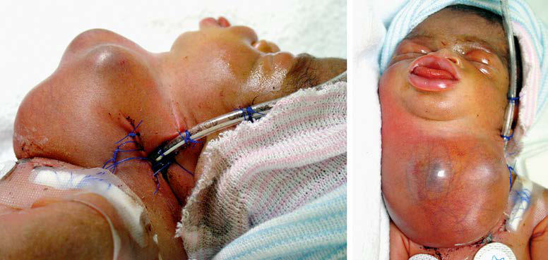

# Chapter 123: Neonatal Resuscitation and Delivery Room Emergencies — Active-Recall Flashcards
**Part X: The Fetus and the Neonatal Infant** | [📖 Read Wiki Chapter](../chapters/123.md) | [📝 Chapter MCQs](../mcqs/123_mcqs.md) | [🏠 Course Master Index](../../index.md)

Total cards: **8** *(Click any card below to reveal the answer)*

### Card 1 (Syndrome & Clinical Profile)

<b>Q:</b> What are the hallmark clinical features and diagnostic profile of **Neonatal Resuscitation and Delivery Room Emergencies**?

**Answer:**
**Category / Inheritance:** The Fetus and the Neonatal I **Clinical Synthesis:** The umbilical cord management plan should be established before delivery.

### Card 2 (Pediatric Therapeutics & Management)

<b>Q:</b> What is the clinical management or therapeutic approach for **Neonatal Resuscitation and Delivery Room Emergencies**?

**Answer:**
**Therapy / Protocol:** Management **Clinical Application:** The umbilical cord management plan should be established before delivery.

### Card 3 (Core Pediatric Concept)

<b>Q:</b> In the pediatric evaluation of **Neonatal Resuscitation and Delivery Room Emergencies** (*Neonatal Resuscitation and Delivery Room Emergencies*), how is **Neonatal Resuscitation Program (NRP)** characterized?

**Answer:**
Neonatal Resuscitation Program (NRP) propose an integrated assessment/response approach for the initial evaluation of an infant, consisting of simultaneous assessment of infant general appearance and risk factors.

### Card 4 (Core Pediatric Concept)

<b>Q:</b> In the pediatric evaluation of **Neonatal Resuscitation and Delivery Room Emergencies** (*Neonatal Resuscitation and Delivery Room Emergencies*), how is **Delayed cord clamping** characterized?

**Answer:**
Delayed cord clamping after birth can be per formed in both preterm and term infants.

### Card 5 (Core Pediatric Concept)

<b>Q:</b> In the pediatric evaluation of **Neonatal Resuscitation and Delivery Room Emergencies** (*Neonatal Resuscitation and Delivery Room Emergencies*), how is **primary apnea** characterized?

**Answer:**
primary apnea respond to stimulation by establishing normal breathing.

### Card 6 (Visual Diagnosis & Clinical Spotter)

<b>Q:</b> Identify the pediatric clinical finding, imaging sign, or mechanism illustrated in **Fig. 123.4** (*Neonatal Resuscitation and Delivery Room Emergencies*):

**Answer:**
Ex utero intrapartum ther apy (EXIT) procedure. Baby with tera toma and critical high airway obstruc tion syndrome (CHAOS). Trachea is displaced to the lateral neck. (Courtesy Dr. Mark Wulkan, Pediatric Surgery, Emory University.)

### Card 7 (High-Yield Board Pearl)

<b>Q:</b> What is a high-yield clinical or diagnostic principle regarding **Neonatal Resuscitation and Delivery Room Emergencies** (*Neonatal Resuscitation and Delivery Room Emergencies*)?

**Answer:**
The umbilical cord management plan should be established before delivery.

### Card 8 (Pathophysiology & Diagnosis)

<b>Q:</b> What core clinical principle governs **Neonatal Resuscitation and Delivery Room Emergencies** in **Neonatal Resuscitation and Delivery Room Emergencies**?

**Answer:**
Recommendations for the Neonatal Resuscitation Program (NRP) propose an integrated assessment/response approach for the initial evaluation of an infant, consisting of simultaneous assessment of infant general appearance and risk factors.

