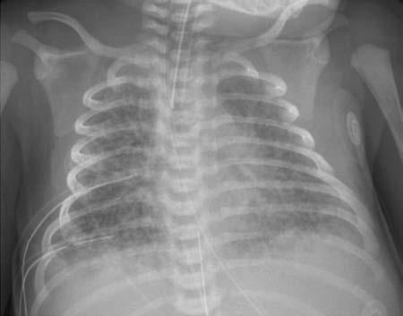

# Chapter 129: Aspiration of Foreign Material (Meconium Aspiration Syndrome, Aspiration Pneumonia) — Active-Recall Flashcards
**Part X: The Fetus and the Neonatal Infant** | [📖 Read Wiki Chapter](../chapters/129.md) | [📝 Chapter MCQs](../mcqs/129_mcqs.md) | [🏠 Course Master Index](../../index.md)

Total cards: **8** *(Click any card below to reveal the answer)*

### Card 1 (Syndrome & Clinical Profile)

<b>Q:</b> What are the hallmark clinical features and diagnostic profile of **Aspiration of Foreign Material (Meconium Aspiration Syndrome, Aspiration Pneumonia)**?

**Answer:**
**Category / Inheritance:** The Fetus and the Neonatal I **Clinical Synthesis:** Recent ad vances in pathophysiology and management of transient tachypnea of newborn.

### Card 2 (Pediatric Therapeutics & Management)

<b>Q:</b> What is the clinical management or therapeutic approach for **Aspiration of Foreign Material (Meconium Aspiration Syndrome, Aspiration Pneumonia)**?

**Answer:**
**Therapy / Protocol:** Management **Clinical Application:** Recent ad vances in pathophysiology and management of transient tachypnea of newborn.

### Card 3 (Core Pediatric Concept)

<b>Q:</b> In the pediatric evaluation of **Aspiration of Foreign Material (Meconium Aspiration Syndrome, Aspiration Pneumonia)** (*Aspiration of Foreign Material (Meconium Aspiration Syndrome, Aspiration Pneumonia)*), how is **INTRAPARTUM ASPIRATION** characterized?

**Answer:**
INTRAPARTUM ASPIRATION With fetal distress, the fetus often initiates vigorous respiratory move ments in utero because of interference with the supply of oxygen through the placenta.

### Card 4 (Core Pediatric Concept)

<b>Q:</b> In the pediatric evaluation of **Aspiration of Foreign Material (Meconium Aspiration Syndrome, Aspiration Pneumonia)** (*Aspiration of Foreign Material (Meconium Aspiration Syndrome, Aspiration Pneumonia)*), how is **Early-Onset Sepsis and Neonatal Pneumonia** characterized?

**Answer:**
Early-Onset Sepsis and Neonatal Pneumonia Pneumonia as a presentation of early-onset sepsis typically arises fol lowing aspiration of infected amniotic fluid.

### Card 5 (Core Pediatric Concept)

<b>Q:</b> In the pediatric evaluation of **Aspiration of Foreign Material (Meconium Aspiration Syndrome, Aspiration Pneumonia)** (*Aspiration of Foreign Material (Meconium Aspiration Syndrome, Aspiration Pneumonia)*), how is **Meconium Aspiration Syndrome** characterized?

**Answer:**
Meconium Aspiration Syndrome Meconium-stained amniotic fluid is found in 10–15% of births and usu ally occurs in term or postterm infants.

### Card 6 (Visual Diagnosis & Clinical Spotter)

<b>Q:</b> Identify the pediatric clinical finding, imaging sign, or mechanism illustrated in **Fig. 128.1** (*Aspiration of Foreign Material (Meconium Aspiration Syndrome, Aspiration Pneumonia)*):

**Answer:**
Chest radiograph of an infant with transient tachypnea of the newborn. No table features include increased pulmonary markings particularly in the perihilar region and fluid in the fissure. This contrasts with the radiograph of an infant with respiratory distress syndrome, which generally includes a homogenous ground glass appearance and hypoinflation. (From Alhassen Z, Vali P, Gugla ni L, Lakshminrusimha S, Ryan RM. Recent ad vances in pathophysiology and management of transient tachypnea of newborn. J Perinatol. 2021;41:6–16. Fig. 5.)

### Card 7 (Visual Diagnosis & Clinical Spotter)

<b>Q:</b> Identify the pediatric clinical finding, imaging sign, or mechanism illustrated in **Fig. 129.2** (*Aspiration of Foreign Material (Meconium Aspiration Syndrome, Aspiration Pneumonia)*):

**Answer:**
Pathophysiology of meconium passage and the meconi um aspiration syndrome. V/Q, ventilation-perfusion ratio. (From Wiswell TE, Bent RC. Meconium staining and the meconium aspiration syn drome: unresolved issues. Pediatr Clin North Am. 1993;40:955–981.)

### Card 8 (High-Yield Board Pearl)

<b>Q:</b> What is a high-yield clinical or diagnostic principle regarding **Aspiration of Foreign Material (Meconium Aspiration Syndrome, Aspiration Pneumonia)** (*Aspiration of Foreign Material (Meconium Aspiration Syndrome, Aspiration Pneumonia)*)?

**Answer:**
Recent ad vances in pathophysiology and management of transient tachypnea of newborn.

