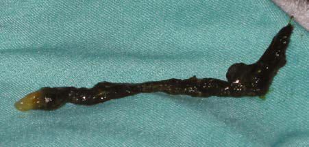

# Chapter 135: Meconium Ileus, Peritonitis, Intestinal Obstruction, and Gastroschisis — Active-Recall Flashcards
**Part X: The Fetus and the Neonatal Infant** | [📖 Read Wiki Chapter](../chapters/135.md) | [📝 Chapter MCQs](../mcqs/135_mcqs.md) | [🏠 Course Master Index](../../index.md)

Total cards: **8** *(Click any card below to reveal the answer)*

### Card 1 (Syndrome & Clinical Profile)

<b>Q:</b> What are the hallmark clinical features and diagnostic profile of **Meconium Ileus, Peritonitis, Intestinal Obstruction, and Gastroschisis**?

**Answer:**
**Associated Gene(s):** `CFTR, GUCY2C` · **Category / Inheritance:** The Fetus and the Neonatal I **Clinical Synthesis:** MECONIUM PLUGS Meconium plugs syndrome refers to intestinal obstruction, usu ally in the distal colon, rectum, and anal canal, caused by meco nium plugs.

### Card 2 (Pediatric Genetics & Pathogenesis)

<b>Q:</b> In **Meconium Ileus, Peritonitis, Intestinal Obstruction, and Gastroschisis**, what clinical phenotype or molecular mechanism is associated with **`CFTR`**?

**Answer:**
Meconium ileus is primarily associated with cystic fibrosis trans membrane regulator (CFTR) pathologic variants F508del, G542X, W1282X, R553X, and G551D.

### Card 3 (Pediatric Therapeutics & Management)

<b>Q:</b> What is the clinical management or therapeutic approach for **Meconium Ileus, Peritonitis, Intestinal Obstruction, and Gastroschisis**?

**Answer:**
**Therapy / Protocol:** Pediatric Clinical Management **Clinical Application:** MECONIUM PLUGS Meconium plugs syndrome refers to intestinal obstruction, usu ally in the distal colon, rectum, and anal canal, caused by meco nium plugs.

### Card 4 (Core Pediatric Concept)

<b>Q:</b> In the pediatric evaluation of **Meconium Ileus, Peritonitis, Intestinal Obstruction, and Gastroschisis** (*Meconium Ileus, Peritonitis, Intestinal Obstruction, and Gastroschisis*), how is **MECONIUM PLUGS Meconium plugs syndrome** characterized?

**Answer:**
MECONIUM PLUGS Meconium plugs syndrome refers to intestinal obstruction, usu ally in the distal colon, rectum, and anal canal, caused by meco nium plugs (Fig.

### Card 5 (Core Pediatric Concept)

<b>Q:</b> In the pediatric evaluation of **Meconium Ileus, Peritonitis, Intestinal Obstruction, and Gastroschisis** (*Meconium Ileus, Peritonitis, Intestinal Obstruction, and Gastroschisis*), how is **Anorectal plugs** characterized?

**Answer:**
Anorectal plugs may also cause mucosal ulceration from bowel wall erosion and subsequent intestinal perforation.

### Card 6 (Core Pediatric Concept)

<b>Q:</b> In the pediatric evaluation of **Meconium Ileus, Peritonitis, Intestinal Obstruction, and Gastroschisis** (*Meconium Ileus, Peritonitis, Intestinal Obstruction, and Gastroschisis*), how is **Meconium plugs** characterized?

**Answer:**
Meconium plugs are associated with small left colon syndrome in infants of diabetic mothers, infants with CF (40%) and Hirschsprung disease (40%), maternal opiate use, and magnesium sulfate therapy for preeclampsia and tocolysis.

### Card 7 (Visual Diagnosis & Clinical Spotter)

<b>Q:</b> Identify the pediatric clinical finding, imaging sign, or mechanism illustrated in **Fig. 135.1** (*Meconium Ileus, Peritonitis, Intestinal Obstruction, and Gastroschisis*):

**Answer:**
Meconium plug. A, Meconium plug evacuated after a di agnostic contrast enema demonstrated the distinctive white tip (arrow). B, Image from a contrast enema in a term neonate with vomiting and bowel distension demonstrates the long filling defect characteristic of meconium plug syndrome. The child was relieved of the obstruction after evacuation of the plug, without recurrence of symptoms. (From Hernanz-Schulman M. Congenital and neonatal disorders. In Coley BD, ed. Caffey’s Pediatric Diagnostic Imaging. 12th ed. Philadelphia: Else vier; 2013: Fig. 106-14.)

### Card 8 (High-Yield Board Pearl)

<b>Q:</b> What is a high-yield clinical or diagnostic principle regarding **Meconium Ileus, Peritonitis, Intestinal Obstruction, and Gastroschisis** (*Meconium Ileus, Peritonitis, Intestinal Obstruction, and Gastroschisis*)?

**Answer:**
MECONIUM PLUGS Meconium plugs syndrome refers to intestinal obstruction, usu ally in the distal colon, rectum, and anal canal, caused by meco nium plugs.

