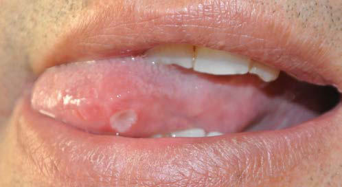

# Chapter 202: Behçet Disease — Active-Recall Flashcards
**Part XIV: Rheumatic Diseases of Childhood (Connective Tissue Diseases, Collagen Vascular Diseases)** | [📖 Read Wiki Chapter](../chapters/202.md) | [📝 Chapter MCQs](../mcqs/202_mcqs.md) | [🏠 Course Master Index](../../index.md)

Total cards: **8** *(Click any card below to reveal the answer)*

### Card 1 (Syndrome & Clinical Profile)

<b>Q:</b> What are the hallmark clinical features and diagnostic profile of **DESCRIPTION (Behçet Disease)**?

**Answer:**
**Category / Inheritance:** Rheumatic Diseases of Childh **Clinical Synthesis:** Recurrent oral aphthosis; At least three attacks/year; Genital ulceration or aphthosis; Typically with scar; Skin involvement; Necrotic folliculitis, acneiform; lesions, erythema nodosum; Ocular involvement; Anterior uveitis, posterior uveitis,; retinal vasculitis; Neurologic signs; With the exception of isolated; head

### Card 2 (Syndrome & Clinical Profile)

<b>Q:</b> What are the hallmark clinical features and diagnostic profile of **Behçet Disease**?

**Answer:**
**Associated Gene(s):** `ERAP1, MEFV, STAT4` · **Category / Inheritance:** Rheumatic Diseases of Childh **Clinical Synthesis:** CLINICAL MANIFESTATIONS AND DIAGNOSIS The course of BD is characterized by exacerbations and remissions.

### Card 3 (Pediatric Genetics & Pathogenesis)

<b>Q:</b> In **Behçet Disease**, what clinical phenotype or molecular mechanism is associated with **`MEFV`**?

**Answer:**
The autoinflammatory nature of BD is sug gested by its episodic nature, the prominent innate immune system activation, the absence of identifiable autoantibodies, and the coassociation with the MEFV gene.

### Card 4 (Pediatric Therapeutics & Management)

<b>Q:</b> What is the clinical management or therapeutic approach for **Behçet Disease**?

**Answer:**
**Therapy / Protocol:** Pediatric Clinical Management **Clinical Application:** Behçet disease (BD) is classified as a primary multisystem variable ves sel vasculitis because of the involvement of any size and type (arterial, venous) of blood vessel.

### Card 5 (Core Pediatric Concept)

<b>Q:</b> In the pediatric evaluation of **Behçet Disease** (*Behçet Disease*), how is **EPIDEMIOLOGY** characterized?

**Answer:**
EPIDEMIOLOGY BD has a high prevalence in countries along the Silk Road, extend ing from Japan to the Eastern Mediterranean.

### Card 6 (Core Pediatric Concept)

<b>Q:</b> In the pediatric evaluation of **Behçet Disease** (*Behçet Disease*), how is **CLINICAL MANIFESTATIONS AND DIAGNOSIS** characterized?

**Answer:**
CLINICAL MANIFESTATIONS AND DIAGNOSIS The course of BD is characterized by exacerbations and remissions.

### Card 7 (Core Pediatric Concept)

<b>Q:</b> In the pediatric evaluation of **Behçet Disease** (*Behçet Disease*), how is **anterior uveitis** characterized?

**Answer:**
anterior uveitis are blurred vision, redness, periorbital or global pain, and photophobia.

### Card 8 (Visual Diagnosis & Clinical Spotter)

<b>Q:</b> Identify the pediatric clinical finding, imaging sign, or mechanism illustrated in **Fig. 202.1** (*Behçet Disease*):

**Answer:**
A deep aphthous ulcer in a patient with Behçet disease.

