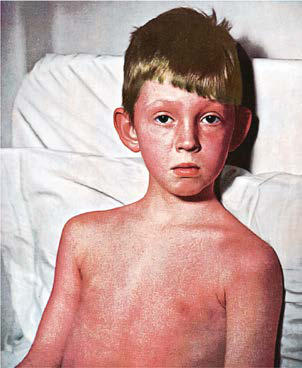

# Chapter 229: Group A Streptococcus — Active-Recall Flashcards
**Part XV: Infectious Diseases** | [📖 Read Wiki Chapter](../chapters/229.md) | [📝 Chapter MCQs](../mcqs/229_mcqs.md) | [🏠 Course Master Index](../../index.md)

Total cards: **8** *(Click any card below to reveal the answer)*

### Card 1 (Syndrome & Clinical Profile)

<b>Q:</b> What are the hallmark clinical features and diagnostic profile of **CLINICAL CRITERIA (Group A Streptococcus)**?

**Answer:**
**Category / Inheritance:** Infectious Diseases **Clinical Synthesis:** Hypotension plus two or more of the following:; Renal impairment; Coagulopathy; Hepatic involvement; Adult respiratory distress syndrome; Generalized erythematous macular rash; Soft tissue necrosis

### Card 2 (Syndrome & Clinical Profile)

<b>Q:</b> What are the hallmark clinical features and diagnostic profile of **DEFINITE CASE (Group A Streptococcus)**?

**Answer:**
**Category / Inheritance:** Infectious Diseases **Clinical Synthesis:** Clinical criteria plus group A Streptococcus from a normally sterile; site

### Card 3 (Syndrome & Clinical Profile)

<b>Q:</b> What are the hallmark clinical features and diagnostic profile of **PROBABLE CASE (Group A Streptococcus)**?

**Answer:**
**Category / Inheritance:** Infectious Diseases **Clinical Synthesis:** Clinical criteria plus group A Streptococcus from a nonsterile site

### Card 4 (Pediatric Therapeutics & Management)

<b>Q:</b> What is the clinical management or therapeutic approach for **Group A Streptococcus**?

**Answer:**
**Therapy / Protocol:** Drug of choice **Clinical Application:** Penicillin or amoxicil lin is therefore the drug of choice (except in patients who are allergic to penicillins) for pharyngeal infections and for suppurative complica tions.

### Card 5 (Core Pediatric Concept)

<b>Q:</b> In the pediatric evaluation of **Group A Streptococcus** (*Group A Streptococcus*), how is **ETIOLOGY** characterized?

**Answer:**
ETIOLOGY Group A streptococci are gram-positive, coccoid-shaped bacteria that tend to grow in chains.

### Card 6 (Core Pediatric Concept)

<b>Q:</b> In the pediatric evaluation of **Group A Streptococcus** (*Group A Streptococcus*), how is **M protein** characterized?

**Answer:**
M protein antigen, which is located on the cell surface and in fimbriae that project from the outer surface of the cell.

### Card 7 (Core Pediatric Concept)

<b>Q:</b> In the pediatric evaluation of **Group A Streptococcus** (*Group A Streptococcus*), how is **EPIDEMIOLOGY** characterized?

**Answer:**
EPIDEMIOLOGY Humans are the natural reservoir for GAS.

### Card 8 (Visual Diagnosis & Clinical Spotter)

<b>Q:</b> Identify the pediatric clinical finding, imaging sign, or mechanism illustrated in **Fig. 229.1** (*Group A Streptococcus*):

**Answer:**
Scarlet fever. A, Punctate, erythematous rash (second day). B, White strawberry tongue (first day). C, Red strawberry tongue (third day). (Courtesy Dr. Franklin H. Top, Professor and Head of the Department of Hygiene and Preventive Medicine, State University of Iowa, College of Medicine, Iowa City, IA; and Parke, Davis & Company’s Therapeutic Notes. From Gershon AA, Hotez PJ, Katz SL. Krugman’s Infectious Diseases of Children, 11th ed. Philadelphia: Mosby; 2004, Plate 53.)

