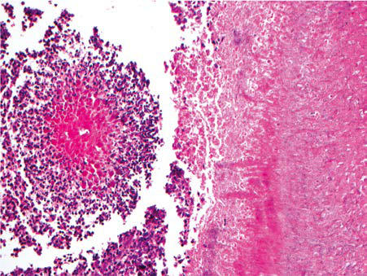

# Chapter 235: Actinomyces — Active-Recall Flashcards
**Part XV: Infectious Diseases** | [📖 Read Wiki Chapter](../chapters/235.md) | [📝 Chapter MCQs](../mcqs/235_mcqs.md) | [🏠 Course Master Index](../../index.md)

Total cards: **8** *(Click any card below to reveal the answer)*

### Card 1 (Syndrome & Clinical Profile)

<b>Q:</b> What are the hallmark clinical features and diagnostic profile of **Actinomyces**?

**Answer:**
**Category / Inheritance:** Infectious Diseases **Clinical Synthesis:** The hallmark of actinomycosis is contiguous spread that fails to respect tissue or fascial planes.

### Card 2 (Pediatric Therapeutics & Management)

<b>Q:</b> What is the clinical management or therapeutic approach for **Actinomyces**?

**Answer:**
**Therapy / Protocol:** Pediatric Clinical Management **Clinical Application:** More than 50 species of Actinomyces have been identified using 16S rRNA sequencing, with more than half of these species associated with human infection.

### Card 3 (Core Pediatric Concept)

<b>Q:</b> In the pediatric evaluation of **Actinomyces** (*Actinomyces*), how is **Actinomyces israelii** characterized?

**Answer:**
Actinomyces israelii is the predominant species causing human actinomycosis.

### Card 4 (Core Pediatric Concept)

<b>Q:</b> In the pediatric evaluation of **Actinomyces** (*Actinomyces*), how is **DIAGNOSIS** characterized?

**Answer:**
DIAGNOSIS Diagnosis of actinomycosis relies on identification of the organism in tissues of affected areas via culture, molecular methods, and/or histo pathology.

### Card 5 (Core Pediatric Concept)

<b>Q:</b> In the pediatric evaluation of **Actinomyces** (*Actinomyces*), how is **sulfur granules** characterized?

**Answer:**
sulfur granules on macroscopic or microscopic evaluation (Fig.

### Card 6 (Visual Diagnosis & Clinical Spotter)

<b>Q:</b> Identify the pediatric clinical finding, imaging sign, or mechanism illustrated in **Fig. 235.1** (*Actinomyces*):

**Answer:**
Actinomycosis. A, Small cluster of Actinomyces on left, with sulfur granule and surrounding mixed inflammation demonstrating the Splendore-Hoeppli phenomenon (×200). B, Gomori methenamine silver stain of the same field, highlighting the filamentous forms (×200). (From Johnson MM. Ear, nose, and throat infections. In: Kradin RL, ed. Diagnostic Pathology of Infectious Disease, 2nd ed. Philadelphia: Else vier; 2018: Fig. 7.6.)

### Card 7 (High-Yield Board Pearl)

<b>Q:</b> What is a high-yield clinical or diagnostic principle regarding **Actinomyces** (*Actinomyces*)?

**Answer:**
The hallmark of actinomycosis is contiguous spread that fails to respect tissue or fascial planes.

### Card 8 (Pathophysiology & Diagnosis)

<b>Q:</b> What core clinical principle governs **Actinomyces** in **Actinomyces**?

**Answer:**
More than 50 species of Actinomyces have been identified using 16S rRNA sequencing, with more than half of these species associated with human infection.

