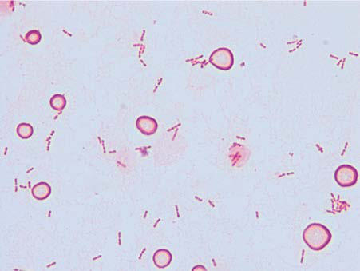

# Chapter 239: Kingella kingae — Active-Recall Flashcards
**Part XV: Infectious Diseases** | [📖 Read Wiki Chapter](../chapters/239.md) | [📝 Chapter MCQs](../mcqs/239_mcqs.md) | [🏠 Course Master Index](../../index.md)

Total cards: **8** *(Click any card below to reveal the answer)*

### Card 1 (Syndrome & Clinical Profile)

<b>Q:</b> What are the hallmark clinical features and diagnostic profile of **FREQUENCY (Kingella kingae)**?

**Answer:**
**Category / Inheritance:** Infectious Diseases **Clinical Synthesis:** Septic arthritis; +++; Osteomyelitis; ++; Spondylodiscitis; +; Tenosynovitis; ±; Bursitis; ±; Bacteremia with no focus; +++; Endocarditis; +; Pericarditis; +; Laryngotracheobronchitis; ±; Pneumonia; ±; Pleural empyema; ±; Keratitis; ±; Corneal abscess; ±; Endophthalmitis; ±; Eyelid abscess; ±; +++, Very common; ++, com

### Card 2 (Syndrome & Clinical Profile)

<b>Q:</b> What are the hallmark clinical features and diagnostic profile of **Kingella kingae**?

**Answer:**
**Category / Inheritance:** Infectious Diseases **Clinical Synthesis:** PREVENTION Efforts to develop gonococcal vaccines that confer broad crossprotection have been unsuccessful thus far.

### Card 3 (Pediatric Therapeutics & Management)

<b>Q:</b> What is the clinical management or therapeutic approach for **Kingella kingae**?

**Answer:**
**Therapy / Protocol:** Mg/kg **Clinical Application:** If erythromycin ointment is unavailable, infants at risk for N. gonorrhoeae (especially those born to a mother with untreated gonococcal infection or with no prenatal care) can be administered cef triaxone 25-50 mg/kg IV or IM, not to exceed 500 mg, in a single dose.

### Card 4 (Core Pediatric Concept)

<b>Q:</b> In the pediatric evaluation of **Kingella kingae** (*Kingella kingae*), how is **PREVENTION** characterized?

**Answer:**
PREVENTION Efforts to develop gonococcal vaccines that confer broad crossprotection have been unsuccessful thus far.

### Card 5 (Core Pediatric Concept)

<b>Q:</b> In the pediatric evaluation of **Kingella kingae** (*Kingella kingae*), how is **barrier protec tion** characterized?

**Answer:**
barrier protec tion (especially condoms), frequent screening of high-risk popula tions as recommended by the U.

### Card 6 (Core Pediatric Concept)

<b>Q:</b> In the pediatric evaluation of **Kingella kingae** (*Kingella kingae*), how is **early identifica tion and treatment** characterized?

**Answer:**
early identifica tion and treatment of contacts—all sex partners within the 60 days preceding symptom onset or gonorrhea diagnosis or, if none, the most recent sex partner should be examined and treated presumptively.

### Card 7 (Visual Diagnosis & Clinical Spotter)

<b>Q:</b> Identify the pediatric clinical finding, imaging sign, or mechanism illustrated in **Fig. 239.1** (*Kingella kingae*):

**Answer:**
Typical Gram stain of a positive blood culture vial from a child with K. kingae bacteremia showing pairs and short chains of plump gram-negative coccobacilli. RBCs, Red blood cells.

### Card 8 (High-Yield Board Pearl)

<b>Q:</b> What is a high-yield clinical or diagnostic principle regarding **Kingella kingae** (*Kingella kingae*)?

**Answer:**
PREVENTION Efforts to develop gonococcal vaccines that confer broad crossprotection have been unsuccessful thus far.

