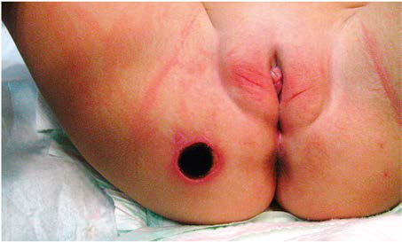

# Chapter 251: Pseudomonas, Burkholderia, and Stenotrophomonas — Active-Recall Flashcards
**Part XV: Infectious Diseases** | [📖 Read Wiki Chapter](../chapters/251.md) | [📝 Chapter MCQs](../mcqs/251_mcqs.md) | [🏠 Course Master Index](../../index.md)

Total cards: **8** *(Click any card below to reveal the answer)*

### Card 1 (Syndrome & Clinical Profile)

<b>Q:</b> What are the hallmark clinical features and diagnostic profile of **COMMON CLINICAL CHARACTERISTICS**?

**Answer:**
**Category / Inheritance:** Infectious Diseases **Clinical Synthesis:** Endocarditis; Native right-sided (tricuspid) valve disease with intravenous drug abuse; Pneumonia; Compromised local (lung) or systemic host defense mechanisms; nosocomial (respiratory),; bacteremic (malignancy), or abnormal mucociliary clearance (cystic fibrosis) may be; pathogenetic; cystic fibrosis is associated wit

### Card 2 (Syndrome & Clinical Profile)

<b>Q:</b> What are the hallmark clinical features and diagnostic profile of **Pseudomonas, Burkholderia, and Stenotrophomonas**?

**Answer:**
**Category / Inheritance:** Infectious Diseases **Clinical Synthesis:** P. aeruginosa was also the second most common cause of catheter-associated urinary tract infections (UTIs) (18.4%) and ventilator-associated pneumonia (16.1%) and the third most common cause of postoperative surgi cal site infections (8.3%).

### Card 3 (Syndrome & Clinical Profile)

<b>Q:</b> What are the hallmark clinical features and diagnostic profile of **Pseudomonas aeruginosa (Pseudomonas, Burkholderia, and Stenotrophomonas)**?

**Answer:**
**Category / Inheritance:** Infectious Diseases **Clinical Synthesis:** The characteristic skin lesions of P. aeruginosa, ecthyma gan grenosum**, whether caused by direct inoculation or a metastatic focus secondary to septicemia, begin as pink macules and progress to hem orrhagic nodules and eventually to ulcers with ecchymotic and gan grenous centers with eschar formation, surrounded by a

### Card 4 (Pediatric Therapeutics & Management)

<b>Q:</b> What is the clinical management or therapeutic approach for **Pseudomonas, Burkholderia, and Stenotrophomonas (251.1 Pseudomonas aeruginosa Thomas S. Murray **?

**Answer:**
**Therapy / Protocol:** Immunoglobulin **Clinical Application:** Dissemination and bloodstream invasion follow extension of local tissue damage and are facilitated by the antiphagocytic properties of endotoxin, the exopolysaccharide, and protease cleavage of immunoglobulin G.

### Card 5 (Core Pediatric Concept)

<b>Q:</b> In the pediatric evaluation of **Pseudomonas, Burkholderia, and Stenotrophomonas** (*251.1 Pseudomonas aeruginosa Thomas S. Murray and Ashley C. Howard*), how is **CLINICAL MANIFESTATIONS** characterized?

**Answer:**
CLINICAL MANIFESTATIONS Most clinical patterns are related to opportunistic infections in immu nocompromised hosts or are associated with shunts and indwelling catheters.

### Card 6 (Core Pediatric Concept)

<b>Q:</b> In the pediatric evaluation of **Pseudomonas, Burkholderia, and Stenotrophomonas** (*251.1 Pseudomonas aeruginosa Thomas S. Murray and Ashley C. Howard*), how is **Burns and Wound Infection** characterized?

**Answer:**
Burns and Wound Infection The surfaces of burns or wounds are frequently populated by *P.

### Card 7 (Core Pediatric Concept)

<b>Q:</b> In the pediatric evaluation of **Pseudomonas, Burkholderia, and Stenotrophomonas** (*251.1 Pseudomonas aeruginosa Thomas S. Murray and Ashley C. Howard*), how is **Immunocompromised Persons** characterized?

**Answer:**
Immunocompromised Persons Children with leukemia or other malignancies, particularly those who are receiving immunosuppressive therapy and who are neutropenic, typically with intravascular catheters, are extremely susceptible to sep ticemia caused by invasion of the bloodstream by *P.

### Card 8 (Visual Diagnosis & Clinical Spotter)

<b>Q:</b> Identify the pediatric clinical finding, imaging sign, or mechanism illustrated in **Fig. 251.1** (*Pseudomonas, Burkholderia, and Stenotrophomonas*):

**Answer:**
Round, nontender skin lesion on 2-yr-old female’s buttock. Note the black ulcerated center of the lesion and its red margin. (From Ghanaiem H, Engelhard D. A healthy 2-year-old child with a round black skin lesion. J Pediatr. 2013;163:1225.)

