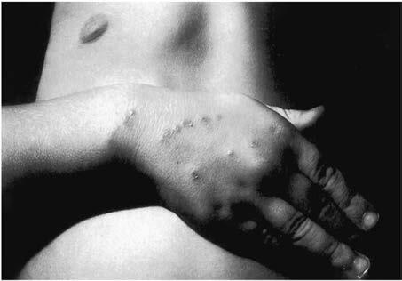

# Chapter 255: Bartonella — Active-Recall Flashcards
**Part XV: Infectious Diseases** | [📖 Read Wiki Chapter](../chapters/255.md) | [📝 Chapter MCQs](../mcqs/255_mcqs.md) | [🏠 Course Master Index](../../index.md)

Total cards: **8** *(Click any card below to reveal the answer)*

### Card 1 (Syndrome & Clinical Profile)

<b>Q:</b> What are the hallmark clinical features and diagnostic profile of **PRIMARY RISK FACTOR**?

**Answer:**
**Category / Inheritance:** Infectious Diseases **Clinical Synthesis:** Bartonellosis (Carrión disease); B. bacilliformis; Sandfly (Lutzomyia verrucarum); Living in endemic areas (Andes; Mountains); Cat scratch disease; B. henselae; B. clarridgeiae; Cat; Cat scratch or bite; Trench fever; B. quintana; Human body louse; Body louse infestation during; outbreak; Bacteremia, endocarditis; B. h

### Card 2 (Syndrome & Clinical Profile)

<b>Q:</b> What are the hallmark clinical features and diagnostic profile of **Bartonella**?

**Answer:**
**Category / Inheritance:** Infectious Diseases **Clinical Synthesis:** The most common presentation of Bartonella infection is cat scratch disease (CSD), which is a subacute, regional lymphadenitis caused most frequently by B. henselae.

### Card 3 (Syndrome & Clinical Profile)

<b>Q:</b> What are the hallmark clinical features and diagnostic profile of **Cat Scratch Disease (Bartonella henselae) (Bartonella)**?

**Answer:**
**Category / Inheritance:** Infectious Diseases **Clinical Synthesis:** CSD is the most common cause of chronic lymphadenitis that persists for >3 weeks.

### Card 4 (Pediatric Therapeutics & Management)

<b>Q:</b> What is the clinical management or therapeutic approach for **Bartonella (255.1 Cat Scratch Disease (Bartonella henselae) Rachel C. Orscheln)**?

**Answer:**
**Therapy / Protocol:** Azithromycin **Clinical Application:** A small prospective study of oral azithromycin (500 mg on day 1, then 250 mg on days 2-5; for smaller children, 10 mg/kg/24 hr on day 1 and 5 mg/kg/24 hr on days 2-5) showed a decrease in initial lymph node volume in 50% of patients during the first 30 days, but after 30 days the

### Card 5 (Core Pediatric Concept)

<b>Q:</b> In the pediatric evaluation of **Bartonella** (*255.1 Cat Scratch Disease (Bartonella henselae) Rachel C. Orscheln*), how is **EPIDEMIOLOGY** characterized?

**Answer:**
EPIDEMIOLOGY CSD is common, with >24,000 estimated cases per year in the United States.

### Card 6 (Core Pediatric Concept)

<b>Q:</b> In the pediatric evaluation of **Bartonella** (*255.1 Cat Scratch Disease (Bartonella henselae) Rachel C. Orscheln*), how is **PATHOGENESIS** characterized?

**Answer:**
PATHOGENESIS The pathologic findings in the primary inoculation papule and affected lymph nodes are similar.

### Card 7 (Core Pediatric Concept)

<b>Q:</b> In the pediatric evaluation of **Bartonella** (*255.1 Cat Scratch Disease (Bartonella henselae) Rachel C. Orscheln*), how is **Hepatosplenomegaly** characterized?

**Answer:**
Hepatosplenomegaly may occur, although hepatic dysfunction is rare (Fig.

### Card 8 (Visual Diagnosis & Clinical Spotter)

<b>Q:</b> Identify the pediatric clinical finding, imaging sign, or mechanism illustrated in **Fig. 255.1** (*Bartonella*):

**Answer:**
A child with typical cat scratch disease demonstrating the original scratch injuries and the primary papule that soon thereafter de veloped proximal to the middle finger. (Courtesy Dr. V.H. San Joaquin, University of Oklahoma Health Sciences Center, Oklahoma City.)

