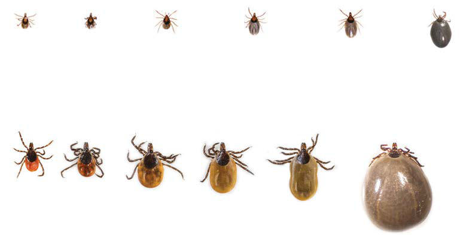

# Chapter 269: Mycoplasma pneumoniae — Active-Recall Flashcards
**Part XV: Infectious Diseases** | [📖 Read Wiki Chapter](../chapters/269.md) | [📝 Chapter MCQs](../mcqs/269_mcqs.md) | [🏠 Course Master Index](../../index.md)

Total cards: **8** *(Click any card below to reveal the answer)*

### Card 1 (Syndrome & Clinical Profile)

<b>Q:</b> What are the hallmark clinical features and diagnostic profile of **Mycoplasma pneumoniae**?

**Answer:**
**Category / Inheritance:** Infectious Diseases **Clinical Synthesis:** Clinical Practice Guidelines by the Infectious Diseases Society of America [IDSA], American Academy of Neurology [AAN], and American College of Rheumatology [ACR]: 2020 Guidelines for the Preven tion, Diagnosis and Treatment of Lyme Disease.

### Card 2 (Pediatric Therapeutics & Management)

<b>Q:</b> What is the clinical management or therapeutic approach for **Mycoplasma pneumoniae**?

**Answer:**
**Therapy / Protocol:** Immunoglobulin **Clinical Application:** Serologic tests (immunofluorescence tests, enzyme-linked immune assays [EIAs]) to detect serum immunoglobulin (Ig) M, IgA, and IgG antibodies against M. pneumoniae are commercially available.

### Card 3 (Core Pediatric Concept)

<b>Q:</b> In the pediatric evaluation of **Mycoplasma pneumoniae** (*Mycoplasma pneumoniae*), how is **THE ORGANISM** characterized?

**Answer:**
THE ORGANISM Mycoplasmas are the smallest self-replicating prokaryotes known to cause disease in humans.

### Card 4 (Core Pediatric Concept)

<b>Q:</b> In the pediatric evaluation of **Mycoplasma pneumoniae** (*Mycoplasma pneumoniae*), how is **Respiratory Tract Disease** characterized?

**Answer:**
Respiratory Tract Disease Tracheobronchitis and atypical pneumonia are the most commonly rec ognized clinical syndromes associated with *M.

### Card 5 (Core Pediatric Concept)

<b>Q:</b> In the pediatric evaluation of **Mycoplasma pneumoniae** (*Mycoplasma pneumoniae*), how is **Extrapulmonary Disease** characterized?

**Answer:**
Extrapulmonary Disease Despite the reportedly rare isolation of *M.

### Card 6 (Visual Diagnosis & Clinical Spotter)

<b>Q:</b> Identify the pediatric clinical finding, imaging sign, or mechanism illustrated in **Fig. 269.2** (*Mycoplasma pneumoniae*):

**Answer:**
are frequently co-detected in children with M. pneumoniae, especially in those younger than 2 years of age, where viral co-infections have been identified in up to 30% of cases. Asymptomatic carriage after infection can last up to 4 months

### Card 7 (High-Yield Board Pearl)

<b>Q:</b> What is a high-yield clinical or diagnostic principle regarding **Mycoplasma pneumoniae** (*Mycoplasma pneumoniae*)?

**Answer:**
Clinical Practice Guidelines by the Infectious Diseases Society of America [IDSA], American Academy of Neurology [AAN], and American College of Rheumatology [ACR]: 2020 Guidelines for the Preven tion, Diagnosis and Treatment of Lyme Disease.

### Card 8 (Pathophysiology & Diagnosis)

<b>Q:</b> What core clinical principle governs **Mycoplasma pneumoniae** in **Mycoplasma pneumoniae**?

**Answer:**
Transmission of Borrelia burgdorferi requires 36-48 hr of feeding, and therefore antibiotic prophylaxis is recommended only if the tick has been attached for at least 36 hr, or 1.5 days.

