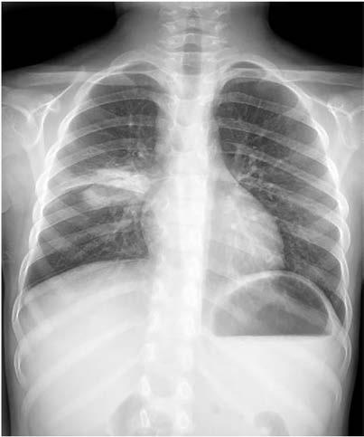

# Chapter 284: Histoplasmosis (Histoplasma capsulatum) — Active-Recall Flashcards
**Part XV: Infectious Diseases** | [📖 Read Wiki Chapter](../chapters/284.md) | [📝 Chapter MCQs](../mcqs/284_mcqs.md) | [🏠 Course Master Index](../../index.md)

Total cards: **8** *(Click any card below to reveal the answer)*

### Card 1 (Syndrome & Clinical Profile)

<b>Q:</b> What are the hallmark clinical features and diagnostic profile of **Histoplasmosis (Histoplasma capsulatum)**?

**Answer:**
**Associated Gene(s):** `AR, DOCK8, GATA2, STAT1` · **Category / Inheritance:** Infectious Diseases **Clinical Synthesis:** Imaging in these patients is much less likely to reveal the halo sign, infarcts, or cavitary lesions and instead generally shows areas of tissue destruction caused by the ongoing inflammatory processes.

### Card 2 (Pediatric Genetics & Pathogenesis)

<b>Q:</b> In **Histoplasmosis (Histoplasma capsulatum)**, what clinical phenotype or molecular mechanism is associated with **`STAT1`**?

**Answer:**
Other primary immunodeficiencies identified in children with disseminated disease include STAT1 gain-of-function pathogenic genetic variants, idiopathic CD4 lymphopenia, AR-DOCK8 deficiency, AD-GATA2 deficiency, and X-linked CD40L deficiency.

### Card 3 (Pediatric Therapeutics & Management)

<b>Q:</b> What is the clinical management or therapeutic approach for **Histoplasmosis (Histoplasma capsulatum)**?

**Answer:**
**Therapy / Protocol:** Voriconazole **Clinical Application:** If the diagnosis is confirmed, treatment should be with voriconazole similar to invasive pulmonary disease.

### Card 4 (Core Pediatric Concept)

<b>Q:</b> In the pediatric evaluation of **Histoplasmosis (Histoplasma capsulatum)** (*Histoplasmosis (Histoplasma capsulatum)*), how is **Special Populations** characterized?

**Answer:**
Special Populations Patients with CGD represent a pediatric population at particular risk for pulmonary aspergillosis.

### Card 5 (Core Pediatric Concept)

<b>Q:</b> In the pediatric evaluation of **Histoplasmosis (Histoplasma capsulatum)** (*Histoplasmosis (Histoplasma capsulatum)*), how is **CUTANEOUS ASPERGILLOSIS** characterized?

**Answer:**
CUTANEOUS ASPERGILLOSIS Cutaneous aspergillosis can occur as a primary disease or as a con sequence of hematogenous dissemination or spread from underlying structures.

### Card 6 (Core Pediatric Concept)

<b>Q:</b> In the pediatric evaluation of **Histoplasmosis (Histoplasma capsulatum)** (*Histoplasmosis (Histoplasma capsulatum)*), how is **INVASIVE SINONASAL DISEASE** characterized?

**Answer:**
INVASIVE SINONASAL DISEASE Invasive Aspergillus sinusitis represents a difficult diagnosis because the clinical presentation tends to be highly variable.

### Card 7 (Visual Diagnosis & Clinical Spotter)

<b>Q:</b> Identify the pediatric clinical finding, imaging sign, or mechanism illustrated in **Fig. 284.1** (*Histoplasmosis (Histoplasma capsulatum)*):

**Answer:**
Radiograph of a 5-yr-old child with acute pulmonary histo plasmosis showing right perihilar lymphadenopathy.

### Card 8 (High-Yield Board Pearl)

<b>Q:</b> What is a high-yield clinical or diagnostic principle regarding **Histoplasmosis (Histoplasma capsulatum)** (*Histoplasmosis (Histoplasma capsulatum)*)?

**Answer:**
Imaging in these patients is much less likely to reveal the halo sign, infarcts, or cavitary lesions and instead generally shows areas of tissue destruction caused by the ongoing inflammatory processes.

