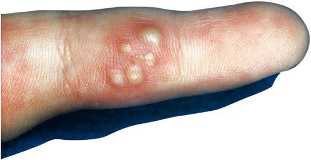

# Chapter 299: Herpes Simplex Virus — Active-Recall Flashcards
**Part XV: Infectious Diseases** | [📖 Read Wiki Chapter](../chapters/299.md) | [📝 Chapter MCQs](../mcqs/299_mcqs.md) | [🏠 Course Master Index](../../index.md)

Total cards: **8** *(Click any card below to reveal the answer)*

### Card 1 (Syndrome & Clinical Profile)

<b>Q:</b> What are the hallmark clinical features and diagnostic profile of **Herpes Simplex Virus**?

**Answer:**
**Associated Gene(s):** `DBR1, TLR3, TRAF3` · **Category / Inheritance:** Infectious Diseases **Clinical Synthesis:** Human Bocavirus Respiratory illness and wheezing caused by HBoV1 cannot be dif ferentiated clinically from other common viral respiratory infections, especially respiratory syncytial virus, human metapneumovirus, rhino viruses, enterovirus D68, and parainfluenza viruses.

### Card 2 (Pediatric Genetics & Pathogenesis)

<b>Q:</b> In **Herpes Simplex Virus**, what clinical phenotype or molecular mechanism is associated with **`TRAF3`**?

**Answer:**
Genetic factors that increase the susceptibility to HSV encephalitis include pathogenic variants in toll-like receptor-3 (TLR3)-dependent interferon immunity, DBR1, RNA5SP141, TRAF3, and other genes involved in TLR3 sensing or downstream signaling.

### Card 3 (Pediatric Therapeutics & Management)

<b>Q:</b> What is the clinical management or therapeutic approach for **Herpes Simplex Virus**?

**Answer:**
**Therapy / Protocol:** Immunoglobulin **Clinical Application:** Commercial lots of intravenous immunoglobulin (IVIG) have been used with some success to treat B19V-related epi sodes of anemia and bone marrow failure in immunocompromised children.

### Card 4 (Core Pediatric Concept)

<b>Q:</b> In the pediatric evaluation of **Herpes Simplex Virus** (*Herpes Simplex Virus*), how is **Human Bocavirus** characterized?

**Answer:**
Human Bocavirus Respiratory illness and wheezing caused by HBoV1 cannot be dif ferentiated clinically from other common viral respiratory infections, especially respiratory syncytial virus, human metapneumovirus, rhino viruses, enterovirus D68, and parainfluenza viruses.

### Card 5 (Core Pediatric Concept)

<b>Q:</b> In the pediatric evaluation of **Herpes Simplex Virus** (*Herpes Simplex Virus*), how is **TREATMENT Parvovirus B19** characterized?

**Answer:**
TREATMENT Parvovirus B19 There is no specific antiviral therapy approved for B19V infection.

### Card 6 (Visual Diagnosis & Clinical Spotter)

<b>Q:</b> Identify the pediatric clinical finding, imaging sign, or mechanism illustrated in **Fig. 299.1** (*Herpes Simplex Virus*):

**Answer:**
Clustered perioral vesicles and erosions in an infant with primary herpetic gingivostomatitis. (From Schachner LA, Hansen RC, eds. Pediatric Dermatology, 3rd ed. Philadelphia: Mosby; 1988:1078.)

### Card 7 (Visual Diagnosis & Clinical Spotter)

<b>Q:</b> Identify the pediatric clinical finding, imaging sign, or mechanism illustrated in **Fig. 299.2** (*Herpes Simplex Virus*):

**Answer:**
Herpes simplex infection of finger (whitlow). (From Schach ner LA, Hansen RC, eds. Pediatric Dermatology, 3rd ed. Philadelphia: Mosby; 1988:1079.)

### Card 8 (High-Yield Board Pearl)

<b>Q:</b> What is a high-yield clinical or diagnostic principle regarding **Herpes Simplex Virus** (*Herpes Simplex Virus*)?

**Answer:**
Human Bocavirus Respiratory illness and wheezing caused by HBoV1 cannot be dif ferentiated clinically from other common viral respiratory infections, especially respiratory syncytial virus, human metapneumovirus, rhino viruses, enterovirus D68, and parainfluenza viruses.

