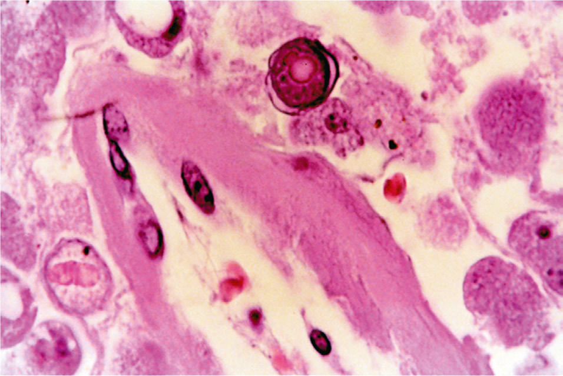
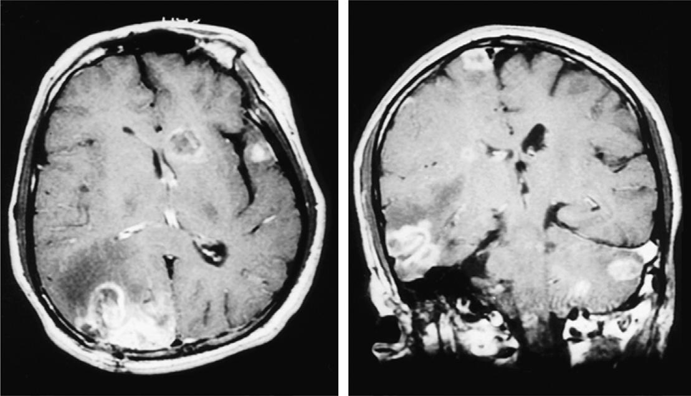

# Chapter 326: Primary Amebic Meningoencephalitis — Active-Recall Flashcards
**Part XV: Infectious Diseases** | [📖 Read Wiki Chapter](../chapters/326.md) | [📝 Chapter MCQs](../mcqs/326_mcqs.md) | [🏠 Course Master Index](../../index.md)

Total cards: **8** *(Click any card below to reveal the answer)*

### Card 1 (Syndrome & Clinical Profile)

<b>Q:</b> What are the hallmark clinical features and diagnostic profile of **Primary Amebic Meningoencephalitis**?

**Answer:**
**Category / Inheritance:** Infectious Diseases **Clinical Synthesis:** The more common is an acute, fulminant, and usually fatal primary amebic meningoencephalitis caused by Naegleria fowleri that occurs in previously healthy children and young adults.

### Card 2 (Pediatric Therapeutics & Management)

<b>Q:</b> What is the clinical management or therapeutic approach for **Primary Amebic Meningoencephalitis**?

**Answer:**
**Therapy / Protocol:** Amphotericin **Clinical Application:** Until 2013, there had been only two known survivors in North America, with treatment regimens of amphotericin B, either alone or in combination with other agents such as rifampin, chloramphenicol, fluconazole, ketoconazole, and dexamethasone.

### Card 3 (Core Pediatric Concept)

<b>Q:</b> In the pediatric evaluation of **Primary Amebic Meningoencephalitis** (*Primary Amebic Meningoencephalitis*), how is **primary amebic meningoencephalitis** characterized?

**Answer:**
primary amebic meningoencephalitis caused by Naegleria fowleri that occurs in previously healthy children and young adults.

### Card 4 (Core Pediatric Concept)

<b>Q:</b> In the pediatric evaluation of **Primary Amebic Meningoencephalitis** (*Primary Amebic Meningoencephalitis*), how is **EPIDEMIOLOGY** characterized?

**Answer:**
EPIDEMIOLOGY The free-living amebae have a worldwide distribution.

### Card 5 (Core Pediatric Concept)

<b>Q:</b> In the pediatric evaluation of **Primary Amebic Meningoencephalitis** (*Primary Amebic Meningoencephalitis*), how is **PATHOGENESIS** characterized?

**Answer:**
PATHOGENESIS The free-living amebae enter the nasal cavity by inhalation or aspira tion of dust or water contaminated with trophozoites or cysts.

### Card 6 (Visual Diagnosis & Clinical Spotter)

<b>Q:</b> Identify the pediatric clinical finding, imaging sign, or mechanism illustrated in **Fig. 326.1** (*Primary Amebic Meningoencephalitis*):

**Answer:**
A and B, MRIs of the brain of a patient with Balamuthia mandrillaris granulomatous amebic encephalitis. Multiple enhancing lesions are seen in the right hemisphere, left cerebellum, midbrain, and brainstem. C, Photomicrograph of the brain lesion from the same patient showing perivascular amebic trophozoites. A round amebic cyst with a characteristic double wall is seen in the top center (hematoxylin and eosin, original magnification ×100). (From Deol I, Robledo L, Meza A, et al. Encephalitis due to a free-living amoeba [Balamuthia mandrillaris]: case report with literature review. Surg Neurol. 2000;53:611–616.)

### Card 7 (Visual Diagnosis & Clinical Spotter)

<b>Q:</b> Identify the pediatric clinical finding, imaging sign, or mechanism illustrated in **Fig. 326.2** (*Primary Amebic Meningoencephalitis*):

**Answer:**
Clinical illustration and diagnostic features of Primary Amebic Meningoencephalitis.

### Card 8 (High-Yield Board Pearl)

<b>Q:</b> What is a high-yield clinical or diagnostic principle regarding **Primary Amebic Meningoencephalitis** (*Primary Amebic Meningoencephalitis*)?

**Answer:**
The more common is an acute, fulminant, and usually fatal primary amebic meningoencephalitis caused by Naegleria fowleri that occurs in previously healthy children and young adults.

