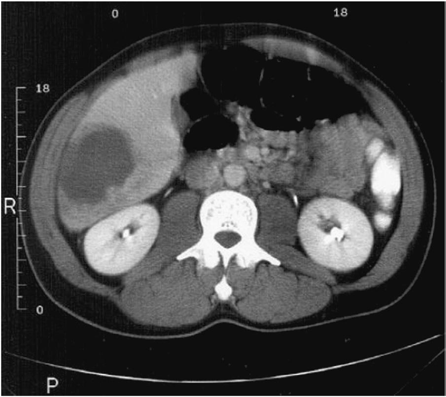

# Chapter 327: Amebiasis — Active-Recall Flashcards
**Part XV: Infectious Diseases** | [📖 Read Wiki Chapter](../chapters/327.md) | [📝 Chapter MCQs](../mcqs/327_mcqs.md) | [🏠 Course Master Index](../../index.md)

Total cards: **8** *(Click any card below to reveal the answer)*

### Card 1 (Syndrome & Clinical Profile)

<b>Q:</b> What are the hallmark clinical features and diagnostic profile of **Amebiasis**?

**Answer:**
**Category / Inheritance:** Infectious Diseases **Clinical Synthesis:** Food or drink contaminated with Entamoeba cysts and oral-anogenital sex are the most common means of infection.

### Card 2 (Pediatric Therapeutics & Management)

<b>Q:</b> What is the clinical management or therapeutic approach for **Amebiasis**?

**Answer:**
**Therapy / Protocol:** Metronidazole **Clinical Application:** Tinida zole may have better clinical efficacy than metronidazole, with shorter and simpler dosing, and is better tolerated.

### Card 3 (Core Pediatric Concept)

<b>Q:</b> In the pediatric evaluation of **Amebiasis** (*Amebiasis*), how is **ETIOLOGY** characterized?

**Answer:**
ETIOLOGY Four morphologically identical but genetically distinct species of Ent amoeba are known to infect humans.

### Card 4 (Core Pediatric Concept)

<b>Q:</b> In the pediatric evaluation of **Amebiasis** (*Amebiasis*), how is **PATHOGENESIS** characterized?

**Answer:**
PATHOGENESIS Trophozoites are responsible for tissue invasion and destruction.

### Card 5 (Core Pediatric Concept)

<b>Q:</b> In the pediatric evaluation of **Amebiasis** (*Amebiasis*), how is **Amebic Colitis** characterized?

**Answer:**
Amebic Colitis Amebic colitis may occur within 2 weeks of infection or may be delayed for months.

### Card 6 (Visual Diagnosis & Clinical Spotter)

<b>Q:</b> Identify the pediatric clinical finding, imaging sign, or mechanism illustrated in **Fig. 327.1** (*Amebiasis*):

**Answer:**
Abdominal CT scan of a patient with an amebic liver ab scess. (From Miller Q, Kenney JM, Cotlar AM. Amebic abscess of the liv er presenting as acute cholecystitis. Curr Surg. 2000;57:476–479. Fig. 1.)

### Card 7 (High-Yield Board Pearl)

<b>Q:</b> What is a high-yield clinical or diagnostic principle regarding **Amebiasis** (*Amebiasis*)?

**Answer:**
Food or drink contaminated with Entamoeba cysts and oral-anogenital sex are the most common means of infection.

### Card 8 (Pathophysiology & Diagnosis)

<b>Q:</b> What core clinical principle governs **Amebiasis** in **Amebiasis**?

**Answer:**
ETIOLOGY Four morphologically identical but genetically distinct species of Ent amoeba are known to infect humans.

