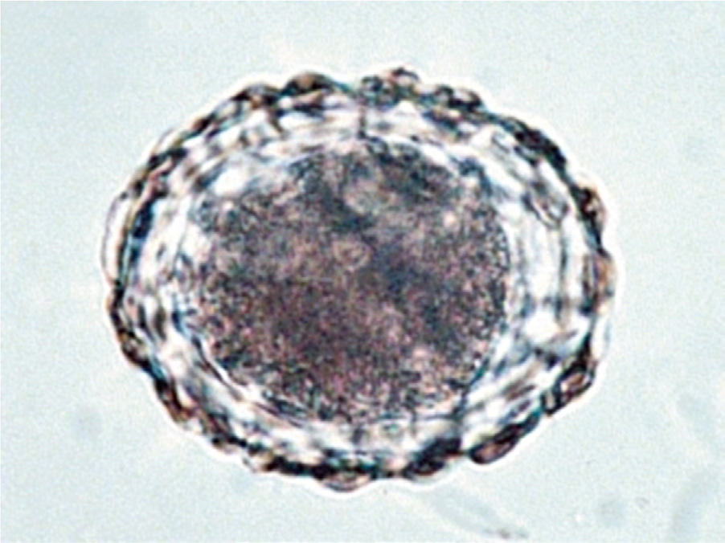
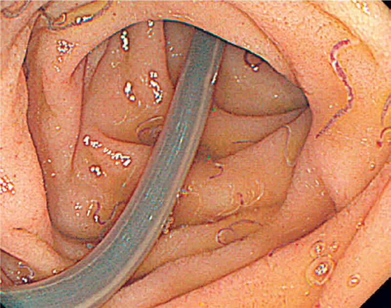

# Chapter 337: Ascariasis (Ascaris lumbricoides) — Active-Recall Flashcards
**Part XV: Infectious Diseases** | [📖 Read Wiki Chapter](../chapters/337.md) | [📝 Chapter MCQs](../mcqs/337_mcqs.md) | [🏠 Course Master Index](../../index.md)

Total cards: **8** *(Click any card below to reveal the answer)*

### Card 1 (Syndrome & Clinical Profile)

<b>Q:</b> What are the hallmark clinical features and diagnostic profile of **Ascariasis (Ascaris lumbricoides)**?

**Answer:**
**Associated Gene(s):** `AR, TH` · **Category / Inheritance:** Infectious Diseases **Clinical Synthesis:** Research is ongoing regarding the molecular targets of a toxoplasmosis vaccine that could be administered to mothers, chil dren, or the general population.

### Card 2 (Pediatric Therapeutics & Management)

<b>Q:</b> What is the clinical management or therapeutic approach for **Ascariasis (Ascaris lumbricoides)**?

**Answer:**
**Therapy / Protocol:** Azithromycin **Clinical Application:** Other experimental agents include the macrolides clarithromycin and azithromycin.

### Card 3 (Core Pediatric Concept)

<b>Q:</b> In the pediatric evaluation of **Ascariasis (Ascaris lumbricoides)** (*Ascariasis (Ascaris lumbricoides)*), how is **Future Treatments** characterized?

**Answer:**
Future Treatments Many potential future treatments are currently being studied, includ ing tetrahydroquinolones and another cytochrome b/c inhibitor as a prodrug, calcium kinase inhibitors, DHFR inhibitors, and nanopar ticle technology.

### Card 4 (Core Pediatric Concept)

<b>Q:</b> In the pediatric evaluation of **Ascariasis (Ascaris lumbricoides)** (*Ascariasis (Ascaris lumbricoides)*), how is **PROGNOSIS** characterized?

**Answer:**
PROGNOSIS Early institution of specific treatment for congenitally infected infants usually rapidly controls the active manifestations of toxoplasmosis, including active chorioretinitis, meningitis, encephalitis, hepatitis, sple nomegaly, and thrombocytopenia.

### Card 5 (Core Pediatric Concept)

<b>Q:</b> In the pediatric evaluation of **Ascariasis (Ascaris lumbricoides)** (*Ascariasis (Ascaris lumbricoides)*), how is **Systematic Review on Congenital Toxoplasmo sis** characterized?

**Answer:**
Systematic Review on Congenital Toxoplasmo sis (SYROCOT) study in Europe indicated that neurologic outcome is improved with shorter times between diagnosis and initiation of treat ment of fetal toxoplasmosis.

### Card 6 (Visual Diagnosis & Clinical Spotter)

<b>Q:</b> Identify the pediatric clinical finding, imaging sign, or mechanism illustrated in **Fig. 337.1** (*Ascariasis (Ascaris lumbricoides)*):

**Answer:**
Soil-transmitted helminth eggs (Ascaris lumbricoides). (From Bethony J, Brooker S, Albonico M, et al. Soil-transmitted hel minth infections: ascariasis, trichuriasis, and hookworm. Lancet. 2006;367:1521–1532.)

### Card 7 (Visual Diagnosis & Clinical Spotter)

<b>Q:</b> Identify the pediatric clinical finding, imaging sign, or mechanism illustrated in **Fig. 337.2** (*Ascariasis (Ascaris lumbricoides)*):

**Answer:**
Endoscopic image of intestinal Ascaris lumbricoides and hookworm co-infection. The ascaris worm is large in relation to the lu men and multiple blood-filled hookworms. (Courtesy Dr. Kunimitsu In oue, Nakamura Hospital, Oita, Japan.)

### Card 8 (High-Yield Board Pearl)

<b>Q:</b> What is a high-yield clinical or diagnostic principle regarding **Ascariasis (Ascaris lumbricoides)** (*Ascariasis (Ascaris lumbricoides)*)?

**Answer:**
Research is ongoing regarding the molecular targets of a toxoplasmosis vaccine that could be administered to mothers, chil dren, or the general population.

