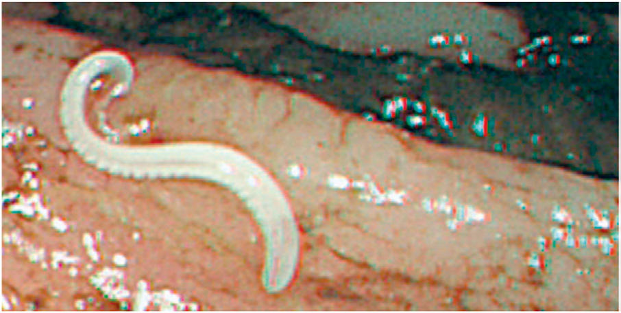

# Chapter 339: Trichuriasis (Trichuris trichiura) — Active-Recall Flashcards
**Part XV: Infectious Diseases** | [📖 Read Wiki Chapter](../chapters/339.md) | [📝 Chapter MCQs](../mcqs/339_mcqs.md) | [🏠 Course Master Index](../../index.md)

Total cards: **8** *(Click any card below to reveal the answer)*

### Card 1 (Syndrome & Clinical Profile)

<b>Q:</b> What are the hallmark clinical features and diagnostic profile of **Trichuriasis (Trichuris trichiura)**?

**Answer:**
**Category / Inheritance:** Infectious Diseases **Clinical Synthesis:** DIAGNOSIS Because egg output is so high, fecal smears frequently reveal the char acteristic barrel-shaped ova of T. trichiura.

### Card 2 (Pediatric Therapeutics & Management)

<b>Q:</b> What is the clinical management or therapeutic approach for **Trichuriasis (Trichuris trichiura)**?

**Answer:**
**Therapy / Protocol:** Drug of choice **Clinical Application:** TREATMENT Albendazole (400 mg orally for 3 days, for all ages) is the drug of choice and is safe and effective, in part because it is poorly absorbed from the gastrointestinal tract.

### Card 3 (Core Pediatric Concept)

<b>Q:</b> In the pediatric evaluation of **Trichuriasis (Trichuris trichiura)** (*Trichuriasis (Trichuris trichiura)*), how is **EPIDEMIOLOGY** characterized?

**Answer:**
EPIDEMIOLOGY Trichuriasis occurs throughout the world and is especially common in poor rural communities with inadequate sanitary facilities and soil contaminated with human or animal feces.

### Card 4 (Core Pediatric Concept)

<b>Q:</b> In the pediatric evaluation of **Trichuriasis (Trichuris trichiura)** (*Trichuriasis (Trichuris trichiura)*), how is **CLINICAL MANIFESTATIONS** characterized?

**Answer:**
CLINICAL MANIFESTATIONS Most persons harbor low worm burdens and do not have symptoms.

### Card 5 (Core Pediatric Concept)

<b>Q:</b> In the pediatric evaluation of **Trichuriasis (Trichuris trichiura)** (*Trichuriasis (Trichuris trichiura)*), how is **DIAGNOSIS** characterized?

**Answer:**
DIAGNOSIS Because egg output is so high, fecal smears frequently reveal the char acteristic barrel-shaped ova of *T.

### Card 6 (Visual Diagnosis & Clinical Spotter)

<b>Q:</b> Identify the pediatric clinical finding, imaging sign, or mechanism illustrated in **Fig. 339.1** (*Trichuriasis (Trichuris trichiura)*):

**Answer:**
Trichuris trichiura. Soil-transmitted helminth eggs. (From Bethony J, Brooker S, Albonico M, et al. Soil-transmitted helminth in fections: ascariasis, trichuriasis, and hookworm. Lancet. 2006;367:1521– 1532.)

### Card 7 (Visual Diagnosis & Clinical Spotter)

<b>Q:</b> Identify the pediatric clinical finding, imaging sign, or mechanism illustrated in **Fig. 339.2** (*Trichuriasis (Trichuris trichiura)*):

**Answer:**
Trichuris trichiura infection. (Courtesy Dr. Kunimitsu Inoue, Nakamura Hospital, Oita, Japan.)

### Card 8 (High-Yield Board Pearl)

<b>Q:</b> What is a high-yield clinical or diagnostic principle regarding **Trichuriasis (Trichuris trichiura)** (*Trichuriasis (Trichuris trichiura)*)?

**Answer:**
DIAGNOSIS Because egg output is so high, fecal smears frequently reveal the char acteristic barrel-shaped ova of T. trichiura.

