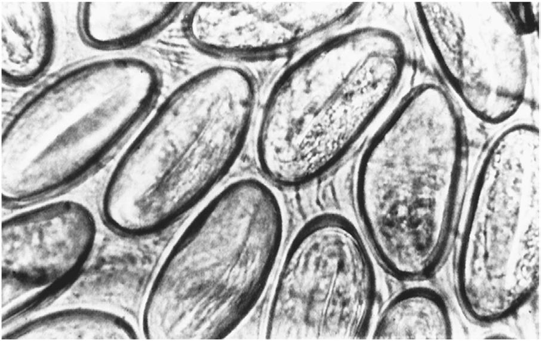

# Chapter 340: Enterobiasis (Enterobius vermicularis) — Active-Recall Flashcards
**Part XV: Infectious Diseases** | [📖 Read Wiki Chapter](../chapters/340.md) | [📝 Chapter MCQs](../mcqs/340_mcqs.md) | [🏠 Course Master Index](../../index.md)

Total cards: **8** *(Click any card below to reveal the answer)*

### Card 1 (Syndrome & Clinical Profile)

<b>Q:</b> What are the hallmark clinical features and diagnostic profile of **Enterobiasis (Enterobius vermicularis)**?

**Answer:**
**Category / Inheritance:** Infectious Diseases **Clinical Synthesis:** It is prevalent in regions with temperate climates and is the most common helminth infection in the United States.

### Card 2 (Pediatric Therapeutics & Management)

<b>Q:</b> What is the clinical management or therapeutic approach for **Enterobiasis (Enterobius vermicularis)**?

**Answer:**
**Therapy / Protocol:** Treatment of choice **Clinical Application:** Albendazole (400 mg orally with a repeat dose 2 week later for all age-groups) is the treatment of choice and results in cure rates exceeding 90%.

### Card 3 (Core Pediatric Concept)

<b>Q:</b> In the pediatric evaluation of **Enterobiasis (Enterobius vermicularis)** (*Enterobiasis (Enterobius vermicularis)*), how is **EPIDEMIOLOGY** characterized?

**Answer:**
EPIDEMIOLOGY Enterobiasis infection occurs in individuals of all ages and socioeco nomic levels.

### Card 4 (Core Pediatric Concept)

<b>Q:</b> In the pediatric evaluation of **Enterobiasis (Enterobius vermicularis)** (*Enterobiasis (Enterobius vermicularis)*), how is **Autoinoculation** characterized?

**Answer:**
Autoinoculation can occur in individu als who habitually put their fingers in their mouth.

### Card 5 (Core Pediatric Concept)

<b>Q:</b> In the pediatric evaluation of **Enterobiasis (Enterobius vermicularis)** (*Enterobiasis (Enterobius vermicularis)*), how is **CLINICAL MANIFESTATIONS** characterized?

**Answer:**
CLINICAL MANIFESTATIONS Pinworm infection is innocuous and rarely causes serious medical problems.

### Card 6 (Visual Diagnosis & Clinical Spotter)

<b>Q:</b> Identify the pediatric clinical finding, imaging sign, or mechanism illustrated in **Fig. 340.1** (*Enterobiasis (Enterobius vermicularis)*):

**Answer:**
Eggs of Enterobius vermicularis. (From Guerrant RL, Walker DH, Weller PF, et al. Tropical Infectious Diseases. Philadelphia: Churchill Livingstone, 2006. p. 1248.)

### Card 7 (High-Yield Board Pearl)

<b>Q:</b> What is a high-yield clinical or diagnostic principle regarding **Enterobiasis (Enterobius vermicularis)** (*Enterobiasis (Enterobius vermicularis)*)?

**Answer:**
It is prevalent in regions with temperate climates and is the most common helminth infection in the United States.

### Card 8 (Pathophysiology & Diagnosis)

<b>Q:</b> What core clinical principle governs **Enterobiasis (Enterobius vermicularis)** in **Enterobiasis (Enterobius vermicularis)**?

**Answer:**
EPIDEMIOLOGY Enterobiasis infection occurs in individuals of all ages and socioeco nomic levels.

