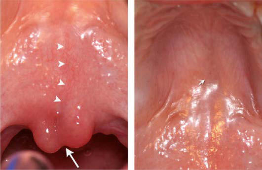

# Chapter 351: Normal Digestive Tract Phenomena — Active-Recall Flashcards
**Part XVI: The Digestive System** | [📖 Read Wiki Chapter](../chapters/351.md) | [📝 Chapter MCQs](../mcqs/351_mcqs.md) | [🏠 Course Master Index](../../index.md)

Total cards: **7** *(Click any card below to reveal the answer)*

### Card 1 (Syndrome & Clinical Profile)

<b>Q:</b> What are the hallmark clinical features and diagnostic profile of **Normal Digestive Tract Phenomena**?

**Answer:**
**Category / Inheritance:** The Digestive System **Clinical Synthesis:** Gastrointestinal function varies with maturity; what is a physiologic event in a newborn or infant might be a pathologic symptom at an older age.

### Card 2 (Pediatric Therapeutics & Management)

<b>Q:</b> What is the clinical management or therapeutic approach for **Normal Digestive Tract Phenomena**?

**Answer:**
**Therapy / Protocol:** Pediatric Clinical Management **Clinical Application:** Gastrointestinal function varies with maturity; what is a physiologic event in a newborn or infant might be a pathologic symptom at an older age.

### Card 3 (Core Pediatric Concept)

<b>Q:</b> In the pediatric evaluation of **Normal Digestive Tract Phenomena** (*Normal Digestive Tract Phenomena*), how is **short lingual frenulum** characterized?

**Answer:**
short lingual frenulum (“tongue-tie”) may be worrisome to parents but only rarely interferes with nursing, bottle feeding, eating, or speech, generally requiring no treatment.

### Card 4 (Core Pediatric Concept)

<b>Q:</b> In the pediatric evaluation of **Normal Digestive Tract Phenomena** (*Normal Digestive Tract Phenomena*), how is **Surface furrowing** characterized?

**Answer:**
Surface furrowing of the tongue (a geographic or scrotal tongue) is usually a normal finding.

### Card 5 (Core Pediatric Concept)

<b>Q:</b> In the pediatric evaluation of **Normal Digestive Tract Phenomena** (*Normal Digestive Tract Phenomena*), how is **bifid uvula** characterized?

**Answer:**
bifid uvula may be isolated or associated with a submucous cleft of the soft palate (Fig.

### Card 6 (Visual Diagnosis & Clinical Spotter)

<b>Q:</b> Identify the pediatric clinical finding, imaging sign, or mechanism illustrated in **Fig. 351.1** (*Normal Digestive Tract Phenomena*):

**Answer:**
Classic submucous cleft palate with triad of bifid uvula (large arrow), furrow along the midline of the soft palate (arrowheads), and a notch in the posterior margin of the hard palate (small arrow). The midline furrow is sometimes referred to as the zona pellucida, reflect ing the translucent nature of this area in some patients. (From Hasan A, Gardner A, Devlin M, Russell C. Submucous cleft palate with bifid uvula. J Pediatr. 2014;165:872.)

### Card 7 (Pathophysiology & Diagnosis)

<b>Q:</b> What core clinical principle governs **Normal Digestive Tract Phenomena** in **Normal Digestive Tract Phenomena**?

**Answer:**
Gastrointestinal function varies with maturity; what is a physiologic event in a newborn or infant might be a pathologic symptom at an older age.

