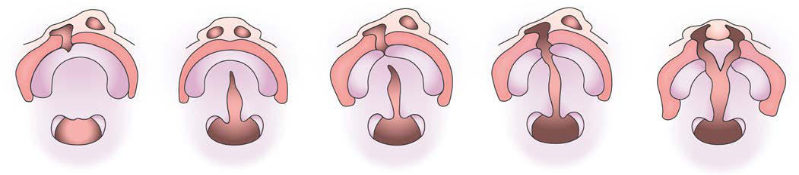

# Chapter 356: Cleft Lip and Palate — Active-Recall Flashcards
**Part XVI: The Digestive System** | [📖 Read Wiki Chapter](../chapters/356.md) | [📝 Chapter MCQs](../mcqs/356_mcqs.md) | [🏠 Course Master Index](../../index.md)

Total cards: **8** *(Click any card below to reveal the answer)*

### Card 1 (Syndrome & Clinical Profile)

<b>Q:</b> What are the hallmark clinical features and diagnostic profile of **Cleft Lip and Palate**?

**Answer:**
**Category / Inheritance:** The Digestive System **Clinical Synthesis:** The flush terminal plane relationship, where the distal surface of mandibular second primary molar is flush with the distal surface of maxillary second primary molar, is most common and can translate into class I occlusion or class II malocclusion in permanent dentition.

### Card 2 (Pediatric Therapeutics & Management)

<b>Q:</b> What is the clinical management or therapeutic approach for **Cleft Lip and Palate**?

**Answer:**
**Therapy / Protocol:** Management **Clinical Application:** POSTOPERATIVE MANAGEMENT During the immediate postoperative period, special nursing care is essential.

### Card 3 (Core Pediatric Concept)

<b>Q:</b> In the pediatric evaluation of **Cleft Lip and Palate** (*Cleft Lip and Palate*), how is **flush terminal plane** characterized?

**Answer:**
flush terminal plane relationship, where the distal surface of mandibular second primary molar is flush with the distal surface of maxillary second primary molar, is most common and can translate into class I occlusion or class II malocclusion in permanent dentition.

### Card 4 (Core Pediatric Concept)

<b>Q:</b> In the pediatric evaluation of **Cleft Lip and Palate** (*Cleft Lip and Palate*), how is **mesial step** characterized?

**Answer:**
mesial step relationship, where the distal surface of mandibular second primary molar lies mesial to the dis tal surface of maxillary second primary molar, is the second most common and often translates into class I occlusion or sometimes into class III malocclusion in permanent dentition.

### Card 5 (Core Pediatric Concept)

<b>Q:</b> In the pediatric evaluation of **Cleft Lip and Palate** (*Cleft Lip and Palate*), how is **distal step** characterized?

**Answer:**
distal step relationship, where the distal surface of the mandibular second primary molar lies distal to the distal surface of maxillary second primary molar, almost always translates into class II occlusion in per manent dentition.

### Card 6 (Visual Diagnosis & Clinical Spotter)

<b>Q:</b> Identify the pediatric clinical finding, imaging sign, or mechanism illustrated in **Fig. 356.1** (*Cleft Lip and Palate*):

**Answer:**
Nonsyndromic orofacial clefts. A, Cleft lip and alveolus. B, Cleft palate. C, Incomplete unilateral cleft lip and palate. D, Complete unilateral cleft lip and palate. E, Complete bilateral cleft lip and palate. (From Shaw WC. Orthodontics and Occlusal Management. Oxford, UK: Butterworth-Heinemann; 1993.)

### Card 7 (High-Yield Board Pearl)

<b>Q:</b> What is a high-yield clinical or diagnostic principle regarding **Cleft Lip and Palate** (*Cleft Lip and Palate*)?

**Answer:**
The flush terminal plane relationship, where the distal surface of mandibular second primary molar is flush with the distal surface of maxillary second primary molar, is most common and can translate into class I occlusion or class II malocclusion in permanent dentition.

### Card 8 (Pathophysiology & Diagnosis)

<b>Q:</b> What core clinical principle governs **Cleft Lip and Palate** in **Cleft Lip and Palate**?

**Answer:**
The molar relationship in primary dentition/baby teeth also has three main types.

