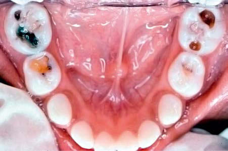

# Chapter 358: Dental Caries — Active-Recall Flashcards
**Part XVI: The Digestive System** | [📖 Read Wiki Chapter](../chapters/358.md) | [📝 Chapter MCQs](../mcqs/358_mcqs.md) | [🏠 Course Master Index](../../index.md)

Total cards: **8** *(Click any card below to reveal the answer)*

### Card 1 (Syndrome & Clinical Profile)

<b>Q:</b> What are the hallmark clinical features and diagnostic profile of **CLINICAL PRESENTATION**?

**Answer:**
**Category / Inheritance:** The Digestive System **Clinical Synthesis:** Dentoalveolar; Swelling of the alveolar ridge with; periodontal, periapical, and subperiosteal; abscess; Submental space; Firm midline swelling beneath the chin;; caused by infection from the mandibular; incisors; Submandibular space; Swelling of the submandibular triangle; of the neck around the angle of the; mandible

### Card 2 (Syndrome & Clinical Profile)

<b>Q:</b> What are the hallmark clinical features and diagnostic profile of **Dental Caries**?

**Answer:**
**Category / Inheritance:** The Digestive System **Clinical Synthesis:** Current evidence supports the use of a chronic disease management model to modify risk factors and manage dental caries.

### Card 3 (Pediatric Therapeutics & Management)

<b>Q:</b> What is the clinical management or therapeutic approach for **Dental Caries**?

**Answer:**
**Therapy / Protocol:** Management **Clinical Application:** Current evidence supports the use of a chronic disease management model to modify risk factors and manage dental caries.

### Card 4 (Core Pediatric Concept)

<b>Q:</b> In the pediatric evaluation of **Dental Caries** (*Dental Caries*), how is **EPIDEMIOLOGY** characterized?

**Answer:**
EPIDEMIOLOGY As per the 2011–2012 National Health and Nutrition Examination Sur vey (NHANES), approximately 15% of children ranging from 2 to 8 years of age had one or more primary teeth affected by dental caries (Fig.

### Card 5 (Core Pediatric Concept)

<b>Q:</b> In the pediatric evaluation of **Dental Caries** (*Dental Caries*), how is **CLINICAL MANIFESTATIONS** characterized?

**Answer:**
CLINICAL MANIFESTATIONS Dental caries of the primary dentition usually begins in the pits and fissures.

### Card 6 (Core Pediatric Concept)

<b>Q:</b> In the pediatric evaluation of **Dental Caries** (*Dental Caries*), how is **COMPLICATIONS** characterized?

**Answer:**
COMPLICATIONS Left untreated, dental caries usually destroy most of the tooth and invade the dental pulp (Fig.

### Card 7 (Visual Diagnosis & Clinical Spotter)

<b>Q:</b> Identify the pediatric clinical finding, imaging sign, or mechanism illustrated in **Fig. 358.1** (*Dental Caries*):

**Answer:**
Initial carious lesions (white spot lesions) around the necks of the maxillary central incisors.

### Card 8 (Visual Diagnosis & Clinical Spotter)

<b>Q:</b> Identify the pediatric clinical finding, imaging sign, or mechanism illustrated in **Fig. 358.4** (*Dental Caries*):

**Answer:**
Rampant caries in a 3-yr-old child. Note darkened and cavitated lesions on the fissure surfaces of mandibular molars.

