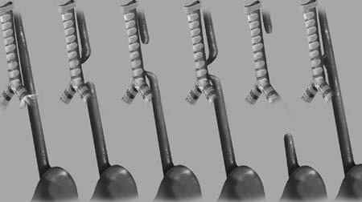

# Chapter 365: Congenital Anomalies — Active-Recall Flashcards
**Part XVI: The Digestive System** | [📖 Read Wiki Chapter](../chapters/365.md) | [📝 Chapter MCQs](../mcqs/365_mcqs.md) | [🏠 Course Master Index](../../index.md)

Total cards: **8** *(Click any card below to reveal the answer)*

### Card 1 (Syndrome & Clinical Profile)

<b>Q:</b> What are the hallmark clinical features and diagnostic profile of **MRI/CT (Congenital Anomalies)**?

**Answer:**
**Category / Inheritance:** The Digestive System **Clinical Synthesis:** Surgery; Vascular anomaly; Infants to adults; Dyspnea, stridor, cough (infants); Dysphagia (adults); Esophagogram*; Angiography†

### Card 2 (Syndrome & Clinical Profile)

<b>Q:</b> What are the hallmark clinical features and diagnostic profile of **MRI/CT/EUS (Congenital Anomalies)**?

**Answer:**
**Category / Inheritance:** The Digestive System **Clinical Synthesis:** Dietary modification‡; Surgery§; Esophageal ring; Children to adults; Dysphagia; Esophagogram; Endoscopy†; Dilation‡; Endoscopic incision§; Esophageal web; Children to adults; Dysphagia; Esophagogram; Endoscopy†; Bougienage; *Diagnostic test of choice.; †Confirmatory test.; ‡Primary therapeutic approach.; §Secondary th

### Card 3 (Pediatric Therapeutics & Management)

<b>Q:</b> What is the clinical management or therapeutic approach for **Congenital Anomalies (365.1 Esophageal Atresia and Tracheoesophageal Fistula)**?

**Answer:**
**Therapy / Protocol:** Management **Clinical Application:** MANAGEMENT Initially, maintaining a patent airway, preoperative proximal pouch decompression to prevent aspiration of oral secretions, and use of antibiotics to prevent consequent pneumonia are paramount.

### Card 4 (Core Pediatric Concept)

<b>Q:</b> In the pediatric evaluation of **Congenital Anomalies** (*365.1 Esophageal Atresia and Tracheoesophageal Fistula*), how is **PRESENTATION** characterized?

**Answer:**
PRESENTATION The neonate with EA typically has frothing and bubbling at the mouth and nose after birth as well as episodes of coughing, cyanosis, and respiratory distress.

### Card 5 (Core Pediatric Concept)

<b>Q:</b> In the pediatric evaluation of **Congenital Anomalies** (*365.1 Esophageal Atresia and Tracheoesophageal Fistula*), how is **DIAGNOSIS** characterized?

**Answer:**
DIAGNOSIS In the setting of polyhydramnios, early-onset respiratory distress and the inability to pass a nasogastric or orogastric tube in the new born suggests EA.

### Card 6 (Core Pediatric Concept)

<b>Q:</b> In the pediatric evaluation of **Congenital Anomalies** (*365.1 Esophageal Atresia and Tracheoesophageal Fistula*), how is **MANAGEMENT** characterized?

**Answer:**
MANAGEMENT Initially, maintaining a patent airway, preoperative proximal pouch decompression to prevent aspiration of oral secretions, and use of antibiotics to prevent consequent pneumonia are paramount.

### Card 7 (Visual Diagnosis & Clinical Spotter)

<b>Q:</b> Identify the pediatric clinical finding, imaging sign, or mechanism illustrated in **Fig. 365.1** (*Congenital Anomalies*):

**Answer:**
Gross type classification and esophageal atresia (EA) and trachea-esophageal fistulas (TEF). Left to right: normal anatomy, gross type B (EA with proximal TEF; 2%), gross type C (EA with distal TEF; 86%), gross type D (EA with proximal and distal TEF; 1%), gross type A (pure EA, 7%), and gross type E (TEF without EA; 4%). (From Harrington AW, Riebold J, Hernandez K, et al. Feeding and growth outcomes in in fants with type C esophageal atresia who undergo early primary repair. J Pediatr. 2022;241:77–82, Fig. 1.)

### Card 8 (High-Yield Board Pearl)

<b>Q:</b> What is a high-yield clinical or diagnostic principle regarding **365.1 Esophageal Atresia and Tracheoesophageal Fistula** (*Congenital Anomalies*)?

**Answer:**
Esophageal atresia (EA) is the most common congenital anomaly of the esophagus, with a prevalence of 1.7 per 10,000 live births.

