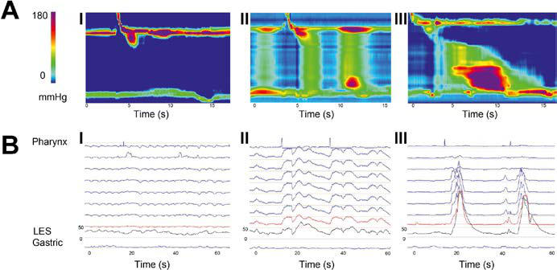
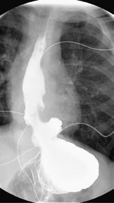

# Chapter 368: Hiatal Hernia — Active-Recall Flashcards
**Part XVI: The Digestive System** | [📖 Read Wiki Chapter](../chapters/368.md) | [📝 Chapter MCQs](../mcqs/368_mcqs.md) | [🏠 Course Master Index](../../index.md)

Total cards: **6** *(Click any card below to reveal the answer)*

### Card 1 (Syndrome & Clinical Profile)

<b>Q:</b> What are the hallmark clinical features and diagnostic profile of **Hiatal Hernia**?

**Answer:**
**Category / Inheritance:** The Digestive System **Clinical Synthesis:** Diagnosis is usually made by an upper gastrointestinal series and upper endos copy.

### Card 2 (Pediatric Therapeutics & Management)

<b>Q:</b> What is the clinical management or therapeutic approach for **Hiatal Hernia**?

**Answer:**
**Therapy / Protocol:** Pediatric Clinical Management **Clinical Application:** A, No dis tal pressurization is observed in type I (AI), whereas panesophageal pressurizations and spastic contrac tions are observed in type II (AII) and type III (AIII), re spectively.

### Card 3 (Visual Diagnosis & Clinical Spotter)

<b>Q:</b> Identify the pediatric clinical finding, imaging sign, or mechanism illustrated in **Fig. 367.2** (*Hiatal Hernia*):

**Answer:**
Based on the residual wave type on high-resolution esophageal manometry (HRM), three subtypes of achalasia can be determined. A, No dis tal pressurization is observed in type I (AI), whereas panesophageal pressurizations and spastic contrac tions are observed in type II (AII) and type III (AIII), re spectively. B, A similar classification can be made when conventional manometry is used. Note that pressure recordings in type II achalasia are similar in every line tracing, compatible with panesophageal pressurization. LES, Lower esophageal sphincter. (From Rohof WO, Sal vador R, Annese V. Outcomes of treatment for achalasia depend on manometric subtype. Gastroenterology. 2013;144:718–725. Fig. 1.)

### Card 4 (Visual Diagnosis & Clinical Spotter)

<b>Q:</b> Identify the pediatric clinical finding, imaging sign, or mechanism illustrated in **Fig. 368.2** (*Hiatal Hernia*):

**Answer:**
A, An upper gastrointestinal series shows a large hiatal hernia that extends above the diaphragm and impedes the exit of con trast from the esophagus into the stomach. Contrast is also noted to reflux to the upper esophagus. B, A retroflexed view of the hernia from the stomach during an upper endoscopy.

### Card 5 (High-Yield Board Pearl)

<b>Q:</b> What is a high-yield clinical or diagnostic principle regarding **Hiatal Hernia** (*Hiatal Hernia*)?

**Answer:**
Diagnosis is usually made by an upper gastrointestinal series and upper endos copy.

### Card 6 (Pathophysiology & Diagnosis)

<b>Q:</b> What core clinical principle governs **Hiatal Hernia** in **Hiatal Hernia**?

**Answer:**
A, No dis tal pressurization is observed in type I (AI), whereas panesophageal pressurizations and spastic contrac tions are observed in type II (AII) and type III (AIII), re spectively.

