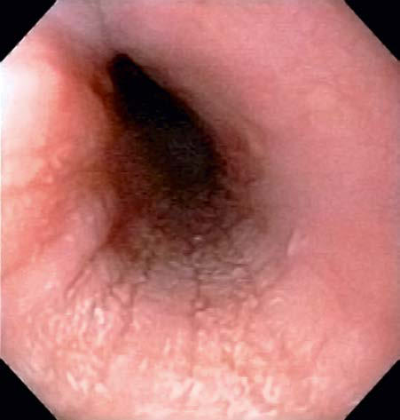

# Chapter 370: Eosinophilic Esophagitis, Pill Esophagitis, and Infective Esophagitis — Active-Recall Flashcards
**Part XVI: The Digestive System** | [📖 Read Wiki Chapter](../chapters/370.md) | [📝 Chapter MCQs](../mcqs/370_mcqs.md) | [🏠 Course Master Index](../../index.md)

Total cards: **6** *(Click any card below to reveal the answer)*

### Card 1 (Syndrome & Clinical Profile)

<b>Q:</b> What are the hallmark clinical features and diagnostic profile of **Eosinophilic Esophagitis, Pill Esophagitis, and Infective Esophagitis**?

**Answer:**
**Category / Inheritance:** The Digestive System **Clinical Synthesis:** Esophageal histology reveals profound eosinophilia, with a currently acceptable cutoff for diagnosis chosen at ≥15-20 eosinophils per hpf.

### Card 2 (Pediatric Therapeutics & Management)

<b>Q:</b> What is the clinical management or therapeutic approach for **Eosinophilic Esophagitis, Pill Esophagitis, and Infective Esophagitis**?

**Answer:**
**Therapy / Protocol:** First-line **Clinical Application:** Topically acting swallowed corticosteroids (fluticasone with out spacer, viscous budesonide suspension) are the only therapy strongly recommended based on moderate quality evidence as first-line therapy, as well as for those who refuse, fail to adhere, or have a poor response to

### Card 3 (Visual Diagnosis & Clinical Spotter)

<b>Q:</b> Identify the pediatric clinical finding, imaging sign, or mechanism illustrated in **Fig. 370.1** (*Eosinophilic Esophagitis, Pill Esophagitis, and Infective Esophagitis*):

**Answer:**
Endoscopic visualization of esophageal food impaction (yellow arrow) and mucosal rings (blue arrows).

### Card 4 (Visual Diagnosis & Clinical Spotter)

<b>Q:</b> Identify the pediatric clinical finding, imaging sign, or mechanism illustrated in **Fig. 370.2** (*Eosinophilic Esophagitis, Pill Esophagitis, and Infective Esophagitis*):

**Answer:**
Eosinophilic esophagitis. Graphical representation of symptoms and endoscopic findings by age. (Modified from Oliva S, Dias JA, Rea F, et al. Characterization of eosinophilic esophagitis from the European pediatric eosinophilic esophagitis registry [pEEr] or ES PGHAN. J Pediatr Gastroenterol Nutr. 2022;75[3]:325–333. Fig. 2.)

### Card 5 (High-Yield Board Pearl)

<b>Q:</b> What is a high-yield clinical or diagnostic principle regarding **Eosinophilic Esophagitis, Pill Esophagitis, and Infective Esophagitis** (*Eosinophilic Esophagitis, Pill Esophagitis, and Infective Esophagitis*)?

**Answer:**
Esophageal histology reveals profound eosinophilia, with a currently acceptable cutoff for diagnosis chosen at ≥15-20 eosinophils per hpf.

### Card 6 (Pathophysiology & Diagnosis)

<b>Q:</b> What core clinical principle governs **Eosinophilic Esophagitis, Pill Esophagitis, and Infective Esophagitis** in **Eosinophilic Esophagitis, Pill Esophagitis, and Infective Esophagitis**?

**Answer:**
Esophageal histology reveals profound eosinophilia, with a currently acceptable cutoff for diagnosis chosen at ≥15-20 eosinophils per hpf.

