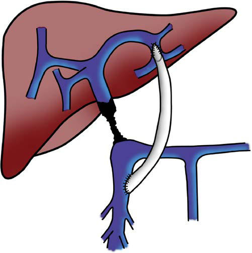

# Chapter 372: Esophageal Varices — Active-Recall Flashcards
**Part XVI: The Digestive System** | [📖 Read Wiki Chapter](../chapters/372.md) | [📝 Chapter MCQs](../mcqs/372_mcqs.md) | [🏠 Course Master Index](../../index.md)

Total cards: **6** *(Click any card below to reveal the answer)*

### Card 1 (Syndrome & Clinical Profile)

<b>Q:</b> What are the hallmark clinical features and diagnostic profile of **Esophageal Varices**?

**Answer:**
**Category / Inheritance:** The Digestive System **Clinical Synthesis:** Meso-Rex bypass for the management of extrahepatic portal vein obstruction in adults.

### Card 2 (Pediatric Therapeutics & Management)

<b>Q:</b> What is the clinical management or therapeutic approach for **Esophageal Varices**?

**Answer:**
**Therapy / Protocol:** Management **Clinical Application:** Meso-Rex bypass for the management of extrahepatic portal vein obstruction in adults.

### Card 3 (Visual Diagnosis & Clinical Spotter)

<b>Q:</b> Identify the pediatric clinical finding, imaging sign, or mechanism illustrated in **Fig. 372.1** (*Esophageal Varices*):

**Answer:**
Meso-Rex bypass between the superior mesenteric vein (SMV) and the Rex recess (RR) of the left portal vein. IMV, Inferior mes enteric vein; MRB, Meso-Rex bypass; SV, splenic vein. (From Brichard M, Iesari S, Lerut J, et al. Meso-Rex bypass for the management of extrahepatic portal vein obstruction in adults. Hepatobiliary Pancreat Dis Int. 2022;21:25–32. Fig. 3.)

### Card 4 (High-Yield Board Pearl)

<b>Q:</b> What is a high-yield clinical or diagnostic principle regarding **Esophageal Varices** (*Esophageal Varices*)?

**Answer:**
Meso-Rex bypass for the management of extrahepatic portal vein obstruction in adults.

### Card 5 (Pathophysiology & Diagnosis)

<b>Q:</b> What core clinical principle governs **Esophageal Varices** in **Esophageal Varices**?

**Answer:**
IMV, Inferior mes enteric vein; MRB, Meso-Rex bypass; SV, splenic vein. (From Brichard M, Iesari S, Lerut J, et al.

### Card 6 (Epidemiology & Clinical Presentation)

<b>Q:</b> What is the primary clinical focus and presentation of **Esophageal Varices** in pediatric practice?

**Answer:**
Meso-Rex bypass for the management of extrahepatic portal vein obstruction in adults.

