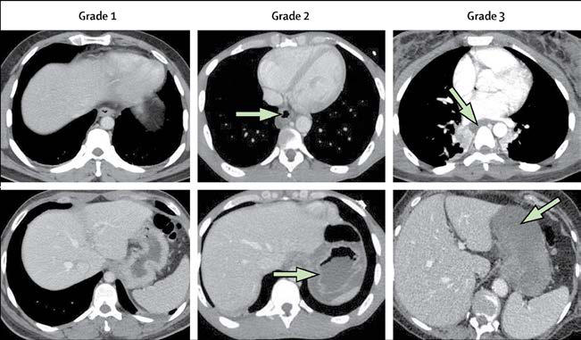

# Chapter 374: Normal Development, Structure, and Function of the Stomach and Intestines — Active-Recall Flashcards
**Part XVI: The Digestive System** | [📖 Read Wiki Chapter](../chapters/374.md) | [📝 Chapter MCQs](../mcqs/374_mcqs.md) | [🏠 Course Master Index](../../index.md)

Total cards: **8** *(Click any card below to reveal the answer)*

### Card 1 (Syndrome & Clinical Profile)

<b>Q:</b> What are the hallmark clinical features and diagnostic profile of **CLINICAL SIGNIFICANCE**?

**Answer:**
**Category / Inheritance:** The Digestive System **Clinical Synthesis:** Grade 0; History of ingestion but no visible damage or symptoms; Able to take fluids immediately; Grade 1; Edema, loss of normal vascular pattern, hyperemia, no; transmucosal injury; Temporary dysphagia, able to swallow within 0-2 days, no; long-term sequelae; Grade 2a; Transmucosal injury with friability, hemorrhage,

### Card 2 (Syndrome & Clinical Profile)

<b>Q:</b> What are the hallmark clinical features and diagnostic profile of **Normal Development, Structure, and Function of the Stomach and Intestines**?

**Answer:**
**Category / Inheritance:** The Digestive System **Clinical Synthesis:** The most common motor activity in the colon is nonpro pulsive rhythmic segmentation that acts to mix the chyme and expose the contents to the colonic mucosa.

### Card 3 (Pediatric Therapeutics & Management)

<b>Q:</b> What is the clinical management or therapeutic approach for **Normal Development, Structure, and Function of the Stomach and Intestines**?

**Answer:**
**Therapy / Protocol:** Insulin **Clinical Application:** In the gut, several growth factors, including growth factor-β, insulin-like growth factor, and growth factors found in human colostrum (human growth factor and epidermal growth factor), influence gene expression.

### Card 4 (Core Pediatric Concept)

<b>Q:</b> In the pediatric evaluation of **Normal Development, Structure, and Function of the Stomach and Intestines** (*Normal Development, Structure, and Function of the Stomach and Intestines*), how is **DEVELOPMENT** characterized?

**Answer:**
DEVELOPMENT The primitive gut is recognizable by the fourth week of gestation and is composed of the foregut, midgut, and hindgut.

### Card 5 (Core Pediatric Concept)

<b>Q:</b> In the pediatric evaluation of **Normal Development, Structure, and Function of the Stomach and Intestines** (*Normal Development, Structure, and Function of the Stomach and Intestines*), how is **midgut** characterized?

**Answer:**
midgut gives rise to the rest of the small bowel and the large bowel to the level of the midtransverse colon.

### Card 6 (Core Pediatric Concept)

<b>Q:</b> In the pediatric evaluation of **Normal Development, Structure, and Function of the Stomach and Intestines** (*Normal Development, Structure, and Function of the Stomach and Intestines*), how is **hindgut** characterized?

**Answer:**
hindgut forms the remain der of the colon and upper anal canal.

### Card 7 (Visual Diagnosis & Clinical Spotter)

<b>Q:</b> Identify the pediatric clinical finding, imaging sign, or mechanism illustrated in **Fig. 373.5** (*Normal Development, Structure, and Function of the Stomach and Intestines*):

**Answer:**
CT grading of corrosive injuries of the esophagus and the stomach. Grade 1, normal appear ance; grade 2, wall and soft tissue edema, increased wall enhancement (arrow); grade 3, transmural necrosis with absent wall enhancement (arrow). (From Chirica M, Bonavina L, Kelly MD, et al. Caustic ingestion. Lancet. 2017;389:2041–2050. Fig. 1.)

### Card 8 (High-Yield Board Pearl)

<b>Q:</b> What is a high-yield clinical or diagnostic principle regarding **Normal Development, Structure, and Function of the Stomach and Intestines** (*Normal Development, Structure, and Function of the Stomach and Intestines*)?

**Answer:**
The most common motor activity in the colon is nonpro pulsive rhythmic segmentation that acts to mix the chyme and expose the contents to the colonic mucosa.

