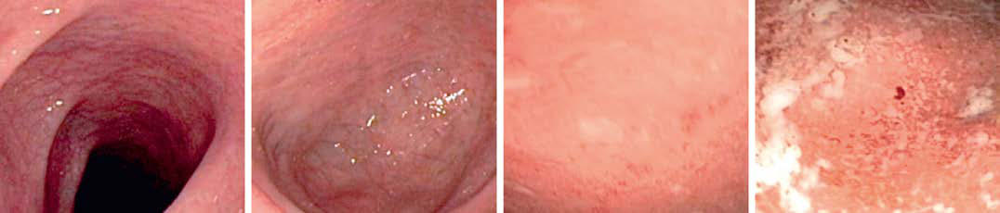

# Chapter 382: Inflammatory Bowel Disease — Active-Recall Flashcards
**Part XVI: The Digestive System** | [📖 Read Wiki Chapter](../chapters/382.md) | [📝 Chapter MCQs](../mcqs/382_mcqs.md) | [🏠 Course Master Index](../../index.md)

Total cards: **8** *(Click any card below to reveal the answer)*

### Card 1 (Syndrome & Clinical Profile)

<b>Q:</b> What are the hallmark clinical features and diagnostic profile of **NOD2 (Inflammatory Bowel Disease)**?

**Answer:**
**Associated Gene(s):** `NOD2` · **Category / Inheritance:** The Digestive System **Clinical Synthesis:** Nucleotide-binding; oligomerization; domain- containing protein 2; Crohn disease; Bacterial recognition and response, NFκB; activation and autophagy and apoptosis; Innate mucosal defense

### Card 2 (Syndrome & Clinical Profile)

<b>Q:</b> What are the hallmark clinical features and diagnostic profile of **IL-10 (Inflammatory Bowel Disease)**?

**Answer:**
**Category / Inheritance:** The Digestive System **Clinical Synthesis:** Crohn disease; Antiinflammatory cytokine, NFκB inhibition,; JAK-STAT regulation; Immune tolerance

### Card 3 (Syndrome & Clinical Profile)

<b>Q:</b> What are the hallmark clinical features and diagnostic profile of **IL10RA (Inflammatory Bowel Disease)**?

**Answer:**
**Associated Gene(s):** `IL10RA` · **Category / Inheritance:** The Digestive System **Clinical Synthesis:** IL-10 receptor A; Crohn disease; Antiinflammatory cytokine receptor, NFκB; inhibition, JAK-STAT regulation; Immune tolerance

### Card 4 (Pediatric Therapeutics & Management)

<b>Q:</b> What is the clinical management or therapeutic approach for **Inflammatory Bowel Disease (382.1 Chronic Ulcerative Colitis Ronen E. Stein, Sudha A. Anupindi,**?

**Answer:**
**Therapy / Protocol:** Management **Clinical Application:** Two competing concerns about this plan of management remain unresolved.

### Card 5 (Core Pediatric Concept)

<b>Q:</b> In the pediatric evaluation of **Inflammatory Bowel Disease** (*Inflammatory Bowel Disease*), how is **Extraintestinal manifestations** characterized?

**Answer:**
Extraintestinal manifestations occur slightly more commonly with Crohn disease than with ulcerative colitis (Table 382.

### Card 6 (Core Pediatric Concept)

<b>Q:</b> In the pediatric evaluation of **Inflammatory Bowel Disease** (*382.1 Chronic Ulcerative Colitis Ronen E. Stein, Sudha A. Anupindi, and Robert N. Baldassano*), how is **CLINICAL MANIFESTATIONS** characterized?

**Answer:**
CLINICAL MANIFESTATIONS Blood, mucus, and pus in the stool as well as diarrhea are the typi cal presentation of ulcerative colitis.

### Card 7 (Core Pediatric Concept)

<b>Q:</b> In the pediatric evaluation of **Inflammatory Bowel Disease** (*382.1 Chronic Ulcerative Colitis Ronen E. Stein, Sudha A. Anupindi, and Robert N. Baldassano*), how is **Extraintestinal manifestations** characterized?

**Answer:**
Extraintestinal manifestations that tend to occur more commonly with ulcerative colitis than with Crohn disease include pyoderma gan grenosum, sclerosing cholangitis, chronic active hepatitis, and anky losing spondylitis.

### Card 8 (Visual Diagnosis & Clinical Spotter)

<b>Q:</b> Identify the pediatric clinical finding, imaging sign, or mechanism illustrated in **Fig. 382.1** (*Inflammatory Bowel Disease*):

**Answer:**
Mayo endoscopic score for ulcerative colitis. A, Score 0 = normal; endoscopic remission. B, Score 1 = mild; erythema, decreased vas cular pattern, mild friability. C, Score 2 = moderate; marked erythema, absent vascular pattern, friability, erosions. D, Score 3 = severe; spontaneous bleeding, ulceration. (Images courtesy Elena Ricart. From Ordàs I, Eckmann L, Talamini M, et al. Ulcerative colitis. Lancet. 2012;380:1606–1616. Fig. 2, p. 1610.)

