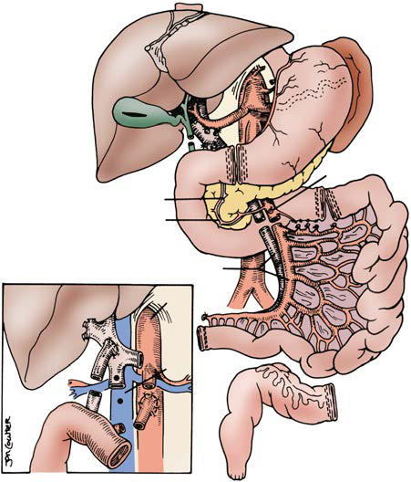

# Chapter 386: Intestinal Transplantation in Children with Intestinal Failure — Active-Recall Flashcards
**Part XVI: The Digestive System** | [📖 Read Wiki Chapter](../chapters/386.md) | [📝 Chapter MCQs](../mcqs/386_mcqs.md) | [🏠 Course Master Index](../../index.md)

Total cards: **8** *(Click any card below to reveal the answer)*

### Card 1 (Syndrome & Clinical Profile)

<b>Q:</b> What are the hallmark clinical features and diagnostic profile of **SHORT BOWEL (Intestinal Transplantation in Children with Intestinal Failure)**?

**Answer:**
**Category / Inheritance:** The Digestive System **Clinical Synthesis:** • Volvulus; • Gastroschisis; • Necrotizing enterocolitis; • Intestinal atresia; • Trauma

### Card 2 (Syndrome & Clinical Profile)

<b>Q:</b> What are the hallmark clinical features and diagnostic profile of **INTESTINAL DYSMOTILITY**?

**Answer:**
**Category / Inheritance:** The Digestive System **Clinical Synthesis:** • Intestinal pseudoobstruction

### Card 3 (Syndrome & Clinical Profile)

<b>Q:</b> What are the hallmark clinical features and diagnostic profile of **MMIHS (Intestinal Transplantation in Children with Intestinal Failure)**?

**Answer:**
**Category / Inheritance:** The Digestive System **Clinical Synthesis:** • Intestinal aganglionosis (Hirschsprung disease)

### Card 4 (Pediatric Therapeutics & Management)

<b>Q:</b> What is the clinical management or therapeutic approach for **Intestinal Transplantation in Children with Intestinal Failure**?

**Answer:**
**Therapy / Protocol:** Management **Clinical Application:** POSTOPERATIVE MANAGEMENT Immunosuppression Successful immunosuppression for intestinal transplantation occurred with the introduction of tacrolimus in addition to corticosteroids.

### Card 5 (Core Pediatric Concept)

<b>Q:</b> In the pediatric evaluation of **Intestinal Transplantation in Children with Intestinal Failure** (*Intestinal Transplantation in Children with Intestinal Failure*), how is **INDICATIONS FOR INTESTINAL TRANSPLANT** characterized?

**Answer:**
INDICATIONS FOR INTESTINAL TRANSPLANT IF describes a patient who has lost the ability to maintain nutritional support and adequate fluid requirements needed to sustain growth with their own intestine and is permanently dependent on parenteral nutrition (PN).

### Card 6 (Core Pediatric Concept)

<b>Q:</b> In the pediatric evaluation of **Intestinal Transplantation in Children with Intestinal Failure** (*Intestinal Transplantation in Children with Intestinal Failure*), how is **Paucity of Venous Access** characterized?

**Answer:**
Paucity of Venous Access Administration of PN requires the insertion of a centrally placed venous catheter, there being only six readily accessible sites (bilateral internal jugular, subclavian, iliac veins).

### Card 7 (Core Pediatric Concept)

<b>Q:</b> In the pediatric evaluation of **Intestinal Transplantation in Children with Intestinal Failure** (*Intestinal Transplantation in Children with Intestinal Failure*), how is **Life-Threatening Infections** characterized?

**Answer:**
Life-Threatening Infections Life-threatening infections are usually catheter related, although their frequency is decreasing with improvements in central venous catheter care including antimicrobial locks.

### Card 8 (Visual Diagnosis & Clinical Spotter)

<b>Q:</b> Identify the pediatric clinical finding, imaging sign, or mechanism illustrated in **Fig. 386.1** (*Intestinal Transplantation in Children with Intestinal Failure*):

**Answer:**
Various abdominal organs can be dissected in situ, provid ing isolated or composite grafts to fit the individual patient’s needs. Separation of intestine and pancreas is feasible, with preservation of the inferior pancreaticoduodenal artery (IPDA) and vein (IPDV). The use of vascular grafts from the donor allow connections to the superior mes enteric pedicle (artery [SMA] and vein [SMV]) to aorta and inferior vena cava (IVC) or portal vein (inset). MCA, Major coronary artery. (From Abu- Elmagd K, Fung J, Bueno J, et al. Logistics and technique for procure ment of intestinal, pancreatic and hepatic grafts from the same donor. Ann Surg. 2000;232:680–697.)

