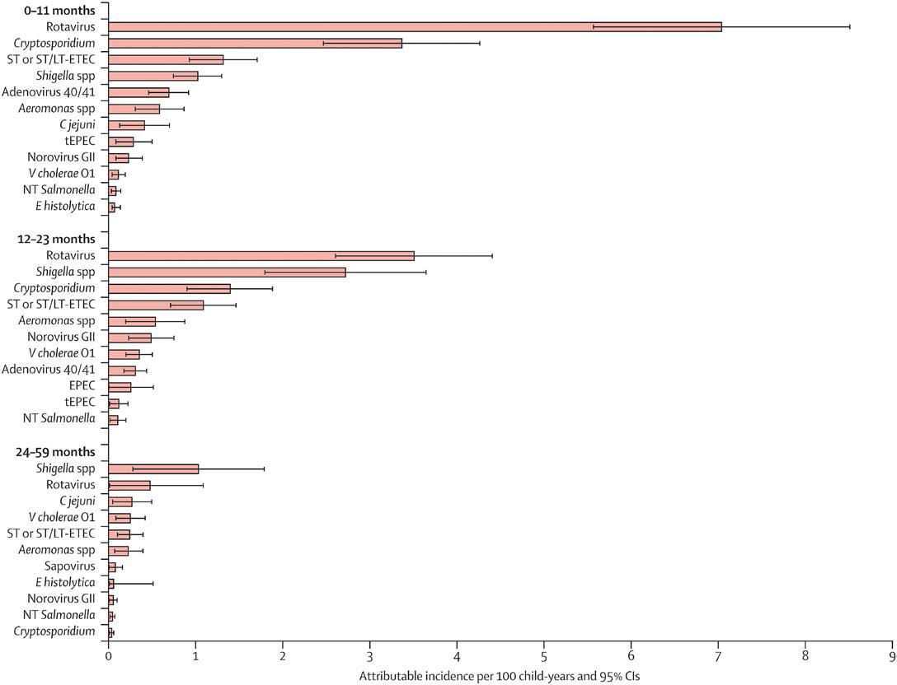

# Chapter 387: Acute Gastroenteritis in Children — Active-Recall Flashcards
**Part XVI: The Digestive System** | [📖 Read Wiki Chapter](../chapters/387.md) | [📝 Chapter MCQs](../mcqs/387_mcqs.md) | [🏠 Course Master Index](../../index.md)

Total cards: **8** *(Click any card below to reveal the answer)*

### Card 1 (Syndrome & Clinical Profile)

<b>Q:</b> What are the hallmark clinical features and diagnostic profile of **DIAGNOSTIC TEST (Acute Gastroenteritis in Children)**?

**Answer:**
**Category / Inheritance:** The Digestive System **Clinical Synthesis:** Caliciviruses; (including; noroviruses and; sapoviruses); 12-48 hr; Nausea, vomiting,; abdominal; cramping, diarrhea,; fever, myalgia, and; some headache; 1-3 days; Person-to-person; (fecal-oral and; aerosolized; vomit), and; food, water,; and fomites; contaminated; with human feces; Very contagious; (chlorine and; hea

### Card 2 (Syndrome & Clinical Profile)

<b>Q:</b> What are the hallmark clinical features and diagnostic profile of **INFECTIONS (Acute Gastroenteritis in Children)**?

**Answer:**
**Category / Inheritance:** The Digestive System **Clinical Synthesis:** Total; 22,019; 5,359 (24); 153 (0.7); 861 (4); —; Campylobacter; 8,974; 1,822 (20); 33 (0.4); 51 (0.6); 17.8; Salmonella; 7,148; 1,974 (28); 52 (0.7); 597 (8); 14.2

### Card 3 (Pediatric Therapeutics & Management)

<b>Q:</b> What is the clinical management or therapeutic approach for **COVID-19)**?

**Answer:**
**Therapy / Protocol:** Etiologies of Viral Gastroenteritis **Clinical Application:** Note: Commercially available denotes that the diagnostic tests have been cleared by the U.S. Food and Drug Administration; RT, Real-time reverse transcriptase; PCR, polymerase chain reaction; CDC, Centers for Disease Control and Prevention; MIS-C, multisystem

### Card 4 (Pediatric Therapeutics & Management)

<b>Q:</b> What is the clinical management or therapeutic approach for **DIAGNOSTIC TEST**?

**Answer:**
**Therapy / Protocol:** Etiologies of Bacterial Gastroenteritis—cont’d **Clinical Application:** Shigella spp.; 1-5 days; (up to 10; days for S.; dysenteriae; type 1); Abdominal cramps, fever,; diarrhea; Begins with watery; stools that can be the; only manifestation or; proceed to dysentery; 5-7 days; Infected people; or fecally; contaminated; surfaces; (

### Card 5 (Core Pediatric Concept)

<b>Q:</b> In the pediatric evaluation of **Acute Gastroenteritis in Children** (*Acute Gastroenteritis in Children*), how is **BURDEN OF CHILDHOOD DIARRHEA** characterized?

**Answer:**
BURDEN OF CHILDHOOD DIARRHEA Although global mortality due to diarrheal diseases has declined substantially (39%) during the past 2 decades, it remains unaccept ably high.

### Card 6 (Core Pediatric Concept)

<b>Q:</b> In the pediatric evaluation of **Acute Gastroenteritis in Children** (*Acute Gastroenteritis in Children*), how is **PATHOGENS** characterized?

**Answer:**
PATHOGENS Rotavirus is the most common cause of AGE among children through out the world.

### Card 7 (Core Pediatric Concept)

<b>Q:</b> In the pediatric evaluation of **Acute Gastroenteritis in Children** (*Acute Gastroenteritis in Children*), how is **Endemic Diarrhea** characterized?

**Answer:**
Endemic Diarrhea In the United States, rotavirus was the most common cause of medically attended AGE among children younger than 5 years until the introduc tion of rotavirus vaccine for routine immunization of infants in 2006.

### Card 8 (Visual Diagnosis & Clinical Spotter)

<b>Q:</b> Identify the pediatric clinical finding, imaging sign, or mechanism illustrated in **Fig. 387.1** (*Acute Gastroenteritis in Children*):

**Answer:**
Attributable incidence of pathogen-specific moderate to severe diarrhea per 100 child-years by age stratum, all sites combined. The bars show the incidence rates and the error bars show the 95% confidence intervals. ST/LT-ETEC, heat-stable toxin (ST) / heat labile toxin (LT)-enterotoxigenic Escherichia coli; tEPEC, traditional (t) enteropathogenic Escherichia coli. (From Kotloff KL, Nataro JP, Blackwelder WC, et al. Burden and aetiology of diarrhoeal disease in infants and young children in developing countries [the Global Enteric Multicenter Study, GEMS]: a prospective, case-control study. Lancet. 2013;382:209–222. Fig. 4.)

